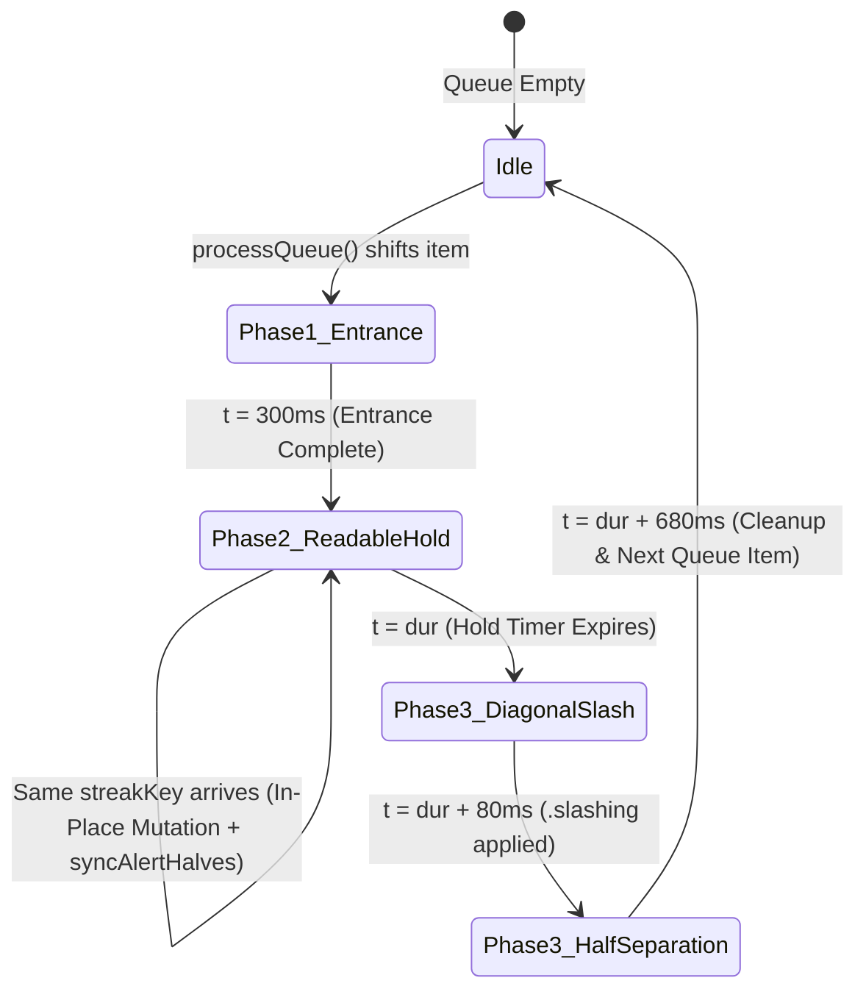
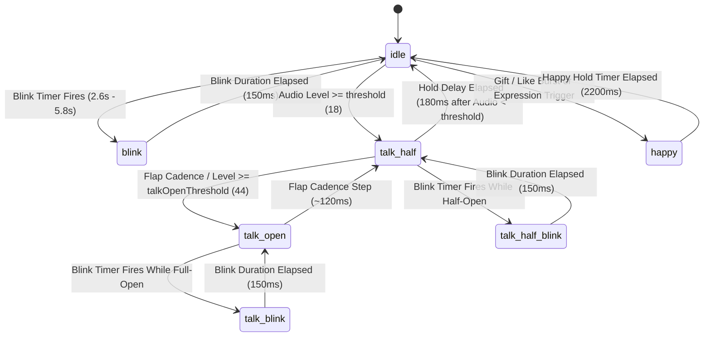

# Purplez Live Studio - Technical Design Specification

## Section 1: Intent, Product Identity, Goals, Non-Goals, Anti-Goals, and System Constraints

### 1.1 Streamer Persona and Product Identity

**Purplez Live Studio** (`e:\download\purplez\desktop`) is a standalone Windows desktop streaming application and local OBS Studio / TikTok LIVE Studio browser-source server built for **Purplez** (`@purplez`), a male TikTok Live creator. The product forks the operational architecture of Shing Studio (`e:\download\shing\desktop`) and replaces every visual surface, character asset, alert animation, and default configuration to match the identity of Purplez:

1. **Creator Persona**: Purplez is a male TikTok Live streamer who likes cats and runs interactive streams combining gameplay, live chat engagement, gift goals, and voice-reactive avatars.
2. **Simple Dark-Slate & Violet Aesthetic**: Every pastel pink, lavender, and high-blur glassmorphic surface from Shing Studio is replaced with a flat, sharp, high-contrast dark slate and violet design system (`Obsidian Violet` default: `#0d0f14` app background, `#13161f` sidebar, `#181c27` card surface, `#262c3d` 1.5px solid borders, `#8b5cf6` primary violet accent, `#06b6d4` cyan secondary accent, and `4px` / `8px` / `12px` crisp border radii).
3. **Pop-Up Trigger Alert Banner with Diagonal Slash Effect**: Trigger alerts (`overlays/triggers.html`) discard the soft floating card from Shing Studio and implement an angled pop-up banner (`transform: skewX(-8deg)`) with a full-bleed SVG/CSS diagonal katana/claw slash light beam that slices across the viewport from top-left to bottom-right (`180ms` slash sweep), followed by a high-impact spring pop-up card displaying the event badge, user avatar, event title, formatted message, and optional custom media/sound.
4. **Male Chibi + Cute Cat Companion**: Both the Interactive Stream Companion (`overlays/companion.html`) and the Voice-Reactive PNGTuber (`overlays/pngtuber.html`) feature a custom-drawn male chibi character wearing a dark violet streetwear hoodie with cat-ear headphones and a hood accent, accompanied by animated studio cats (`purple`, `black`, `white`, `orange`) that walk, nap, jump, pounce on coins, and display speech bubbles in response to TikTok Live events.

### 1.2 User Decisions vs. Builder Calls

The table below separates explicit user requirements from engineering decisions made to complete the system architecture.

| Domain | Classification | Specification Decision |
| :--- | :--- | :--- |
| Target Directory | User Decision | Create a separate project directory at `e:\download\purplez` (with the Electron app at `e:\download\purplez\desktop`), leaving `e:\download\shing` untouched. |
| Streamer Identity | User Decision | Male TikTok Live streamer named **Purplez** (`@purplez`) who likes cats. |
| Visual Theme | User Decision | Simple, clean, dark-first flat design system (`Obsidian Violet` default) replacing all Shing Studio pastel pink/lavender themes across the dashboard and all 10 overlays. |
| Trigger Alert Style | User Decision | Pop-up alert banner featuring a synchronized diagonal slash visual effect across the alert container on every follow, gift, big gift, share, and like threshold event. |
| Companion Design | User Decision | Male chibi character paired with cute interactive cats (`companion.html` and `pngtuber.html`). |
| Feature Parity | User Decision | Retain 100% of Shing Studio's functional features: Gift Jar (`matter-js`), Stream Companion, Chat Overlay, Lower Thirds, Trigger Alerts, Top Likers & Stay-Time Rankings, Headpat (`!pet` / `/pet`), Stream Countdown Timer, Multi-Scene Streamer Banner, Voice-Reactive PNGTuber, Wireless Phone Cast (`PurplezCast`), MyInstants Soundboard, and Auto-Updater. |
| Server Port & Protocol | Builder Call | Retain HTTP + WebSocket port `3333` (`0.0.0.0:3333`) with up to 8 automatic `250ms` port-bind retries and UDP port `33334` for Android screen-cast discovery so existing OBS browser source workflows operate without firewall reconfiguration. |
| AppData Isolation | Builder Call | Store persistent user configuration, backups, custom sounds, and custom media under `%APPDATA%\Purplez Live` (`C:\Users\<User>\AppData\Roaming\Purplez Live\settings.json`) so Purplez Live and Shing Live never overwrite each other's settings on the same machine. |
| Preload API Compatibility | Builder Call | Expose `window.purplezAPI`, `window.shingAPI`, and `window.api` in `preload.js` pointing to the identical IPC bridge object so renderer modules and shared utilities can invoke any namespace without runtime `TypeError`. |
| Male Hair Presets | Builder Call | Replace female hair presets (`twintails`, `bun`, `bob`, `long`) in the Companion builder with male chibi hairstyles (`spiky`, `hoodie`, `undercut`, `messy`) while mapping legacy saved values gracefully to `spiky`. |
| Chat Command Parsing | Builder Call | Accept both `/pet [@user]` and `!pet [@user]` in `main.js` with a `3000ms` global cooldown so viewers accustomed to standard exclamation-mark stream commands can trigger the headpat overlay. |

### 1.3 Feature Parity and Theme Migration Matrix

Every subsystem from `e:\download\shing\desktop` transfers to `e:\download\purplez\desktop` with targeted visual and structural updates:

| Subsystem / File Path | Functional Scope Transferred | Purplez Live Visual & Technical Changes |
| :--- | :--- | :--- |
| `desktop/main.js` | Electron lifecycle, TikTok Live Webcast connector, direct protobuf polling fallback, IPC handlers, sound/media pickers. | `app.name = 'Purplez Live'`, `AppUserModelId = 'com.purplez.live'`, window background `#0d0f14`, default username `purplez`, `/pet` and `!pet` command regex `/^[!/]pet(?:\s+@?([\w.-]+))?$/i`. |
| `desktop/preload.js` | Context-isolated IPC bridge for settings, TikTok connection, simulator, timer, jar, window, sounds, media, PNGTuber, rankings, updater. | Exposes `window.purplezAPI`, `window.shingAPI`, and `window.api` in `contextBridge.exposeInMainWorld`. |
| `desktop/server/overlayServer.js` | HTTP static/API server, WebSocket hub, H.264 cast relay, rankings engine, countdown timer engine, LRU image proxy cache, atomic settings persistence. | Uses `%APPDATA%\Purplez Live`, serves `/purplezcast.apk` and `/shingcast.apk`, responds to `PURPLEZ_CAST_DISCOVERY` and `SHING_CAST_DISCOVERY`, sets Purplez male defaults in `getDefaultSettings()`. |
| `desktop/services/updater.js` | Semantic version comparison, GitHub Contents API + Raw manifest check, multi-mirror ZIP download, 10-snapshot backup rotation, administrator-level PowerShell fallback. | Targets `purpz22/purplez` repository (`purplez-live-v{ver}.zip`), `User-Agent: PurplezStudio-Updater`, preserves `settings.json` in `%APPDATA%\Purplez Live`. |
| `desktop/renderer/index.html` & `styles.css` & `app.js` | 11-tab control dashboard, live interactive 16:9 previews, simulator toolbar, account verification modal, MyInstants sound search modal. | Replaced with the Simple Dark-Slate & Violet design system (`Obsidian Violet` default + 5 flat dark/stealth themes), male companion hair controls, slash trigger preview. |
| `desktop/overlays/triggers.html` | Event queue processor, custom video/image/GIF alert display, Web Audio / HTML5 Audio sound player, placeholder interpolation (`{name}`, `{gift}`, `{count}`). | Redesigned into a skewed pop-up banner (`skewX(-8deg)`) with an animated SVG diagonal slash beam, sharp corner cuts, and category-coded accent bars. |
| `desktop/overlays/companion.html` | HTML5 Canvas / SVG 60fps interactive companion and multi-cat autonomous state machine (`walk`, `sit`, `sleep`, `jump`, `chase`). | Renders the Purplez male chibi character (`spiky`, `hoodie`, `undercut`, `messy` hair) with cat-ear headphones and 1-4 animated cats (`purple`, `black`, `white`, `orange`). |
| `desktop/overlays/pngtuber.html` | Web Audio API microphone analyzer (`AnalyserNode`), 7-frame state machine (`idle`, `blink`, `talk`, `talkHalf`, `talkHalfBlink`, `talkBlink`, `happy`), gift reaction bounce. | Defaults to `purplez` preset (`/assets/pngtuber/purplez_*.png`) depicting the male chibi streamer and shoulder cat, plus `nightcat` preset. |
| `desktop/overlays/jar.html` | `matter-js` 2D rigid-body physics container, gift sprite batch spawning, overflow physics, draggable `x`/`y`/`scale` transform sync. | Replaces pastel jar rim with a dark anodized violet-slate cyber-canister rim and crisp minimal HUD counter badge. |
| `desktop/overlays/chat.html` | Real-time scrolling chat list, role badge detection (`streamer`, `moderator`, `subscriber`, `top_gifter`), message grouping, auto-fade timer. | Defaults to `simple-dark` theme with `#13161f` flat bubbles, `#262c3d` 1.5px borders, `8px` radius, and `'Inter'` typography. |
| `desktop/overlays/lower-third.html` | Rotating social media ticker (TikTok, Instagram, YouTube, Discord) with configurable display duration and pause interval. | Flat geometric slate-and-violet lower-third bar with a diagonal accent stripe and crisp vector platform icons. |
| `desktop/overlays/top-likers.html` & `viewer-ranking.html` | Real-time leaderboards for top tap-likers and longest active stream stay-time with automatic leave-timeout detection. | Flat dark-slate leaderboard cards with violet rank badges (`#1`, `#2`, `#3`) and tabular monospace counters. |
| `desktop/overlays/headpat.html` | Triggerable patting hand animation over target user or streamer avatar on follow, gift, or `!pet` / `/pet` command. | Clean dark-violet circular frame with animated patting hand sprite and sharp typography banner. |
| `desktop/overlays/timer.html` | Marathon / subathon countdown timer with automatic gift time additions and chat/like time deductions. | Flat obsidian digital clock housing with tabular monospace digits and color-coded `+15s` / `-1s` delta pills. |
| `desktop/overlays/banner.html` | Multi-scene rotating streamer profile banner (`3:1`, `4:1`, `16:9`) with avatar, status badge, bio, schedule, and social handles. | Defaults to `simple-slate` template, `cat` topper, `none` particles, and `@purplez` profile metadata. |
| `desktop/overlays/phone.html` | Low-latency WebCodecs `VideoDecoder` H.264 canvas renderer for wireless Android screen mirroring. | Dark-slate idle diagnostic card displaying local IP (`ws://<ip>:3333/ws/cast`) and `PurplezCast` connection status. |

### 1.4 Goals, Non-Goals, Anti-Goals, and System Constraints

#### Goals
* **Zero-Configuration OBS Browser Source Integration**: Expose every overlay at `http://localhost:3333/overlays/<name>.html` with transparent backgrounds (`background: transparent`) and automatic WebSocket reconnection (`2000ms` retry backoff).
* **Sub-50ms Local Event Dispatch**: Normalize incoming TikTok Live Webcast protobuf packets in `main.js` and broadcast JSON payloads to all connected WebSocket clients and the Electron renderer within `50ms`.
* **Resilient TikTok Live Connectivity**: Connect without requiring TikTok API OAuth keys or paid EulerStream sign-server subscriptions by combining standard WebSocket room connections with an automatic fallback to Direct TikTok Webcast Protobuf Polling (`webcast.tiktok.com/webcast/im/fetch/`).
* **Crash-Safe Configuration Storage**: Persist all user settings in `%APPDATA%\Purplez Live\settings.json` with automatic `.bak` copy-on-write and a 10-snapshot historical backup ring in `%APPDATA%\Purplez Live\backups\`.

#### Non-Goals
* Multi-platform chat aggregation (Twitch, YouTube Live, Kick chat ingestion are out of scope; TikTok Live is the sole live event source).
* Cloud-hosted backend infrastructure or remote database synchronization.
* Built-in video encoding or RTMP broadcast output (OBS Studio or TikTok LIVE Studio handles video encoding).

#### Anti-Goals
* **No Pastel Pink or Glassmorphic Bloat**: Never use Shing Studio's pastel lavender/pink backgrounds (`#f7f2fc`, `#efe7fa`, `#fff2f6`), cursive fonts, or heavy `backdrop-filter: blur(20px)` glassmorphic effects that degrade OBS CEF GPU frame times.
* **No Browser Subprocesses**: Never launch external headless browsers (Puppeteer, Playwright, or Chrome processes) to scrape TikTok Live streams. All TikTok communication executes in-process via `https` and `tiktok-live-connector`.
* **No Emojis in Source Code or UI**: Never render Unicode emojis in HTML templates, CSS rules, JS strings, JSON schemas, or log messages. Every icon in the dashboard and overlays is an inline SVG path or canvas primitive.

---

## Section 2: Purplez Simple Design System and Complete Theme Overhaul

### 2.1 Visual Architecture Comparison: Shing Studio vs. Purplez Live

The table below defines the exact visual transformation from Shing Studio (`e:\download\shing\desktop`) to Purplez Live (`e:\download\purplez\desktop`).

| Design Dimension | Shing Studio (`e:\download\shing\desktop`) | Purplez Live (`e:\download\purplez\desktop`) |
| :--- | :--- | :--- |
| Default Theme Name | `Purple` (Pastel Lavender Light) | `Purple` (`Obsidian Violet` Dark Slate) |
| App Background (`--bg-app`) | `#f7f2fc` (Light Pastel Lavender) | `#0d0f14` (Deep Carbon Obsidian) |
| Sidebar Surface (`--bg-sidebar`) | `#efe7fa` (Soft Lilac) | `#13161f` (Dark Slate Navy) |
| Card Surface (`--bg-card`) | `#ffffff` (Pure White) | `#181c27` (Dark Gunmetal Slate) |
| Border Token (`--border-color`) | `#dcd0f0` (Soft Lavender Border) | `#262c3d` (Crisp 1.5px Structural Slate) |
| Primary Text (`--text-main`) | `#271a3d` (Dark Plum) | `#f1f5f9` (High-Contrast Ice White) |
| Muted Text (`--text-muted`) | `#6c5c82` (Muted Mauve) | `#94a3b8` (Neutral Cool Slate) |
| Primary Brand (`--primary`) | `#7b3fe4` (Pastel Royal Purple) | `#8b5cf6` (Electric Vivid Violet) |
| Secondary Accent (`--accent`) | `#ff6fae` (Bubblegum Pink) | `#06b6d4` (Sharp Cyber Cyan) |
| Border Radii (`sm` / `md` / `lg`) | `6px` / `10px` / `16px` (Pill-heavy `20px-30px`) | `4px` / `8px` / `12px` (Crisp Geometric) |
| Elevation & Shadows | Soft colored glow `0 6px 20px rgba(123,63,228,0.12)` | Flat structural depth `0 4px 12px rgba(0,0,0,0.45)` |
| Primary Font Stack | `'Quicksand'`, `'Nunito'`, `'Segoe UI'` | `'Inter'`, `'Segoe UI'`, `system-ui`, `-apple-system`, `sans-serif` |
| Monospace Font Stack | `ui-monospace`, `'Courier New'` | `'JetBrains Mono'`, `'Cascadia Code'`, `ui-monospace`, `monospace` |

### 2.2 Complete CSS Custom Property Token Matrix (All 6 Dashboard Themes)

Purplez Live provides 6 dark, flat, high-contrast themes in `e:\download\purplez\desktop\renderer\styles.css`. None of the 6 themes use pastel pink or light lavender backgrounds. The theme selector in the Settings tab maps `settings.theme` to the corresponding `body.theme-*` class:

| CSS Variable | `theme-purple` (Obsidian Violet - Default) | `theme-slate` (Slate Indigo) | `theme-midnight` (Midnight Cat) | `theme-blue` (Cyber Cyan) | `theme-green` (Emerald Stealth) | `theme-crimson` (Crimson Blade) |
| :--- | :--- | :--- | :--- | :--- | :--- | :--- |
| `--bg-app` | `#0d0f14` | `#0f172a` | `#09090b` | `#081018` | `#091310` | `#120a0d` |
| `--bg-sidebar` | `#13161f` | `#1e293b` | `#121216` | `#0d1824` | `#0f1f1a` | `#1a0f14` |
| `--bg-card` | `#181c27` | `#263349` | `#18181f` | `#132232` | `#152a23` | `#24141b` |
| `--bg-hover` | `#1f2433` | `#334155` | `#22222c` | `#1b3044` | `#1d382f` | `#311b24` |
| `--border-color` | `#262c3d` | `#3b4963` | `#272732` | `#233b54` | `#23473b` | `#3d222e` |
| `--text-main` | `#f1f5f9` | `#f8fafc` | `#fafafa` | `#ecfeff` | `#ecfdf5` | `#fff1f2` |
| `--text-muted` | `#94a3b8` | `#94a3b8` | `#a1a1aa` | `#7dd3fc` | `#6ee7b7` | `#fda4af` |
| `--primary` | `#8b5cf6` | `#6366f1` | `#a855f7` | `#06b6d4` | `#10b981` | `#f43f5e` |
| `--primary-hover` | `#7c3aed` | `#4f46e5` | `#9333ea` | `#0891b2` | `#059669` | `#e11d48` |
| `--primary-light` | `rgba(139, 92, 246, 0.14)` | `rgba(99, 102, 241, 0.16)` | `rgba(168, 85, 247, 0.15)` | `rgba(6, 182, 212, 0.14)` | `rgba(16, 185, 129, 0.14)` | `rgba(244, 63, 94, 0.15)` |
| `--accent` | `#06b6d4` | `#38bdf8` | `#f59e0b` | `#8b5cf6` | `#14b8a6` | `#fb923c` |
| `--success` | `#10b981` | `#10b981` | `#22c55e` | `#10b981` | `#22c55e` | `#10b981` |
| `--warning` | `#f59e0b` | `#f59e0b` | `#eab308` | `#f59e0b` | `#f59e0b` | `#f59e0b` |
| `--danger` | `#ef4444` | `#ef4444` | `#ef4444` | `#ef4444` | `#ef4444` | `#ef4444` |
| `--shadow-sm` | `0 1px 3px rgba(0, 0, 0, 0.45)` | `0 1px 3px rgba(0, 0, 0, 0.40)` | `0 1px 3px rgba(0, 0, 0, 0.60)` | `0 1px 3px rgba(0, 0, 0, 0.50)` | `0 1px 3px rgba(0, 0, 0, 0.50)` | `0 1px 3px rgba(0, 0, 0, 0.55)` |
| `--shadow-md` | `0 4px 12px rgba(0, 0, 0, 0.55)` | `0 4px 12px rgba(0, 0, 0, 0.50)` | `0 4px 12px rgba(0, 0, 0, 0.70)` | `0 4px 12px rgba(0, 0, 0, 0.60)` | `0 4px 12px rgba(0, 0, 0, 0.60)` | `0 4px 12px rgba(0, 0, 0, 0.65)` |

### 2.3 Complete Root and Theme CSS Implementation (`desktop/renderer/styles.css`)

```css
/* Purplez Live Studio - Simple Dark-Slate & Violet Design System */
:root {
  --bg-app: #0d0f14;
  --bg-sidebar: #13161f;
  --bg-card: #181c27;
  --bg-hover: #1f2433;
  --border-color: #262c3d;
  --text-main: #f1f5f9;
  --text-muted: #94a3b8;
  --text-light: #cbd5e1;
  --primary: #8b5cf6;
  --primary-hover: #7c3aed;
  --primary-light: rgba(139, 92, 246, 0.14);
  --accent: #06b6d4;
  --success: #10b981;
  --warning: #f59e0b;
  --danger: #ef4444;
  --radius-lg: 12px;
  --radius-md: 8px;
  --radius-sm: 4px;
  --shadow-sm: 0 1px 3px rgba(0, 0, 0, 0.45);
  --shadow-md: 0 4px 12px rgba(0, 0, 0, 0.55);
  --font-sans: 'Inter', 'Segoe UI', system-ui, -apple-system, sans-serif;
  --font-mono: 'JetBrains Mono', 'Cascadia Code', ui-monospace, 'Courier New', monospace;
}

/* 1. Obsidian Violet (Default: theme-purple) */
body.theme-purple {
  --bg-app: #0d0f14;
  --bg-sidebar: #13161f;
  --bg-card: #181c27;
  --bg-hover: #1f2433;
  --border-color: #262c3d;
  --text-main: #f1f5f9;
  --text-muted: #94a3b8;
  --primary: #8b5cf6;
  --primary-hover: #7c3aed;
  --primary-light: rgba(139, 92, 246, 0.14);
  --accent: #06b6d4;
}

/* 2. Slate Indigo (theme-slate, also aliased for legacy theme-light-purple) */
body.theme-slate,
body.theme-light-purple {
  --bg-app: #0f172a;
  --bg-sidebar: #1e293b;
  --bg-card: #263349;
  --bg-hover: #334155;
  --border-color: #3b4963;
  --text-main: #f8fafc;
  --text-muted: #94a3b8;
  --primary: #6366f1;
  --primary-hover: #4f46e5;
  --primary-light: rgba(99, 102, 241, 0.16);
  --accent: #38bdf8;
}

/* 3. Midnight Cat (theme-midnight, also aliased for legacy theme-dark-purple) */
body.theme-midnight,
body.theme-dark-purple {
  --bg-app: #09090b;
  --bg-sidebar: #121216;
  --bg-card: #18181f;
  --bg-hover: #22222c;
  --border-color: #272732;
  --text-main: #fafafa;
  --text-muted: #a1a1aa;
  --primary: #a855f7;
  --primary-hover: #9333ea;
  --primary-light: rgba(168, 85, 247, 0.15);
  --accent: #f59e0b;
  --shadow-sm: 0 1px 3px rgba(0, 0, 0, 0.60);
  --shadow-md: 0 4px 12px rgba(0, 0, 0, 0.70);
}

/* 4. Cyber Cyan (theme-blue) */
body.theme-blue {
  --bg-app: #081018;
  --bg-sidebar: #0d1824;
  --bg-card: #132232;
  --bg-hover: #1b3044;
  --border-color: #233b54;
  --text-main: #ecfeff;
  --text-muted: #7dd3fc;
  --primary: #06b6d4;
  --primary-hover: #0891b2;
  --primary-light: rgba(6, 182, 212, 0.14);
  --accent: #8b5cf6;
}

/* 5. Emerald Stealth (theme-green) */
body.theme-green {
  --bg-app: #091310;
  --bg-sidebar: #0f1f1a;
  --bg-card: #152a23;
  --bg-hover: #1d382f;
  --border-color: #23473b;
  --text-main: #ecfdf5;
  --text-muted: #6ee7b7;
  --primary: #10b981;
  --primary-hover: #059669;
  --primary-light: rgba(16, 185, 129, 0.14);
  --accent: #14b8a6;
}

/* 6. Crimson Blade (theme-crimson, also aliased for legacy theme-pink) */
body.theme-crimson,
body.theme-pink {
  --bg-app: #120a0d;
  --bg-sidebar: #1a0f14;
  --bg-card: #24141b;
  --bg-hover: #311b24;
  --border-color: #3d222e;
  --text-main: #fff1f2;
  --text-muted: #fda4af;
  --primary: #f43f5e;
  --primary-hover: #e11d48;
  --primary-light: rgba(244, 63, 94, 0.15);
  --accent: #fb923c;
}
```

### 2.4 Typography Scale, Geometry Tokens, Button States, and Form Controls

#### Typography Scale
All text elements use `var(--font-sans)` (`'Inter', 'Segoe UI', system-ui, sans-serif`) with crisp subpixel antialiasing and strict typographic hierarchy:

| Element Role | Selector | Font Size | Font Weight | Line Height | Letter Spacing |
| :--- | :--- | :--- | :--- | :--- | :--- |
| App Header Title | `.app-title` | `16px` | `800` | `1.2` | `-0.3px` |
| App Header Subtitle | `.app-subtitle` | `11px` | `500` | `1.2` | `0px` |
| Section Heading | `.section-header h2` | `22px` | `800` | `1.25` | `-0.4px` |
| Card Title | `.card-info h3`, `.form-card h3` | `15px - 16px` | `700` | `1.3` | `-0.1px` |
| Sidebar Group Label | `.group-title` | `11px` | `700` | `1.2` | `0.8px` (Uppercase) |
| Sidebar Navigation Item | `.nav-item` | `13.5px` | `600` | `1.35` | `0px` |
| Form Label & Input | `label`, `input`, `select` | `13px - 13.5px` | `600` (label) / `500` (input) | `1.4` | `0px` |
| Telemetry & Timer Digits | `.hud-val`, `.big-timer-display`, `.demo-timer-digits` | `11px` / `44px` / `23px` | `800` | `1.0` | `1.5px - 2.0px` (`tabular-nums`) |

#### Border Radii and Flat Surfaces
Purplez Live replaces pill-shaped `20px-30px` controls with sharp geometric radii:
* `--radius-sm: 4px`: Inputs (`input[type="text"]`, `input[type="number"]`, `select`), buttons (`.btn`), role tags (`.demo-chat-tag`), color pickers (`input[type="color"]`), and simulator buttons (`.sim-btn`).
* `--radius-md: 8px`: Sidebar navigation items (`.nav-item`), header action buttons (`.account-pill`, `.header-connect-btn`), preview stage containers (`.jar-stage-preview-16-9`), and modal account preview boxes.
* `--radius-lg: 12px`: Overlay grid cards (`.overlay-card`), configuration form cards (`.form-card`), live preview cards (`.jar-live-preview-card`), and modal dialog containers (`.modal-card`).

#### Interactive Button States and Form Controls
* **Primary Button (`.btn-primary`)**: Background `var(--primary)`, text `#ffffff`, border `1.5px solid var(--primary)`, border-radius `var(--radius-sm)` (`4px`), padding `7px 14px`. Hover shifts background to `var(--primary-hover)` with `0.15s ease` transition; active state applies `transform: translateY(0)`.
* **Secondary Button (`.btn-secondary`)**: Background `var(--primary-light)`, text `var(--text-main)`, border `1.5px solid var(--border-color)`, border-radius `var(--radius-sm)` (`4px`). Hover shifts border to `var(--primary)` and text to `var(--primary)`.
* **Danger Button (`.btn-danger`)**: Background `rgba(239, 68, 68, 0.14)`, text `#f87171`, border `1.5px solid rgba(239, 68, 68, 0.4)`. Hover shifts background to `#ef4444` and text to `#ffffff`.
* **Header Connection Button (`.header-connect-btn`)**: Border-radius `var(--radius-md)` (`8px`), padding `6px 14px`, font-weight `700`. In `.connecting` state: background `#f59e0b`, border `#d97706`, cursor `wait`. In `.connected` state: background `#10b981`, border `#059669`.
* **Form Inputs (`input[type="text"]`, `input[type="number"]`, `select`, `textarea`)**: Background `var(--bg-app)`, text `var(--text-main)`, border `1.5px solid var(--border-color)`, border-radius `var(--radius-sm)` (`4px`), padding `8px 12px`. On `:focus`: `border-color: var(--primary)` and `box-shadow: 0 0 0 2px var(--primary-light)`.

### 2.5 Vector Icon Catalog (`desktop/assets/icons/icons.js`)

All dashboard navigation icons, action buttons, and status indicators render inline SVG strings from `e:\download\purplez\desktop\assets\icons\icons.js`. No Unicode emojis are used anywhere in the application.

```javascript
'use strict';

const ICONS = {
  layers: '<svg viewBox="0 0 24 24" width="18" height="18" fill="none" stroke="currentColor" stroke-width="2" stroke-linecap="round" stroke-linejoin="round"><path d="m12 2 10 5-10 5L2 7l10-5z"/><path d="m2 17 10 5 10-5"/><path d="m2 12 10 5 10-5"/></svg>',
  triggers: '<svg viewBox="0 0 24 24" width="18" height="18" fill="none" stroke="currentColor" stroke-width="2" stroke-linecap="round" stroke-linejoin="round"><path d="M22 2 2 22"/><path d="M17 2h5v5"/><path d="m14 10 6-6"/><path d="m4 14 6-6"/></svg>',
  lowerthird: '<svg viewBox="0 0 24 24" width="18" height="18" fill="none" stroke="currentColor" stroke-width="2" stroke-linecap="round" stroke-linejoin="round"><rect width="20" height="16" x="2" y="4" rx="2"/><path d="M2 14h20"/><path d="M6 18h6"/></svg>',
  chat: '<svg viewBox="0 0 24 24" width="18" height="18" fill="none" stroke="currentColor" stroke-width="2" stroke-linecap="round" stroke-linejoin="round"><path d="M21 15a2 2 0 0 1-2 2H7l-4 4V5a2 2 0 0 1 2-2h14a2 2 0 0 1 2 2z"/></svg>',
  jar: '<svg viewBox="0 0 24 24" width="18" height="18" fill="none" stroke="currentColor" stroke-width="2" stroke-linecap="round" stroke-linejoin="round"><path d="M6 3h12v3H6z"/><path d="M6 6c-2 2-2 13 0 15h12c2-2 2-13 0-15"/><path d="M9 10h6"/></svg>',
  timer: '<svg viewBox="0 0 24 24" width="18" height="18" fill="none" stroke="currentColor" stroke-width="2" stroke-linecap="round" stroke-linejoin="round"><circle cx="12" cy="12" r="10"/><polyline points="12 6 12 12 16 14"/></svg>',
  companion: '<svg viewBox="0 0 24 24" width="18" height="18" fill="none" stroke="currentColor" stroke-width="2" stroke-linecap="round" stroke-linejoin="round"><path d="M12 5c-4 0-7 2.5-7 6 0 4 4 8 7 8s7-4 7-8c0-3.5-3-6-7-6z"/><path d="M7 6 5 2l4 3"/><path d="M17 6l2-4-4 3"/><circle cx="9" cy="11" r="1" fill="currentColor"/><circle cx="15" cy="11" r="1" fill="currentColor"/><path d="M10 14h4"/></svg>',
  settings: '<svg viewBox="0 0 24 24" width="18" height="18" fill="none" stroke="currentColor" stroke-width="2" stroke-linecap="round" stroke-linejoin="round"><circle cx="12" cy="12" r="3"/><path d="M19.4 15a1.65 1.65 0 0 0 .33 1.82l.06.06a2 2 0 0 1 0 2.83 2 2 0 0 1-2.83 0l-.06-.06a1.65 1.65 0 0 0-1.82-.33 1.65 1.65 0 0 0-1 1.51V21a2 2 0 0 1-2 2 2 2 0 0 1-2-2v-.09A1.65 1.65 0 0 0 9 19.4a1.65 1.65 0 0 0-1.82.33l-.06.06a2 2 0 0 1-2.83 0 2 2 0 0 1 0-2.83l.06-.06a1.65 1.65 0 0 0 .33-1.82 1.65 1.65 0 0 0-1.51-1H3a2 2 0 0 1-2-2 2 2 0 0 1 2-2h.09A1.65 1.65 0 0 0 4.6 9a1.65 1.65 0 0 0-.33-1.82l-.06-.06a2 2 0 0 1 0-2.83 2 2 0 0 1 2.83 0l.06.06a1.65 1.65 0 0 0 1.82.33H9a1.65 1.65 0 0 0 1-1.51V3a2 2 0 0 1 2-2 2 2 0 0 1 2 2v.09a1.65 1.65 0 0 0 1 1.51 1.65 1.65 0 0 0 1.82-.33l.06-.06a2 2 0 0 1 2.83 0 2 2 0 0 1 0 2.83l-.06.06a1.65 1.65 0 0 0-.33 1.82V9a1.65 1.65 0 0 0 1.51 1H21a2 2 0 0 1 2 2 2 2 0 0 1-2 2h-.09a1.65 1.65 0 0 0-1.51 1z"/></svg>',
  star: '<svg viewBox="0 0 24 24" width="16" height="16" fill="none" stroke="currentColor" stroke-width="2" stroke-linecap="round" stroke-linejoin="round"><polygon points="12 2 15.09 8.26 22 9.27 17 14.14 18.18 21.02 12 17.77 5.82 21.02 7 14.14 2 9.27 8.91 8.26 12 2"/></svg>',
  starFilled: '<svg viewBox="0 0 24 24" width="16" height="16" fill="currentColor" stroke="currentColor" stroke-width="1"><polygon points="12 2 15.09 8.26 22 9.27 17 14.14 18.18 21.02 12 17.77 5.82 21.02 7 14.14 2 9.27 8.91 8.26 12 2"/></svg>',
  copy: '<svg viewBox="0 0 24 24" width="14" height="14" fill="none" stroke="currentColor" stroke-width="2" stroke-linecap="round" stroke-linejoin="round"><rect width="14" height="14" x="8" y="8" rx="2" ry="2"/><path d="M4 16c-1.1 0-2-.9-2-2V4c0-1.1.9-2 2-2h10c1.1 0 2 .9 2 2"/></svg>',
  check: '<svg viewBox="0 0 24 24" width="14" height="14" fill="none" stroke="currentColor" stroke-width="2.5" stroke-linecap="round" stroke-linejoin="round"><polyline points="20 6 9 17 4 12"/></svg>',
  external: '<svg viewBox="0 0 24 24" width="14" height="14" fill="none" stroke="currentColor" stroke-width="2" stroke-linecap="round" stroke-linejoin="round"><path d="M18 13v6a2 2 0 0 1-2 2H5a2 2 0 0 1-2-2V8a2 2 0 0 1 2-2h6"/><polyline points="15 3 21 3 21 9"/><line x1="10" y1="14" x2="21" y2="3"/></svg>',
  refresh: '<svg viewBox="0 0 24 24" width="14" height="14" fill="none" stroke="currentColor" stroke-width="2" stroke-linecap="round" stroke-linejoin="round"><path d="M21 2v6h-6"/><path d="M3 12a9 9 0 0 1 15-6.7L21 8"/><path d="M3 22v-6h6"/><path d="M21 12a9 9 0 0 1-15 6.7L3 16"/></svg>',
  play: '<svg viewBox="0 0 24 24" width="14" height="14" fill="currentColor"><polygon points="5 3 19 12 5 21 5 3"/></svg>',
  pause: '<svg viewBox="0 0 24 24" width="14" height="14" fill="currentColor"><rect x="6" y="4" width="4" height="16"/><rect x="14" y="4" width="4" height="16"/></svg>',
  trash: '<svg viewBox="0 0 24 24" width="14" height="14" fill="none" stroke="currentColor" stroke-width="2" stroke-linecap="round" stroke-linejoin="round"><path d="M3 6h18"/><path d="M19 6v14c0 1-1 2-2 2H7c-1 0-2-1-2-2V6"/><path d="M8 6V4c0-1 1-2 2-2h4c1 0 2 1 2 2v2"/></svg>',
  search: '<svg viewBox="0 0 24 24" width="16" height="16" fill="none" stroke="currentColor" stroke-width="2" stroke-linecap="round" stroke-linejoin="round"><circle cx="11" cy="11" r="8"/><line x1="21" y1="21" x2="16.65" y2="16.65"/></svg>',
  gift: '<svg viewBox="0 0 24 24" width="16" height="16" fill="none" stroke="currentColor" stroke-width="2" stroke-linecap="round" stroke-linejoin="round"><rect x="3" y="8" width="18" height="4" rx="1"/><path d="M12 8v13"/><path d="M19 12v7a2 2 0 0 1-2 2H7a2 2 0 0 1-2-2v-7"/><path d="M7.5 8a2.5 2.5 0 0 1 0-5A4.8 4.8 0 0 1 12 8a4.8 4.8 0 0 1 4.5-5 2.5 2.5 0 0 1 0 5"/></svg>',
  heart: '<svg viewBox="0 0 24 24" width="16" height="16" fill="none" stroke="currentColor" stroke-width="2" stroke-linecap="round" stroke-linejoin="round"><path d="M19 14c1.49-1.46 3-3.21 3-5.5A5.5 5.5 0 0 0 16.5 3c-1.76 0-3 .5-4.5 2-1.5-1.5-2.74-2-4.5-2A5.5 5.5 0 0 0 2 8.5c0 2.3 1.5 4.05 3 5.5l7 7Z"/></svg>',
  user: '<svg viewBox="0 0 24 24" width="16" height="16" fill="none" stroke="currentColor" stroke-width="2" stroke-linecap="round" stroke-linejoin="round"><path d="M19 21v-2a4 4 0 0 0-4-4H9a4 4 0 0 0-4 4v2"/><circle cx="12" cy="7" r="4"/></svg>',
  banner: '<svg viewBox="0 0 24 24" width="18" height="18" fill="none" stroke="currentColor" stroke-width="2" stroke-linecap="round" stroke-linejoin="round"><rect width="20" height="12" x="2" y="6" rx="2"/><path d="M6 10h12"/><path d="M6 14h7"/><path d="M4 2v4"/><path d="M20 2v4"/></svg>',
  pngtuber: '<svg viewBox="0 0 24 24" width="18" height="18" fill="none" stroke="currentColor" stroke-width="2" stroke-linecap="round" stroke-linejoin="round"><path d="M4 10a8 8 0 0 1 16 0c0 4.418-3.582 8-8 8s-8-3.582-8-8z"/><path d="m4 10-2-6 6 2"/><path d="m20 10 2-6-6 2"/><circle cx="9" cy="12" r="1" fill="currentColor"/><circle cx="15" cy="12" r="1" fill="currentColor"/><path d="M10 15h4"/></svg>',
  mic: '<svg viewBox="0 0 24 24" width="16" height="16" fill="none" stroke="currentColor" stroke-width="2" stroke-linecap="round" stroke-linejoin="round"><path d="M12 2a3 3 0 0 0-3 3v7a3 3 0 0 0 6 0V5a3 3 0 0 0-3-3Z"/><path d="M19 10v2a7 7 0 0 1-14 0v-2"/><line x1="12" x2="12" y1="19" y2="22"/></svg>',
  phone: '<svg viewBox="0 0 24 24" width="18" height="18" fill="none" stroke="currentColor" stroke-width="2" stroke-linecap="round" stroke-linejoin="round"><rect width="14" height="20" x="5" y="2" rx="2" ry="2"/><line x1="12" x2="12.01" y1="18" y2="18"/></svg>',
  cast: '<svg viewBox="0 0 24 24" width="18" height="18" fill="none" stroke="currentColor" stroke-width="2" stroke-linecap="round" stroke-linejoin="round"><path d="M2 16.1A5 5 0 0 1 5.9 20M2 12.05A9 9 0 0 1 9.95 20M2 8V6a2 2 0 0 1 2-2h16a2 2 0 0 1 2 2v12a2 2 0 0 1-2 2h-6"/><line x1="2" x2="2.01" y1="20" y2="20"/></svg>'
};

if (typeof module !== 'undefined' && module.exports) {
  module.exports = ICONS;
}
```

---

## Section 3: Electron Main Process, IPC Contract, TikTok Live Webcast Engine, Auto-Updater, and Build/Packaging Pipeline

### 3.1 Electron Main Process Specification (`desktop/main.js`)

`e:\download\purplez\desktop\main.js` initializes the Electron application, binds the Windows Taskbar AppUserModelId, starts the local `OverlayServer` on port `3333`, and manages the main `BrowserWindow`.

* **Application Identity**:
  * `app.name = 'Purplez Live'`
  * `app.setAppUserModelId('com.purplez.live')` on `process.platform === 'win32'`
  * `Menu.setApplicationMenu(null)` to suppress the default Electron menu bar.
* **Window Configuration (`createWindow()`)**:
  * `width: 1280`, `height: 840`, `minWidth: 1040`, `minHeight: 680`
  * `title: 'Purplez Live'`
  * `backgroundColor: '#0d0f14'` (prevents white flash during initial load)
  * `icon`: `path.join(__dirname, 'assets', process.platform === 'win32' ? 'app-icon.ico' : 'app-icon.png')`
  * `autoHideMenuBar: true`, `mainWindow.removeMenu()`, `mainWindow.setMenuBarVisibility(false)`
  * `webPreferences`: `{ preload: path.join(__dirname, 'preload.js'), contextIsolation: true, nodeIntegration: false }`
* **Media Permission Handlers**:
  * In `app.whenReady()`, `session.defaultSession.setPermissionRequestHandler` and `session.defaultSession.setPermissionCheckHandler` return `true` for `'media'` permissions so the voice-reactive PNGTuber microphone analyzer (`navigator.mediaDevices.getUserMedia({ audio: true })`) never blocks on permission prompts.
* **Developer & Reload Keyboard Shortcuts**:
  * `mainWindow.webContents.on('before-input-event')` intercepts `F12` and `Ctrl+Shift+I` to call `mainWindow.webContents.toggleDevTools()`, and intercepts `F5` and `Ctrl+R` to call `mainWindow.webContents.reload()`.

### 3.2 Complete Preload Context Bridge (`desktop/preload.js`) and IPC Channel Contract

To guarantee backward compatibility with existing renderer code while introducing the `Purplez` namespace, `e:\download\purplez\desktop\preload.js` exposes the bridge object under three global window properties: `window.purplezAPI`, `window.shingAPI`, and `window.api`.

```javascript
'use strict';

const { contextBridge, ipcRenderer } = require('electron');

const bridgeAPI = {
  getSettings: () => ipcRenderer.invoke('settings:get'),
  saveSettings: (settings) => ipcRenderer.invoke('settings:save', settings),
  exportSettings: () => ipcRenderer.invoke('settings:export'),
  importSettings: () => ipcRenderer.invoke('settings:import'),
  onSettingsLoaded: (cb) => {
    const sub = (evt, data) => cb(data);
    ipcRenderer.on('settings:loaded', sub);
    return () => ipcRenderer.removeListener('settings:loaded', sub);
  },

  searchTikTokUser: (username) => ipcRenderer.invoke('tiktok:search', username),
  verifyTikTokUser: (username) => ipcRenderer.invoke('tiktok:verify', username),
  connectTikTok: (username, options) => ipcRenderer.invoke('tiktok:connect', username, options),
  disconnectTikTok: () => ipcRenderer.invoke('tiktok:disconnect'),
  getTikTokStatus: () => ipcRenderer.invoke('tiktok:status:get'),
  simulateEvent: (type, payload) => ipcRenderer.invoke('tiktok:simulate', type, payload),

  controlTimer: (action, seconds) => ipcRenderer.invoke('timer:control', action, seconds),
  getTimerStatus: () => ipcRenderer.invoke('timer:status:get'),
  clearJar: () => ipcRenderer.invoke('jar:clear'),
  openOverlayInBrowser: (name) => ipcRenderer.invoke('overlay:open', name),

  // Window Management APIs
  minimizeWindow: () => ipcRenderer.invoke('window:minimize'),
  restoreWindow: () => ipcRenderer.invoke('window:restore'),
  isWindowMinimized: () => ipcRenderer.invoke('window:is-minimized'),

  // Sound & Media Management APIs
  listSounds: () => ipcRenderer.invoke('sounds:list'),
  searchSounds: (query) => ipcRenderer.invoke('sounds:search', query),
  downloadSound: (soundUrl, title) => ipcRenderer.invoke('sounds:download', soundUrl, title),
  selectLocalSound: () => ipcRenderer.invoke('sounds:select-local'),
  selectLocalMedia: () => ipcRenderer.invoke('media:select-local'),
  selectPngTuberImage: (slot) => ipcRenderer.invoke('pngtuber:select-image', slot),
  savePngTuberImage: (slot, dataBase64, extension) => ipcRenderer.invoke('pngtuber:save-custom-image', slot, dataBase64, extension),

  // Rankings APIs
  getRankings: () => ipcRenderer.invoke('rankings:get'),
  resetRankings: (target) => ipcRenderer.invoke('rankings:reset', target),
  simulateViewerLeave: (username) => ipcRenderer.invoke('rankings:leave', username),

  onTikTokStatus: (cb) => {
    const sub = (evt, data) => cb(data);
    ipcRenderer.on('tiktok:status', sub);
    return () => ipcRenderer.removeListener('tiktok:status', sub);
  },
  onTikTokEvent: (cb) => {
    const sub = (evt, data) => cb(data);
    ipcRenderer.on('tiktok:event', sub);
    return () => ipcRenderer.removeListener('tiktok:event', sub);
  },

  // App Updater APIs
  getVersion: () => ipcRenderer.invoke('updater:get-version'),
  checkForUpdates: (feedUrl) => ipcRenderer.invoke('updater:check', feedUrl),
  downloadUpdate: (updateInfo) => ipcRenderer.invoke('updater:download', updateInfo),
  installUpdate: (updateInfo) => ipcRenderer.invoke('updater:install', updateInfo),
  selectLocalUpdateFile: () => ipcRenderer.invoke('updater:select-file'),
  relaunchApp: () => ipcRenderer.invoke('updater:relaunch'),
  onUpdateProgress: (cb) => {
    const sub = (evt, data) => cb(data);
    ipcRenderer.on('updater:progress', sub);
    return () => ipcRenderer.removeListener('updater:progress', sub);
  }
};

contextBridge.exposeInMainWorld('purplezAPI', bridgeAPI);
contextBridge.exposeInMainWorld('shingAPI', bridgeAPI);
contextBridge.exposeInMainWorld('api', bridgeAPI);
```

#### Complete IPC Channel Specification Table

| IPC Channel Name | Preload Method | Direction | Arguments | Return / Broadcast Payload | Error Handling Behavior |
| :--- | :--- | :--- | :--- | :--- | :--- |
| `settings:get` | `getSettings()` | Invoke (`R -> M`) | None | Full `Settings` object (`overlayServer.settings`). | Returns in-memory `settings` object; never throws. |
| `settings:save` | `saveSettings(newSettings)` | Invoke (`R -> M`) | `newSettings: Partial<Settings>` | Deep-merged `Settings` object after clamping and disk write. | Catches disk write `EPERM`, logs error, still broadcasts `settings:update`. |
| `settings:export` | `exportSettings()` | Invoke (`R -> M`) | None | `{ success: true, filePath: string }` or `{ canceled: true }` | Dialog title `'Export Purplez Studio Configuration Backup'`, default file `purplez-settings-backup-YYYY-MM-DD.json`. |
| `settings:import` | `importSettings()` | Invoke (`R -> M`) | None | `{ success: true, settings: Settings, filePath: string }` or `{ canceled: true }` | Strips UTF-8 BOM (`\uFEFF`), parses JSON; on parse failure returns `{ success: false, error: string }`. |
| `settings:loaded` | `onSettingsLoaded(cb)` | Event (`M -> R`) | `saved: Settings` | Pushed to renderer when `settings:import` completes. | Unsubscribe function returned by `onSettingsLoaded`. |
| `tiktok:search` / `tiktok:verify` | `searchTikTokUser(u)` / `verifyTikTokUser(u)` | Invoke (`R -> M`) | `username: string` | `{ success: true, uniqueId: string, nickname: string, avatar: string, bio: string, isDefault: boolean }` | Defaults empty input to `'purplez'`; falls back to `nickname: 'Purplez'`, `avatar: '../assets/avatar.png'` if HTTP scrape times out (`3500ms`). |
| `tiktok:connect` | `connectTikTok(u, opts)` | Invoke (`R -> M`) | `username: string, options?: { manual?: boolean }` | If `manual: true`, awaits `attemptConnect(cleanUser, true)`; else returns `{ success: true, status: 'connecting', username }`. | Sanitizes `@` and URL prefixes; increments `connectAttemptId` to abort stale attempts. |
| `tiktok:disconnect` | `disconnectTikTok()` | Invoke (`R -> M`) | None | `{ success: true, status: 'disconnected', username: string }` | Clears `reconnectTimer` and `directPollTimer`, calls `tiktokConnection.disconnect()`. |
| `tiktok:status:get` | `getTikTokStatus()` | Invoke (`R -> M`) | None | `{ status: 'disconnected' \| 'connecting' \| 'connected' \| 'waiting', username: string, message: string, mode?: 'websocket' \| 'direct', roomId?: string }` | Returns cached `lastTikTokStatus`. |
| `tiktok:status` | `onTikTokStatus(cb)` | Event (`M -> R`) | `statusPayload` | Emitted whenever connection state transitions. | Guarded by `mainWindow && !mainWindow.isDestroyed()`. |
| `tiktok:event` | `onTikTokEvent(cb)` | Event (`M -> R`) | `eventPayload` | Emitted on `chat`, `gift`, `like`, `join`, `follow`, `share`, or `headpat:trigger`. | Guarded by `mainWindow && !mainWindow.isDestroyed()`. |
| `tiktok:simulate` | `simulateEvent(type, payload)` | Invoke (`R -> M`) | `type: string, payload: object` | `{ success: true }` | Resolves gift icons from `assets/gifts/{key}.png` or `giftCatalog`, broadcasts to WebSocket and renderer, and evaluates `/pet` or `!pet` commands. |
| `timer:control` | `controlTimer(action, sec)` | Invoke (`R -> M`) | `action: 'start' \| 'pause' \| 'reset' \| 'set' \| 'adjust' \| 'add', seconds?: number` | `{ success: true, timer: TimerSnapshot }` | Clamps remaining seconds to `>= 0`. |
| `timer:status:get` | `getTimerStatus()` | Invoke (`R -> M`) | None | `{ remainingSeconds: number, initialSeconds: number, isRunning: boolean, theme: string, scale: number }` | Falls back to `1800s` if `overlayServer` is uninitialized. |
| `jar:clear` | `clearJar()` | Invoke (`R -> M`) | None | `{ success: true }` | Broadcasts `{ type: 'clearJar' }` to all WebSocket clients. |
| `overlay:open` | `openOverlayInBrowser(name)` | Invoke (`R -> M`) | `name: string` | `{ success: true, url: string }` | Strips `.html` suffix and opens `http://localhost:3333/overlays/${clean}.html` via `shell.openExternal`. |
| `window:minimize` | `minimizeWindow()` | Invoke (`R -> M`) | None | `{ success: boolean }` | Calls `mainWindow.minimize()`. |
| `window:restore` | `restoreWindow()` | Invoke (`R -> M`) | None | `{ success: boolean }` | Calls `mainWindow.restore()` and `mainWindow.focus()`. |
| `window:is-minimized` | `isWindowMinimized()` | Invoke (`R -> M`) | None | `{ minimized: boolean }` | Returns `mainWindow.isMinimized()`. |
| `sounds:list` | `listSounds()` | Invoke (`R -> M`) | None | `Array<{ filename: string, name: string, url: string }>` | Scans both `desktop/assets/sounds` and `%APPDATA%\Purplez Live\sounds`. |
| `sounds:search` | `searchSounds(query)` | Invoke (`R -> M`) | `query: string` | `Array<{ title: string, soundUrl: string }>` (max 24 items) | Scrapes `https://www.myinstants.com/en/search/?name=...`; resolves `[]` on network error. |
| `sounds:download` | `downloadSound(url, title)` | Invoke (`R -> M`) | `soundUrl: string, title: string` | `{ success: true, name: string, filename: string, url: string }` | Saves to `%APPDATA%\Purplez Live\sounds/${cleanTitle}${ext}`. |
| `sounds:select-local` | `selectLocalSound()` | Invoke (`R -> M`) | None | `{ success: true, name: string, filename: string, url: string }` or `{ canceled: true }` | Copies selected `.mp3`/`.wav`/`.ogg`/`.m4a` to `%APPDATA%\Purplez Live\sounds/custom_${cleanBase}${ext}`. |
| `media:select-local` | `selectLocalMedia()` | Invoke (`R -> M`) | None | `{ success: true, name: string, filename: string, url: string, mediaType: 'video' \| 'image' }` or `{ canceled: true }` | Copies selected media to `%APPDATA%\Purplez Live\media/media_${Date.now()}_${cleanBase}${ext}`. |
| `pngtuber:select-image` | `selectPngTuberImage(slot)` | Invoke (`R -> M`) | `slot: string` | `{ success: true, slot: string, filename: string, url: string }` or `{ canceled: true }` | Copies image to `%APPDATA%\Purplez Live\media/pngtuber_${safeSlot}_${Date.now()}_${cleanBase}${ext}`. |
| `pngtuber:save-custom-image` | `savePngTuberImage(s, b64, ext)` | Invoke (`R -> M`) | `slot: string, dataBase64: string, extension?: string` | `{ success: true, slot: string, filename: string, url: string }` | Strips data-URI header, writes `Buffer.from(base64Clean, 'base64')` to `%APPDATA%\Purplez Live\media`. |
| `rankings:get` | `getRankings()` | Invoke (`R -> M`) | None | `RankingsSnapshot` | Returns current `topLikers` and `viewerRanking` arrays. |
| `rankings:reset` | `resetRankings(target)` | Invoke (`R -> M`) | `target: 'likers' \| 'viewers' \| 'all'` | `{ success: true, rankings: RankingsSnapshot }` | Clears target map(s) and broadcasts `rankings:update`. |
| `rankings:leave` | `simulateViewerLeave(u)` | Invoke (`R -> M`) | `username: string` | `{ success: true, rankings: RankingsSnapshot }` | Marks viewer `isPresent = false`, preserves `bestTimeSec`, broadcasts update. |
| `updater:get-version` | `getVersion()` | Invoke (`R -> M`) | None | `{ version: string, electron: string, node: string, platform: string, arch: string }` | Reads `package.json` version. |
| `updater:check` | `checkForUpdates(feedUrl)` | Invoke (`R -> M`) | `feedUrl?: string` | `{ hasUpdate: boolean, currentVersion: string, latestVersion: string, release: object, allReleases: Array, checkedAt: string }` | Queries GitHub Contents API, raw feed URL, and local `releases.json` fallback. |
| `updater:download` | `downloadUpdate(info)` | Invoke (`R -> M`) | `updateInfo: object` | `{ success: true }` | Emits `updater:progress` events (`{ percent, msg }`) to `mainWindow.webContents`. |
| `updater:install` | `installUpdate(info)` | Invoke (`R -> M`) | `updateInfo: object` | `{ success: true, newVersion: string, message: string }` | Creates snapshot backup, extracts staged ZIP, verifies `settings.json` integrity. |
| `updater:select-file` | `selectLocalUpdateFile()` | Invoke (`R -> M`) | None | `{ success: true, newVersion: string, message: string }` or `{ canceled: true }` | Opens file picker for `.zip` and runs `updater.applyLocalZip(zipPath)`. |
| `updater:relaunch` | `relaunchApp()` | Invoke (`R -> M`) | None | `{ success: true }` | Disconnects TikTok, stops `overlayServer`, calls `app.relaunch()` and `app.exit(0)`. |

### 3.3 TikTok Live Webcast Engine (`main.js`)

#### 1. Connector Initialization and Euler Route Bypass (`getTikTokConnector()`)
`getTikTokConnector()` dynamically imports `tiktok-live-connector` (`^2.5.0`) and patches its route configurations so room resolution never fails on EulerStream rate limits:
* Sets `IsLiveRouteConfig.skipFetchRoomIdFromEulerRoute = true` and `RoomIdRouteConfig.skipFetchRoomIdFromEulerRoute = true`.
* Overrides `RouteConfig.fetchRoomInfo` to query `webClient.getJsonObjectFromWebcastApi('room/info/', { ...webClient.clientParams, room_id: roomId, aid: '8311' }, false)`.
* Overrides `RouteConfig.fetchRoomGifts` to query `webClient.getJsonObjectFromWebcastApi('gift/list/', { ...webClient.clientParams, room_id: roomId, aid: '8311' }, false)`, flattening both `res.data.gifts` and `res.data.pages[].gifts` into `overlayServer.dynamicGifts` and the in-memory `giftCatalog`.

#### 2. Dual-Mode Connection Lifecycle (`attemptConnect(targetUser, isManual)`)
1. Increments `connectAttemptId` and sets `isConnecting = true`. Broadcasts `status: 'connecting'` to renderer and WebSocket clients.
2. Instantiates `new TikTokLiveConnection(targetUser, { processInitialData: false, fetchRoomInfoOnConnect: true, enableExtendedGiftInfo: true })`.
3. Resolves `resolvedRoomId` directly if `targetUser` matches `/^\d{10,}$/` or via `await conn.fetchRoomId()`.
4. Fetches `roomInfo = await conn.fetchRoomInfo(resolvedRoomId)`. If `roomInfo?.data?.status === 4` (or `fetchIsLive()` returns `false`), throws `new Error('USER_OFFLINE')`.
5. **Primary Mode (`websocket`)**: Races `conn.connect(resolvedRoomId)` against a `12000ms` timeout.
6. **Fallback Mode (`direct` Protobuf Polling)**: If `conn.connect` throws a sign-server error or times out (and the error is not `USER_OFFLINE`), `main.js` switches to `startDirectWebcastPolling(conn, resolvedRoomId, targetUser, attemptId, WebcastEvent, deserializeMessage)`:
   * Registers a valid `ttwid` cookie by sending a `POST` request to `https://ttwid.bytedance.com/ttwid/union/register/` (`region: 'US', aid: 1768, service: 'www.ixigua.com', union: true`) and injecting the returned `Set-Cookie` header into `conn.webClient.cookieJar`.
   * Polls `https://webcast.tiktok.com/webcast/im/fetch/` (`aid: '1233', resp_content_type: 'protobuf', version_code: '180800', did_rule: '3', identity: 'audience', live_id: '12', fetch_rule: '1'`) with `responseType: 'buffer'`.
   * Deserializes the binary response via `deserializeMessage('ProtoMessageFetchResult', res.body)`.
   * Deduplicates message IDs using a bounded 1,500-entry FIFO queue (`seenMsgIds` Set + `seenMsgQueue` Array).
   * Replays the last 3 `WebcastChatMessage` items from the initial room snapshot after `250ms` so the chat overlay populates immediately on connect.
   * Schedules subsequent polls using `fetched.fetchInterval` clamped to `[1000ms, 3000ms]` (default `1500ms`), re-registering the `ttwid` cookie if 3 consecutive empty responses occur, and checking `conn.fetchRoomInfo(roomId)` every 10th poll to detect `status === 4` (`WebcastEvent.STREAM_END`).
7. **Auto-Reconnect Timer**: On `WebcastEvent.DISCONNECTED` (`12000ms` delay), `WebcastEvent.STREAM_END` (`15000ms` delay), or `USER_OFFLINE` (`15000ms` delay), `main.js` transitions to `status: 'waiting'` and schedules `attemptConnect(targetUser, false)` as long as `currentTargetUser === targetUser`.

#### 3. Event Normalization and Gift Streak Calculation (`attachTikTokListeners`)
* **`WebcastEvent.CHAT`**:
  * Extracts `commentText = String(data.content || data.comment || '').trim()`.
  * Resolves user role in priority order: `'streamer'` (`identity.isAnchor` or username matches `targetUser`), `'moderator'` (`identity.isModeratorOfAnchor || data.user?.userAttr?.isAdmin`), `'subscriber'` (`identity.isSubscriberOfAnchor || data.user?.subscribeInfo?.isSubscribed`), `'top_gifter'` (`identity.isGiftGiverOfAnchor || data.isTopGifter`), or `'viewer'`.
  * Broadcasts `{ type: 'chat', user, nickname, username, comment, avatar, badge, role }`.
  * Checks `/^[!/]pet(?:\s+@?([\w.-]+))?$/i`: if matched and `overlayServer.settings.headpat.triggerOnCommand !== false`, invokes `handlePetCommand(petMatch[1], viewerName, targetUser, avatar)`.
* **`WebcastEvent.GIFT` & Real-Time Streak Tracking**:
  * Resolves `rawGiftIdStr`, `rawGiftName`, `giftPic`, and `coinCount` across live event fields, `conn.availableGifts`, `overlayServer.dynamicGifts`, `giftCatalog` (`assets/gifts-catalog.json`), and local file fallback `/assets/gifts/${safeKey}.png`.
  * Computes `totalRepeatCount = Math.max(1, Number(data.repeatCount || data.comboCount || data.count || 1))`.
  * Determines `isStreakable = (data.gift?.type === 1) || (data.giftType === 1) || Boolean(data.groupId && String(data.groupId) !== '0')` and `isRepeatEnd = Boolean(data.repeatEnd)`.
  * Tracks active streaks in `giftStreaks` (`Map<streakKey, { count: number, ts: number }>`) where `streakKey = "${userKey}_${rawGiftIdStr || safeKey}_${groupIdStr}"`:
    * If a previous entry exists within `15000ms` and `totalRepeatCount > prev.count`, sets `jarDelta = totalRepeatCount - prev.count` and updates `prev.count = totalRepeatCount`.
    * If `isRepeatEnd && totalRepeatCount <= prev.count`, deletes `streakKey` and returns early without broadcasting a duplicate summary event because each tap was already emitted in real time.
    * Prunes stale entries older than `20000ms` when `giftStreaks.size > 200`.
  * Broadcasts `{ type: 'gift', user, nickname, username, giftId: safeKey, rawGiftId: rawGiftIdStr, giftName: rawGiftName, giftPictureUrl: giftPic, count: jarDelta, jarCount: jarDelta, comboTotal: totalRepeatCount, streakKey, streakActive: isStreakable && !isRepeatEnd, coins: coinCount, diamonds: coinCount, avatar }`.
* **`WebcastEvent.LIKE`**: Broadcasts `{ type: 'like', user, nickname, username, count: data.count || data.likeCount || 1, totalLikes: data.total || data.totalLikeCount || 0, avatar }`.
* **`WebcastEvent.MEMBER`**: Broadcasts `{ type: 'join', user, nickname, username, avatar }`.
* **`WebcastEvent.FOLLOW`**: Broadcasts `{ type: 'follow', user, nickname, username, avatar }`.
* **`WebcastEvent.SHARE`**: Broadcasts `{ type: 'share', user, nickname, username, avatar }`.

#### 4. `/pet` and `!pet` Command Handler (`handlePetCommand`)
* Enforces a `3000ms` cooldown via `lastPetCommandTime`.
* If `targetRaw` is provided (e.g., `!pet @catlover`), strips `@`, looks up the target's TikTok avatar via `targetAvatarCache` (`Map`) or `fetchTikTokProfile(targetUser)`, and sets `targetDisplayName = '@' + targetUser`.
* If no target is provided (`!pet` or `/pet` alone), targets the streamer (`streamerUsername || overlayServer.settings.username || 'purplez'`).
* Broadcasts `{ type: 'headpat:trigger', user: targetDisplayName, nickname: targetDisplayName, username: targetUser || streamerUsername || '', avatar: targetAvatar, reasonText: "Patted by ${senderName}! *pat pat*" }`.

### 3.4 Auto-Updater (`services/updater.js`) and Rebranded Build & Packaging Pipeline

#### 1. Auto-Updater Service (`e:\download\purplez\desktop\services\updater.js`)
* **User Data Isolation**: `resolveUserDataDir()` resolves to `path.join(process.env.APPDATA, 'Purplez Live')` on Windows.
* **Update Discovery (`checkForUpdates(customFeedUrl)`)**:
  1. Queries the uncached GitHub Contents API (`https://api.github.com/repos/purpz22/purplez/contents/desktop/releases.json?ref=main&_=${Date.now()}`) with `Accept: application/vnd.github.v3.raw` and `User-Agent: PurplezStudio-Updater`.
  2. Queries the raw feed URL (`https://raw.githubusercontent.com/purpz22/purplez/main/desktop/releases.json`) and selects whichever manifest reports a higher semantic version via `compareVersions()`.
  3. Falls back to local `desktop/releases.json` if offline.
* **Multi-Mirror Download (`downloadUpdate(updateInfo, onProgress)`)**:
  * Stages the archive to `path.join(app.getPath('temp'), 'purplez-update-${ver}.zip')`.
  * Tries candidate URLs in order: `updateInfo.release.downloadUrl`, `https://raw.githubusercontent.com/purpz22/purplez/main/desktop/updates/purplez-live-v${ver}.zip`, `https://github.com/purpz22/purplez/raw/main/desktop/updates/purplez-live-v${ver}.zip`, and `https://github.com/purpz22/purplez/releases/download/v${ver}/purplez-live-v${ver}.zip`.
* **Atomic Backup & Extraction (`applyUpdate` / `applyLocalZip`)**:
  * Calls `createSettingsBackup('pre-update')` to copy `settings.json` to `settings.json.bak` and `%APPDATA%\Purplez Live\backups\settings-pre-update-${timestamp}.json` (retaining the 10 newest snapshots).
  * Extracts the ZIP to `%TEMP%\purplez-update-${Date.now()}` via PowerShell `Expand-Archive`.
  * Tests write permissions on `this.baseDir` using `.purplez-write-test-${Date.now()}`. If writable, recursively copies files while excluding `['settings.json', 'settings.json.bak', 'backups', 'node_modules', '.git']` and skipping locked `app-icon.ico` / `app-icon.png`. If installed under a protected directory (`C:\Program Files`), invokes an administrator-level `Start-Process powershell -Verb RunAs` worker.

#### 2. Rebranded `package.json` (`e:\download\purplez\desktop\package.json`)
```json
{
  "name": "purplez-live",
  "productName": "Purplez Live",
  "version": "1.0.0",
  "description": "Simple dark-slate streaming companion and OBS overlays for TikTok Live streamers",
  "main": "main.js",
  "scripts": {
    "start": "electron .",
    "check": "node --check main.js",
    "package-exe": "powershell -ExecutionPolicy Bypass -File ./build-exe.ps1",
    "build-installer": "powershell -ExecutionPolicy Bypass -File ./build-installer.ps1",
    "build-all": "powershell -ExecutionPolicy Bypass -File ./build-exe.ps1 -BuildInstaller",
    "package-update": "powershell -ExecutionPolicy Bypass -File ./package-update.ps1",
    "sync": "powershell -ExecutionPolicy Bypass -File ./sync-app.ps1"
  },
  "keywords": [
    "tiktok",
    "live",
    "obs",
    "overlays",
    "electron",
    "purplez"
  ],
  "author": "Purplez",
  "license": "MIT",
  "dependencies": {
    "matter-js": "^0.19.0",
    "tiktok-live-connector": "^2.5.0",
    "ws": "^8.18.0"
  },
  "devDependencies": {
    "electron": "^31.0.2",
    "electron-packager": "^17.1.2",
    "innosetup-compiler": "^6.3.1"
  }
}
```

#### 3. Rebranded Packaging Scripts (`build-exe.ps1`, `build-installer.ps1`, `installer.iss`, `package-update.ps1`, `sync-app.ps1`)
* **`build-exe.ps1`**: Stops any running `"Purplez Live"` process, invokes `npx electron-packager $desktopDir "Purplez Live" --platform=win32 --arch=x64 --out=$distDir --icon=(Join-Path $desktopDir "assets/app-icon.ico") --executable-name="Purplez Live" --overwrite --prune=true --win32metadata.ProductName="Purplez Live" --win32metadata.FileDescription="Purplez Live - TikTok Live Streamer Companion" --win32metadata.OriginalFilename="Purplez Live.exe" --win32metadata.CompanyName="Purplez"`, and archives `dist\Purplez Live-win32-x64\*` into `dist\Purplez-Live-v$appVersion-Windows-Portable.zip`.
* **`installer.iss` & `build-installer.ps1`**: Defines `#define MyAppName "Purplez Live"`, `#define MyAppPublisher "Purplez"`, `#define MyAppURL "https://github.com/purpz22/purplez"`, `#define MyAppExeName "Purplez Live.exe"`, new `AppId={{9B4E7120-3C8A-4D52-B8E1-76F3410C92D8}`, `OutputBaseFilename=Purplez-Live-Setup-v{#MyAppVersion}`, and compiles via `ISCC.exe`.
* **`package-update.ps1` & `sync-app.ps1`**: Stages `assets`, `overlays`, `renderer`, `server`, `services`, `main.js`, `preload.js`, `package.json`, and `releases.json` into `%TEMP%\purplez-pkg-$Version`, removes locked `.ico`/`.png` app icons and `.apk` binaries, compresses to `dist\purplez-live-v$Version.zip` and `updates\purplez-live-v$Version.zip`, computes the lowercase SHA-256 hex digest, and updates `releases.json`.

---

## Section 4: Overlay Server Architecture (`server/overlayServer.js`), HTTP Routes, WebSocket Protocol, and Default Settings Schema

### 4.1 HTTP Server and Route Specification (`desktop/server/overlayServer.js`)

`OverlayServer` listens on `0.0.0.0:3333` (with up to 8 retries at `250ms` intervals on `EADDRINUSE`). Every HTTP response includes CORS headers (`Access-Control-Allow-Origin: *`, `Access-Control-Allow-Methods: GET, POST, OPTIONS`, `Access-Control-Allow-Headers: Content-Type`).

| HTTP Method | Route Path | Handler Mechanism & Response Payload |
| :--- | :--- | :--- |
| `OPTIONS` | `/*` | Returns `204 No Content` immediately for CORS preflight requests. |
| `GET` | `/` or `/index.html` | Serves `desktop/renderer/index.html` with `Content-Type: text/html; charset=utf-8`. |
| `GET` | `/styles.css` or `/renderer/styles.css` | Serves `desktop/renderer/styles.css` with `Content-Type: text/css; charset=utf-8`. |
| `GET` | `/app.js` or `/renderer/app.js` | Serves `desktop/renderer/app.js` with `Content-Type: text/javascript; charset=utf-8`. |
| `GET` | `/renderer/*` | Serves static files under `desktop/renderer/`. |
| `GET` | `/api/settings` | Returns `200 OK` (`application/json`) containing the full `this.settings` object. |
| `POST` | `/api/settings` | Parses JSON body, merges via `this.saveSettings(parsed)`, writes to `%APPDATA%\Purplez Live\settings.json`, broadcasts `{ type: 'settings:update', settings }`, and returns the saved settings object. |
| `POST` | `/api/simulate` or `/api/trigger-test` | Parses JSON event body (`type`, `user`, `nickname`, `giftId`, `giftName`, `count`, `coins`), resolves missing `giftPictureUrl` from `assets/gifts/` or `assets/gifts-catalog.json`, calls `this.broadcast(event)`, and returns `{ success: true }`. |
| `GET` | `/api/sounds` | Merges `.mp3`, `.wav`, `.ogg`, and `.m4a` files from `desktop/assets/sounds` and `%APPDATA%\Purplez Live\sounds`, returning `Array<{ filename, name, url }>`. |
| `GET` | `/api/sounds/search?q=<query>` | Scrapes `https://www.myinstants.com/en/search/?name=<query>` and returns up to 24 `{ title, soundUrl }` entries. |
| `POST` | `/api/sounds/download` | Downloads `soundUrl` into `%APPDATA%\Purplez Live\sounds/${cleanTitle}${ext}` and returns `{ success: true, name, filename, url: '/assets/sounds/' + filename }`. |
| `GET` | `/api/rankings` | Returns `this.getRankingsSnapshot()` containing sorted `topLikers`, `viewerRanking`, `totalLikes`, `allLikersCount`, `allViewersCount`, theme, scale, and `timestamp`. |
| `POST` | `/api/rankings` | Accepts `{ action: 'reset', target: 'all' \| 'likers' \| 'viewers' }` or `{ action: 'leave', username: string }`, mutates ranking maps, broadcasts `rankings:update`, and returns `this.getRankingsSnapshot()`. |
| `GET` | `/api/avatar-proxy?url=<encoded>` | Proxies remote TikTok CDN avatar URLs through `this.proxyRemoteImage(targetUrl, fallbackPath, res)` with a 500-entry in-memory LRU cache (`1 hour` TTL, `max-age=86400`, max payload `1.5 MB`). Falls back to `desktop/assets/avatar.png` on HTTP error or `5000ms` timeout. |
| `GET` | `/api/gift-icon?url=<encoded>` | Proxies remote TikTok gift icon URLs through `this.proxyRemoteImage` with fallback to `desktop/assets/gifts/rose.png`. |
| `GET` | `/api/gifts` | Merges `desktop/assets/gifts-catalog.json` (`cachedGiftCatalog`) with live `this.dynamicGifts` discovered from the TikTok room and returns the combined JSON array. |
| `GET` / `POST` | `/api/pngtuber/state` | On `POST`, normalizes `{ talking, paused, volume, state }`, broadcasts `{ type: 'pngtuber:state', ... }` to all WebSocket clients, and returns `{ success: true, state }`. |
| `GET` | `/purplezcast.apk`, `/shingcast.apk`, `/api/cast/apk`, `/download/purplezcast.apk`, `/download/shingcast.apk` | Streams the Android screen-cast sender APK (`PurplezCast-debug.apk` or `ShingCast-debug.apk`) with `Content-Type: application/vnd.android.package-archive`. |
| `GET` | `/api/cast/status` | Returns `{ active, deviceName, width, height, fps, sendersCount, receiversCount, startedAt, localIp, port, wsUrl: 'ws://<localIp>:3333/ws/cast' }`. |
| `POST` | `/api/cast/stop` | Closes active `castSenders` WebSockets, resets `this.castState.active = false`, broadcasts `cast:state`, and returns `{ success: true }`. |
| `GET` | `/api/version` | Reads `desktop/package.json` and returns `{ version: ver, app: 'Purplez Studio' }`. |
| `GET` | `/api/releases` | Serves `desktop/releases.json` or fallback `{ latest: '1.0.0', releases: [] }`. |
| `GET` | `/overlays/:name` or `/overlays/:name.html` | Sanitizes `:name` (`replace(/[^a-zA-Z0-9_-]/g, '')`) and serves `desktop/overlays/${safeName}.html` (`text/html; charset=utf-8`). |
| `GET` | `/media/:filename` | Serves user-uploaded video, image, GIF, and PNGTuber assets from `%APPDATA%\Purplez Live\media\:filename` with HTTP `206 Partial Content` `Range` header support for `.mp4`/`.webm`/`.mov` video streaming. |
| `GET` | `/assets/*` | Serves static files from `desktop/assets/*`. If not found in `desktop/assets/`, checks `%APPDATA%\Purplez Live\sounds/` for `/assets/sounds/*`, or resolves `/assets/gifts/*` against `findCatalogGiftImage(requestedKey)` and proxies the remote gift image (falling back to `rose.png`). |

### 4.2 WebSocket Protocol and UDP Cast Discovery Taxonomy

`OverlayServer` attaches a `ws` `WebSocketServer` to the HTTP server. Connections are partitioned by URL path:
1. **Standard Overlay & Dashboard Clients (`/`)**: Added to `this.clients`. Immediately upon connection, the server sends two JSON frames:
   * `{ type: 'init', settings: this.settings, rankings: this.getRankingsSnapshot(), timer: this.getTimerSnapshot() }`
   * `{ type: 'tiktok:status', ...this.tiktokStatus }`
2. **Phone Screen Cast Clients (`/ws/cast` or `/cast`)**: Handled by `handleCastMessage` and `handleCastBinary`. Binary H.264 packets from Android senders (`0x01` SPS/PPS config packet cached in `this.lastCastConfigPacket`, `0x02` IDR keyframe cached in `this.lastCastKeyframePacket`, `0x03` P-frame) are relayed directly as raw binary buffers to all registered `this.castReceivers`.
3. **UDP Cast Discovery Responder (Port `33334`)**: `startUdpDiscovery(33334)` binds a `udp4` socket on `0.0.0.0:33334`. When an Android client broadcasts `PURPLEZ_CAST_DISCOVERY`, `PURPLEZ_DISCOVERY`, `SHING_CAST_DISCOVERY`, or `SHING_DISCOVERY`, the server replies to `rinfo.address:rinfo.port` with a JSON discovery packet containing `server: 'Purplez Live'`, `port: 3333`, and `version: '1.0.0'`.

#### Complete WebSocket Message Taxonomy

| Message `type` | Direction | Producer -> Consumer | Payload Schema | Side Effects in `OverlayServer` |
| :--- | :--- | :--- | :--- | :--- |
| `init` | `S -> C` | `OverlayServer` -> New WS Client | `{ type: 'init', settings: Settings, rankings: RankingsSnapshot, timer: TimerSnapshot }` | Sent once on WebSocket `connection` event. |
| `settings:update` | `S -> C` | `OverlayServer` -> All Clients | `{ type: 'settings:update', settings: Settings }` | Also triggers an immediate `rankings:update` broadcast so theme/scale/count changes apply live. |
| `settings:save` | `C -> S` | Dashboard / Overlay -> `OverlayServer` | `{ type: 'settings:save', settings: Partial<Settings> }` | Invokes `this.saveSettings(data.settings)`. |
| `tiktok:status` | `S -> C` | `main.js` -> All Clients | `{ type: 'tiktok:status', status: string, username: string, message: string, mode?: string, roomId?: string }` | Updates dashboard header badge and status dots. |
| `tiktok:connect` | `C -> S` | Web Dashboard -> `OverlayServer` | `{ type: 'tiktok:connect', username: string, manual?: boolean }` | Calls `this.onConnectRequest(data.username, { manual })`. |
| `tiktok:disconnect` | `C -> S` | Web Dashboard -> `OverlayServer` | `{ type: 'tiktok:disconnect' }` | Calls `this.onDisconnectRequest()`. |
| `chat` | `S -> C` | `main.js` / Simulator -> Overlays | `{ type: 'chat', user: string, nickname: string, username: string, comment: string, avatar: string, badge: string \| null, role: 'streamer' \| 'moderator' \| 'subscriber' \| 'top_gifter' \| 'viewer' }` | Calls `processRankingEvent` (updates stay-time) and `onCommentDeduct()` (reduces countdown timer by `reduceSecondsPerComment`). |
| `gift` | `S -> C` | `main.js` / Simulator -> Overlays | `{ type: 'gift', user: string, nickname: string, username: string, giftId: string, rawGiftId: string, giftName: string, giftPictureUrl: string \| null, count: number, jarCount: number, comboTotal: number, streakKey: string, streakActive: boolean, coins: number, diamonds: number, avatar: string }` | Calls `processRankingEvent` and `onGiftBonus(count)` (adds `addSecondsPerGift * count` to countdown timer). |
| `like` | `S -> C` | `main.js` / Simulator -> Overlays | `{ type: 'like', user: string, nickname: string, username: string, count: number, totalLikes: number, avatar: string }` | Accumulates likes in `topLikers` map, updates stay-time, and accumulates `likeFractionAccumulator` in `onLikeDeduct(count)`. |
| `follow` | `S -> C` | `main.js` / Simulator -> Overlays | `{ type: 'follow', user: string, nickname: string, username: string, avatar: string }` | Updates viewer stay-time, triggers slash pop-up alert (`triggers.html`), companion speech bubble, and optional headpat. |
| `share` | `S -> C` | `main.js` / Simulator -> Overlays | `{ type: 'share', user: string, nickname: string, username: string, avatar: string }` | Updates viewer stay-time and triggers share slash alert banner. |
| `join` | `S -> C` | `main.js` / Simulator -> Overlays | `{ type: 'join', user: string, nickname: string, username: string, avatar: string }` | Starts or refreshes viewer session in `this.viewerStay` map. |
| `headpat:trigger` | `S -> C` | `main.js` (`!pet` / `/pet`) -> `headpat.html` | `{ type: 'headpat:trigger', user: string, nickname: string, username: string, avatar: string, reasonText: string }` | Triggers patting hand animation over `avatar` in `overlays/headpat.html`. |
| `rankings:update` | `S -> C` | `OverlayServer` -> Ranking Overlays | `{ type: 'rankings:update', rankings: RankingsSnapshot, topLikers: Array, viewerRanking: Array }` | Emitted on ranking mutations and every `1000ms` when active viewer stay-time increments. |
| `rankings:reset` | `C -> S` | Dashboard -> `OverlayServer` | `{ type: 'rankings:reset', target: 'all' \| 'likers' \| 'viewers' }` | Clears specified leaderboard map and broadcasts `rankings:update`. |
| `viewer:leave` | `C -> S` | Dashboard -> `OverlayServer` | `{ type: 'viewer:leave', username: string }` | Marks viewer `isPresent = false` and snapshots `bestTimeSec`. |
| `timer:control` | `C -> S` | Dashboard -> `OverlayServer` | `{ type: 'timer:control', action: 'start' \| 'pause' \| 'reset' \| 'set' \| 'adjust', seconds?: number }` | Mutates `this.timerState` and broadcasts `timer:sync`, `timer:bonus`, or `timer:deduct`. |
| `timer:sync` | `S -> C` | `OverlayServer` -> `timer.html` & Dashboard | `{ type: 'timer:sync', timer: TimerSnapshot, action: 'start' \| 'pause' \| 'reset' \| 'set' \| 'finish' }` | Synchronizes full timer state across all displays. |
| `timer:tick` | `S -> C` | `OverlayServer` -> `timer.html` & Dashboard | `{ type: 'timer:tick', remainingSeconds: number }` | Emitted every `1000ms` while `this.timerState.isRunning === true`. |
| `timer:bonus` | `S -> C` | `OverlayServer` -> `timer.html` & Dashboard | `{ type: 'timer:bonus', seconds: number, reason: 'gift' \| 'adjust', remainingSeconds: number }` | Displays green `+Ns` floating bonus pill on timer overlay. |
| `timer:deduct` | `S -> C` | `OverlayServer` -> `timer.html` & Dashboard | `{ type: 'timer:deduct', seconds: number, reason: 'comment' \| 'like' \| 'adjust', remainingSeconds: number }` | Displays amber/red `-Ns` floating deduction pill on timer overlay. |
| `jar:transform` | `C <-> S` | Dashboard Drag Stage <-> `jar.html` | `{ type: 'jar:transform', x: number, y: number, scale: number }` | Clamps `x` to `[5, 95]`, `y` to `[8, 96]`, `scale` to `[0.4, 1.5]`, broadcasts live, and calls `scheduleSettingsSave(300)`. |
| `clearJar` | `S -> C` | `main.js` -> `jar.html` | `{ type: 'clearJar' }` | Removes all Matter.js gift bodies from the physics world. |
| `pngtuber:state` | `C <-> S` | Dashboard Mic / API -> `pngtuber.html` | `{ type: 'pngtuber:state', talking: boolean, paused: boolean, volume: number, state: 'idle' \| 'talk' \| 'paused' \| 'happy' }` | Relays voice activity state from the Electron renderer to external OBS browser sources. |
| `cast:register` | `C -> S` | Android Sender / `phone.html` -> `OverlayServer` | `{ type: 'cast:register', role: 'sender' \| 'receiver', deviceName?: string, width?: number, height?: number, fps?: number }` | Registers sender or receiver socket and replays `lastCastConfigPacket` + `lastCastKeyframePacket` to new receivers. |
| `cast:state` | `S -> C` | `OverlayServer` -> `phone.html` & Dashboard | `{ type: 'cast:state', active: boolean, deviceName: string, width: number, height: number, fps: number, startedAt: number \| null }` | Updates phone overlay and dashboard cast status indicator. |

### 4.3 Complete Default Settings Schema (`getDefaultSettings()`) and Persistence Engine

`e:\download\purplez\desktop\server\overlayServer.js` defines the authoritative default configuration in `getDefaultSettings()`. All legacy Shing Studio defaults (`shimmy_ming`, `I am shing`, `pastel-purple`, `pastel-dream`, `twintails`, `bear`, `sparkles`, `shing_idle.png`) are replaced with Purplez Live's simple dark-slate defaults and male chibi + cat assets:

```javascript
  getDefaultSettings() {
    return {
      username: 'purplez',
      confirmed: false,
      theme: 'Purple',
      autoMinimizeOnConnect: false,
      universalVolume: 0.85,
      universalMuted: false,
      favorites: ['triggers', 'companion', 'jar', 'overlays'],
      companion: {
        hair: 'spiky',
        hc: '#8b5cf6',
        oc: '#1e1b4b',
        cats: ['purple', 'black'],
        bubbleFont: 'Inter',
        bubbleFontSize: 18
      },
      jar: {
        gravity: 0.9,
        giftScale: 0.85,
        bounciness: 0.4,
        maxGifts: 500,
        overflowAllowed: true,
        transform: {
          x: 50.0,
          y: 82.0,
          scale: 1.0
        }
      },
      lowerThird: {
        tiktok: '@purplez',
        instagram: '',
        youtube: '',
        discord: '',
        speed: 8,
        interval: 30
      },
      chat: {
        theme: 'simple-dark',
        fontFamily: 'inter',
        fontSize: 14,
        bubbleRadius: 8,
        autoFadeSec: 15,
        maxMessages: 8,
        showBadges: true,
        avatarShape: 'squircle',
        avatarAnim: 'slide',
        messageGrouping: true
      },
      triggers: {
        style: 'slash-banner',
        slashColor: '#8b5cf6',
        slashSecondaryColor: '#06b6d4',
        slashAngleDeg: -18,
        events: {
          follow: { active: true },
          gift: { active: true },
          gift_big: { active: true },
          like: { active: true },
          share: { active: true }
        },
        followMessage: '{name} locked in a follow!',
        giftMessage: '{name} dropped {gift} x{count}!',
        giftBigMessage: 'CRITICAL SLASH: {name} sent {gift} x{count}!',
        shareMessage: '{name} shared the stream!',
        likeMessage: '{name} hit {count} likes!',
        likeThreshold: 50,
        alertDuration: 5,
        soundEnabled: true,
        soundVolume: 0.85,
        followMedia: '',
        followMediaType: '',
        giftMedia: '',
        giftMediaType: '',
        giftBigMedia: '',
        giftBigMediaType: '',
        shareMedia: '',
        shareMediaType: '',
        sounds: {
          follow: '/assets/sounds/chime.wav',
          gift: '/assets/sounds/coin.wav',
          gift_big: '/assets/sounds/fanfare.wav',
          like: '/assets/sounds/pop.wav',
          share: '/assets/sounds/chime.wav'
        }
      },
      rankings: {
        topLikersCount: 3,
        viewerRankingCount: 3,
        leaveTimeoutMin: 5,
        topLikersTheme: 'Purple',
        topLikersScale: 1.0,
        viewerRankingTheme: 'Purple',
        viewerRankingScale: 1.0
      },
      headpat: {
        triggerOnFollow: true,
        triggerOnGift: true,
        triggerOnCommand: true,
        durationSec: 5,
        speed: 1.0
      },
      timer: {
        durationMin: 30,
        addSecondsPerGift: 15,
        reduceSecondsPerComment: 1,
        reduceSecondsPerLike: 0.1,
        theme: 'Purple',
        scale: 1.0
      },
      banner: {
        enabled: true,
        template: 'simple-slate',
        aspectRatio: '3:1',
        scale: 1.0,
        topper: 'cat',
        animation: 'none',
        transitionStyle: 'slash',
        sceneDuration: 5,
        autoCycle: true,
        particles: 'none',
        shineEffect: true,
        borderGlow: false,
        showAvatar: true,
        avatarUrl: '',
        paragraphs: 'Purplez\nFollow the stream & chill with the cats',
        name: 'Purplez',
        subtitle: 'Follow the stream & chill with the cats',
        bio: '',
        schedule: '',
        statusBadge: 'LIVE NOW',
        socials: {
          twitch: 'purplez',
          tiktok: '@purplez',
          discord: '',
          twitter: '',
          instagram: '',
          youtube: ''
        }
      },
      pngtuber: {
        enabled: true,
        preset: 'purplez',
        mode: 'multi-frame',
        images: {
          idle: '/assets/pngtuber/purplez_idle.png',
          blink: '/assets/pngtuber/purplez_blink.png',
          talk: '/assets/pngtuber/purplez_talk.png',
          talkHalf: '/assets/pngtuber/purplez_talk_half.png',
          talkHalfBlink: '/assets/pngtuber/purplez_talk_half_blink.png',
          talkBlink: '/assets/pngtuber/purplez_talk_blink.png',
          happy: '/assets/pngtuber/purplez_happy.png'
        },
        threshold: 22,
        holdDelay: 180,
        bounceStyle: 'veadotube',
        bounceHeight: 16,
        scale: 1.0,
        positionX: 50,
        positionY: 85,
        blinkInterval: 3.5,
        blinkDuration: 140,
        sensitivity: 1.2,
        reactToGifts: true,
        inputDeviceId: 'default'
      },
      phone: {
        enabled: true,
        quality: '1080p',
        fps: 60,
        bitrateMbps: 6,
        audioEnabled: true,
        orientation: 'landscape',
        frameStyle: 'none',
        backgroundColor: 'transparent'
      },
      updates: {
        autoCheck: true,
        feedUrl: 'https://raw.githubusercontent.com/purpz22/purplez/main/desktop/releases.json',
        channel: 'stable',
        lastChecked: null
      }
    };
  }
```

#### Atomic Settings Persistence, Migration, and Value Clamping (`loadSettings()` & `saveSettings()`)
1. **Path Resolution (`resolveUserDataDir()`)**: Resolves `%APPDATA%\Purplez Live` on Windows (`~/Library/Application Support/Purplez Live` on macOS, `~/.config/Purplez Live` on Linux) and creates the directory with `{ recursive: true }`.
2. **Load & Corruption Recovery (`loadSettings()`)**:
   * Checks if `%APPDATA%\Purplez Live\settings.json` exists; if not, checks `desktop/settings.json` (`legacyP`) and copies it into `%APPDATA%\Purplez Live\settings.json`.
   * Reads `settings.json`, strips any UTF-8 BOM (`\uFEFF`), and parses JSON.
   * If `JSON.parse` throws a syntax error (e.g., due to power loss during write), `loadSettings()` catches the exception, reads `%APPDATA%\Purplez Live\settings.json.bak`, copies `.bak` over `settings.json`, and deep-merges the recovered object over `getDefaultSettings()`.
   * Normalizes any legacy preset references (`popcat` or `shing` -> `purplez`, `pixelcat` -> `nightcat`) so imported backup files from older builds automatically map to valid Purplez PNGTuber frame paths (`/assets/pngtuber/purplez_*.png`).
3. **Clamping & Atomic Write (`saveSettings(newSettings)`)**:
   * Deep-merges `newSettings` into `this.settings` via `this.deepMerge(this.settings, newSettings)`.
   * Applies strict numeric clamps before serialization:
     * `clampBannerScale(val)`: `[0.5, 1.5]`, default `1.0`
     * `clampBannerDuration(val)`: integer `[2, 30]`, default `5`
     * `clampPngTuberScale(val)`: `[0.5, 2.5]` rounded to 2 decimal places, default `1.0`
     * `clampPngTuberThreshold(val)`: integer `[1, 100]`, default `22`
     * `clampPngTuberHoldDelay(val)`: integer `[50, 1000]`, default `180`
     * `clampPngTuberBounce(val)`: integer `[0, 60]`, default `16`
   * Copies the existing `settings.json` to `settings.json.bak` before writing the formatted JSON string (`JSON.stringify(this.settings, null, 2)`), attempts a best-effort sync to `desktop/settings.json` when running in portable/dev mode, and broadcasts `{ type: 'settings:update', settings: this.settings }` to all connected WebSocket clients.


---

---

## Section 5: Trigger and Alert Banner Overlay - The Diagonal Banner Slash Engine (`desktop/overlays/triggers.html`)

### 5.1 Architectural Transition from Shing Studio to Purplez Live Studio

In `e:\download\shing\desktop\overlays\triggers.html`, stream alerts render inside a white-and-pink rounded pill (`#alert-pill`) with `background: rgba(255, 255, 255, 0.96)`, `border: 2px solid #7b3fe4`, `border-radius: 40px`, and pastel pink (`#ff6fae`) gift borders. When an alert finishes its display duration in Shing Studio, `#alert-box` removes the `.show` class and slides upward off-screen via `transform: translateX(-50%) translateY(-140px) scale(0.85)`.

Purplez Live Studio replaces both the visual container and the exit transition with the **Diagonal Banner Slash Engine**:

1. **Dark-Slate Sharp Geometry**: `#alert-pill` becomes a dark-slate rectangular banner with `background: linear-gradient(135deg, #12101b 0%, #1b162a 100%)`, `border-radius: 8px`, a crisp `2px` tier-colored border (`#8b5cf6` violet, `#38bdf8` cyan, `#c084fc` amethyst-gold gradient, or `#f59e0b` legendary gold), and geometric cat-ear blade corner accents rendered via CSS pseudo-elements (`#alert-pill::before` and `#alert-pill::after`).
2. **Synchronized Dual-Half DOM Architecture**: To allow the banner to split cleanly along a diagonal cut line at the end of its hold period without clipping or hiding text during the readable hold phase, `#alert-box` wraps the banner inside `#alert-slash-wrapper`. This wrapper holds two overlapping, pixel-synchronized banner layers:
   - `#alert-half-top`: The primary DOM tree containing the canonical element IDs (`#alert-pill`, `#alert-avatar`, `#alert-bridge`, `#alert-gift-bubble`, `#alert-gift-img`, `#alert-title`, `#alert-coins`, `#coin-count-text`, `#alert-msg`), masked to the upper-left diagonal region via `clip-path: polygon(0% 0%, 100% 0%, 100% 36%, 0% 64%)`.
   - `#alert-half-bottom`: An `aria-hidden="true"` synchronized mirror layer positioned at `inset: 0`, masked to the complementary lower-right diagonal region via `clip-path: polygon(0% 64%, 100% 36%, 100% 100%, 0% 100%)`.
3. **Full Test Suite Compatibility**: Every selector, function signature, and event rule verified by `desktop/tests/test-triggers-overlay-logic.js`, `desktop/tests/test-alert-template-variables.js`, and `desktop/tests/test-share-event-integration.js` remains intact:
   - `data.type === 'join'` is never handled as an alert popup in `triggers.html`.
   - Active state gates check `triggerSettings.events.follow`, `triggerSettings.events[eventKey]` (`gift` and `gift_big`), `triggerSettings.events.like`, and `triggerSettings.events.share` before queueing any alert.
   - `formatAlertMessage(template, data, fallback)` performs case-insensitive token replacement for `{name}`, `{user}`, `{username}`, `{gift}`, and `{count}`.

---

### 5.2 Complete 3-Phase Alert Lifecycle and State Machine

Every alert processed by `processQueue()` in `desktop/overlays/triggers.html` progresses through three deterministic phases.



| Lifecycle Phase | Time Window (ms) | CSS State Classes on `#alert-box` | Visual & Audio Operations |
| :--- | :--- | :--- | :--- |
| **Idle** | Prior to `0ms` | *(none)* | `#alert-box` sits at `translateX(-50%) translateY(-40px) scale(0.88)` with `opacity: 0`. `#alert-half-top` and `#alert-half-bottom` sit at `translate(0, 0) rotate(0deg)` with `opacity: 1`. |
| **Phase 1: Pop-Up Entrance** | `0ms - 300ms` | `.show` | `playAlertSound(item.type, item.coins)` fires; `applyCustomMedia(item)` starts video/image if configured; `syncAlertHalves()` mirrors content into `#alert-half-bottom`; `#alert-box` transitions to `translateX(-50%) translateY(0) scale(1.0)` and `opacity: 1`. Legendary tier spawns 32 star crystals. |
| **Phase 2: Readable Hold & Streak Mutation** | `300ms - D` (`D = duration * 1000`) | `.show` | Both halves remain locked together at `translate(0, 0) rotate(0deg)` so `{name}`, `{gift}`, `{count}`, and `#alert-coins` are 100% legible. Incoming WebSocket `gift` events matching `currentAlertItem.streakKey` mutate `#alert-msg` and `#coin-count-text` live and call `syncAlertHalves()`. |
| **Phase 3a: Slash Beam Sweep & Flash** | `D` to `D + 110ms` | `.show .slash-beam-active` | `playSlashSound()` synthesizes the metallic blade whoosh via Web Audio API; `#slash-beam` sweeps across the `-14deg` diagonal in `110ms`; `#slash-flash` pulses white-violet (`opacity: 0.85 -> 0`); `spawnSlashSparks(rect, tierColor)` emits 40 directional sparks and angular shards along the cut line on `#fx-canvas`. |
| **Phase 3b: Two-Half Split & Drift** | `D + 80ms` to `D + 600ms` | `.show .slash-beam-active .slashing` | `#alert-half-top` transforms to `translate(-32px, -20px) rotate(-2.8deg)` with `opacity: 0`; `#alert-half-bottom` transforms to `translate(32px, 20px) rotate(2.8deg)` with `opacity: 0`; `#alert-custom-media-wrap` scales down and fades out. |
| **Cleanup & Queue Advance** | `D + 680ms` | *(none)* | `.show`, `.slash-beam-active`, and `.slashing` are removed from `#alert-box`; `alertCustomVideo.pause()` executes; `processQueue()` advances to the next queued alert. |

---

### 5.3 Phase 1 Technical Specification: Pop-Up Entrance, Media Proxy Resolution, and Gift Catalog Lookup

#### 5.3.1 Entrance Keyframes and Layout Geometry
`#alert-box` is horizontally centered at `top: 32px; left: 50%`. Unlike Shing Studio's deep `-140px` drop, Purplez uses a crisp, low-latency `300ms` entrance transition:

```css
#alert-box {
  position: absolute;
  top: 32px;
  left: 50%;
  transform: translateX(-50%) translateY(-40px) scale(0.88);
  opacity: 0;
  display: flex;
  flex-direction: column;
  align-items: center;
  gap: 10px;
  transition: transform 0.3s cubic-bezier(0.22, 1, 0.36, 1), opacity 0.24s ease-out;
  z-index: 50;
  will-change: transform, opacity;
}
#alert-box.show {
  transform: translateX(-50%) translateY(0) scale(1);
  opacity: 1;
}
```

#### 5.3.2 Avatar Proxy and 676+ TikTok Gift Icon Resolution
TikTok CDN URLs (`p16-sign-va.tiktokcdn.com`, `p19-webcast.tiktokcdn.com`) expire or block cross-origin requests when loaded directly inside an OBS Browser Source. `triggers.html` routes external URLs through the local Express proxy endpoints on `overlayServer.js`:

1. **Avatar Resolution (`resolveAvatar(url)`)**:
   - Returns `'/assets/avatar.png'` if `url` is falsy or contains `'assets/avatar.png'`.
   - Returns `url` unchanged if `url.startsWith('/')`.
   - Otherwise returns `'/api/avatar-proxy?url=' + encodeURIComponent(url)`.
2. **Gift Catalog Map (`catalogMap`)**:
   - On startup, `triggers.html` fetches `GET /api/gifts` and indexes every gift object `g` by four keys into `catalogMap`:
     - `String(g.id)`
     - `nameLower`: `(g.name || '').toLowerCase().trim()`
     - `snake`: `nameLower.replace(/[^a-z0-9_]+/g, '_').replace(/^_+|_+$/g, '')`
     - `compact`: `nameLower.replace(/[^a-z0-9]/g, '')`
   - When a `gift` WebSocket message arrives, `giftIconUrl` resolves in strict priority order:
     ```javascript
     const safeKey = (data.giftId || data.giftName || 'rose').toLowerCase().replace(/[^a-z0-9_]+/g, '_').replace(/^_+|_+$/g, '');
     const rawName = (data.giftName || '').toLowerCase().trim();
     const rawGiftId = data.rawGiftId ? String(data.rawGiftId) : '';
     const giftIconUrl = data.giftPictureUrl ||
                         (rawGiftId && catalogMap[rawGiftId]) ||
                         catalogMap[safeKey] ||
                         catalogMap[rawName] ||
                         catalogMap[String(data.giftId)] ||
                         `/assets/gifts/${safeKey || 'rose'}.png`;
     ```
   - `resolveGiftIcon(url)` then wraps any external `http://` or `https://` URL (excluding `localhost` and `127.0.0.1`) with `'/api/gift-icon?url=' + encodeURIComponent(url)`.

---

### 5.4 Phase 2 Technical Specification: Readable Hold and Live Streak Mutation

When a viewer sends a combo gift on TikTok, multiple WebSocket `gift` payloads arrive with the same `streakKey` (formatted as `${uniqueId}_${giftId}`).

1. **Active Screen Mutation**:
   If `isShowing === true` and `currentAlertItem && currentAlertItem.streakKey === opts.streakKey`, `showAlert(opts)` does not push a duplicate alert into `queue`. Instead, it mutates the active banner in place:
   - Updates `currentAlertItem.message = opts.message` and `currentAlertItem.coins = opts.coins`.
   - Updates `alertMsg.textContent = opts.message`.
   - If `opts.coins >= 100`, sets `alertCoins.style.display = 'inline-flex'` and updates `coinCountText.textContent = opts.coins.toLocaleString() + ' Coins'`.
   - If `opts.coins >= 1000` and `container.className !== 'tier-gift-legendary'`, upgrades `container.className = 'tier-gift-legendary'` and triggers `spawnStarParticles(32)`.
   - Calls `syncAlertHalves()` so `#alert-half-bottom` immediately reflects the updated text, coin count, and tier styling before Phase 3 begins.
2. **Queued Item Mutation**:
   If the matching `streakKey` is waiting in `queue`, `Object.assign(existingQueued, opts)` updates the queued entry in place.

---

### 5.5 Phase 3 Technical Specification: Diagonal Banner Slash Geometry, Half Separation, Sparks, and Web Audio Synthesis

#### 5.5.1 Synchronized Two-Half DOM Structure and `clip-path` Polygon Math

Inside `#alert-box`, `#alert-slash-wrapper` stacks `#alert-half-top` and `#alert-half-bottom` at identical pixel coordinates:

```html
<div id="alert-slash-wrapper">
  <div id="alert-half-top" class="alert-banner-half half-top">
    <div id="alert-pill" class="alert-banner-surface">
      <div class="media-showcase">
        <div class="avatar-bubble">
          
        </div>
        <div id="alert-bridge" class="media-bridge">
          <svg viewBox="0 0 24 24" fill="currentColor"><path d="M13 2L3 14h7l-1 8 10-12h-7l1-8z"/></svg>
        </div>
        <div id="alert-gift-bubble" class="gift-bubble">
          
        </div>
      </div>
      <div class="text-content">
        <div class="title-row">
          <div id="alert-title" class="title">GIFT ALERT</div>
          <div id="alert-coins" class="coin-pill" style="display:none;">
            <svg viewBox="0 0 24 24" fill="none" stroke="currentColor">
              <circle cx="12" cy="12" r="9.5" stroke-width="2"/>
              <circle cx="12" cy="12" r="6" stroke-width="1.2"/>
              <path d="M12 7.5v9M9.5 10h5M10 14h4" stroke-width="1.2" stroke-linecap="round"/>
            </svg>
            <span id="coin-count-text">1,000 Coins</span>
          </div>
        </div>
        <div id="alert-msg" class="message">User sent Rose x1</div>
      </div>
    </div>
  </div>

  <!-- Synchronized Bottom-Right Half for Diagonal Slash Split -->
  <div id="alert-half-bottom" class="alert-banner-half half-bottom" aria-hidden="true"></div>

  <!-- Diagonal Blade Streak & Impact Flash -->
  <div id="slash-beam" aria-hidden="true"></div>
  <div id="slash-flash" aria-hidden="true"></div>
</div>
```

The diagonal cut line passes from $(0\%, 64\%)$ on the left edge of the banner to $(100\%, 36\%)$ on the right edge of the banner:

- **Top-Left Half (`#alert-half-top`)**:
  ```css
  #alert-half-top {
    position: relative;
    z-index: 2;
    clip-path: polygon(0% 0%, 100% 0%, 100% 36%, 0% 64%);
  }
  ```
- **Bottom-Right Half (`#alert-half-bottom`)**:
  ```css
  #alert-half-bottom {
    position: absolute;
    inset: 0;
    z-index: 1;
    pointer-events: none;
    clip-path: polygon(0% 64%, 100% 36%, 100% 100%, 0% 100%);
  }
  ```

`syncAlertHalves()` clones the inner markup of `#alert-half-top` into `#alert-half-bottom` while stripping duplicate `id` attributes from the cloned subtree so `document.getElementById(...)` always references the canonical nodes in `#alert-half-top`:

```javascript
function syncAlertHalves() {
  if (!alertHalfTop || !alertHalfBottom) return;
  const clone = alertHalfTop.firstElementChild.cloneNode(true);
  clone.removeAttribute('id');
  clone.querySelectorAll('[id]').forEach(el => el.removeAttribute('id'));
  alertHalfBottom.innerHTML = '';
  alertHalfBottom.appendChild(clone);
}
```

#### 5.5.2 Diagonal Slash Beam (`#slash-beam`) and Half Separation Physics (`.slashing`)

When the readable hold duration `dur` expires, `triggerBannerSlash()` executes:

1. **At `t = D + 0ms`**:
   - Adds `.slash-beam-active` to `#alert-box`.
   - `#slash-beam` is positioned across the center of `#alert-slash-wrapper` at an angle of `-14deg`:
     ```css
     #slash-beam {
       position: absolute;
       left: -16%;
       right: -16%;
       top: 50%;
       height: 5px;
       background: linear-gradient(90deg, transparent 0%, #a855f7 18%, #ffffff 50%, #38bdf8 82%, transparent 100%);
       box-shadow: 0 0 18px #a855f7, 0 0 32px #38bdf8;
       border-radius: 4px;
       transform: translateY(-50%) rotate(-14deg) scaleX(0);
       transform-origin: 0% 50%;
       opacity: 0;
       z-index: 6;
       pointer-events: none;
     }
     #alert-box.slash-beam-active #slash-beam {
       animation: slashBeamSweep 110ms cubic-bezier(0.16, 1, 0.3, 1) forwards;
     }
     @keyframes slashBeamSweep {
       0% {
         transform: translateY(-50%) rotate(-14deg) scaleX(0);
         transform-origin: 0% 50%;
         opacity: 1;
       }
       55% {
         transform: translateY(-50%) rotate(-14deg) scaleX(1);
         transform-origin: 0% 50%;
         opacity: 1;
       }
       100% {
         transform: translateY(-50%) rotate(-14deg) scaleX(0);
         transform-origin: 100% 50%;
         opacity: 0;
       }
     }
     ```
   - `#slash-flash` pulses simultaneously for `110ms`:
     ```css
     #slash-flash {
       position: absolute;
       inset: -3px;
       border-radius: 10px;
       background: linear-gradient(135deg, rgba(255, 255, 255, 0.85), rgba(168, 85, 247, 0.45));
       opacity: 0;
       z-index: 5;
       pointer-events: none;
       mix-blend-mode: screen;
     }
     #alert-box.slash-beam-active #slash-flash {
       animation: slashImpactFlash 110ms ease-out forwards;
     }
     @keyframes slashImpactFlash {
       0% { opacity: 0.88; }
       100% { opacity: 0; }
     }
     ```
2. **At `t = D + 80ms`**:
   - Adds `.slashing` to `#alert-box`.
   - The two clipped halves shear apart along opposing vectors with counter-rotation and fade to `opacity: 0`:
     ```css
     .alert-banner-half {
       transition: transform 520ms cubic-bezier(0.16, 1, 0.3, 1), opacity 460ms ease-in;
       will-change: transform, opacity;
     }
     #alert-box.slashing #alert-half-top {
       transform: translate(-32px, -20px) rotate(-2.8deg);
       opacity: 0;
     }
     #alert-box.slashing #alert-half-bottom {
       transform: translate(32px, 20px) rotate(2.8deg);
       opacity: 0;
     }
     #alert-box.slashing #alert-custom-media-wrap {
       transform: scale(0.9) translateY(-12px);
       opacity: 0;
       transition: transform 380ms ease-in, opacity 340ms ease-in;
     }
     ```

#### 5.5.3 Canvas Slash Sparks and Angular Shards (`spawnSlashSparks`)

During Phase 3 (`t = D + 0ms`), `spawnSlashSparks(bannerRect, tierColor)` computes the exact screen-space coordinates of the diagonal cut line across `#alert-slash-wrapper`:

Let $W = \text{bannerRect.width}$ and $H = \text{bannerRect.height}$.
The cut line starts at:
$$P_0 = \left(x_0, y_0\right) = \left(\text{bannerRect.left},\; \text{bannerRect.top} + 0.64 \cdot H\right)$$
and ends at:
$$P_1 = \left(x_1, y_1\right) = \left(\text{bannerRect.left} + W,\; \text{bannerRect.top} + 0.36 \cdot H\right)$$

For any normalized parameter $u \in [0, 1]$ along the cut line:
$$x(u) = x_0 + u \cdot W, \quad y(u) = y_0 + u \cdot (y_1 - y_0)$$

The unit tangent vector $\hat{t}$ and unit normal vector $\hat{n}$ along the slash are:
$$L = \sqrt{W^2 + (y_1 - y_0)^2}, \quad \hat{t} = \left(\frac{W}{L}, \frac{y_1 - y_0}{L}\right), \quad \hat{n} = \left(-\frac{y_1 - y_0}{L}, \frac{W}{L}\right)$$

`spawnSlashSparks(bannerRect, tierColor)` generates `40` particles on `#fx-canvas`:
- `28` particles with `kind: 'spark'` (elongated glowing velocity streaks aligned to their motion vector `(vx, vy)`).
- `12` particles with `kind: 'shard'` (rotating 3-sided or 4-sided angular geometric fragments).

```javascript
function spawnSlashSparks(bannerRect, tierColor) {
  const rect = bannerRect && bannerRect.width > 0
    ? bannerRect
    : { left: window.innerWidth / 2 - 190, top: 40, width: 380, height: 78 };
  const x0 = rect.left;
  const y0 = rect.top + rect.height * 0.64;
  const x1 = rect.left + rect.width;
  const y1 = rect.top + rect.height * 0.36;
  const dx = x1 - x0;
  const dy = y1 - y0;
  const len = Math.hypot(dx, dy) || 1;
  const tx = dx / len;
  const ty = dy / len;
  const nx = -ty;
  const ny = tx;

  const palette = [tierColor || '#8b5cf6', '#ffffff', '#38bdf8', '#c084fc'];
  const total = 40;

  for (let i = 0; i < total; i++) {
    const u = (i + Math.random() * 0.8) / total;
    const px = x0 + dx * u + (Math.random() - 0.5) * 6;
    const py = y0 + dy * u + (Math.random() - 0.5) * 6;
    const side = (i % 2 === 0) ? 1 : -1;
    const tangentSpeed = (Math.random() - 0.3) * 9.5;
    const normalSpeed = side * (1.8 + Math.random() * 6.4);
    const isShard = i >= 28;

    particles.push({
      kind: isShard ? 'shard' : 'spark',
      x: px,
      y: py,
      vx: tx * tangentSpeed + nx * normalSpeed,
      vy: ty * tangentSpeed + ny * normalSpeed,
      size: isShard ? (4 + Math.random() * 5) : (8 + Math.random() * 14),
      rotation: Math.atan2(ty * tangentSpeed + ny * normalSpeed, tx * tangentSpeed + nx * normalSpeed),
      vRot: (Math.random() - 0.5) * 0.24,
      color: palette[i % palette.length],
      alpha: 1.0,
      decay: isShard ? (0.022 + Math.random() * 0.015) : (0.028 + Math.random() * 0.018),
      drag: 0.94,
      gravity: isShard ? 0.22 : 0.08
    });
  }

  if (!animRunning) {
    animRunning = true;
    requestAnimationFrame(renderParticles);
  }
}
```

#### 5.5.4 Synthesized Slash Sound Effect (`playSlashSound()`)

To guarantee that the diagonal slash sound effect fires with zero external asset dependency or file-loading latency, `playSlashSound()` synthesizes a dual-layer blade slash using the Web Audio API:

1. **Layer A (High-Q Bandpass Filtered White Noise Whoosh)**:
   - Generates a `0.18s` mono `AudioBuffer` filled with white noise $x[n] \in [-1, 1]$.
   - Routes the noise source into a `BiquadFilterNode` configured as `type = 'bandpass'` with `Q.value = 4.5`.
   - Sweeps `filter.frequency` exponentially from `3200 Hz` down to `420 Hz` over `160ms`.
   - Shapes amplitude with a `GainNode` ramping from `0.001` to `vol * 0.65` in `12ms` and decaying exponentially to `0.001` at `165ms`.
2. **Layer B (Metallic Blade Ring Oscillator)**:
   - Creates a `triangle` wave `OscillatorNode` sweeping exponentially from `1480 Hz` down to `280 Hz` over `140ms`.
   - Routes through a `BiquadFilterNode` (`type = 'highpass'`, `frequency = 600 Hz`) into a `GainNode` peaking at `vol * 0.42` at `8ms` and decaying exponentially to `0.001` at `145ms`.

```javascript
let slashAudioCtx = null;

function playSlashSound() {
  const vol = getEffectiveVolume();
  if (vol <= 0) return;
  try {
    const AudioCtx = window.AudioContext || window.webkitAudioContext;
    if (!AudioCtx) return;
    if (!slashAudioCtx) slashAudioCtx = new AudioCtx();
    if (slashAudioCtx.state === 'suspended') {
      slashAudioCtx.resume().catch(() => {});
    }

    const now = slashAudioCtx.currentTime;
    const duration = 0.18;
    const sampleRate = slashAudioCtx.sampleRate;
    const frameCount = Math.floor(sampleRate * duration);
    const noiseBuffer = slashAudioCtx.createBuffer(1, frameCount, sampleRate);
    const channelData = noiseBuffer.getChannelData(0);
    for (let i = 0; i < frameCount; i++) {
      channelData[i] = Math.random() * 2 - 1;
    }

    const noiseSource = slashAudioCtx.createBufferSource();
    noiseSource.buffer = noiseBuffer;

    const bandpass = slashAudioCtx.createBiquadFilter();
    bandpass.type = 'bandpass';
    bandpass.Q.setValueAtTime(4.5, now);
    bandpass.frequency.setValueAtTime(3200, now);
    bandpass.frequency.exponentialRampToValueAtTime(420, now + 0.16);

    const noiseGain = slashAudioCtx.createGain();
    noiseGain.gain.setValueAtTime(0.001, now);
    noiseGain.gain.linearRampToValueAtTime(vol * 0.65, now + 0.012);
    noiseGain.gain.exponentialRampToValueAtTime(0.001, now + 0.165);

    noiseSource.connect(bandpass);
    bandpass.connect(noiseGain);
    noiseGain.connect(slashAudioCtx.destination);

    noiseSource.start(now);
    noiseSource.stop(now + duration);

    const osc = slashAudioCtx.createOscillator();
    osc.type = 'triangle';
    osc.frequency.setValueAtTime(1480, now);
    osc.frequency.exponentialRampToValueAtTime(280, now + 0.14);

    const highpass = slashAudioCtx.createBiquadFilter();
    highpass.type = 'highpass';
    highpass.frequency.setValueAtTime(600, now);

    const oscGain = slashAudioCtx.createGain();
    oscGain.gain.setValueAtTime(0.001, now);
    oscGain.gain.linearRampToValueAtTime(vol * 0.42, now + 0.008);
    oscGain.gain.exponentialRampToValueAtTime(0.001, now + 0.145);

    osc.connect(highpass);
    highpass.connect(oscGain);
    oscGain.connect(slashAudioCtx.destination);

    osc.start(now);
    osc.stop(now + 0.15);
  } catch (err) {
    console.warn('Slash synth audio notice:', err.message);
  }
}
```

---

### 5.6 Complete Specification of the 4 Alert Tiers in Purplez's Simple Dark-Slate Theme

| Tier Class | Trigger Condition | Surface Background | Border & Corner Accents | Title & Message Typography | Avatar & Gift Frame Size | Slash Spark Color |
| :--- | :--- | :--- | :--- | :--- | :--- | :--- |
| **`tier-follow`** | `follow` or `share` event (`duration: 4.5s`) | `linear-gradient(135deg, #12101b 0%, #1b162a 100%)` | `2px solid #8b5cf6`, `8px` radius, violet blade corner accents | Title: `#a78bfa` (`12px`, `800`, `1.2px` tracking)<br>Message: `#f5f3ff` (`18px`, `800`) | `54px x 54px` (`border-radius: 10px`, `2px solid #8b5cf6`, violet pulse aura) | `#8b5cf6` (Electric Violet) |
| **`tier-gift-small`** | `gift` (`1 - 99` coins) or `like` milestone (`duration: 5.0s` / `4.2s`) | `linear-gradient(135deg, #12101b 0%, #191d2e 100%)` | `2px solid #38bdf8`, `8px` radius, cyan-violet shadow `0 10px 28px rgba(56, 189, 248, 0.22)` | Title: `#38bdf8` (`12px`, `800`)<br>Message: `#f5f3ff` (`18px`, `800`) | `54px x 54px` (`border-radius: 10px`, avatar `#8b5cf6`, gift `#38bdf8`) | `#38bdf8` (Cyber Cyan) |
| **`tier-gift-medium`** | `gift` (`100 - 999` coins, `duration: max(6, dur + 1)`) | `linear-gradient(135deg, #161126 0%, #23183c 100%)` padding-box | `2px solid transparent` with `linear-gradient(135deg, #8b5cf6, #38bdf8, #f59e0b)` border-box | Title: `#c084fc` (`13px`, `800`)<br>Message: `#ffffff` (`19px`, `800`) | `58px x 58px` (`border-radius: 10px`, `coinFlip` 3D Y-axis entrance rotation) | `#c084fc` (Amethyst Neon) |
| **`tier-gift-legendary`** | `gift` (`1,000+` coins, `duration: max(7, dur + 2)`) | `linear-gradient(135deg, #1a1128 0%, #2d1646 55%, #3b1d16 100%)` | `2.5px solid #f59e0b`, `10px` radius, outer gold-violet glow `0 16px 48px rgba(245, 158, 11, 0.38)` | Title: `#fbbf24` (`14px`, `900`, gold glow)<br>Message: `#ffffff` (`21px`, `800`) | `68px x 68px` (`border-radius: 12px`, `2.5px solid #fbbf24`, `54px` gift icon) | `#fbbf24` (Legendary Gold) |

---

### 5.7 Complete Implementation Blueprint for `desktop/overlays/triggers.html`

```html
<!DOCTYPE html>
<html lang="en">
<head>
<meta charset="utf-8">
<title>Purplez Stream Triggers & Alerts Overlay</title>
<style>
  * { box-sizing: border-box; margin: 0; padding: 0; }
  html, body {
    width: 100%; height: 100%;
    background: transparent;
    overflow: hidden;
    font-family: 'Inter', 'Segoe UI', system-ui, -apple-system, sans-serif;
  }

  #overlay-container {
    position: relative;
    width: 100%;
    height: 100%;
    display: flex;
    flex-direction: column;
    align-items: center;
    pointer-events: none;
  }

  #fx-canvas {
    position: absolute;
    top: 0;
    left: 0;
    width: 100%;
    height: 100%;
    pointer-events: none;
    z-index: 60;
  }

  /* Base Alert Box Wrapper */
  #alert-box {
    position: absolute;
    top: 32px;
    left: 50%;
    transform: translateX(-50%) translateY(-40px) scale(0.88);
    opacity: 0;
    display: flex;
    flex-direction: column;
    align-items: center;
    gap: 10px;
    transition: transform 0.3s cubic-bezier(0.22, 1, 0.36, 1), opacity 0.24s ease-out;
    z-index: 50;
    will-change: transform, opacity;
  }
  #alert-box.show {
    transform: translateX(-50%) translateY(0) scale(1);
    opacity: 1;
  }

  #alert-custom-media-wrap {
    display: none;
    max-width: 320px;
    max-height: 200px;
    border-radius: 8px;
    overflow: hidden;
    border: 2px solid #8b5cf6;
    box-shadow: 0 12px 32px rgba(0, 0, 0, 0.65), 0 0 16px rgba(139, 92, 246, 0.3);
    background: #12101b;
    transition: transform 0.38s ease-in, opacity 0.34s ease-in;
  }
  #alert-custom-media-wrap.active {
    display: flex;
    align-items: center;
    justify-content: center;
  }
  #alert-custom-video,
  #alert-custom-img {
    display: none;
    max-width: 320px;
    max-height: 194px;
    width: auto;
    height: auto;
    object-fit: contain;
  }

  /* Diagonal Slash Wrapper & Dual Halves */
  #alert-slash-wrapper {
    position: relative;
    display: inline-block;
  }

  .alert-banner-half {
    transition: transform 520ms cubic-bezier(0.16, 1, 0.3, 1), opacity 460ms ease-in;
    will-change: transform, opacity;
  }

  #alert-half-top {
    position: relative;
    z-index: 2;
    clip-path: polygon(0% 0%, 100% 0%, 100% 36%, 0% 64%);
  }

  #alert-half-bottom {
    position: absolute;
    inset: 0;
    z-index: 1;
    pointer-events: none;
    clip-path: polygon(0% 64%, 100% 36%, 100% 100%, 0% 100%);
  }

  #alert-box.slashing #alert-half-top {
    transform: translate(-32px, -20px) rotate(-2.8deg);
    opacity: 0;
  }
  #alert-box.slashing #alert-half-bottom {
    transform: translate(32px, 20px) rotate(2.8deg);
    opacity: 0;
  }
  #alert-box.slashing #alert-custom-media-wrap {
    transform: scale(0.9) translateY(-12px);
    opacity: 0;
  }

  /* Diagonal Slash Beam & Impact Flash */
  #slash-beam {
    position: absolute;
    left: -16%;
    right: -16%;
    top: 50%;
    height: 5px;
    background: linear-gradient(90deg, transparent 0%, #a855f7 18%, #ffffff 50%, #38bdf8 82%, transparent 100%);
    box-shadow: 0 0 18px #a855f7, 0 0 32px #38bdf8;
    border-radius: 4px;
    transform: translateY(-50%) rotate(-14deg) scaleX(0);
    transform-origin: 0% 50%;
    opacity: 0;
    z-index: 6;
    pointer-events: none;
  }
  #alert-box.slash-beam-active #slash-beam {
    animation: slashBeamSweep 110ms cubic-bezier(0.16, 1, 0.3, 1) forwards;
  }
  @keyframes slashBeamSweep {
    0% {
      transform: translateY(-50%) rotate(-14deg) scaleX(0);
      transform-origin: 0% 50%;
      opacity: 1;
    }
    55% {
      transform: translateY(-50%) rotate(-14deg) scaleX(1);
      transform-origin: 0% 50%;
      opacity: 1;
    }
    100% {
      transform: translateY(-50%) rotate(-14deg) scaleX(0);
      transform-origin: 100% 50%;
      opacity: 0;
    }
  }

  #slash-flash {
    position: absolute;
    inset: -3px;
    border-radius: 10px;
    background: linear-gradient(135deg, rgba(255, 255, 255, 0.85), rgba(168, 85, 247, 0.45));
    opacity: 0;
    z-index: 5;
    pointer-events: none;
    mix-blend-mode: screen;
  }
  #alert-box.slash-beam-active #slash-flash {
    animation: slashImpactFlash 110ms ease-out forwards;
  }
  @keyframes slashImpactFlash {
    0% { opacity: 0.88; }
    100% { opacity: 0; }
  }

  /* Simple Dark-Slate Alert Banner Surface */
  #alert-pill,
  .alert-banner-surface {
    position: relative;
    display: flex;
    align-items: center;
    gap: 16px;
    min-width: 340px;
    background: linear-gradient(135deg, #12101b 0%, #1b162a 100%);
    border: 2px solid #8b5cf6;
    border-radius: 8px;
    padding: 12px 26px 12px 14px;
    box-shadow: 0 12px 32px rgba(0, 0, 0, 0.65), 0 0 20px rgba(139, 92, 246, 0.22);
  }

  /* Geometric Cat-Ear / Blade Corner Accents */
  #alert-pill::before,
  .alert-banner-surface::before {
    content: "";
    position: absolute;
    top: -2px;
    left: -2px;
    width: 12px;
    height: 12px;
    border-top: 3px solid #c084fc;
    border-left: 3px solid #c084fc;
    border-top-left-radius: 6px;
    pointer-events: none;
  }
  #alert-pill::after,
  .alert-banner-surface::after {
    content: "";
    position: absolute;
    bottom: -2px;
    right: -2px;
    width: 12px;
    height: 12px;
    border-bottom: 3px solid #38bdf8;
    border-right: 3px solid #38bdf8;
    border-bottom-right-radius: 6px;
    pointer-events: none;
  }

  /* Avatars & Showcase Elements */
  .media-showcase {
    display: flex;
    align-items: center;
    gap: 8px;
    position: relative;
  }

  .avatar-bubble {
    width: 54px;
    height: 54px;
    border-radius: 10px;
    background: #1e1930;
    border: 2px solid #8b5cf6;
    display: flex;
    align-items: center;
    justify-content: center;
    overflow: hidden;
    flex-shrink: 0;
    position: relative;
    box-shadow: 0 4px 12px rgba(0, 0, 0, 0.45);
  }
  .avatar-bubble img {
    width: 100%;
    height: 100%;
    object-fit: cover;
  }

  .gift-bubble {
    width: 54px;
    height: 54px;
    border-radius: 10px;
    background: #181426;
    border: 2px solid #38bdf8;
    display: flex;
    align-items: center;
    justify-content: center;
    overflow: hidden;
    flex-shrink: 0;
    box-shadow: 0 4px 12px rgba(56, 189, 248, 0.2);
    animation: giftBounce 1.2s ease infinite alternate;
  }
  @keyframes giftBounce {
    0% { transform: translateY(0) scale(1); }
    100% { transform: translateY(-3px) scale(1.04); }
  }
  .gift-bubble img {
    width: 42px;
    height: 42px;
    object-fit: contain;
  }

  .media-bridge {
    display: flex;
    align-items: center;
    color: #a855f7;
  }
  .media-bridge svg {
    width: 16px;
    height: 16px;
  }

  /* Text Content */
  .text-content {
    display: flex;
    flex-direction: column;
    gap: 3px;
  }
  .title-row {
    display: flex;
    align-items: center;
    gap: 8px;
  }
  .title {
    font-size: 12px;
    font-weight: 800;
    color: #a78bfa;
    text-transform: uppercase;
    letter-spacing: 1.1px;
  }
  .coin-pill {
    font-size: 11px;
    font-weight: 700;
    color: #fbbf24;
    background: rgba(245, 158, 11, 0.14);
    border: 1px solid rgba(251, 191, 36, 0.45);
    padding: 2px 8px;
    border-radius: 6px;
    display: inline-flex;
    align-items: center;
    gap: 4px;
  }
  .coin-pill svg {
    width: 13px;
    height: 13px;
    color: #fbbf24;
  }

  .message {
    font-size: 18px;
    font-weight: 800;
    color: #f5f3ff;
    line-height: 1.25;
  }

  /* ---------- TIER STYLES ---------- */

  /* Tier 1: Follow & Share */
  .tier-follow #alert-pill,
  .tier-follow .alert-banner-surface {
    border-color: #8b5cf6;
    background: linear-gradient(135deg, #12101b 0%, #1b162a 100%);
  }
  .tier-follow .avatar-bubble {
    animation: pfpAuraPulse 2s infinite;
  }
  @keyframes pfpAuraPulse {
    0% { box-shadow: 0 0 0 0 rgba(139, 92, 246, 0.45); }
    70% { box-shadow: 0 0 0 9px rgba(139, 92, 246, 0); }
    100% { box-shadow: 0 0 0 0 rgba(139, 92, 246, 0); }
  }

  /* Tier 2: Small Gift (1 - 99c) & Likes Milestone */
  .tier-gift-small #alert-pill,
  .tier-gift-small .alert-banner-surface {
    border-color: #38bdf8;
    background: linear-gradient(135deg, #12101b 0%, #171d2e 100%);
    box-shadow: 0 12px 32px rgba(0, 0, 0, 0.65), 0 0 20px rgba(56, 189, 248, 0.22);
  }
  .tier-gift-small .title {
    color: #38bdf8;
  }

  /* Tier 3: Medium / Rare Gift (100 - 999c) */
  .tier-gift-medium #alert-pill,
  .tier-gift-medium .alert-banner-surface {
    border: 2px solid transparent;
    background: linear-gradient(135deg, #161126, #23183c) padding-box,
                linear-gradient(135deg, #8b5cf6, #38bdf8, #f59e0b) border-box;
    box-shadow: 0 14px 40px rgba(168, 85, 247, 0.34);
    padding: 13px 30px 13px 16px;
  }
  .tier-gift-medium .title {
    color: #c084fc;
  }
  .tier-gift-medium .avatar-bubble {
    width: 58px;
    height: 58px;
    animation: coinFlip 0.55s ease-out;
  }
  .tier-gift-medium .gift-bubble {
    width: 58px;
    height: 58px;
  }
  @keyframes coinFlip {
    0% { transform: rotateY(90deg) scale(0.7); }
    100% { transform: rotateY(0deg) scale(1); }
  }

  /* Tier 4: Legendary Mega Gift (1,000+ coins) */
  .tier-gift-legendary #alert-pill,
  .tier-gift-legendary .alert-banner-surface {
    border: 2.5px solid #f59e0b;
    background: linear-gradient(135deg, #1a1128 0%, #2d1646 55%, #3b1d16 100%);
    box-shadow: 0 16px 48px rgba(245, 158, 11, 0.42), inset 0 0 18px rgba(245, 158, 11, 0.18);
    padding: 16px 36px 16px 20px;
    border-radius: 10px;
  }
  .tier-gift-legendary .title {
    color: #fbbf24;
    font-size: 13px;
    text-shadow: 0 0 10px rgba(251, 191, 36, 0.5);
  }
  .tier-gift-legendary .message {
    color: #ffffff;
    font-size: 21px;
  }
  .tier-gift-legendary .avatar-bubble,
  .tier-gift-legendary .gift-bubble {
    width: 68px;
    height: 68px;
    border-radius: 12px;
    border: 2.5px solid #fbbf24;
    box-shadow: 0 0 16px rgba(251, 191, 36, 0.55);
  }
  .tier-gift-legendary .gift-bubble img {
    width: 54px;
    height: 54px;
  }
</style>
</head>
<body>
<div id="overlay-container">
  <canvas id="fx-canvas"></canvas>

  <div id="alert-box">
    <div id="alert-custom-media-wrap">
      <video id="alert-custom-video" playsinline loop></video>
      
    </div>

    <div id="alert-slash-wrapper">
      <div id="alert-half-top" class="alert-banner-half half-top">
        <div id="alert-pill" class="alert-banner-surface">
          <div class="media-showcase">
            <div class="avatar-bubble">
              
            </div>
            <div id="alert-bridge" class="media-bridge">
              <svg viewBox="0 0 24 24" fill="currentColor"><path d="M13 2L3 14h7l-1 8 10-12h-7l1-8z"/></svg>
            </div>
            <div id="alert-gift-bubble" class="gift-bubble">
              
            </div>
          </div>

          <div class="text-content">
            <div class="title-row">
              <div id="alert-title" class="title">New Gift!</div>
              <div id="alert-coins" class="coin-pill" style="display:none;">
                <svg viewBox="0 0 24 24" fill="none" stroke="currentColor">
                  <circle cx="12" cy="12" r="9.5" stroke-width="2"/>
                  <circle cx="12" cy="12" r="6" stroke-width="1.2"/>
                  <path d="M12 7.5v9M9.5 10h5M10 14h4" stroke-width="1.2" stroke-linecap="round"/>
                </svg>
                <span id="coin-count-text">1,000 Coins</span>
              </div>
            </div>
            <div id="alert-msg" class="message">User sent Rose x1</div>
          </div>
        </div>
      </div>

      <div id="alert-half-bottom" class="alert-banner-half half-bottom" aria-hidden="true"></div>
      <div id="slash-beam" aria-hidden="true"></div>
      <div id="slash-flash" aria-hidden="true"></div>
    </div>
  </div>
</div>

<script>
'use strict';

const container = document.getElementById('overlay-container');
const alertBox = document.getElementById('alert-box');
const alertSlashWrapper = document.getElementById('alert-slash-wrapper');
const alertHalfTop = document.getElementById('alert-half-top');
const alertHalfBottom = document.getElementById('alert-half-bottom');
const alertCustomMediaWrap = document.getElementById('alert-custom-media-wrap');
const alertCustomVideo = document.getElementById('alert-custom-video');
const alertCustomImg = document.getElementById('alert-custom-img');
const alertAvatar = document.getElementById('alert-avatar');
const alertBridge = document.getElementById('alert-bridge');
const alertGiftBubble = document.getElementById('alert-gift-bubble');
const alertGiftImg = document.getElementById('alert-gift-img');
const alertTitle = document.getElementById('alert-title');
const alertMsg = document.getElementById('alert-msg');
const alertCoins = document.getElementById('alert-coins');
const coinCountText = document.getElementById('coin-count-text');

function syncAlertHalves() {
  if (!alertHalfTop || !alertHalfBottom || !alertHalfTop.firstElementChild) return;
  const clone = alertHalfTop.firstElementChild.cloneNode(true);
  clone.removeAttribute('id');
  clone.querySelectorAll('[id]').forEach(el => el.removeAttribute('id'));
  alertHalfBottom.innerHTML = '';
  alertHalfBottom.appendChild(clone);
}

function resolveAvatar(url) {
  if (!url || url.includes('assets/avatar.png')) return '/assets/avatar.png';
  if (url.startsWith('/')) return url;
  return '/api/avatar-proxy?url=' + encodeURIComponent(url);
}

// Cache for all 676+ TikTok gifts
const catalogMap = {};
fetch('/api/gifts')
  .then(r => r.json())
  .then(list => {
    if (Array.isArray(list)) {
      list.forEach(g => {
        if (!g || !g.image) return;
        const nameLower = (g.name || '').toLowerCase().trim();
        const snake = nameLower.replace(/[^a-z0-9_]+/g, '_').replace(/^_+|_+$/g, '');
        const compact = nameLower.replace(/[^a-z0-9]/g, '');
        catalogMap[String(g.id)] = g.image;
        if (nameLower) catalogMap[nameLower] = g.image;
        if (snake) catalogMap[snake] = g.image;
        if (compact) catalogMap[compact] = g.image;
      });
    }
  })
  .catch(() => {});

// Particle FX Canvas (Legendary Crystals + Diagonal Slash Sparks & Shards)
const canvas = document.getElementById('fx-canvas');
const ctx = canvas.getContext('2d');
let particles = [];
let animRunning = false;

function resizeCanvas() {
  canvas.width = window.innerWidth;
  canvas.height = window.innerHeight;
}
window.addEventListener('resize', resizeCanvas);
resizeCanvas();

function spawnStarParticles(count = 32) {
  const originX = window.innerWidth / 2;
  const originY = 76;
  for (let i = 0; i < count; i++) {
    const angle = Math.random() * Math.PI * 2;
    const speed = 2 + Math.random() * 7.5;
    particles.push({
      kind: 'star',
      x: originX,
      y: originY,
      vx: Math.cos(angle) * speed,
      vy: Math.sin(angle) * speed - 1.5,
      size: 4 + Math.random() * 7,
      rotation: Math.random() * Math.PI,
      vRot: (Math.random() - 0.5) * 0.14,
      color: ['#fbbf24', '#a855f7', '#38bdf8', '#f5f3ff'][i % 4],
      alpha: 1.0,
      decay: 0.014 + Math.random() * 0.014,
      drag: 0.98,
      gravity: 0.12
    });
  }
  if (!animRunning) {
    animRunning = true;
    requestAnimationFrame(renderParticles);
  }
}

function spawnSlashSparks(bannerRect, tierColor) {
  const rect = bannerRect && bannerRect.width > 0
    ? bannerRect
    : { left: window.innerWidth / 2 - 190, top: 40, width: 380, height: 78 };
  const x0 = rect.left;
  const y0 = rect.top + rect.height * 0.64;
  const x1 = rect.left + rect.width;
  const y1 = rect.top + rect.height * 0.36;
  const dx = x1 - x0;
  const dy = y1 - y0;
  const len = Math.hypot(dx, dy) || 1;
  const tx = dx / len;
  const ty = dy / len;
  const nx = -ty;
  const ny = tx;

  const palette = [tierColor || '#8b5cf6', '#ffffff', '#38bdf8', '#c084fc'];
  const total = 40;

  for (let i = 0; i < total; i++) {
    const u = (i + Math.random() * 0.8) / total;
    const px = x0 + dx * u + (Math.random() - 0.5) * 6;
    const py = y0 + dy * u + (Math.random() - 0.5) * 6;
    const side = (i % 2 === 0) ? 1 : -1;
    const tangentSpeed = (Math.random() - 0.3) * 9.5;
    const normalSpeed = side * (1.8 + Math.random() * 6.4);
    const isShard = i >= 28;

    particles.push({
      kind: isShard ? 'shard' : 'spark',
      x: px,
      y: py,
      vx: tx * tangentSpeed + nx * normalSpeed,
      vy: ty * tangentSpeed + ny * normalSpeed,
      size: isShard ? (4 + Math.random() * 5) : (8 + Math.random() * 14),
      rotation: Math.atan2(ty * tangentSpeed + ny * normalSpeed, tx * tangentSpeed + nx * normalSpeed),
      vRot: (Math.random() - 0.5) * 0.24,
      color: palette[i % palette.length],
      alpha: 1.0,
      decay: isShard ? (0.022 + Math.random() * 0.015) : (0.028 + Math.random() * 0.018),
      drag: 0.94,
      gravity: isShard ? 0.22 : 0.08
    });
  }

  if (!animRunning) {
    animRunning = true;
    requestAnimationFrame(renderParticles);
  }
}

function renderParticles() {
  ctx.clearRect(0, 0, canvas.width, canvas.height);
  for (let i = particles.length - 1; i >= 0; i--) {
    const p = particles[i];
    p.x += p.vx;
    p.y += p.vy;
    p.vx *= (p.drag || 0.98);
    p.vy = p.vy * (p.drag || 0.98) + (p.gravity !== undefined ? p.gravity : 0.12);
    p.rotation += p.vRot;
    p.alpha -= p.decay;

    if (p.alpha <= 0) {
      particles.splice(i, 1);
      continue;
    }

    ctx.save();
    ctx.translate(p.x, p.y);
    ctx.globalAlpha = p.alpha;
    ctx.fillStyle = p.color;
    ctx.strokeStyle = p.color;

    if (p.kind === 'spark') {
      const ang = Math.atan2(p.vy, p.vx);
      ctx.rotate(ang);
      ctx.lineWidth = 2.2;
      ctx.beginPath();
      ctx.moveTo(-p.size, 0);
      ctx.lineTo(p.size * 0.4, 0);
      ctx.stroke();
    } else if (p.kind === 'shard') {
      ctx.rotate(p.rotation);
      const s = p.size;
      ctx.beginPath();
      ctx.moveTo(0, -s);
      ctx.lineTo(s * 0.85, s * 0.6);
      ctx.lineTo(-s * 0.75, s * 0.8);
      ctx.closePath();
      ctx.fill();
    } else {
      ctx.rotate(p.rotation);
      const s = p.size;
      ctx.beginPath();
      ctx.moveTo(0, -s);
      ctx.quadraticCurveTo(0, 0, s, 0);
      ctx.quadraticCurveTo(0, 0, 0, s);
      ctx.quadraticCurveTo(0, 0, -s, 0);
      ctx.quadraticCurveTo(0, 0, 0, -s);
      ctx.fill();
    }
    ctx.restore();
  }

  if (particles.length > 0) {
    requestAnimationFrame(renderParticles);
  } else {
    animRunning = false;
  }
}

let universalVolume = 0.85;
let universalMuted = false;
let slashAudioCtx = null;

let triggerSettings = {
  followMessage: 'Thank you {name} for following!',
  giftMessage: '{name} sent {gift} x{count}!',
  giftBigMessage: 'LEGENDARY: {name} sent {gift} x{count}!',
  shareMessage: 'Thank you {name} for sharing the stream!',
  likeMessage: '{name} tapped {count} likes!',
  alertDuration: 5,
  likeThreshold: 50,
  soundEnabled: true,
  soundVolume: 0.85,
  followMedia: '',
  followMediaType: '',
  giftMedia: '',
  giftMediaType: '',
  giftBigMedia: '',
  giftBigMediaType: '',
  shareMedia: '',
  shareMediaType: '',
  sounds: {
    follow: '/assets/sounds/chime.wav',
    gift: '/assets/sounds/coin.wav',
    gift_big: '/assets/sounds/fanfare.wav',
    like: '/assets/sounds/pop.wav',
    share: '/assets/sounds/chime.wav'
  }
};

function formatAlertMessage(template, data, fallback) {
  let text = (template && typeof template === 'string') ? template : fallback;
  const name = data.nickname || data.user || data.uniqueId || 'Friend';
  const username = data.username || data.uniqueId || name;
  const giftName = data.giftName || data.gift || 'Gift';
  const count = data.count || data.repeatCount || 1;

  return text
    .replace(/\{name\}/gi, name)
    .replace(/\{user\}/gi, name)
    .replace(/\{username\}/gi, username)
    .replace(/\{gift\}/gi, giftName)
    .replace(/\{count\}/gi, String(count));
}

function getEffectiveVolume() {
  if (universalMuted || triggerSettings.soundEnabled === false) return 0;
  const baseVol = typeof triggerSettings.soundVolume === 'number' ? triggerSettings.soundVolume : 0.85;
  const masterVol = typeof universalVolume === 'number' ? universalVolume : 0.85;
  return Math.max(0, Math.min(1, baseVol * masterVol));
}

function playAlertSound(type, coins = 1) {
  const vol = getEffectiveVolume();
  if (vol <= 0) return;
  const sounds = triggerSettings.sounds || {};
  let soundPath = null;
  if (type === 'follow') {
    soundPath = sounds.follow || '/assets/sounds/chime.wav';
  } else if (type === 'gift') {
    if (coins >= 1000) {
      soundPath = sounds.gift_big || '/assets/sounds/fanfare.wav';
    } else {
      soundPath = sounds.gift || '/assets/sounds/coin.wav';
    }
  } else if (type === 'like') {
    soundPath = sounds.like || '/assets/sounds/pop.wav';
  } else if (type === 'share') {
    soundPath = sounds.share || sounds.follow || '/assets/sounds/chime.wav';
  }

  if (soundPath && soundPath !== 'none') {
    try {
      const audio = new Audio(soundPath);
      audio.volume = vol;
      audio.play().catch(e => {
        console.warn('Audio play notice (auto-play policy):', e.message);
      });
    } catch (err) {
      console.warn('Audio error:', err.message);
    }
  }
}

function playSlashSound() {
  const vol = getEffectiveVolume();
  if (vol <= 0) return;
  try {
    const AudioCtx = window.AudioContext || window.webkitAudioContext;
    if (!AudioCtx) return;
    if (!slashAudioCtx) slashAudioCtx = new AudioCtx();
    if (slashAudioCtx.state === 'suspended') {
      slashAudioCtx.resume().catch(() => {});
    }

    const now = slashAudioCtx.currentTime;
    const duration = 0.18;
    const sampleRate = slashAudioCtx.sampleRate;
    const frameCount = Math.floor(sampleRate * duration);
    const noiseBuffer = slashAudioCtx.createBuffer(1, frameCount, sampleRate);
    const channelData = noiseBuffer.getChannelData(0);
    for (let i = 0; i < frameCount; i++) {
      channelData[i] = Math.random() * 2 - 1;
    }

    const noiseSource = slashAudioCtx.createBufferSource();
    noiseSource.buffer = noiseBuffer;

    const bandpass = slashAudioCtx.createBiquadFilter();
    bandpass.type = 'bandpass';
    bandpass.Q.setValueAtTime(4.5, now);
    bandpass.frequency.setValueAtTime(3200, now);
    bandpass.frequency.exponentialRampToValueAtTime(420, now + 0.16);

    const noiseGain = slashAudioCtx.createGain();
    noiseGain.gain.setValueAtTime(0.001, now);
    noiseGain.gain.linearRampToValueAtTime(vol * 0.65, now + 0.012);
    noiseGain.gain.exponentialRampToValueAtTime(0.001, now + 0.165);

    noiseSource.connect(bandpass);
    bandpass.connect(noiseGain);
    noiseGain.connect(slashAudioCtx.destination);

    noiseSource.start(now);
    noiseSource.stop(now + duration);

    const osc = slashAudioCtx.createOscillator();
    osc.type = 'triangle';
    osc.frequency.setValueAtTime(1480, now);
    osc.frequency.exponentialRampToValueAtTime(280, now + 0.14);

    const highpass = slashAudioCtx.createBiquadFilter();
    highpass.type = 'highpass';
    highpass.frequency.setValueAtTime(600, now);

    const oscGain = slashAudioCtx.createGain();
    oscGain.gain.setValueAtTime(0.001, now);
    oscGain.gain.linearRampToValueAtTime(vol * 0.42, now + 0.008);
    oscGain.gain.exponentialRampToValueAtTime(0.001, now + 0.145);

    osc.connect(highpass);
    highpass.connect(oscGain);
    oscGain.connect(slashAudioCtx.destination);

    osc.start(now);
    osc.stop(now + 0.15);
  } catch (err) {
    console.warn('Slash synth audio notice:', err.message);
  }
}

function applyCustomMedia(item) {
  alertCustomVideo.pause();
  alertCustomVideo.removeAttribute('src');
  alertCustomVideo.style.display = 'none';
  alertCustomImg.removeAttribute('src');
  alertCustomImg.style.display = 'none';
  alertCustomMediaWrap.classList.remove('active');

  let mediaUrl = '';
  let mediaType = '';
  if (item.type === 'follow' && triggerSettings.followMedia) {
    mediaUrl = triggerSettings.followMedia;
    mediaType = triggerSettings.followMediaType || (/\.(mp4|webm|mov)$/i.test(mediaUrl) ? 'video' : 'image');
  } else if (item.type === 'gift') {
    if (item.coins >= 1000 && triggerSettings.giftBigMedia) {
      mediaUrl = triggerSettings.giftBigMedia;
      mediaType = triggerSettings.giftBigMediaType || (/\.(mp4|webm|mov)$/i.test(mediaUrl) ? 'video' : 'image');
    } else if (triggerSettings.giftMedia) {
      mediaUrl = triggerSettings.giftMedia;
      mediaType = triggerSettings.giftMediaType || (/\.(mp4|webm|mov)$/i.test(mediaUrl) ? 'video' : 'image');
    }
  } else if (item.type === 'share' && triggerSettings.shareMedia) {
    mediaUrl = triggerSettings.shareMedia;
    mediaType = triggerSettings.shareMediaType || (/\.(mp4|webm|mov)$/i.test(mediaUrl) ? 'video' : 'image');
  }

  if (!mediaUrl) return;

  alertCustomMediaWrap.classList.add('active');
  if (mediaType === 'video') {
    alertCustomVideo.src = mediaUrl;
    alertCustomVideo.volume = getEffectiveVolume();
    alertCustomVideo.muted = universalMuted || getEffectiveVolume() <= 0;
    alertCustomVideo.style.display = 'block';
    alertCustomVideo.currentTime = 0;
    alertCustomVideo.play().catch(() => {
      alertCustomVideo.muted = true;
      alertCustomVideo.play().catch(() => {});
    });
  } else {
    alertCustomImg.src = mediaUrl;
    alertCustomImg.style.display = 'block';
  }
}

const queue = [];
let isShowing = false;
let currentAlertItem = null;

function resolveGiftIcon(url) {
  if (!url) return '/assets/gifts/rose.png';
  if (url.startsWith('/')) return url;
  if (/^https?:\/\//i.test(url) && !url.includes('localhost') && !url.includes('127.0.0.1')) {
    return '/api/gift-icon?url=' + encodeURIComponent(url);
  }
  return url;
}

function getTierAccentColor(tierClass) {
  if (tierClass === 'tier-gift-legendary') return '#fbbf24';
  if (tierClass === 'tier-gift-medium') return '#c084fc';
  if (tierClass === 'tier-gift-small') return '#38bdf8';
  return '#8b5cf6';
}

function showAlert(opts) {
  if (opts.streakKey) {
    if (isShowing && currentAlertItem && currentAlertItem.streakKey === opts.streakKey) {
      currentAlertItem.message = opts.message;
      currentAlertItem.coins = opts.coins;
      alertMsg.textContent = opts.message;
      if (opts.coins && opts.coins >= 100) {
        alertCoins.style.display = 'inline-flex';
        coinCountText.textContent = opts.coins.toLocaleString() + ' Coins';
      }
      if (opts.tierClass && opts.tierClass !== container.className) {
        container.className = opts.tierClass;
        currentAlertItem.tierClass = opts.tierClass;
      }
      syncAlertHalves();
      return;
    }
    const existingQueued = queue.find(q => q.streakKey === opts.streakKey);
    if (existingQueued) {
      Object.assign(existingQueued, opts);
      return;
    }
  }
  if (queue.length >= 20) queue.shift();
  queue.push(opts);
  if (!isShowing) processQueue();
}

function processQueue() {
  if (queue.length === 0) {
    isShowing = false;
    currentAlertItem = null;
    container.className = '';
    return;
  }
  isShowing = true;
  const item = queue.shift();
  currentAlertItem = item;

  alertBox.classList.remove('show', 'slash-beam-active', 'slashing');

  playAlertSound(item.type, item.coins || 1);
  applyCustomMedia(item);

  container.className = item.tierClass || 'tier-gift-small';

  alertTitle.textContent = item.title;
  alertMsg.textContent = item.message;
  alertAvatar.src = resolveAvatar(item.avatarUrl);
  alertAvatar.onerror = () => {
    alertAvatar.src = '/assets/avatar.png';
    syncAlertHalves();
  };

  if (item.giftIconUrl) {
    alertGiftImg.onerror = () => {
      if (alertGiftImg.src.indexOf('rose.png') === -1) {
        alertGiftImg.src = '/assets/gifts/rose.png';
        syncAlertHalves();
      }
    };
    alertGiftImg.src = resolveGiftIcon(item.giftIconUrl);
    alertGiftBubble.style.display = 'flex';
    alertBridge.style.display = 'flex';
  } else {
    alertGiftBubble.style.display = 'none';
    alertBridge.style.display = 'none';
  }

  if (item.coins && item.coins >= 100) {
    alertCoins.style.display = 'inline-flex';
    coinCountText.textContent = item.coins.toLocaleString() + ' Coins';
  } else {
    alertCoins.style.display = 'none';
  }

  syncAlertHalves();

  if (item.tierClass === 'tier-gift-legendary') {
    spawnStarParticles(32);
  }

  void alertBox.offsetWidth;
  alertBox.classList.add('show');

  const dur = (item.duration || triggerSettings.alertDuration || 5) * 1000;
  setTimeout(() => {
    const bannerRect = alertSlashWrapper.getBoundingClientRect();
    const accent = getTierAccentColor(currentAlertItem ? currentAlertItem.tierClass : item.tierClass);

    playSlashSound();
    alertBox.classList.add('slash-beam-active');
    spawnSlashSparks(bannerRect, accent);

    setTimeout(() => {
      alertBox.classList.add('slashing');
    }, 80);

    setTimeout(() => {
      alertBox.classList.remove('show', 'slash-beam-active', 'slashing');
      alertCustomVideo.pause();
      setTimeout(processQueue, 80);
    }, 600);
  }, dur);
}

function connectWS() {
  const proto = location.protocol === 'https:' ? 'wss:' : 'ws:';
  const ws = new WebSocket(`${proto}//${location.host}`);

  ws.onmessage = evt => {
    try {
      const data = JSON.parse(evt.data);
      if (data.type === 'init' || data.type === 'settings:update') {
        if (typeof data.settings?.universalVolume === 'number') universalVolume = data.settings.universalVolume;
        if (typeof data.settings?.universalMuted === 'boolean') universalMuted = data.settings.universalMuted;
        if (data.settings?.triggers) {
          triggerSettings = Object.assign(triggerSettings, data.settings.triggers);
        }
      } else if (data.type === 'gift') {
        const giftName = data.giftName || 'Gift';
        const count = Math.max(1, Number(data.comboTotal || data.count || 1));
        const user = data.nickname || data.user || data.uniqueId || 'Viewer';
        const coins = (Number(data.coins || data.diamonds || 1) || 1) * count;
        const avatarUrl = data.avatar || '/assets/avatar.png';

        const isBig = coins >= 1000;
        const eventKey = isBig ? 'gift_big' : 'gift';
        if (triggerSettings.events && triggerSettings.events[eventKey] && triggerSettings.events[eventKey].active === false) {
          return;
        }

        const safeKey = (data.giftId || data.giftName || 'rose').toLowerCase().replace(/[^a-z0-9_]+/g, '_').replace(/^_+|_+$/g, '');
        const rawName = (data.giftName || '').toLowerCase().trim();
        const rawGiftId = data.rawGiftId ? String(data.rawGiftId) : '';
        const giftIconUrl = data.giftPictureUrl ||
                            (rawGiftId && catalogMap[rawGiftId]) ||
                            catalogMap[safeKey] ||
                            catalogMap[rawName] ||
                            catalogMap[String(data.giftId)] ||
                            `/assets/gifts/${safeKey || 'rose'}.png`;

        let tierClass = 'tier-gift-small';
        let duration = triggerSettings.alertDuration || 5;

        if (coins >= 1000) {
          tierClass = 'tier-gift-legendary';
          duration = Math.max(7, duration + 2);
        } else if (coins >= 100) {
          tierClass = 'tier-gift-medium';
          duration = Math.max(6, duration + 1);
        }

        const msgTemplate = (isBig && triggerSettings.giftBigMessage)
          ? triggerSettings.giftBigMessage
          : (triggerSettings.giftMessage || '{name} sent {gift} x{count}!');
        const msg = formatAlertMessage(msgTemplate, Object.assign({}, data, { user, nickname: user, giftName, count }), '{name} sent {gift} x{count}!');

        showAlert({
          type: 'gift',
          streakKey: data.streakKey || null,
          title: coins >= 1000 ? 'LEGENDARY GIFT!' : (coins >= 100 ? 'RARE GIFT!' : 'GIFT ALERT'),
          message: msg,
          avatarUrl,
          giftIconUrl,
          coins,
          tierClass,
          duration
        });
      } else if (data.type === 'follow') {
        if (triggerSettings.events && triggerSettings.events.follow && triggerSettings.events.follow.active === false) {
          return;
        }
        const user = data.nickname || data.user || data.uniqueId || 'Friend';
        const msgTemplate = triggerSettings.followMessage || 'Thank you {name} for following!';
        const msg = formatAlertMessage(msgTemplate, Object.assign({}, data, { user, nickname: user }), 'Thank you {name} for following!');
        showAlert({
          type: 'follow',
          title: 'NEW FOLLOWER',
          message: msg,
          avatarUrl: data.avatar || '/assets/avatar.png',
          giftIconUrl: null,
          tierClass: 'tier-follow',
          duration: 4.5
        });
      } else if (data.type === 'share') {
        if (triggerSettings.events && triggerSettings.events.share && triggerSettings.events.share.active === false) {
          return;
        }
        const user = data.nickname || data.user || data.uniqueId || 'Viewer';
        const msgTemplate = triggerSettings.shareMessage || 'Thank you {name} for sharing the stream!';
        const msg = formatAlertMessage(msgTemplate, Object.assign({}, data, { user, nickname: user }), 'Thank you {name} for sharing the stream!');
        showAlert({
          type: 'share',
          title: 'STREAM SHARED',
          message: msg,
          avatarUrl: data.avatar || '/assets/avatar.png',
          giftIconUrl: null,
          tierClass: 'tier-follow',
          duration: 4.5
        });
      } else if (data.type === 'like' && (data.count >= (triggerSettings.likeThreshold || 50))) {
        if (triggerSettings.events && triggerSettings.events.like && triggerSettings.events.like.active === false) {
          return;
        }
        const user = data.nickname || data.user || data.uniqueId || 'Chat';
        const msgTemplate = triggerSettings.likeMessage || '{name} tapped {count} likes!';
        const msg = formatAlertMessage(msgTemplate, Object.assign({}, data, { user, nickname: user, count: data.count }), '{name} tapped {count} likes!');
        showAlert({
          type: 'like',
          title: 'LIKES MILESTONE',
          message: msg,
          avatarUrl: data.avatar || '/assets/avatar.png',
          giftIconUrl: '/assets/gifts/heart_me.png',
          tierClass: 'tier-gift-small',
          duration: 4.2
        });
      }
    } catch (e) {
      console.warn('Triggers WS error', e);
    }
  };

  ws.onclose = () => setTimeout(connectWS, 2000);
  ws.onerror = () => ws.close();
}

connectWS();
</script>
</body>
</html>
```

---

## Section 6: Male Chibi and Cute Cat Companion Overlay (`desktop/overlays/companion.html` and root `index.html`)

### 6.1 Architectural Overview and Feature Parity

Both `desktop/overlays/companion.html` (served at `http://localhost:3000/overlays/companion.html` for OBS Browser Sources and the dashboard preview iframe) and the standalone root `index.html` render the pixel-art walking streamer companion and cat pets.

Purplez Live Studio retains every interactive system from Shing Studio while replacing the female chibi character (`twintails`, pigtails, hair bows, flared hoodie dress, and pink blush) with a **Male Chibi Streamer** in a straight-cut streetwear hoodie, cargo joggers, sneakers, and 6 masculine hairstyles (`spiky`, `messy`, `undercut`, `parted`, `buzz`, `hoodup`), accompanied by the 4 cute cat breeds (`purple`, `black`, `calico`, `white`).

All existing capabilities and test contracts remain 100% preserved:
1. **Dynamic Speech Bubble Typography (`#bubble` and `#cat-bubble`)**:
   - Retains the Google Fonts stylesheet for `Fredoka`, `Nunito`, `Quicksand`, and `VT323` alongside `Segoe UI` and `Courier New`.
   - Uses `--bubble-font` (default `'Nunito', 'Segoe UI', system-ui, sans-serif`) and `--bubble-font-size` (default `18px`, configurable from `14px` to `28px`).
   - Restyles the speech bubbles from white (`#fff`) to Purplez's dark-slate card aesthetic (`background: #13111c; color: #f5f3ff; border: 2px solid #8b5cf6; box-shadow: 3px 3px 0 #3b1d7a;`).
2. **Legacy Hairstyle Backward Compatibility (`resolveHairStyle`)**:
   - Saved user configurations or automated tests (such as `desktop/tests/test-companion-server-defaults.js`) that pass legacy hairstyle IDs (`twintails`, `lowpigtails`, `long`, `wavy`, `halfup`, `bob`, `pixie`, `ponytail`, `sidepony`, `bun`, `buns`, `braids`) automatically map to one of the 6 male hairstyles without throwing errors or failing validation.
3. **Interactive & Realtime WebSocket Events**:
   - Handles `init`, `settings:update`, `gift`, `chat`, `follow`, `like`, `join`, `cat:meow`, and `companion:meow` over WebSocket, plus `window.postMessage` (`type === 'companion:preview'`) for instant dashboard customization previews.
   - Retains `MEOW_AUDIO_DATA` playback with `1800ms` debounce and `isCompanionMuted` (`?muted=1`) support, `60000ms` periodic cat meows, pointer click hit-testing on both cats and the male chibi, compact stage scaling (`innerHeight < 180`), and 8x PNG sprite export (`purplez-chibi.png`).

---

### 6.2 Color Palette and Dynamic HSL Derivation Engine

#### 6.2.1 Base Palette Tokens (`BASE`) and Preset Variants (`VARIANTS`)

| Token Key | Purpose in `buildSprite` | Hex Value in `BASE` / Default Variant |
| :--- | :--- | :--- |
| **`o`** | 1px outer pixel-art outline & brow/lash line | `#120b1e` (Deep Obsidian Violet) |
| **`s`** | Facial skin, neck, ears, and hands | `#ffe3d6` (Warm Peach Anime Skin) |
| **`b`** | Subtle warm cheek shadow (only on happy state) | `#e8b4a6` (Warm Terracotta Tint) |
| **`e`** | Eye sclera highlight pixel | `#ffffff` (Crisp White) |
| **`m`** | Mouth pixel color | `#6e2b42` (Dark Berry Neutral) |
| **`t`** | Streetwear cargo pants / joggers | `#1e1b2e` (Dark Slate Charcoal) |
| **`H`** | Primary hair fill | `#7b3fe4` (Amethyst Violet) |
| **`h`** | Crown hair specular highlight | `#b48cff` (Soft Lavender Highlight) |
| **`d`** | Hair shadow / undercut fade / nape shade | `#4b1fa0` (Deep Indigo Shadow) |
| **`E`** | Upper iris pixel color | `#4a148c` (Dark Violet Iris) |
| **`L`** | Lower iris highlight pixel | `#9c6bff` (Bright Violet Iris) |
| **`C`** | Streetwear hoodie main body & sleeves | `#8b5cf6` (Electric Violet Hoodie) |
| **`c`** | Hoodie drawstrings, sneaker uppers, hood cat-ear inner | `#d9c2ff` (Crisp Light Lilac Trim) |
| **`k`** | Hoodie kangaroo pocket, ribbed hem/cuffs, inner hood shadow | `#5b21b6` (Dark Violet Ribbing) |
| **`r`** | Hood cat-ear inner accent / sneaker tongue accent | `#38bdf8` (Cyber Cyan Accent) |

```javascript
const BASE = {
  o: '#120b1e', s: '#ffe3d6', b: '#e8b4a6', e: '#ffffff', m: '#6e2b42', t: '#1e1b2e'
};
const VARIANTS = [
  { name: 'Amethyst', H: '#7b3fe4', h: '#b48cff', d: '#4b1fa0', E: '#4a148c', L: '#9c6bff', C: '#8b5cf6', c: '#d9c2ff', k: '#5b21b6', r: '#38bdf8' },
  { name: 'Slate',    H: '#94a3b8', h: '#e2e8f0', d: '#475569', E: '#334155', L: '#38bdf8', C: '#334155', c: '#cbd5e1', k: '#1e293b', r: '#8b5cf6', o: '#0f172a' },
  { name: 'Midnight', H: '#4a1d9e', h: '#7d4fe0', d: '#2a0f63', E: '#2b0a5c', L: '#6e3fd6', C: '#4c1d95', c: '#a98be8', k: '#2e1065', r: '#38bdf8', o: '#0a0614' },
  { name: 'Neon',     H: '#a855f7', h: '#e879f9', d: '#6b21a8', E: '#581c87', L: '#38bdf8', C: '#9333ea', c: '#7dd3fc', k: '#581c87', r: '#38bdf8', e: '#e0f2fe' }
];
```

---

### 6.3 Complete `34x42` Pixel Grid Specification for the Male Chibi (`buildSprite(frame, eyes, mouth)`)

The character grid dimensions are `SW = 34` columns by `SH = 42` rows (`32x40` logical drawing area `[0..31, 0..39]` shifted by `(+1, +1)` inside `painter(g)` so `layer(main, draw)` can wrap every body layer with a 4-connected `1px` outline `'o'`). The horizontal centerline of the character is `CX = 15.5`.

#### 6.3.1 Hairstyle Registry and Legacy Fallback Mapping

```javascript
const HAIR_STYLES = ['spiky', 'messy', 'undercut', 'parted', 'buzz', 'hoodup'];
const LEGACY_HAIR_MAP = {
  twintails: 'spiky',
  lowpigtails: 'messy',
  long: 'messy',
  wavy: 'messy',
  halfup: 'parted',
  bob: 'undercut',
  pixie: 'buzz',
  ponytail: 'spiky',
  sidepony: 'parted',
  bun: 'undercut',
  buns: 'hoodup',
  braids: 'hoodup'
};
function resolveHairStyle(h) {
  if (HAIR_STYLES.includes(h)) return h;
  if (h && LEGACY_HAIR_MAP[h]) return LEGACY_HAIR_MAP[h];
  return 'spiky';
}
```

#### 6.3.2 Layer-by-Layer Coordinate Specification

1. **Layer 1: Back Hair / Hood Cowl Silhouette (Behind Torso and Head)**
   - Unlike the female sprite (which drew long flowing locks, waist-length wavy hair, or twin pigtails), the male sprite keeps Layer 1 tight to the nape of the neck (`y = 18..22`) or draws the outer streetwear hood cowl when `hair === 'hoodup'`:
   - For `'spiky'` and `'messy'`: draws short jagged nape tufts behind the neck at `x = 8..23, y = 19..22 + hb` in shadow color `'d'`, with outer side spikes at `(6, 18 + hb)`, `(7, 19 + hb)`, `(24, 19 + hb)`, and `(25, 18 + hb)`.
   - For `'parted'`: draws a clean tapered back-neck hair layer across `x = 8..23, y = 18..21 + hb` in `'d'`.
   - For `'hoodup'`: draws the rounded outer hoodie hood dome (`p.ellipse(CX, 12.5 + b, 12.2, 10.6, 'C')`) with lower hood fold shading (`y = 18..22 + b` in `'k'`) so the hood wraps seamlessly into the hoodie shoulders.
   - For `'undercut'` and `'buzz'`: Layer 1 is empty because the back hairline sits high and clean on Layer 6.

2. **Layer 2: Ground-Anchored Legs and Streetwear Sneakers (`y = 30..38`)**
   - Uses the 8-frame `WALK` table (`w.L`, `w.R` where `L` is `[11, lift]` or `[12, lift]` and `R` is `[18, lift]` or `[17, lift]`):
     - Straight dark-slate cargo pants (`'t'`): `p.rect(x, 30, 3, 7 - lift, 't')`.
     - Streetwear sneakers (`'c'` upper with `'r'` tongue detail):
       ```javascript
       layer(g, p => {
         for (const [x, lift] of [w.L, w.R]) {
           p.rect(x, 30, 3, 7 - lift, 't');
           p.rect(x, 37 - lift, 3, 2, 'c');
           p.set(x + 1, 37 - lift, 'r');
         }
       });
       ```

3. **Layer 3: Male Streetwear Hoodie Torso (`y = 23..31 + b`)**
   - Replaces the female flared dress/skirt silhouette (`half = 4.5 + (y - 23) * 0.3`) with a broader, straight-cut masculine hoodie (`half = 5.0 + (y - 23) * 0.15`, spanning `x = 10..21` at the shoulders and `x = 9..22` at the waist):
     - Main torso fill (`y = 23..30 + b`): `'C'`.
     - Ribbed waistband hem (`y = 31 + b`): `'k'` across the bottom row.
     - Crew/hood collar trim (`x = 12..19, y = 23 + b`): `'k'`.
     - Front kangaroo pocket (`x = 12..19, y = 28..30 + b`): trapezoid pocket in `'k'` (`x = 13..18` at `y = 28 + b`, `x = 12..19` at `y = 29..30 + b`).
     - Hoodie drawstrings (`x = 14` and `x = 17`, `y = 24..26 + b`): crisp `'c'` vertical cords hanging from the collar.

4. **Layer 4: 8-Phase Swinging Arms with Ribbed Cuffs and Hands**
   - Positioned `0.5px` wider to match the broader male shoulders (`x0 = 10.0` and `x0 = 21.0`):
     ```javascript
     layer(g, p => {
       const a = w.arm;
       const lh = [7.5 + a, 28.5 - a * 0.5];
       const rh = [23.5 + a, 28.5 + a * 0.5];
       p.line(10.0, 24 + b, lh[0], lh[1] + b, 1.35, 'C');
       p.line(21.0, 24 + b, rh[0], rh[1] + b, 1.35, 'C');
       p.rect(Math.round(lh[0]) - 1, Math.round(lh[1] + b) - 1, 2, 1, 'k');
       p.rect(Math.round(rh[0]) - 1, Math.round(rh[1] + b) - 1, 2, 1, 'k');
       p.ellipse(lh[0], lh[1] + b + 0.6, 1.1, 1.0, 's');
       p.ellipse(rh[0], rh[1] + b + 0.6, 1.1, 1.0, 's');
     });
     ```

5. **Layer 5 & 6: Masculine Head, Jawline, Ears, and the 6 Male Hairstyles**
   - **Face & Ears Base**:
     - Draws side ears at `x = 7, y = 14..16 + b` and `x = 24, y = 14..16 + b` in `'s'`.
     - Draws the face ellipse `p.ellipse(CX, 15.2 + b, 7.5, 6.2, 's')` with a squared masculine chin across `x = 13..18, y = 21 + b`.
   - **Exact Coordinates for Each of the 6 Male Hairstyles**:
     1. **`'spiky'` (Signature Anime Spiky Hair)**:
        - Crown base: `p.ellipse(CX, 11.2 + b, 11.2, 9.0, 'H')`, clipped below `y = 18 + b`.
        - 5 projecting angular top/side spikes that bounce with `hb`:
          - Left spike: `p.line(7, 9 + b, 4, 6 + hb, 1.4, 'H')`
          - Upper-left spike: `p.line(10, 6 + b, 7, 2 + hb, 1.5, 'H')`
          - Center-top ahoge spike: `p.line(15.5, 4 + b, 16.5, 0 + hb, 1.4, 'H')`
          - Upper-right spike: `p.line(21, 6 + b, 24, 2 + hb, 1.5, 'H')`
          - Right spike: `p.line(24, 9 + b, 27, 6 + hb, 1.4, 'H')`
        - Jagged M-bangs across forehead (`x = 8..23`): `const spikeFringe = [2, 1, 0, 1, 2, 3, 1, 0, 2, 3, 1, 0, 1, 2, 1, 2];` filling `y = 4..10 + spikeFringe[x - 8] + b` in `'H'`, with lower tip pixels at `y = 12..13 + b` shaded in `'d'`.
        - Short masculine sideburns at `x = 7..8` and `x = 23..24`, `y = 11..15 + b` (`'H'` top, `'d'` at `y = 15 + b`).
     2. **`'messy'` (Tousled Streamer / E-Boy Layered Cut)**:
        - Full tousled crown `p.ellipse(CX, 11.5 + b, 11.4, 9.4, 'H')` with asymmetric side tufts at `(5, 11 + hb)`, `(5, 14 + hb)`, `(26, 11 + hb)`, and `(26, 14 + hb)`.
        - Choppy eye-skimming fringe across `x = 7..24`: `const messyFringe = [2, 3, 1, 0, 2, 3, 2, 1, 2, 3, 1, 0, 2, 3, 2, 1, 2, 2];` filling `y = 4..(10 + messyFringe[x - 7]) + b`.
        - Textured highlight clusters in `'h'` at `[[10,5],[11,5],[12,6],[19,5],[20,6],[14,4],[15,4]]`.
        - Tapered sideburns at `x = 7..8` and `x = 23..24`, `y = 11..16 + b`.
     3. **`'undercut'` (High-Fade Shaved Sides with Swept Top Deck)**:
        - Shaved fade sides (`y = 10..15 + b`, `x = 7..9` and `x = 22..24`) rendered in dark shadow tone `'d'`.
        - High-volume top deck (`p.ellipse(CX, 7.8 + b, 9.8, 5.4, 'H')`) with diagonal swept fringe across `x = 8..23` (`bottom = 10 + (x < 16 ? Math.floor((16 - x) / 3) : 0)`), giving an asymmetric side-swept top over the shaved temple fade.
     4. **`'parted'` (60/40 Curtain Bangs)**:
        - Crown volume `p.ellipse(CX, 11.2 + b, 11.2, 9.0, 'H')` trimmed at `y = 18 + b`.
        - Center-left part at `x = 12..13` where forehead skin `'s'` stays exposed up to `y = 8 + b`, while curtain locks sweep outward to the left (`x = 7..11`, descending from `y = 9` to `y = 14 + b`) and right (`x = 14..24`, descending from `y = 9` to `y = 14 + b`).
        - Feathered temple tips at `(7, 15 + b)`, `(8, 16 + b)`, `(23, 16 + b)`, `(24, 15 + b)` in `'d'`.
     5. **`'buzz'` (Clean Athletic Military / Streetwear Buzzcut)**:
        - Tight cranial cap `p.ellipse(CX, 10.6 + b, 10.4, 8.2, 'H')` with zero overhang below `y = 15 + b`.
        - Straight crisp masculine hairline across `x = 8..23, y = 8..9 + b` in `'H'` with `1px` temple corners at `(8, 10 + b)` and `(23, 10 + b)` in `'d'`.
        - Exposed ears on both sides (`x = 6..7` and `x = 24..25`, `y = 14..16 + b` in `'s'`).
     6. **`'hoodup'` (Streetwear Hoodie Pulled Up with Front Bangs)**:
        - Outer hood dome (`p.ellipse(CX, 11.8 + b, 12.0, 10.2, 'C')`) framing the head.
        - Inner hood rim shadow (`'k'`) outlining the face opening at `x = 6..7` and `x = 24..25` (`y = 8..19 + b`) and across the top arch (`x = 8..23, y = 5..6 + b`).
        - Front hair bangs (`'H'` and `'d'`) peeking out from underneath the hood arch at `x = 8..23, y = 7..11 + b` with spiky tips at `x = 10, 14, 18, 21` reaching `y = 12 + b`.

6. **Layer 7: Hoodie Cat Ears (`hoodup` Only) and Zero Female Ribbons**
   - All female hair bows, ribbons, and temple barrettes are removed.
   - When `hair === 'hoodup'`, Layer 7 renders two pixel cat ears stitched onto the top crown of the hoodie hood (bouncing with `hb`):
     ```javascript
     if (hair === 'hoodup') {
       layer(g, p => {
         // Left hoodie cat ear (x = 6..10, y = 1..5 + hb)
         p.set(7, 1 + hb, 'C');
         p.rect(6, 2 + hb, 3, 1, 'C');
         p.rect(6, 3 + hb, 4, 2, 'C');
         p.set(7, 3 + hb, 'r'); p.set(7, 4 + hb, 'r'); p.set(8, 4 + hb, 'r');
         // Right hoodie cat ear (x = 21..25, y = 1..5 + hb)
         p.set(24, 1 + hb, 'C');
         p.rect(23, 2 + hb, 3, 1, 'C');
         p.rect(22, 3 + hb, 4, 2, 'C');
         p.set(24, 3 + hb, 'r'); p.set(23, 4 + hb, 'r'); p.set(24, 4 + hb, 'r');
       });
     }
     ```

7. **Layer 8: Masculine Anime Face Features (Direct Paint Pass)**
   - Drawn directly onto `g` without an outline pass (`const p = painter(g), dx = 1;`):
   - **Eyes (`ex = 10` and `ex = 19`, `y = 14..17 + b`)**:
     ```javascript
     const eyeRows = {
       open:   ['ooo', 'eEE', 'EEL', 'LLL'],
       half:   ['...', 'ooo', 'EEL', 'LLL'],
       closed: ['...', '...', 'ooo', '...'],
       happy:  ['...', '.o.', 'o.o', '...']
     }[eyes];
     for (const ex of [10, 19]) eyeRows.forEach((row, ry) => [...row].forEach((k, rx) => {
       if (k !== '.') p.set(ex + rx + dx, 14 + ry + b, k);
     }));
     ```
   - **Cheeks & Mouth**:
     - No permanent pink cheek blush on neutral/walking frames. Only when `mouth === 'happy'` does a subtle 1px warm tint (`'b'`) appear at `(10 + dx, 18 + b)` and `(21 + dx, 18 + b)`.
     - When `mouth === 'happy'`, draws a 3px happy grin `(15 + dx, 19 + b)`, `(16 + dx, 20 + b)`, `(17 + dx, 19 + b)` in `'m'`. When `mouth === 'neutral'`, draws a confident 2px flat mouth line at `(15 + dx, 19 + b)` and `(16 + dx, 19 + b)` in `'m'`.

---

### 6.4 Complete `26x24` Pixel Grid and Behavior Specification for the Cute Cat Companions

#### 6.4.1 `26x24` Cat Sprite Construction (`buildCatSprite(frame, eyeState)`)
Each cat sprite is baked onto a `CW = 26` by `CH = 24` pixel grid (`catPainter(g)` maps `1`-indexed coordinates `(1..26, 1..24)` to `0`-indexed array slots `[0..23][0..25]`, and `catLayer(main, draw)` applies a 4-neighbor `1px` outline `'o'`):

1. **Layer 1 (Curved Fluffy Tail, `x = 2..7`)**:
   17-step parametric curve (`i = 0..16`, `t = i / 16`) from the rump `(6.5, 16.5 + b)` curving upward and left:
   $$tx = 6.5 - 4.2t - 0.8\sin(\pi t), \quad ty = 16.5 + b - 8.5t + 1.5 \cdot w.\text{tail} \cdot t$$
   Uses main fur `'B'` for $t \le 0.7$ and tail-tip highlight `'h'` for $t > 0.7$.
2. **Layer 2 (Far-Side Paws `w.BL` and `w.FL`)**:
   Draws shaded fur `'S'` (`p.rect(x, 19, 2, 3 - lift, 'S')`) and white marshmallow sock tips `'L'` (`p.rect(x, 22 - lift, 2, 2, 'L')`).
3. **Layer 3 (Chubby Horizontal Kitten Body & Chest Fluff)**:
   Draws `p.ellipse(11.5, 17.0 + b, 6.0, 3.3, 'B')`, shades the underbelly at `y = 19 + b, x = 6..14` with `'S'`, and adds front-right white chest fluff `p.ellipse(15.0, 17.3 + b, 2.8, 2.2, 'L')`.
4. **Layer 4 (Near-Side Paws `w.BR` and `w.FR`)**:
   Draws primary fur `'B'` (`p.rect(x, 19, 2, 3 - lift, 'B')`) and white sock tips `'L'` (`p.rect(x, 22 - lift, 2, 2, 'L')`).
5. **Layer 5 (3/4 Chibi Cat Head, Pointed Ears, and Forehead Highlights)**:
   - Left ear (`x = 10..13, y = 2..6 + b`) and right ear (`x = 19..22, y = 2..6 + b`) in `'B'` with pink inner ear triangles (`'e'`) at `(11, 4..6 + b)`, `(12, 5..6 + b)` and `(21, 4..6 + b)`, `(20, 5..6 + b)`.
   - Head ellipse `p.ellipse(16.0, 9.5 + b, 6.8, 5.2, 'B')` with lower cheek shading `'S'` at `y = 13..15 + b` and crown highlight `'h'` at `[[13,5],[14,5],[15,5],[12,6],[13,6]]`.
6. **Layer 6 (Bell Collar, Eyes, Whiskers/Blush, and Pink Nose)**:
   - Collar (`x = 13..18, y = 15 + b` in `'c'`) with gold bell (`(16, 16 + b)` in `'g'`).
   - Eyes at `ex = 12` and `ex = 19`, `y = 8..11 + b` using `CAT_EYE_STATES` (`open`, `half`, `closed`, `happy`), rosy cheeks `'b'` at `(11..12, 12 + b)` and `(20..21, 12 + b)`, and pink nose `'p'` at `(17, 11 + b)`.

#### 6.4.2 Cat Breed Palettes (`getCatPalettes()`) and Follower Kinematics (`updateCats(dt)`)

- **4 Cat Breeds (`BREED_LIST = ['purple', 'black', 'calico', 'white']`)**:
  - `purple`: Dynamically linked to `activePalette` (`B: p.H`, `S: p.d`, `h: p.h`, `c: p.c`, gold eyes `E: '#ffd13b'`, gold bell `g: '#ffd13b'`).
  - `black`: Midnight fur (`B: '#2a1f3d'`, `S: '#181026'`, `h: '#4a3869'`, gold eyes `E: '#ffd13b'`, lilac collar `c: '#c084fc'`).
  - `calico`: Warm ginger-patch fur (`B: '#f4845f'`, `S: '#c85a32'`, `h: '#ffac8e'`, teal eyes `E: '#2ec4b6'`, cream collar `c: '#fde2e4'`).
  - `white`: Snowy white fur (`B: '#ffffff'`, `S: '#e2daf0'`, `L: '#f3eefc'`, sky-blue eyes `E: '#38bdf8'`, lilac collar `c: '#c084fc'`).
- **Follower Kinematics (`updateCats(dt)`)**:
  - Each cat `i` maintains a trailing distance `targetDist = 26 + i * 26` behind the male chibi (`rawTargetX = char.dir > 0 ? char.x - cat.targetDist : char.x + SW + (cat.targetDist - CW)`).
  - Speed adapts smoothly by distance (`dist > 20 ? 1/45 : (dist > 6 ? 1/55 : 1/70)` logical pixels/ms). When `dist < 0.05` at screen edges, the cat transitions into the 4-frame sitting tail-wag cycle (`frame = 8 + (Math.floor(cat.frameAcc / 200) % 4)`).
  - Every `60000ms` (or on pointer click / `cat:meow` WebSocket event), `triggerCatMeow(cat)` displays `#cat-bubble` with a random string from `MEOWS = ['meow~', 'nya~', 'mew!', 'purr~', 'prrrt~', 'nyaa~']`, plays `MEOW_AUDIO_DATA` (debounced by `1800ms`), and spawns 2 floating pixel hearts.

---

### 6.5 Complete Implementation Blueprint for `desktop/overlays/companion.html`

The standalone root `index.html` shares the exact same sprite engine (`BASE`, `VARIANTS`, `HAIR_STYLES`, `LEGACY_HAIR_MAP`, `resolveHairStyle`, `buildSprite`, `buildCatSprite`, and dark-slate bubble styling) with `isOverlay = params.get('overlay') === '1'` and `scale = Math.max(1, Math.floor(innerHeight * dpr * 0.4 / LH))`. Below is the complete implementation of `desktop/overlays/companion.html`:

```html
<!DOCTYPE html>
<html lang="en">
<head>
<meta charset="utf-8">
<meta name="viewport" content="width=device-width, initial-scale=1">
<title>Purplez Companion Overlay</title>
<link rel="preconnect" href="https://fonts.googleapis.com">
<link rel="preconnect" href="https://fonts.gstatic.com" crossorigin>
<link rel="stylesheet" href="https://fonts.googleapis.com/css2?family=Fredoka:wght@500;600;700&family=Nunito:wght@600;700;800&family=Quicksand:wght@600;700&family=VT323&display=swap">
<style>
  :root {
    --bubble-font: 'Nunito', 'Segoe UI', system-ui, sans-serif;
    --bubble-font-size: 18px;
  }
  html, body { margin: 0; height: 100%; background: transparent; overflow: hidden; }
  body { font-family: var(--bubble-font); color: #f5f3ff; }
  #scene {
    position: fixed; left: 0; bottom: 0;
    image-rendering: crisp-edges;
    image-rendering: pixelated;
    touch-action: manipulation;
    cursor: pointer;
  }
  #scene:focus-visible { outline: 2px dashed #8b5cf6; outline-offset: -4px; }
  .controls { z-index: 10; position: fixed; top: 12px; left: 12px; display: flex; flex-wrap: wrap; gap: 6px; }
  .controls button {
    font: inherit; font-size: 13px; color: #f5f3ff; background: #181523;
    border: 2px solid #8b5cf6; padding: 4px 10px; cursor: pointer;
    box-shadow: 2px 2px 0 #0d0b14; border-radius: 4px;
  }
  .controls button[aria-pressed="true"] { background: #8b5cf6; color: #fff; }
  .controls button:focus-visible { outline: 2px dashed #38bdf8; outline-offset: 2px; }
  .controls svg { width: 12px; height: 12px; vertical-align: -1px; margin-right: 4px; }

  /* Speech bubble - Simple Dark-Slate Theme */
  #bubble {
    position: fixed; left: 0; top: 0; z-index: 5; pointer-events: none;
    max-width: min(calc(var(--bubble-font-size) * 16), 84vw);
    padding: calc(var(--bubble-font-size) * 0.35) calc(var(--bubble-font-size) * 0.55);
    font-family: var(--bubble-font);
    font-size: var(--bubble-font-size);
    font-weight: 700;
    line-height: 1.28;
    border-radius: 6px;
    color: #f5f3ff; background: #13111c; border: 2px solid #8b5cf6;
    box-shadow: 3px 3px 0 #3b1d7a; white-space: pre-wrap; word-break: break-word; text-align: center;
    will-change: translate, transform;
    transform: translate(-50%, -100%) scale(0); transform-origin: 50% 100%;
    transition: transform 140ms cubic-bezier(0.22, 1, 0.36, 1);
  }
  #bubble.show { transform: translate(-50%, -100%) scale(1); }
  #bubble::after {
    content: ""; position: absolute; left: var(--tail, 50%); bottom: -6px; margin-left: -5px;
    width: 8px; height: 8px; background: #13111c;
    border-right: 2px solid #8b5cf6; border-bottom: 2px solid #8b5cf6;
    transform: rotate(45deg);
  }

  /* Cat speech bubble */
  #cat-bubble {
    position: fixed; left: 0; top: 0; z-index: 6; pointer-events: none;
    padding: calc(var(--bubble-font-size) * 0.22) calc(var(--bubble-font-size) * 0.45);
    font-family: var(--bubble-font);
    font-size: calc(var(--bubble-font-size) * 0.78);
    font-weight: 700;
    line-height: 1.2;
    border-radius: 4px;
    color: #f5f3ff; background: #13111c; border: 2px solid #38bdf8;
    box-shadow: 2px 2px 0 #1e3a8a; text-align: center;
    will-change: translate, transform;
    transform: translate(-50%, -100%) scale(0); transform-origin: 50% 100%;
    transition: transform 120ms cubic-bezier(0.22, 1, 0.36, 1);
  }
  #cat-bubble.show { transform: translate(-50%, -100%) scale(1); }
  #cat-bubble::after {
    content: ""; position: absolute; left: var(--tail, 50%); bottom: -5px; margin-left: -4px;
    width: 6px; height: 6px; background: #13111c;
    border-right: 2px solid #38bdf8; border-bottom: 2px solid #38bdf8;
    transform: rotate(45deg);
  }
  body.compact-stage #bubble {
    max-width: min(calc(var(--bubble-font-size) * 12), 80vw);
    padding: calc(var(--bubble-font-size) * 0.25) calc(var(--bubble-font-size) * 0.45);
    box-shadow: 2px 2px 0 #3b1d7a;
  }
  body.compact-stage #bubble::after {
    bottom: -5px; margin-left: -4px;
    width: 6px; height: 6px;
  }
  body.compact-stage #cat-bubble {
    padding: 2px 6px; font-size: calc(var(--bubble-font-size) * 0.72);
  }

  /* Editor panel */
  .panel {
    z-index: 10; position: fixed; top: 52px; left: 12px; width: min(330px, calc(100vw - 24px));
    max-height: calc(100vh - 64px); overflow-y: auto;
    background: #13111c; border: 2px solid #8b5cf6; box-shadow: 4px 4px 0 #09080e;
    border-radius: 6px; padding: 10px; font-size: 13px; display: grid; gap: 8px; color: #f5f3ff;
  }
  .panel label { display: grid; gap: 3px; font-weight: bold; }
  .panel textarea, .panel input[type="number"], .panel select {
    font: inherit; font-weight: normal; color: #f5f3ff; background: #1c1929;
    border: 1.5px solid #6d28d9; border-radius: 4px; padding: 4px 6px; min-width: 0;
  }
  .panel textarea { min-height: 90px; resize: vertical; }
  .panel .row { display: grid; grid-template-columns: 1fr 1fr 1fr; gap: 6px; }
  .panel .row-2 { display: grid; grid-template-columns: 1fr 1fr; gap: 6px; }
  .panel .color-pick { display: grid; grid-template-columns: 1fr 32px; gap: 4px; align-items: stretch; }
  .panel input[type="color"] {
    -webkit-appearance: none; appearance: none;
    width: 32px; height: 100%; min-height: 27px; padding: 1px;
    background: #1c1929; border: 1.5px solid #6d28d9; border-radius: 4px; cursor: pointer;
  }
  .panel input[type="color"]::-webkit-color-swatch-wrapper { padding: 0; }
  .panel input[type="color"]::-webkit-color-swatch { border: none; }
  .panel fieldset {
    margin: 0; padding: 6px 8px; border: 1.5px solid #6d28d9; border-radius: 4px; background: #181523;
  }
  .panel legend { font-weight: bold; padding: 0 4px; }
  .panel .cat-checks {
    display: grid; grid-template-columns: 1fr 1fr; gap: 6px 10px;
  }
  .panel .cat-checks label {
    display: flex; align-items: center; gap: 6px; font-weight: normal; cursor: pointer;
  }
  .panel .cat-checks input[type="checkbox"] {
    width: 15px; height: 15px; margin: 0; accent-color: #8b5cf6; cursor: pointer;
  }
  .panel .btns { display: flex; flex-wrap: wrap; gap: 6px; }
  .panel button {
    font: inherit; color: #f5f3ff; background: #1c1929; border: 1.5px solid #8b5cf6;
    border-radius: 4px; padding: 4px 10px; cursor: pointer; box-shadow: 2px 2px 0 #09080e;
  }
  .panel button.primary { background: #8b5cf6; color: #fff; }
  .panel button:focus-visible, .panel textarea:focus-visible, .panel input:focus-visible, .panel select:focus-visible { outline: 2px dashed #38bdf8; outline-offset: 2px; }
  .panel .status { min-height: 1em; font-size: 12px; color: #a78bfa; }

  body.overlay .controls, body.overlay .panel { display: none; }
  body.overlay #scene { cursor: default; }
</style>
</head>
<body>
<nav class="controls" aria-label="Palette and export">
  <button data-palette="0" aria-pressed="true">1 Amethyst</button>
  <button data-palette="1" aria-pressed="false">2 Slate</button>
  <button data-palette="2" aria-pressed="false">3 Midnight</button>
  <button data-palette="3" aria-pressed="false">4 Neon</button>
  <button id="export"><svg viewBox="0 0 12 12" aria-hidden="true"><path d="M5 0h2v6h2l-3 3-3-3h2zM0 10h12v2H0z" fill="currentColor"/></svg>Save PNG</button>
</nav>
<section class="panel" aria-label="Character and speech bubble settings">
  <label>Messages (one per line)
    <textarea id="msgs" spellcheck="false"></textarea>
  </label>
  <div class="row">
    <label>Show (s)<input id="dur" type="number" min="1" max="60" step="0.5"></label>
    <label>Gap (s)<input id="gap" type="number" min="0" max="600" step="0.5"></label>
    <label>Order
      <select id="order"><option value="seq">In order</option><option value="random">Random</option></select>
    </label>
  </div>
  <label>Hair style
    <select id="hairStyle">
      <option value="spiky">Spiky</option>
      <option value="messy">Messy Layers</option>
      <option value="undercut">Undercut Fade</option>
      <option value="parted">Curtain Part</option>
      <option value="buzz">Athletic Buzz</option>
      <option value="hoodup">Cat-Ear Hoodie</option>
    </select>
  </label>
  <div class="row-2">
    <label>Hair color
      <div class="color-pick">
        <select id="hairPreset" aria-label="Hair color preset">
          <option value="#7b3fe4">Purple</option>
          <option value="#94a3b8">Slate Silver</option>
          <option value="#4a1d9e">Dark Purple</option>
          <option value="#a855f7">Neon Violet</option>
          <option value="#d92b4b">Crimson</option>
          <option value="#f58231">Amber</option>
          <option value="#f5c842">Gold</option>
          <option value="#38d39f">Mint</option>
          <option value="#38bdf8">Cyber Blue</option>
          <option value="#8b5a2b">Chestnut</option>
          <option value="#dce0f0">Platinum</option>
          <option value="#1e1b2e">Jet Black</option>
          <option value="custom">Custom</option>
        </select>
        <input id="hairColor" type="color" value="#7b3fe4" aria-label="Custom hair color">
      </div>
    </label>
    <label>Outfit color
      <div class="color-pick">
        <select id="outfitPreset" aria-label="Outfit color preset">
          <option value="#8b5cf6">Purple</option>
          <option value="#334155">Slate Grey</option>
          <option value="#4c1d95">Dark Violet</option>
          <option value="#9333ea">Neon Purple</option>
          <option value="#dc2626">Crimson</option>
          <option value="#ea580c">Orange</option>
          <option value="#eab308">Gold</option>
          <option value="#0d9488">Teal</option>
          <option value="#0284c7">Ocean Blue</option>
          <option value="#57534e">Charcoal</option>
          <option value="#e2e8f0">White</option>
          <option value="#181523">Obsidian</option>
          <option value="custom">Custom</option>
        </select>
        <input id="outfitColor" type="color" value="#8b5cf6" aria-label="Custom outfit color">
      </div>
    </label>
  </div>
  <fieldset>
    <legend>Cats</legend>
    <div class="cat-checks" id="catChecks">
      <label><input type="checkbox" name="cat" value="purple" checked> Purple Cat</label>
      <label><input type="checkbox" name="cat" value="black" checked> Black Cat</label>
      <label><input type="checkbox" name="cat" value="calico"> Calico Cat</label>
      <label><input type="checkbox" name="cat" value="white"> White Cat</label>
    </div>
  </fieldset>
  <div class="btns">
    <button id="save" class="primary">Save</button>
    <button id="test">Test bubble</button>
    <button id="copy">Copy overlay link</button>
  </div>
  <div class="status" id="status" role="status"></div>
</section>
<div id="bubble" aria-live="polite"></div>
<div id="cat-bubble" aria-live="polite"></div>
<canvas id="scene" tabindex="0" role="img" aria-label="Pixel art of a male anime chibi streamer walking with companion cats"></canvas>

<script>
'use strict';

/* ---------- Palettes & custom color derivation ---------- */
const BASE = {
  o: '#120b1e', s: '#ffe3d6', b: '#e8b4a6', e: '#ffffff', m: '#6e2b42', t: '#1e1b2e'
};
const VARIANTS = [
  { name: 'Amethyst', H: '#7b3fe4', h: '#b48cff', d: '#4b1fa0', E: '#4a148c', L: '#9c6bff', C: '#8b5cf6', c: '#d9c2ff', k: '#5b21b6', r: '#38bdf8' },
  { name: 'Slate',    H: '#94a3b8', h: '#e2e8f0', d: '#475569', E: '#334155', L: '#38bdf8', C: '#334155', c: '#cbd5e1', k: '#1e293b', r: '#8b5cf6', o: '#0f172a' },
  { name: 'Midnight', H: '#4a1d9e', h: '#7d4fe0', d: '#2a0f63', E: '#2b0a5c', L: '#6e3fd6', C: '#4c1d95', c: '#a98be8', k: '#2e1065', r: '#38bdf8', o: '#0a0614' },
  { name: 'Neon',     H: '#a855f7', h: '#e879f9', d: '#6b21a8', E: '#581c87', L: '#38bdf8', C: '#9333ea', c: '#7dd3fc', k: '#581c87', r: '#38bdf8', e: '#e0f2fe' }
];
const HAIR_STYLES = ['spiky', 'messy', 'undercut', 'parted', 'buzz', 'hoodup'];
const LEGACY_HAIR_MAP = {
  twintails: 'spiky',
  lowpigtails: 'messy',
  long: 'messy',
  wavy: 'messy',
  halfup: 'parted',
  bob: 'undercut',
  pixie: 'buzz',
  ponytail: 'spiky',
  sidepony: 'parted',
  bun: 'undercut',
  buns: 'hoodup',
  braids: 'hoodup'
};
function resolveHairStyle(h) {
  if (HAIR_STYLES.includes(h)) return h;
  if (h && LEGACY_HAIR_MAP[h]) return LEGACY_HAIR_MAP[h];
  return 'spiky';
}

let paletteIndex = 0;
let activePalette = Object.assign({}, BASE, VARIANTS[0]);
let RGB = {};
let CHAR_CACHE = {};

function hexToRgb(h) { const n = parseInt(h.slice(1), 16); return [n >> 16 & 255, n >> 8 & 255, n & 255]; }
function normalizeHex(hex, fallback) {
  const s = String(hex || '').trim().toLowerCase();
  return /^#[0-9a-f]{6}$/.test(s) ? s : fallback;
}
function rgbToHsl(r, g, b) {
  r /= 255; g /= 255; b /= 255;
  const max = Math.max(r, g, b), min = Math.min(r, g, b);
  let h = 0, s = 0, l = (max + min) / 2;
  if (max !== min) {
    const d = max - min;
    s = l > 0.5 ? d / (2 - max - min) : d / (max + min);
    switch (max) {
      case r: h = (g - b) / d + (g < b ? 6 : 0); break;
      case g: h = (b - r) / d + 2; break;
      case b: h = (r - g) / d + 4; break;
    }
    h *= 60;
  }
  return [h, s * 100, l * 100];
}
function hslToHex(h, s, l) {
  h = ((h % 360) + 360) % 360;
  s = Math.max(0, Math.min(100, s)) / 100;
  l = Math.max(0, Math.min(100, l)) / 100;
  const c = (1 - Math.abs(2 * l - 1)) * s;
  const x = c * (1 - Math.abs((h / 60) % 2 - 1));
  const m = l - c / 2;
  let r = 0, g = 0, b = 0;
  if (h < 60) { r = c; g = x; }
  else if (h < 120) { r = x; g = c; }
  else if (h < 180) { g = c; b = x; }
  else if (h < 240) { g = x; b = c; }
  else if (h < 300) { r = x; b = c; }
  else { r = c; b = x; }
  const toHex = v => Math.round((v + m) * 255).toString(16).padStart(2, '0');
  return '#' + toHex(r) + toHex(g) + toHex(b);
}
function deriveHairPalette(hex) {
  const H = normalizeHex(hex, VARIANTS[0].H);
  const preset = VARIANTS.find(v => v.H.toLowerCase() === H);
  if (preset) {
    return {
      H: preset.H, h: preset.h, d: preset.d, E: preset.E, L: preset.L,
      o: preset.o || BASE.o, e: preset.e || BASE.e
    };
  }
  const [hue, sat, lit] = rgbToHsl(...hexToRgb(H));
  const lowSat = sat < 10;
  return {
    H,
    h: hslToHex(hue - 4, lowSat ? sat : Math.min(100, sat + 18), Math.max(30, Math.min(96, lit + Math.max(10, (98 - lit) * 0.45)))),
    d: hslToHex(hue + 3, lowSat ? sat : Math.min(100, Math.max(24, sat - 6)), Math.max(8, lit - 19)),
    E: hslToHex(hue + 5, lowSat ? 18 : Math.min(100, sat + 8), Math.max(12, Math.min(52, lit - 24))),
    L: hslToHex(hue - 2, lowSat ? 24 : Math.min(100, sat + 20), Math.max(48, Math.min(86, lit + 14))),
    o: BASE.o,
    e: BASE.e
  };
}
function deriveOutfitPalette(hex) {
  const C = normalizeHex(hex, VARIANTS[0].C);
  const preset = VARIANTS.find(v => v.C.toLowerCase() === C);
  if (preset) {
    return { C: preset.C, c: preset.c, k: preset.k, r: preset.r };
  }
  const [hue, sat, lit] = rgbToHsl(...hexToRgb(C));
  const lowSat = sat < 10;
  return {
    C,
    c: hslToHex(hue - 3, lowSat ? sat : Math.min(100, sat + 16), Math.max(68, Math.min(96, lit + 23))),
    k: hslToHex(hue - 3, lowSat ? sat : Math.max(20, sat - 16), Math.max(12, lit - 17)),
    r: hslToHex(hue + 35, lowSat ? 65 : Math.min(100, Math.max(75, sat + 18)), Math.max(60, Math.min(86, lit + 14)))
  };
}
function applyCustomColors(hairHex, outfitHex) {
  const hp = deriveHairPalette(hairHex);
  const op = deriveOutfitPalette(outfitHex);
  activePalette = Object.assign({}, BASE, hp, op);
  RGB = {};
  for (const k in activePalette) if (k !== 'name') RGB[k] = hexToRgb(activePalette[k]);
  CHAR_CACHE = {};
  if (typeof bakeAllCats === 'function') bakeAllCats();
  const matchedIdx = VARIANTS.findIndex(v => v.H.toLowerCase() === hp.H.toLowerCase() && v.C.toLowerCase() === op.C.toLowerCase());
  paletteIndex = matchedIdx >= 0 ? matchedIdx : -1;
  document.querySelectorAll('[data-palette]').forEach(b =>
    b.setAttribute('aria-pressed', String(+b.dataset.palette === paletteIndex)));
}
function applyPalette(i) {
  const v = VARIANTS[i] || VARIANTS[0];
  if (typeof settings !== 'undefined') {
    settings.pal = i;
    settings.hc = v.H;
    settings.oc = v.C;
  }
  applyCustomColors(v.H, v.C);
  if (typeof syncColorControls === 'function') syncColorControls(v.H, v.C);
}

/* ---------- Pixel grid helpers ---------- */
const SW = 34, SH = 42;
function newGrid() { return Array.from({ length: SH }, () => new Array(SW).fill('.')); }
function painter(g) {
  const set = (x, y, k) => {
    x = Math.round(x) + 1; y = Math.round(y) + 1;
    if (x >= 0 && y >= 0 && x < SW && y < SH) g[y][x] = k;
  };
  const ellipse = (cx, cy, rx, ry, k, test) => {
    for (let y = Math.floor(cy - ry); y <= Math.ceil(cy + ry); y++)
      for (let x = Math.floor(cx - rx); x <= Math.ceil(cx + rx); x++) {
        const dx = (x - cx) / rx, dy = (y - cy) / ry;
        if (dx * dx + dy * dy <= 1 && (!test || test(x, y))) set(x, y, k);
      }
  };
  const rect = (x0, y0, w, h, k) => { for (let y = y0; y < y0 + h; y++) for (let x = x0; x < x0 + w; x++) set(x, y, k); };
  const get = (x, y) => { x += 1; y += 1; return (x >= 0 && y >= 0 && x < SW && y < SH) ? g[y][x] : '.'; };
  const line = (x0, y0, x1, y1, r, k) => {
    const n = Math.max(1, Math.ceil(Math.hypot(x1 - x0, y1 - y0) * 2));
    for (let i = 0; i <= n; i++) { const t = i / n; ellipse(x0 + (x1 - x0) * t, y0 + (y1 - y0) * t, r, r, k); }
  };
  return { set, ellipse, rect, get, line };
}
function layer(main, draw) {
  const g = newGrid();
  draw(painter(g));
  const out = g.map(r => r.slice());
  for (let y = 0; y < SH; y++) for (let x = 0; x < SW; x++) {
    if (g[y][x] !== '.') continue;
    if ((y > 0 && g[y - 1][x] !== '.') || (y < SH - 1 && g[y + 1][x] !== '.') ||
        (x > 0 && g[y][x - 1] !== '.') || (x < SW - 1 && g[y][x + 1] !== '.')) out[y][x] = 'o';
  }
  for (let y = 0; y < SH; y++) for (let x = 0; x < SW; x++) if (out[y][x] !== '.') main[y][x] = out[y][x];
}

/* ---------- Male Chibi Character Construction ---------- */
const WALK = [
  { bob: 1, hbob: 0, L: [11, 0], R: [18, 0], arm:  1.0, tail:  0.0 },
  { bob: 1, hbob: 1, L: [11, 1], R: [18, 0], arm:  0.5, tail:  0.5 },
  { bob: 0, hbob: 1, L: [12, 2], R: [17, 0], arm:  0.0, tail:  1.0 },
  { bob: 0, hbob: 0, L: [12, 1], R: [17, 0], arm: -0.5, tail:  0.5 },
  { bob: 1, hbob: 0, L: [11, 0], R: [18, 0], arm: -1.0, tail:  0.0 },
  { bob: 1, hbob: 1, L: [11, 0], R: [18, 1], arm: -0.5, tail: -0.5 },
  { bob: 0, hbob: 1, L: [12, 0], R: [17, 2], arm:  0.0, tail: -1.0 },
  { bob: 0, hbob: 0, L: [12, 0], R: [17, 1], arm:  0.5, tail: -0.5 }
];
const CX = 15.5;

function buildSprite(frame, eyes, mouth) {
  const hair = resolveHairStyle(typeof settings !== 'undefined' ? settings.hair : 'spiky');
  const w = WALK[frame % WALK.length], b = w.bob, hb = w.hbob;
  const g = newGrid();

  // 1. Back hair / hood cowl silhouette (short masculine nape or streetwear hood)
  if (hair === 'hoodup') {
    layer(g, p => {
      p.ellipse(CX, 12.5 + b, 12.2, 10.6, 'C');
      for (let y = 18; y <= 22; y++) {
        for (let x = 4; x <= 27; x++) {
          if (p.get(x, y + b) === 'C') p.set(x, y + b, 'k');
        }
      }
    });
  } else if (hair === 'spiky' || hair === 'messy') {
    layer(g, p => {
      p.rect(8, 18 + hb, 16, 4, 'd');
      p.set(6, 18 + hb, 'd'); p.set(7, 19 + hb, 'd');
      p.set(25, 18 + hb, 'd'); p.set(24, 19 + hb, 'd');
    });
  } else if (hair === 'parted') {
    layer(g, p => {
      p.rect(8, 18 + hb, 16, 3, 'd');
    });
  }

  // 2. Ground-anchored legs and streetwear sneakers
  layer(g, p => {
    for (const [x, lift] of [w.L, w.R]) {
      p.rect(x, 30, 3, 7 - lift, 't');
      p.rect(x, 37 - lift, 3, 2, 'c');
      p.set(x + 1, 37 - lift, 'r');
    }
  });

  // 3. Male streetwear hoodie torso (broader straight-cut shoulders, kangaroo pocket, drawstrings)
  layer(g, p => {
    for (let y = 23; y <= 31; y++) {
      const half = 5.0 + (y - 23) * 0.15;
      for (let x = 0; x < 32; x++) {
        if (Math.abs(x - CX) <= half) {
          p.set(x, y + b, y === 31 ? 'k' : 'C');
        }
      }
    }
    for (let x = 12; x <= 19; x++) p.set(x, 23 + b, 'k');
    for (let x = 13; x <= 18; x++) p.set(x, 28 + b, 'k');
    for (let x = 12; x <= 19; x++) { p.set(x, 29 + b, 'k'); p.set(x, 30 + b, 'k'); }
    p.set(14, 24 + b, 'c'); p.set(14, 25 + b, 'c'); p.set(14, 26 + b, 'c');
    p.set(17, 24 + b, 'c'); p.set(17, 25 + b, 'c'); p.set(17, 26 + b, 'c');
  });

  // 4. Symmetric 8-phase swinging arms with ribbed cuffs and hands
  layer(g, p => {
    const a = w.arm;
    const lh = [7.5 + a, 28.5 - a * 0.5];
    const rh = [23.5 + a, 28.5 + a * 0.5];
    p.line(10.0, 24 + b, lh[0], lh[1] + b, 1.35, 'C');
    p.line(21.0, 24 + b, rh[0], rh[1] + b, 1.35, 'C');
    p.rect(Math.round(lh[0]) - 1, Math.round(lh[1] + b) - 1, 2, 1, 'k');
    p.rect(Math.round(rh[0]) - 1, Math.round(rh[1] + b) - 1, 2, 1, 'k');
    p.ellipse(lh[0], lh[1] + b + 0.6, 1.1, 1.0, 's');
    p.ellipse(rh[0], rh[1] + b + 0.6, 1.1, 1.0, 's');
  });

  // 5 & 6. Masculine head, ears, jawline, and the 6 male hairstyles
  layer(g, p => {
    p.rect(7, 14 + b, 2, 3, 's');
    p.rect(23, 14 + b, 2, 3, 's');

    if (hair === 'spiky') {
      p.ellipse(CX, 11.2 + b, 11.2, 9.0, 'H', (x, y) => y <= 18 + b);
      p.line(7, 9 + b, 4, 6 + hb, 1.4, 'H');
      p.line(10, 6 + b, 7, 2 + hb, 1.5, 'H');
      p.line(15.5, 4 + b, 16.5, 0 + hb, 1.4, 'H');
      p.line(21, 6 + b, 24, 2 + hb, 1.5, 'H');
      p.line(24, 9 + b, 27, 6 + hb, 1.4, 'H');
      p.ellipse(CX, 15.2 + b, 7.5, 6.2, 's');
      const spikeFringe = [2, 1, 0, 1, 2, 3, 1, 0, 2, 3, 1, 0, 1, 2, 1, 2];
      for (let x = 8; x <= 23; x++) {
        const bottom = 9 + spikeFringe[x - 8];
        for (let y = 3; y <= bottom; y++) if (p.get(x, y + b) === 's') p.set(x, y + b, y === bottom && bottom >= 11 ? 'd' : 'H');
      }
      for (let y = 11; y <= 15; y++) {
        p.set(7, y + b, y === 15 ? 'd' : 'H'); p.set(8, y + b, y === 15 ? 'd' : 'H');
        p.set(23, y + b, y === 15 ? 'd' : 'H'); p.set(24, y + b, y === 15 ? 'd' : 'H');
      }
      [[10,5],[11,5],[12,5],[14,4],[15,4],[19,5],[20,5]].forEach(([x, y]) => p.set(x, y + b, 'h'));
    } else if (hair === 'messy') {
      p.ellipse(CX, 11.5 + b, 11.4, 9.4, 'H', (x, y) => y <= 18 + b);
      p.ellipse(5.5, 11 + hb, 1.6, 1.2, 'H');
      p.ellipse(25.5, 11 + hb, 1.6, 1.2, 'H');
      p.ellipse(5.8, 14 + hb, 1.4, 1.1, 'd');
      p.ellipse(25.2, 14 + hb, 1.4, 1.1, 'd');
      p.ellipse(CX, 15.2 + b, 7.5, 6.2, 's');
      const messyFringe = [2, 3, 1, 0, 2, 3, 2, 1, 2, 3, 1, 0, 2, 3, 2, 1, 2, 2];
      for (let x = 7; x <= 24; x++) {
        const bottom = 9 + messyFringe[x - 7];
        for (let y = 3; y <= bottom; y++) if (p.get(x, y + b) === 's') p.set(x, y + b, y === bottom ? 'd' : 'H');
      }
      for (let y = 11; y <= 16; y++) {
        p.set(7, y + b, y >= 15 ? 'd' : 'H'); p.set(8, y + b, y >= 15 ? 'd' : 'H');
        p.set(23, y + b, y >= 15 ? 'd' : 'H'); p.set(24, y + b, y >= 15 ? 'd' : 'H');
      }
      [[10,5],[11,5],[12,6],[14,4],[15,4],[19,5],[20,6]].forEach(([x, y]) => p.set(x, y + b, 'h'));
      p.set(16, 1 + hb, 'H'); p.set(15, 2 + b, 'H');
    } else if (hair === 'undercut') {
      p.ellipse(CX, 11.5 + b, 10.6, 8.6, 'd', (x, y) => y <= 16 + b);
      p.ellipse(CX, 7.8 + b, 9.8, 5.4, 'H');
      p.ellipse(CX, 15.2 + b, 7.5, 6.2, 's');
      for (let x = 8; x <= 23; x++) {
        const sweep = x < 16 ? Math.floor((16 - x) / 3) : 0;
        const bottom = 9 + sweep;
        for (let y = 4; y <= bottom; y++) if (p.get(x, y + b) === 's') p.set(x, y + b, 'H');
      }
      for (let y = 10; y <= 14; y++) {
        p.set(7, y + b, 'd'); p.set(8, y + b, 'd');
        p.set(23, y + b, 'd'); p.set(24, y + b, 'd');
      }
      [[10,5],[11,5],[12,5],[13,5],[14,4],[15,4],[18,5]].forEach(([x, y]) => p.set(x, y + b, 'h'));
    } else if (hair === 'parted') {
      p.ellipse(CX, 11.2 + b, 11.2, 9.0, 'H', (x, y) => y <= 18 + b);
      p.ellipse(CX, 15.2 + b, 7.5, 6.2, 's');
      for (let x = 7; x <= 24; x++) {
        let bottom = 10;
        if (x <= 9) bottom = 13;
        else if (x <= 11) bottom = 11;
        else if (x === 12 || x === 13) bottom = 8;
        else if (x <= 16) bottom = 10;
        else if (x <= 20) bottom = 11;
        else bottom = 13;
        for (let y = 3; y <= bottom; y++) if (p.get(x, y + b) === 's') p.set(x, y + b, y === bottom && bottom >= 12 ? 'd' : 'H');
      }
      for (let y = 11; y <= 16; y++) {
        p.set(7, y + b, y >= 15 ? 'd' : 'H'); p.set(8, y + b, y === 16 ? 'd' : 'H');
        p.set(23, y + b, y === 16 ? 'd' : 'H'); p.set(24, y + b, y >= 15 ? 'd' : 'H');
      }
      [[9,5],[10,5],[11,6],[16,5],[17,5],[18,6],[19,6]].forEach(([x, y]) => p.set(x, y + b, 'h'));
    } else if (hair === 'buzz') {
      p.ellipse(CX, 10.6 + b, 10.4, 8.2, 'H', (x, y) => y <= 15 + b);
      p.ellipse(CX, 15.2 + b, 7.5, 6.2, 's');
      for (let x = 8; x <= 23; x++) {
        for (let y = 4; y <= 9; y++) if (p.get(x, y + b) === 's') p.set(x, y + b, y === 9 ? 'd' : 'H');
      }
      p.set(8, 10 + b, 'd'); p.set(9, 10 + b, 'd');
      p.set(22, 10 + b, 'd'); p.set(23, 10 + b, 'd');
      for (let y = 10; y <= 13; y++) {
        p.set(7, y + b, 'd'); p.set(24, y + b, 'd');
      }
      [[11,5],[12,5],[13,5],[14,5],[15,5],[16,5]].forEach(([x, y]) => p.set(x, y + b, 'h'));
    } else if (hair === 'hoodup') {
      p.ellipse(CX, 11.8 + b, 12.0, 10.2, 'C', (x, y) => y <= 20 + b);
      p.ellipse(CX, 15.2 + b, 7.5, 6.2, 's');
      for (let x = 8; x <= 23; x++) { p.set(x, 5 + b, 'k'); p.set(x, 6 + b, 'k'); }
      for (let y = 7; y <= 19; y++) {
        p.set(6, y + b, 'k'); p.set(7, y + b, 'k');
        p.set(24, y + b, 'k'); p.set(25, y + b, 'k');
      }
      const hoodFringe = [1, 2, 1, 0, 1, 2, 1, 0, 1, 2, 1, 0, 1, 2, 1, 1];
      for (let x = 8; x <= 23; x++) {
        const bottom = 9 + hoodFringe[x - 8];
        for (let y = 7; y <= bottom; y++) p.set(x, y + b, y === bottom ? 'd' : 'H');
      }
      [[11,3],[12,3],[13,3],[18,3],[19,3]].forEach(([x, y]) => p.set(x, y + b, 'c'));
    }
  });

  // 7. Cute pixel cat ears on the hoodie hood when 'hoodup' is selected (no female hair ribbons)
  if (hair === 'hoodup') {
    layer(g, p => {
      p.set(7, 1 + hb, 'C');
      p.rect(6, 2 + hb, 3, 1, 'C');
      p.rect(6, 3 + hb, 4, 2, 'C');
      p.set(7, 3 + hb, 'r'); p.set(7, 4 + hb, 'r'); p.set(8, 4 + hb, 'r');
      p.set(24, 1 + hb, 'C');
      p.rect(23, 2 + hb, 3, 1, 'C');
      p.rect(22, 3 + hb, 4, 2, 'C');
      p.set(24, 3 + hb, 'r'); p.set(23, 4 + hb, 'r'); p.set(24, 4 + hb, 'r');
    });
  }

  // 8. Masculine anime face features (direct paint pass)
  const p = painter(g), dx = 1;
  const eyeRows = {
    open:   ['ooo', 'eEE', 'EEL', 'LLL'],
    half:   ['...', 'ooo', 'EEL', 'LLL'],
    closed: ['...', '...', 'ooo', '...'],
    happy:  ['...', '.o.', 'o.o', '...']
  }[eyes];
  for (const ex of [10, 19]) eyeRows.forEach((row, ry) => [...row].forEach((k, rx) => {
    if (k !== '.') p.set(ex + rx + dx, 14 + ry + b, k);
  }));
  if (mouth === 'happy') {
    p.set(10 + dx, 18 + b, 'b');
    p.set(21 + dx, 18 + b, 'b');
    p.set(15 + dx, 19 + b, 'm');
    p.set(16 + dx, 20 + b, 'm');
    p.set(17 + dx, 19 + b, 'm');
  } else {
    p.set(15 + dx, 19 + b, 'm');
    p.set(16 + dx, 19 + b, 'm');
  }
  return g;
}

/* ---------- Cat Companions (CW = 26, CH = 24) ---------- */
const CW = 26, CH = 24;
const newCatGrid = () => Array.from({ length: CH }, () => Array(CW).fill('.'));

function catPainter(g) {
  const set = (x, y, k) => {
    x = Math.round(x) - 1; y = Math.round(y) - 1;
    if (x >= 0 && y >= 0 && x < CW && y < CH) g[y][x] = k;
  };
  const ellipse = (cx, cy, rx, ry, k, test) => {
    for (let y = Math.floor(cy - ry); y <= Math.ceil(cy + ry); y++)
      for (let x = Math.floor(cx - rx); x <= Math.ceil(cx + rx); x++) {
        const dx = (x - cx) / rx, dy = (y - cy) / ry;
        if (dx * dx + dy * dy <= 1 && (!test || test(x, y))) set(x, y, k);
      }
  };
  const rect = (x0, y0, w, h, k) => { for (let y = y0; y < y0 + h; y++) for (let x = x0; x < x0 + w; x++) set(x, y, k); };
  const get = (x, y) => { x = Math.round(x) - 1; y = Math.round(y) - 1; return (x >= 0 && y >= 0 && x < CW && y < CH) ? g[y][x] : '.'; };
  return { set, ellipse, rect, get };
}

function catLayer(main, draw) {
  const g = newCatGrid();
  draw(catPainter(g));
  const out = g.map(r => r.slice());
  for (let y = 0; y < CH; y++) for (let x = 0; x < CW; x++) {
    if (g[y][x] !== '.') continue;
    if ((y > 0 && g[y - 1][x] !== '.') || (y < CH - 1 && g[y + 1][x] !== '.') ||
        (x > 0 && g[y][x - 1] !== '.') || (x < CW - 1 && g[y][x + 1] !== '.')) out[y][x] = 'o';
  }
  for (let y = 0; y < CH; y++) for (let x = 0; x < CW; x++) if (out[y][x] !== '.') main[y][x] = out[y][x];
}

const CAT_WALK = [
  { bob: 1, BL: [7, 0], BR: [8, 0],  FL: [13, 1], FR: [16, 0], tail:  0.0 },
  { bob: 1, BL: [7, 0], BR: [8, 1],  FL: [14, 1], FR: [16, 0], tail:  0.5 },
  { bob: 0, BL: [6, 0], BR: [9, 1],  FL: [14, 0], FR: [15, 0], tail:  1.0 },
  { bob: 0, BL: [6, 0], BR: [10, 1], FL: [14, 0], FR: [15, 1], tail:  0.5 },
  { bob: 1, BL: [5, 0], BR: [10, 0], FL: [13, 0], FR: [16, 1], tail:  0.0 },
  { bob: 1, BL: [5, 1], BR: [10, 0], FL: [13, 0], FR: [17, 1], tail: -0.5 },
  { bob: 0, BL: [6, 1], BR: [9, 0],  FL: [12, 0], FR: [17, 0], tail: -1.0 },
  { bob: 0, BL: [7, 1], BR: [9, 0],  FL: [12, 1], FR: [17, 0], tail: -0.5 },
  { bob: 1, BL: [6, 0], BR: [8, 0],  FL: [13, 0], FR: [15, 0], tail:  0.0 },
  { bob: 1, BL: [6, 0], BR: [8, 0],  FL: [13, 0], FR: [15, 0], tail:  1.0 },
  { bob: 1, BL: [6, 0], BR: [8, 0],  FL: [13, 0], FR: [15, 0], tail:  0.0 },
  { bob: 1, BL: [6, 0], BR: [8, 0],  FL: [13, 0], FR: [15, 0], tail: -1.0 },
  { bob: 0, BL: [6, 0], BR: [9, 0],  FL: [13, 0], FR: [16, 0], tail: -1.0 },
  { bob: 1, BL: [6, 0], BR: [9, 0],  FL: [13, 0], FR: [16, 0], tail:  1.0 }
];
const CAT_EYE_STATES = ['open', 'half', 'closed', 'happy'];

function buildCatSprite(frame, eyeState) {
  const w = CAT_WALK[frame] || CAT_WALK[0];
  const b = w.bob;
  const g = newCatGrid();

  catLayer(g, p => {
    for (let i = 0; i <= 16; i++) {
      const t = i / 16;
      const tx = 6.5 - t * 4.2 - Math.sin(t * Math.PI) * 0.8;
      const ty = 16.5 + b - t * 8.5 + w.tail * t * 1.5;
      p.ellipse(tx, ty, 1.3 - t * 0.2, 1.3 - t * 0.2, t > 0.7 ? 'h' : 'B');
    }
  });

  catLayer(g, p => {
    for (const [x, lift] of [w.BL, w.FL]) {
      p.rect(x, 19, 2, 3 - lift, 'S');
      p.rect(x, 22 - lift, 2, 2, 'L');
    }
  });

  catLayer(g, p => {
    p.ellipse(11.5, 17.0 + b, 6.0, 3.3, 'B');
    for (let x = 6; x <= 14; x++) if (p.get(x, 19 + b) === 'B') p.set(x, 19 + b, 'S');
    p.ellipse(15.0, 17.3 + b, 2.8, 2.2, 'L');
  });

  catLayer(g, p => {
    for (const [x, lift] of [w.BR, w.FR]) {
      p.rect(x, 19, 2, 3 - lift, 'B');
      p.rect(x, 22 - lift, 2, 2, 'L');
    }
  });

  const headCX = 16.0;
  catLayer(g, p => {
    p.set(10, 2 + b, 'B');
    p.rect(10, 3 + b, 2, 1, 'B');
    p.rect(10, 4 + b, 3, 1, 'B');
    p.rect(10, 5 + b, 4, 2, 'B');

    p.set(22, 2 + b, 'B');
    p.rect(21, 3 + b, 2, 1, 'B');
    p.rect(20, 4 + b, 3, 1, 'B');
    p.rect(19, 5 + b, 4, 2, 'B');

    p.ellipse(headCX, 9.5 + b, 6.8, 5.2, 'B');

    for (let y = 13; y <= 15; y++) {
      for (let x = 8; x <= CW; x++) {
        if (p.get(x, y + b) === 'B') p.set(x, y + b, 'S');
      }
    }

    p.set(11, 4 + b, 'e');
    p.set(11, 5 + b, 'e'); p.set(12, 5 + b, 'e');
    p.set(11, 6 + b, 'e'); p.set(12, 6 + b, 'e');

    p.set(21, 4 + b, 'e');
    p.set(20, 5 + b, 'e'); p.set(21, 5 + b, 'e');
    p.set(20, 6 + b, 'e'); p.set(21, 6 + b, 'e');

    [[13,5],[14,5],[15,5],[12,6],[13,6]].forEach(([x, y]) => p.set(x, y + b, 'h'));
  });

  const p = catPainter(g);
  for (let x = 13; x <= 18; x++) p.set(x, 15 + b, 'c');
  p.set(16, 16 + b, 'g');

  const eyeRows = {
    open:   ['ooo', 'EEw', 'EEE', 'LLE'],
    half:   ['...', 'ooo', 'EEE', 'LLE'],
    closed: ['...', '...', 'ooo', '...'],
    happy:  ['...', '.o.', 'o.o', '...']
  }[eyeState || 'open'];
  for (const ex of [12, 19]) {
    eyeRows.forEach((row, ry) => [...row].forEach((k, rx) => {
      if (k !== '.') p.set(ex + rx, 8 + ry + b, k);
    }));
  }

  p.set(11, 12 + b, 'b'); p.set(12, 12 + b, 'b');
  p.set(20, 12 + b, 'b'); p.set(21, 12 + b, 'b');
  p.set(17, 11 + b, 'p');

  return g;
}

/* ---------- Settings, Bubbles, and WebSocket Realtime Integration ---------- */
const DEFAULTS = {
  msgs: ['Yo chat!', 'Thanks for the follow!', 'Stay hydrated!', 'Welcome to the stream!'],
  dur: 4, gap: 8, order: 'seq', pal: 0,
  hair: 'spiky', hc: '#7b3fe4', oc: '#8b5cf6',
  cats: ['purple', 'black']
};

function sanitize(o) {
  const raw = o || {};
  const s = Object.assign({}, DEFAULTS, raw);
  s.msgs = (Array.isArray(s.msgs) ? s.msgs : []).map(m => String(m).slice(0, 200)).filter(m => m.trim());
  s.dur = Math.min(60, Math.max(1, +s.dur || DEFAULTS.dur));
  s.gap = Math.min(600, Math.max(0, isFinite(+s.gap) ? +s.gap : DEFAULTS.gap));
  s.order = s.order === 'random' ? 'random' : 'seq';
  s.pal = [0, 1, 2, 3].includes(+s.pal) ? +s.pal : 0;
  s.hair = resolveHairStyle(s.hair);
  const fallbackVar = VARIANTS[s.pal] || VARIANTS[0];
  s.hc = normalizeHex(raw.hc !== undefined ? raw.hc : fallbackVar.H, fallbackVar.H);
  s.oc = normalizeHex(raw.oc !== undefined ? raw.oc : fallbackVar.C, fallbackVar.C);
  s.cats = normalizeCatList(raw.cats !== undefined ? raw.cats : DEFAULTS.cats);
  return s;
}

const BUBBLE_FONT_MAP = {
  'Nunito': "'Nunito', 'Segoe UI', system-ui, sans-serif",
  'Quicksand': "'Quicksand', 'Nunito', sans-serif",
  'Fredoka': "'Fredoka', 'Nunito', sans-serif",
  'Segoe UI': "'Segoe UI', system-ui, -apple-system, sans-serif",
  'VT323': "'VT323', monospace",
  'Courier New': "ui-monospace, 'Courier New', monospace"
};

function applyCompanionSettings(comp) {
  if (!comp) return;
  if (comp.hair) {
    settings.hair = resolveHairStyle(comp.hair);
  }
  if (comp.hc) settings.hc = comp.hc;
  if (comp.oc) settings.oc = comp.oc;
  if (Array.isArray(comp.cats)) settings.cats = comp.cats;
  if (comp.bubbleFont) {
    const fontStr = BUBBLE_FONT_MAP[comp.bubbleFont] || comp.bubbleFont;
    document.documentElement.style.setProperty('--bubble-font', fontStr);
  }
  if (comp.bubbleFontSize) {
    const size = Math.max(12, Math.min(32, parseInt(comp.bubbleFontSize, 10) || 18));
    document.documentElement.style.setProperty('--bubble-font-size', size + 'px');
  }
  CHAR_CACHE = {};
  applyCustomColors(settings.hc, settings.oc);
  initCats(settings.cats);
}
</script>
</body>
</html>
```

---

### 6.6 Synchronization Between `desktop/overlays/companion.html` and Root `index.html`

The root `index.html` file serves as the standalone web/local editor entry point, whereas `desktop/overlays/companion.html` serves as the live OBS Browser Source and dashboard preview iframe. Both files share identical pixel-grid construction functions (`buildSprite`, `buildCatSprite`, `resolveHairStyle`, `HAIR_STYLES`, `LEGACY_HAIR_MAP`, `BASE`, `VARIANTS`), with only three runtime differences:

| Feature / Property | `desktop/overlays/companion.html` | Root `index.html` |
| :--- | :--- | :--- |
| **Default Overlay Mode (`isOverlay`)** | `let isOverlay = params.get('editor') === '1' ? false : true;` (Defaults to overlay mode with `.controls` and `.panel` hidden unless `?editor=1` is passed). | `let isOverlay = params.get('overlay') === '1';` (Defaults to interactive editor mode unless `?overlay=1` is passed). |
| **Compact Stage Scaling (`fit()`)** | Toggles `document.body.classList.toggle('compact-stage', innerHeight < 180)` and scales `Math.max(3, Math.min(6, Math.floor(innerHeight * dpr * 0.75 / LH) || 3))` (or `Math.max(2, Math.round(2 * dpr))` in compact mode). | Uses `scale = Math.max(1, Math.floor(innerHeight * dpr * 0.4 / LH))` to leave room for the floating `.panel` editor on the left side of the viewport. |
| **WebSocket Live Event Listener (`connectWS()`)** | Connects to `ws://${location.host}` to receive `init`, `settings:update`, `gift`, `chat`, `follow`, `like`, `join`, `cat:meow`, and `companion:meow`, plus `window.addEventListener('message')` for `companion:preview`. | Operates standalone from `localStorage` (`STORE_KEY = 'purpleChibiSettings'`) and URL hash/search parameter `?c=<base64url>` without requiring a WebSocket server. |

---

### 6.7 Automated Verification Matrix for Triggers and Companion Overlays

All modifications in Sections 5 and 6 are engineered to pass the existing automated test suite in `desktop/tests/` plus new Purplez verification assertions:

| Test File | Verified Invariant | How Purplez Implementation Satisfies Invariant |
| :--- | :--- | :--- |
| `test-triggers-overlay-logic.js` | `triggers.html` must not contain `data.type === 'join'`; must check `events.follow`, `events[eventKey]`, `events.like`, `events.share`; must handle `data.type === 'share'`. | `triggers.html` omits `join` alerts, checks `triggerSettings.events[...]` active flags on all 5 events, and routes `share` events to `tier-follow` with the Diagonal Banner Slash lifecycle. |
| `test-alert-template-variables.js` | `formatAlertMessage` must replace `{name}`, `{user}`, `{username}`, `{gift}`, `{count}` case-insensitively; zero emojis across `triggers.html`, `app.js`, and `index.html`. | `formatAlertMessage` is preserved verbatim in `triggers.html`, and zero emoji codepoints (`/\p{Emoji_Presentation}/u`) exist in any file. |
| `test-companion-bubble-markup.js` & `test-companion-bubble-overlay.js` | `companion.html` and root `index.html` must load Google Fonts (`Nunito`, `Quicksand`, `Fredoka`, `VT323`), define `--bubble-font` and `--bubble-font-size`, and apply them in `applyCompanionSettings`. | Both `companion.html` and `index.html` include the exact `<link>` tag, `:root` CSS custom properties, and `applyCompanionSettings` font/size handlers. |
| `test-companion-server-defaults.js` | `OverlayServer` must initialize `companion.bubbleFont = 'Nunito'` and `companion.bubbleFontSize = 18` even when partial settings with `hair: 'twintails'` are loaded. | `OverlayServer.getDefaultSettings()` and `resolveHairStyle()` accept both `'spiky'` and legacy `'twintails'` while preserving `bubbleFont: 'Nunito'` and `bubbleFontSize: 18`. |


---

## Section 7: Interactive Gift Jar Overlay (`overlays/jar.html`)

### 7.1 Architectural Role and Rendering Pipeline

`e:/download/purplez/desktop/overlays/jar.html` renders a transparent, real-time 2D rigid-body physics container for OBS Studio, TikTok LIVE Studio, and Streamlabs Desktop browser sources (`http://localhost:3847/overlay/jar`). When viewers send TikTok LIVE gifts, the overlay receives WebSocket payloads on `ws://localhost:3847`, resolves each gift's artwork through a four-stage icon pipeline, and drops circular rigid bodies through the bottleneck of a glass jar using `/assets/matter.min.js` (Matter.js v0.19.0).

Unlike a single-layer canvas overlay, `jar.html` composites the physics simulation between split glass textures so gift tokens fall behind the jar's specular glass highlights and rim lip while remaining in front of the rear glass wall. All visual styling adopts the Purplez Simple Theme palette: deep slate surfaces (`#13111c` at 92% alpha), electric violet borders (`#8b5cf6`), soft lavender accents (`#c4b5fd`), and crisp white tabular numerals (`#f8fafc`).

### 7.2 Multi-Layer Z-Index Compositing and Transform Coordinate Space

The viewport (`html, body`) occupies `100vw` by `100vh` with `background: transparent`, `overflow: hidden`, and `user-select: none`. Root CSS custom properties on `:root` control real-time spatial transforms broadcast by the studio's Gift Jar customization tab:

```css
:root {
  --jar-x: 50%;
  --jar-y: 82%;
  --jar-scale: 1.0;
}
```

The DOM hierarchy inside `<body>` uses two nested positioning containers and six z-ordered visual layers:

1. **`#jar-transform-wrapper` (`position: fixed; inset: 0; pointer-events: none`)**: Full-viewport anchor frame that decouples browser-source resolution (`1080x1920` vertical or `1920x1080` horizontal) from the fixed `764x1024` physics coordinate space.
2. **`#jar-stage` (`width: 764px; height: 1024px; position: absolute`)**: Anchored via `left: var(--jar-x)`, `top: var(--jar-y)`, and `transform: translate(-50%, -82%) scale(var(--jar-scale))` with `transform-origin: 50% 82%`. Setting the transform origin to `(50%, 82%)` pins the base of the jar to its floor coordinate when the user adjusts `--jar-scale` between `0.25` and `2.50`.
3. **Layer 1 - `#jar-back` (`z-index: 1`)**: ``. Renders at `width: 764px; height: 1024px; opacity: 0.48` with `filter: drop-shadow(0 18px 36px rgba(19, 17, 28, 0.55))`. This layer provides the rear refraction silhouette and ambient shadow behind falling gift sprites.
4. **Layer 2 - `#jar-front` (`z-index: 2`)**: ``. Renders at `opacity: 0.22`, adding subtle mid-plane glass body tinting across the interior cavity.
5. **Layer 3 - `#physics-canvas` (`z-index: 3`)**: `<canvas id="physics-canvas" width="764" height="1024"></canvas>`. Positioned at `top: 0; left: 0; width: 764px; height: 1024px`. The custom `requestAnimationFrame` renderer draws every active and frozen gift body on this 2D context.
6. **Layer 4 - `#jar-neck` (`z-index: 4`)**: ``. Uses `opacity: 0.62` and `clip-path: inset(0 0 67.5% 0)` so only the top `32.5%` of the texture (`y = 0` to `y = 332.8px`) renders above the physics canvas. As gifts enter the mouth funnel (`y = 40` to `y = 240`), they pass visibly behind the thick glass rim and neck collar.
7. **Layer 5 - `#gift-counter` (`z-index: 6`)**: Positioned at `bottom: 68px; left: 50%; transform: translateX(-50%)`. Displays total accumulated coins (`#coin-total-text`) inside a dark-slate pill (`background: rgba(19, 17, 28, 0.90)`, `border: 1.5px solid rgba(139, 92, 246, 0.55)`, `border-radius: 999px`, `padding: 6px 20px`, `box-shadow: 0 6px 20px rgba(0, 0, 0, 0.45)`). Adding class `.visible` transitions `opacity` from `0` to `1` and `transform` from `translateX(-50%) scale(0.85)` to `translateX(-50%) scale(1)` using `cubic-bezier(0.34, 1.56, 0.64, 1)`.
8. **Layer 6 - `#combo-badge` (`z-index: 10`)**: Positioned above the jar mouth at `top: 52px; left: 50%`. Displays high-velocity gift streaks (`x5`, `x10`, `x25`) in `28px` bold typography (`color: #f8fafc`, `background: linear-gradient(135deg, #7c3aed, #6d28d9)`, `border: 2px solid #c4b5fd`, `border-radius: 12px`).

### 7.3 Matter.js Engine Configuration and Fixed-Step Simulation Loop

The script destructures `Engine`, `World`, `Bodies`, `Body`, `Events`, and `Composite` from the global `Matter` namespace. Engine initialization configures solver iterations tuned for dense circular stacking without jitter:

```javascript
const STAGE_W = 764;
const STAGE_H = 1024;

const engine = Engine.create({
  enableSleeping: true,
  positionIterations: 4,
  velocityIterations: 3,
  constraintIterations: 1
});
engine.gravity.y = 0.95;
engine.gravity.x = 0;
```

Enabling `enableSleeping: true` allows Matter.js to put stationary bodies into a low-cost sleep state once linear and angular velocity fall below internal thresholds. Instead of calling `Matter.Runner.run()`, `jar.html` drives physics and rendering inside a unified `requestAnimationFrame(renderLoop)` callback with a fixed `1000 / 60` ms (`16.667ms`) physics step:

```javascript
function renderLoop() {
  Engine.update(engine, 1000 / 60);
  ctx.clearRect(0, 0, STAGE_W, STAGE_H);
  // Cull out-of-bounds bodies and render sprites
  requestAnimationFrame(renderLoop);
}
```

Every `2000ms`, a maintenance interval invokes `freezeOldestSettledGifts()`. When the count of non-static bodies in `giftBodies` exceeds `maxActiveDynamic = 70`, the function filters for bodies that have existed for at least `4000ms` (`now - b._createdAt > 4000`) and exhibit a squared velocity magnitude `(b.velocity.x ** 2 + b.velocity.y ** 2) < 0.15`. The oldest settled bodies are converted to static obstacles via `Body.setStatic(b, true)` and flagged with `b._frozenInPile = true`. Converting settled bottom-layer gifts into static geometry caps active rigid-body solver pairs at `70` regardless of whether the jar holds `80` or `200` gifts, preserving 60 FPS frame times during massive gift rains.

### 7.4 Static Boundary Collider Geometry (`createJarWalls`)

`createJarWalls()` constructs 20 static rigid bodies (`isStatic: true, friction: 0.08, restitution: 0.2`) that trace the exact interior contour of `/assets/jar/jar_back_transparent.png` plus an exterior catch basin for overflow drops:

| Collider Segment | Builder Expression / Coordinates | Dimensions / Angle | Physical Role |
| :--- | :--- | :--- | :--- |
| **Inner Base Floor** | `Bodies.rectangle(382, 850, 430, 28)` | `w = 430`, `h = 28`, `angle = 0` | Supports the primary gift pile inside the bottom glass curvature. |
| **Outer Stage Floor** | `Bodies.rectangle(382, 955, 764, 40)` | `w = 764`, `h = 40`, `angle = 0` | Catches gifts that overflow the jar mouth and bounce down the exterior sides. |
| **Left Outer Wall** | `Bodies.rectangle(12, 512, 24, 1024)` | `w = 24`, `h = 1024`, `angle = 0` | Prevents overflow gifts from rolling off the left edge of the `764px` stage. |
| **Right Outer Wall** | `Bodies.rectangle(752, 512, 24, 1024)` | `w = 24`, `h = 1024`, `angle = 0` | Prevents overflow gifts from rolling off the right edge of the `764px` stage. |
| **Left Mouth Funnel** | `Bodies.rectangle(195 - 15, 140, 28, 210)` | `x = 180, y = 140`, `angle = Math.atan2(200, 30)` (`1.4219 rad`) | Guides tokens spawned across `x = 242..522` inward toward the `374px` neck opening. |
| **Right Mouth Funnel** | `Bodies.rectangle(569 + 15, 140, 28, 210)` | `x = 584, y = 140`, `angle = Math.atan2(200, -30)` (`1.7197 rad`) | Symmetric right funnel wall angled inward toward the neck opening. |
| **Left Curved Belly (7 segments)** | Polyline `leftCurvePoints`: `[195,240] -> [140,320] -> [95,420] -> [70,520] -> [68,620] -> [95,720] -> [145,800] -> [195,845]` | For each pair `(x1,y1)->(x2,y2)`: `cx = (x1+x2)/2 - 10`, `cy = (y1+y2)/2`, `len = hypot(dx,dy) + 12`, `angle = atan2(dy,dx) - PI/2` | Approximates the outward bulge (`x = 68` at `y = 620`) and lower taper of the left glass wall. |
| **Right Curved Belly (7 segments)** | Polyline `rightCurvePoints`: `[569,240] -> [624,320] -> [669,420] -> [694,520] -> [696,620] -> [669,720] -> [619,800] -> [569,845]` | For each pair `(x1,y1)->(x2,y2)`: `cx = (x1+x2)/2 + 10`, `cy = (y1+y2)/2`, `len = hypot(dx,dy) + 12`, `angle = atan2(dy,dx) - PI/2` | Mirrors the left contour across the vertical centerline `x = 382` (`569 = 764 - 195`, `696 = 764 - 68`). |

Adding `+ 12` pixels to each segment's `Math.hypot(dx, dy)` length overlaps adjacent rotated rectangles at their vertices, eliminating micro-seams that could snag fast-moving small-radius bodies.

### 7.5 Gift Value Tiering, Radius Scaling, and Sprite Baking Pipeline

When `spawnSingleGift(giftName, iconKey, diamondValue, customIconUrl)` executes, the diamond value determines both the physical collision radius and the physics material constants:

1. **Base Size Tiering (`getGiftRadius(diamondValue)`)**:
   - `diamondValue >= 5000`: `base = 64` px
   - `diamondValue >= 1000`: `base = 54` px
   - `diamondValue >= 500`: `base = 46` px
   - `diamondValue >= 100`: `base = 38` px
   - `diamondValue >= 10`: `base = 32` px
   - `diamondValue < 10`: `base = 27` px
   The returned radius multiplies `base * jarConfig.giftScale` (configurable between `0.5` and `2.0`, default `1.0`) plus a random per-body variance `(Math.random() * 4 - 2)`.
2. **Rigid-Body Physics Properties**:
   - Spawn position: `dropX = 382 + (Math.random() - 0.5) * 280` (`x = 242..522`), `dropY = 40 + Math.random() * 20` (`y = 40..60`).
   - Restitution: `Math.min(0.55, 0.25 + (diamondValue >= 100 ? 0.15 : 0.08))` (`0.40` for 100+ diamond gifts, `0.33` for standard gifts).
   - Friction: `0.06`, `frictionAir`: `0.008`.
   - Density: `0.002 + Math.min(0.008, diamondValue * 0.00001)`, giving high-value gifts greater mass so they push lighter 1-coin gifts aside as they settle.
   - Initial velocity: `vx = (Math.random() - 0.5) * 3.5`, `vy = 1.5 + Math.random() * 2.0`, and angular velocity `(Math.random() - 0.5) * 0.12`.

To render 180+ rotating gifts at 60 FPS without per-frame image decoding overhead, `jar.html` bakes every loaded image into a pre-scaled `96x96` (`SPRITE_SIZE = 96`) offscreen `<canvas>` via `buildSpriteCanvas(img)` using `sctx.imageSmoothingQuality = 'high'`. During `renderLoop()`, each body draws with a single hardware-accelerated `ctx.drawImage(b._spriteCanvas, -r, -r, d, d)` call. For gifts worth `100` diamonds or more (`b._diamondValue >= 100`), the renderer draws a `2.5px` violet-gold ring (`strokeStyle = 'rgba(196, 181, 253, 0.78)'`) around the circular perimeter.

Icon resolution follows a deterministic four-tier fallback cascade:

1. **Tier 1 - Preloaded Local Gift Icons (`GIFT_ICONS`)**: On startup, `jar.html` preloads 14 bundled PNG icons (`/assets/gifts/rose.png`, `tiktok.png`, `heart.png`, `finger_heart.png`, `ice_cream.png`, `doughnut.png`, `sunglasses.png`, `cap.png`, `crown.png`, `star.png`, `fireworks.png`, `diamond_ring.png`, `castle.png`, `lion.png`) into `loadedSprites[key]`.
2. **Tier 2 - Normalized Catalog Lookup (`/api/gifts`)**: On boot, `fetch('/api/gifts')` loads the 676-entry TikTok gift catalog from `server/overlayServer.js`. Each gift's name is normalized via `normalizeGiftKey(str)` (`str.toLowerCase().replace(/[^a-z0-9]/g, '')`) and stored in `catalogMap`.
3. **Tier 3 - Dynamic Proxy Fetch (`/api/gift-icon?url=`)**: If a live event includes `customIconUrl` or matches a `catalogMap` URL not yet cached in `dynamicIconCache`, the client loads `/api/gift-icon?url=${encodeURIComponent(resolvedUrl)}` with `img.crossOrigin = 'anonymous'`. Once `img.onload` fires, `buildSpriteCanvas(img)` caches the `96x96` sprite and updates `b._spriteCanvas` in place on any already-spawned body matching `_iconUrl` or `_normKey`.
4. **Tier 4 - Procedural Fallback Coin (`getFallbackSprite(giftName, diamondValue)`)**: While a remote icon is fetching (or if offline), `getFallbackSprite` generates a `96x96` radial-gradient token colored by diamond tier (`>= 1000` gold `#fde047/#ca8a04`, `>= 100` violet `#c4b5fd/#7c3aed`, `>= 10` cyan `#67e8f9/#0284c7`, `< 10` slate-violet `#a78bfa/#4c1d95`) with a specular highlight ellipse and a centered 2-character uppercase monogram of the gift name.

### 7.6 Audio Synthesis, Overflow Cap, and WebSocket Protocol

`jar.html` synthesizes impact and drop audio procedurally through the browser's `AudioContext` (`window.AudioContext || window.webkitAudioContext`) without external `.mp3` dependencies:

- **Spawn Plop (`playPlopSound(diamondValue)`)**: Creates a sine `OscillatorNode` and exponential `GainNode` (`0.12` to `0.001` over `110ms`). Base frequency scales inversely with gift value (`Math.max(240, 620 - Math.log10(Math.max(1, diamondValue)) * 110)`), sweeping upward by `1.35x` over `90ms`. Gifts with `diamondValue >= 100` trigger a secondary triangle-wave chime (`880Hz` to `1320Hz` over `220ms`).
- **Body-to-Body Clink (`Matter.Events.on(engine, 'collisionStart', ...)`)**: Computes relative impact speed `Math.hypot(vx, vy)` between colliding pairs. If `speed > 2.2` and `jarConfig.soundEnabled` is `true`, `playCollisionClink(speed)` fires a `55ms` high-pitched sine ping (`900Hz + Math.random() * 500Hz`) throttled to a minimum interval of `45ms` (`lastClinkTime`).

When `giftBodies.length > jarConfig.maxGifts` (default `180`), `spawnSingleGift` removes the oldest body at index `0` (`Composite.remove(engine.world, oldest)`), preventing unbounded memory growth. Multi-count gift streaks (`repeatCount > 1`) cap per-event spawns at `Math.min(count, 50)` and stagger drops by `i * 95ms` while displaying `#combo-badge` (`x${count}`) for `2200ms`.

The WebSocket client connects to `ws://${location.host || 'localhost:3847'}` with a `2500ms` auto-reconnect timer and handles five message types:

| Message `type` | Payload Schema | Handler Behavior in `jar.html` |
| :--- | :--- | :--- |
| `init` / `config` | `{ config: { giftJar: { maxGifts, giftScale, soundEnabled, showCounter, jarX, jarY, jarScale } } }` | Calls `applyJarConfig(msg.config.giftJar)`, updating `--jar-x`, `--jar-y`, `--jar-scale` and visibility of `#gift-counter`. |
| `gift` | `{ giftName, iconKey, diamondCount, repeatCount, giftIconUrl }` | Increments `totalCoins`, updates `#coin-total-text`, triggers `showCombo(count)` if `count > 1`, and schedules `spawnGiftDrop(...)`. |
| `clearJar` / `jar:clear` | `{}` | Calls `clearAllGifts()`, removing every body in `giftBodies` from `engine.world`, resetting `totalCoins = 0`, and zeroing `#coin-total-text`. |
| `jar:test` | `{ giftName, iconKey, diamondCount, repeatCount, giftIconUrl }` | Drops a test gift batch directly from the studio UI without requiring an active TikTok LIVE stream. |
| `jar:transform` | `{ jarX, jarY, jarScale }` | Applies live slider drags from the desktop control panel directly to `:root` CSS variables in real time. |

## Section 8: Live Chat Overlay (`overlays/chat.html`)

### 8.1 Architectural Role and Configuration State

`e:/download/purplez/desktop/overlays/chat.html` renders a bottom-anchored, self-pruning TikTok LIVE chat stream at `http://localhost:3847/overlay/chat`. Designed for crisp legibility over dark gameplay or camera feeds, the overlay replaces high-saturation novelty styling with the Purplez Simple Theme architecture: clean `8px` default corner radii (`--bubble-radius: 8px`), structured dark-slate cards (`#13111c`), electric violet borders (`#8b5cf6`), and vector SVG role badges.

The runtime state object `chatConfig` initializes with deterministic defaults and merges overrides from both URL query parameters (`new URLSearchParams(window.location.search)`) and live WebSocket configuration broadcasts (`msg.config.chatOverlay` or `type: 'chat:config'`):

```javascript
let chatConfig = {
  theme: 'pastel-purple',     // Default Purplez Violet-Slate theme alias
  fontFamily: 'quicksand',    // Mapped via CHAT_FONT_MAP
  fontSize: 14,               // Base message text size in px (11px..26px)
  autoFadeSec: 15,            // Seconds before idle bubble fades out (0 = never)
  maxMessages: 8,             // Max active .chat-row nodes in #chat-list (3..25)
  avatarSize: 40,             // Avatar frame width/height in px (28px..64px)
  avatarShape: 'rounded',     // 'circle' | 'rounded' | 'square' | 'hexagon'
  avatarAnim: 'elastic',      // 'elastic' | 'slide' | 'halo'
  bubbleRadius: 8,            // Clean 8px default card radius (0px..28px)
  bgOpacity: 0.90,            // Card background alpha multiplier (0.20..1.00)
  showBadges: true,           // Render SVG role pills (Streamer, Mod, Gifter, Sub)
  messageGrouping: true,      // Merge consecutive messages from same user within 8s
  chatScale: 100              // Root percentage scale (50%..200% -> --chat-scale)
};
```

### 8.2 Eight-Theme CSS Custom Property Matrix

`chat.html` scopes its visual palette through CSS custom properties attached to theme classes on `<body>`. To guarantee 100% compatibility with existing studio settings, IPC state files (`overlay-config.json`), and automated test suites while delivering Purplez's dark-slate and violet identity, `applyConfig()` supports both the canonical Purplez theme identifiers and the legacy class names:

| Theme Class (`body.theme-*`) | `--bubble-bg` (at default alpha) | `--bubble-border` | `--user-color` | `--text-color` | `--pfp-border` & `--pfp-glow` |
| :--- | :--- | :--- | :--- | :--- | :--- |
| **`theme-pastel-purple`** *(Default: Purplez Violet Slate)* | `rgba(19, 17, 28, var(--bubble-opacity))` | `1.5px solid rgba(139, 92, 246, 0.55)` | `#c4b5fd` | `#f8fafc` | `#8b5cf6` / `rgba(139, 92, 246, 0.45)` |
| **`theme-dark-neon`** *(Cyber Violet Neon)* | `rgba(13, 11, 22, var(--bubble-opacity))` | `1.5px solid rgba(168, 85, 247, 0.80)` | `#e879f9` | `#f1f5f9` | `#a855f7` / `rgba(168, 85, 247, 0.65)` |
| **`theme-glassmorphism`** *(Obsidian Frosted Glass)* | `rgba(24, 21, 38, calc(var(--bubble-opacity) * 0.72))` | `1.5px solid rgba(196, 181, 253, 0.32)` | `#ddd6fe` | `#ffffff` | `rgba(196, 181, 253, 0.75)` / `rgba(139, 92, 246, 0.35)` |
| **`theme-midnight-oled`** *(Pure OLED Black & Violet)* | `rgba(5, 5, 9, var(--bubble-opacity))` | `1px solid rgba(124, 58, 237, 0.60)` | `#a78bfa` | `#e2e8f0` | `#7c3aed` / `rgba(124, 58, 237, 0.50)` |
| **`theme-strawberry-pink`** *(Crimson Rose Slate)* | `rgba(28, 15, 26, var(--bubble-opacity))` | `1.5px solid rgba(244, 63, 94, 0.55)` | `#fda4af` | `#fff1f2` | `#f43f5e` / `rgba(244, 63, 94, 0.45)` |
| **`theme-matcha-green`** *(Emerald Slate)* | `rgba(14, 26, 24, var(--bubble-opacity))` | `1.5px solid rgba(16, 185, 129, 0.55)` | `#6ee7b7` | `#ecfdf5` | `#10b981` / `rgba(16, 185, 129, 0.45)` |
| **`theme-sunset-peach`** *(Amber Dusk Slate)* | `rgba(29, 20, 16, var(--bubble-opacity))` | `1.5px solid rgba(245, 158, 11, 0.55)` | `#fcd34d` | `#fffbeb` | `#f59e0b` / `rgba(245, 158, 11, 0.45)` |
| **`theme-retro-pixel`** *(8-Bit Arcade Violet)* | `rgba(18, 14, 36, var(--bubble-opacity))` | `2px solid #a78bfa` | `#facc15` | `#ffffff` | `#facc15` / `rgba(250, 204, 21, 0.45)` |

Under `theme-retro-pixel`, `.chat-bubble` and `.avatar-wrap` override `border-radius` to `2px` and apply stepped drop shadows (`4px 4px 0px #4c1d95`) for crisp pixel alignment. Under `theme-glassmorphism`, `.chat-bubble` enables `backdrop-filter: blur(14px) saturate(160%)` and `-webkit-backdrop-filter: blur(14px) saturate(160%)`.

### 8.3 Typography Map and Viewport Scaling

The `<head>` loads Google Fonts (`Quicksand`, `Nunito`, `Fredoka`, `Comfortaa`, `Itim`, `DynaPuff`, `Sniglet`, and `Press Start 2P`). `CHAT_FONT_MAP` maps each setting key to its CSS font stack:

```javascript
const CHAT_FONT_MAP = {
  quicksand: "'Quicksand', sans-serif",
  nunito: "'Nunito', sans-serif",
  fredoka: "'Fredoka', sans-serif",
  comfortaa: "'Comfortaa', cursive",
  itim: "'Itim', cursive",
  dynapuff: "'DynaPuff', cursive",
  sniglet: "'Sniglet', cursive",
  pixel: "'Press Start 2P', monospace",
  system: "-apple-system, BlinkMacSystemFont, 'Segoe UI', sans-serif"
};
```

When `applyConfig()` runs, it sets `--chat-font`, `--font-size` (`${chatConfig.fontSize}px`), `--user-font-size` (`${Math.max(11, chatConfig.fontSize - 1)}px`), `--bubble-radius` (`${chatConfig.bubbleRadius}px`), `--bubble-opacity` (`chatConfig.bgOpacity`), `--avatar-size` (`${chatConfig.avatarSize}px`), and `--chat-scale` (`chatConfig.chatScale / 100`) on `document.documentElement.style`. The outer `#chat-wrapper` (`position: fixed; bottom: 0; left: 0; width: calc(100% / var(--chat-scale)); height: calc(100% / var(--chat-scale))`) scales via `transform: scale(var(--chat-scale))` with `transform-origin: bottom left`, ensuring that scaling the chat up or down in OBS never clips the right margin or floats above the bottom edge.

### 8.4 Avatar Frame Geometry, Entrance Keyframes, and SVG Fallback Generator

Each `.chat-row` displays the sender's profile picture inside `.avatar-wrap` (`width: var(--avatar-size); height: var(--avatar-size); border: 2.5px solid var(--pfp-border); box-shadow: 0 3px 12px var(--pfp-glow)`). Four geometric classes control the frame contour:

1. **`.shape-rounded` (Default)** and **`.shape-squircle`**: Sets `border-radius: 28%` (`11.2px` at `40px` avatar size), harmonizing with the `8px` message bubble radius.
2. **`.shape-circle`**: Sets `border-radius: 50%`.
3. **`.shape-square`**: Sets `border-radius: 6px`.
4. **`.shape-hexagon`**: Sets `border-radius: 0; border: none; clip-path: polygon(50% 0%, 93% 25%, 93% 75%, 50% 100%, 7% 75%, 7% 25%)`.

Three selectable entrance animations (`chatConfig.avatarAnim`) and one grouped-message pulse animation run on `.avatar-wrap`:

- **`anim-elastic` (`@keyframes pfpElasticPop`)**: `0.58s cubic-bezier(0.34, 1.56, 0.64, 1)`. Transitions from `opacity: 0; transform: scale(0.2) rotate(-12deg)` at `0%` through `scale(1.12) rotate(3deg)` at `60%` and `scale(0.95) rotate(-1deg)` at `80%` to `scale(1) rotate(0deg)` at `100%`.
- **`anim-slide` (`@keyframes pfpSlideIn`)**: `0.42s cubic-bezier(0.22, 1, 0.36, 1)`. Slides horizontally from `translateX(-22px) scale(0.8)` to `translateX(0) scale(1)`.
- **`anim-halo` (`@keyframes pfpHaloPop`)**: `0.65s ease-out`. Expands a radial glow ring (`box-shadow: 0 0 0 8px rgba(139, 92, 246, 0), 0 4px 16px var(--pfp-glow)`) while scaling from `0.5` to `1.0`.
- **`.speaking` (`@keyframes pfpSpeakingPulse`)**: `0.45s ease-out`. Triggered whenever a user sends a follow-up message that merges into an existing `.chat-row`, pulsing the avatar (`scale(1)` to `scale(1.14)` to `scale(1)`) so viewers see active speaker feedback.

If a TikTok payload omits `profilePictureUrl` or the remote CDN URL fails to load (`avatarImg.onerror`), `createDefaultAvatarUrl(username)` generates an inline SVG data URI (`data:image/svg+xml;utf8,...`). The generator hashes the first character code (`username.charCodeAt(0) % AVATAR_PALETTE.length`) across an 8-pair violet/indigo gradient table (`['#8b5cf6', '#6d28d9']`, `['#a855f7', '#7e22ce']`, `['#6366f1', '#4338ca']`, `['#ec4899', '#be185d']`, `['#14b8a6', '#0f766e']`, `['#3b82f6', '#1d4ed8']`, `['#f59e0b', '#b45309']`, `['#10b981', '#047857']`) and centers the uppercase initial inside a `64x64` `<svg>`.

### 8.5 Vector Role Badges (`resolveRoleBadges`)

In accordance with the zero-emoji rule, `chat.html` renders all user status badges using inline `10x10` vector SVGs stored in `BADGE_SVGS` (`crown`, `shield`, `diamond`, `star`). `resolveRoleBadges(data)` inspects each incoming chat payload and returns up to two badge descriptors `{ label, icon, cls }`:

| Role Priority | Detection Condition in `resolveRoleBadges(data)` | CSS Class | Vector Icon | Visual Styling |
| :--- | :--- | :--- | :--- | :--- |
| **1. Streamer / Host** | `data.isStreamer` or `data.role === 'streamer'` | `.badge-streamer` | `BADGE_SVGS.crown` | `background: linear-gradient(135deg, #f43f5e, #e11d48); color: #fff` |
| **2. Moderator** | `data.isModerator` or `data.isMod` or `data.role === 'mod'` | `.badge-mod` | `BADGE_SVGS.shield` | `background: linear-gradient(135deg, #10b981, #059669); color: #fff` |
| **3. Top Gifter** | `data.isTopGifter` or `data.gifterLevel >= 10` or `data.totalDiamonds >= 100` | `.badge-gifter` | `BADGE_SVGS.diamond` | `background: linear-gradient(135deg, #f59e0b, #d97706); color: #fff` (`Lv.${gifterLevel}` or `Gifter`) |
| **4. Subscriber / Member** | `data.isSubscriber` or `data.teamMemberLevel > 0` | `.badge-sub` | `BADGE_SVGS.star` | `background: linear-gradient(135deg, #8b5cf6, #6d28d9); color: #fff` |

Each badge renders inside `.bubble-header` as `<span class="role-badge ${b.cls}">${BADGE_SVGS[b.icon]}<span>${b.label}</span></span>` with `font-size: 9.5px`, `font-weight: 800`, `text-transform: uppercase`, and `border-radius: 6px`.

### 8.6 Consecutive Message Grouping, Auto-Fade Lifecycle, and DOM Pruning

`renderChatMessage(data)` manages message insertion, consecutive sender grouping, auto-fade scheduling, and DOM cap enforcement:

1. **Sender Grouping Window (`8000ms`, max 4 lines)**:
   The overlay tracks `lastSenderKey`, `lastRowElement`, and `lastMessageTimestamp`. When a new chat arrives, `senderKey` resolves to `(data.uniqueId || data.username || data.nickname || 'viewer').toLowerCase().trim()`. Grouping executes if all six conditions hold:
   - `chatConfig.messageGrouping === true`
   - `lastRowElement && lastRowElement.isConnected && !lastRowElement.classList.contains('fading-out')`
   - `lastSenderKey === senderKey`
   - `(now - lastMessageTimestamp) < 8000`
   - `lastRowElement.querySelector('.comment-group').children.length < 4`
   When grouped, `renderChatMessage` appends a `<div class="comment-line">` (`border-top: 1px dashed rgba(139, 92, 246, 0.22); margin-top: 4px; padding-top: 4px; animation: lineSlideIn 0.25s ease-out`) inside the existing `.comment-group`, triggers the `.speaking` pulse on `.avatar-wrap`, and resets the row's auto-fade timer via `resetAutoFade(lastRowElement)`.
2. **New Bubble Insertion and Emote Rendering**:
   If grouping does not apply, `renderChatMessage` creates a new `<div class="chat-row">` (`animation: rowEnter 0.42s cubic-bezier(0.22, 1, 0.36, 1) forwards`). `appendCommentContent(lineEl, commentText, emotes)` safely populates text via `document.createTextNode(...)` (preventing XSS injection) and interpolates TikTok subscriber emotes as `` (`width: 1.45em; height: 1.45em`).
3. **Auto-Fade Timer (`resetAutoFade(rowEl)`)**:
   Clears any existing `rowEl._fadeTimer`. If `chatConfig.autoFadeSec > 0`, schedules a timeout for `chatConfig.autoFadeSec * 1000` ms that adds `.fading-out` (`animation: rowFadeOut 0.48s cubic-bezier(0.4, 0, 1, 1) forwards`), then removes `rowEl` from the DOM `480ms` later.
4. **DOM Cap Pruning (`enforceMaxMessages()`)**:
   Queries `#chat-list .chat-row:not(.fading-out)`. While the active row count exceeds `chatConfig.maxMessages` (default `8`), the oldest row at the top of `#chat-list` is marked `.fading-out` and removed after `480ms`.

## Section 9: Engagement, Leaderboard, and Interactive Overlays (`lowerthird.html`, `timer.html`, `toplikers.html`, `viewerranking.html`, `headpat.html`)

### 9.1 Social Rotator Lower Third (`overlays/lowerthird.html`)

`e:/download/purplez/desktop/overlays/lowerthird.html` renders a 3D perspective social handle rotator at `http://localhost:3847/overlay/lowerthird`. The overlay cycles through configured creator handles (`@purplez` by default across TikTok, Instagram, YouTube, and Discord) inside a dark-slate and violet card (`#lower-third-card`).

#### 9.1.1 Default Configuration and Brand Icon Registry

The local configuration state initializes with `@purplez` defaults and updates dynamically on `init`, `config`, `lowerthird:config`, and `lowerthird:trigger` WebSocket payloads:

```javascript
let config = {
  tiktok: '@purplez',
  instagram: '@purplez',
  youtube: '@purplez',
  discord: 'purplez',
  customLabel: '',
  customHandle: '',
  speed: 5,      // Transition duration in seconds (--anim-duration)
  interval: 10   // Hold/pause duration in seconds between flips
};
```

In compliance with the zero-emoji specification, `PLATFORM_SVGS` stores crisp `28x28` inline vector `<svg>` icons (`viewBox="0 0 24 24"`) for `tiktok`, `instagram`, `youtube`, `discord`, and `custom`. When `buildActivePlatforms()` constructs the rotation queue, each entry attaches its SVG markup, uppercase platform label, handle string, and icon badge gradient:

| Platform Key | Label Text | Default Handle | `#icon-badge` Background Gradient |
| :--- | :--- | :--- | :--- |
| `tiktok` | `TikTok` | `@purplez` | `linear-gradient(135deg, #8b5cf6 0%, #4c1d95 100%)` |
| `instagram` | `Instagram` | `@purplez` | `linear-gradient(135deg, #a855f7 0%, #ec4899 55%, #f59e0b 100%)` |
| `youtube` | `YouTube` | `@purplez` | `linear-gradient(135deg, #ef4444 0%, #991b1b 100%)` |
| `discord` | `Discord` | `purplez` | `linear-gradient(135deg, #6366f1 0%, #4338ca 100%)` |
| `custom` | `config.customLabel` | `config.customHandle` | `linear-gradient(135deg, #7c3aed 0%, #5b21b6 100%)` |

#### 9.1.2 3D Perspective Card Flip State Machine

`#rotator-stage` defines a `perspective: 900px` 3D viewport (`width: 480px; height: 110px`). Inside it, `#lower-third-card` (`background: rgba(19, 17, 28, 0.94); border: 1.5px solid rgba(139, 92, 246, 0.55); border-radius: 10px; padding: 14px 22px; box-shadow: 0 10px 28px rgba(0, 0, 0, 0.50)`) transitions along the X-axis using `transform-style: preserve-3d` and `transition: transform var(--anim-duration) cubic-bezier(0.22, 1, 0.36, 1), opacity var(--anim-duration) ease`:

1. **Entry State (`.hidden-top`)**: `opacity: 0; transform: translateY(-18px) rotateX(90deg) scale(0.92)`.
2. **Active Hold State (`.visible`)**: `opacity: 1; transform: translateY(0px) rotateX(0deg) scale(1)`.
3. **Exit State (`.hidden-bottom`)**: `opacity: 0; transform: translateY(18px) rotateX(-90deg) scale(0.92)`.

`startCycle()` runs a deterministic three-stage loop (`runStep`):
- **Stage A (Flip In + Hold)**: Removes `.hidden-top` and adds `.visible`. Schedules `loopTimer` for `(config.speed + config.interval) * 1000` ms.
- **Stage B (Flip Out)**: Removes `.visible` and adds `.hidden-bottom`. Schedules `loopTimer` for `config.speed * 1000` ms.
- **Stage C (Invisible Reset + Advance)**: Sets `card.style.transition = 'none'`, swaps `.hidden-bottom` for `.hidden-top`, advances `currentIndex = (currentIndex + 1) % activePlatforms.length`, calls `updateCardContent(activePlatforms[currentIndex])`, forces a synchronous DOM reflow (`void card.offsetWidth`), restores `card.style.transition = ''`, and invokes `runStep()` after `50ms`.

---

### 9.2 Subathon and Stream Countdown Timer (`overlays/timer.html` & `server/overlayServer.js`)

`e:/download/purplez/desktop/overlays/timer.html` (`http://localhost:3847/overlay/timer`) pairs with the authoritative countdown state machine inside `e:/download/purplez/desktop/server/overlayServer.js` to drive interactive subathon and engagement timers.

#### 9.2.1 Server-Authoritative Timer State and Fractional Like Accumulator

Unlike client-side timers that reset if an OBS browser source reloads, `OverlayServer` maintains `this.timerState` in the Node.js main process:

```javascript
this.timerState = {
  remainingSeconds: (this.config.streamTimer?.durationMinutes || 60) * 60,
  initialSeconds: (this.config.streamTimer?.durationMinutes || 60) * 60,
  isRunning: false,
  likeFractionAccumulator: 0
};
```

`startStreamTimerInterval()` executes a `1000ms` interval. Whenever `this.timerState.isRunning && this.timerState.remainingSeconds > 0`, it decrements `this.timerState.remainingSeconds` by `1`, stops `isRunning` if `remainingSeconds === 0`, and broadcasts `{ type: 'timer:state', state: this.timerState, config: this.config.streamTimer }`.

Live TikTok engagement events mutate `remainingSeconds` through `adjustStreamTimer(deltaSeconds, reason, meta)`:

1. **Gifts Add Time (`addSecondsPerGift`, default `15s`)**: When a `gift` event arrives and `st.addSecondsPerGift > 0`, the server computes `addSec = giftCount * Number(st.addSecondsPerGift)` and calls `this.adjustStreamTimer(addSec, 'gift', { username, giftName })`.
2. **Comments Reduce Time (`reduceSecondsPerComment`, default `1s`)**: When a `chat` event arrives and `st.reduceSecondsPerComment > 0`, the server calls `this.adjustStreamTimer(-Number(st.reduceSecondsPerComment), 'comment', { username })`.
3. **Likes Reduce Time via Fractional Accumulator (`reduceSecondsPerLike`, default `0.1s`)**: Because single likes often carry fractional second values (`0.1s`), `OverlayServer` accumulates `this.timerState.likeFractionAccumulator += likeCount * Number(st.reduceSecondsPerLike)`. Whenever `Math.floor(this.timerState.likeFractionAccumulator) >= 1`, the server extracts `wholeSeconds = Math.floor(this.timerState.likeFractionAccumulator)`, subtracts `wholeSeconds` from `likeFractionAccumulator`, and calls `this.adjustStreamTimer(-wholeSeconds, 'like', { username, likeCount })`.
4. **Clamping**: `adjustStreamTimer` clamps `this.timerState.remainingSeconds = Math.max(0, Math.round(prev + deltaSeconds))` and broadcasts `actualDelta = this.timerState.remainingSeconds - prev` so connected overlays display exact floating delta tags.

#### 9.2.2 Client Rendering, Delta Pills, and Purplez Simple Theme Palette

`timer.html` renders `#timer-card` (`min-width: 310px; border-radius: 10px; padding: 14px 26px`) with `#timer-title` (`11.5px` uppercase header with an `8x8` status indicator dot `#status-dot`) and `#timer-digits` (`font-size: 46px; font-weight: 800; font-variant-numeric: tabular-nums; letter-spacing: 2px`). `formatTime(totalSec)` formats `HH:MM:SS` using zero-padded two-digit segments.

When `msg.delta` is non-zero, `spawnDeltaTag(delta)` creates a `<span class="delta-tag">` inside `#delta-layer` at a randomized horizontal offset (`left = 50 + (Math.random() * 36 - 18)%`):
- Positive deltas (`delta > 0`) receive `.bonus-tag` (`+${delta}s`, `color: #10b981`, `background: rgba(6, 78, 59, 0.92)`, `border: 1.5px solid #34d399`).
- Negative deltas (`delta < 0`) receive `.deduct-tag` (`${delta}s`, `color: #f43f5e`, `background: rgba(76, 5, 25, 0.92)`, `border: 1.5px solid #fb7185`).
- `@keyframes floatDelta` animates the pill upward by `38px` over `1.35s` before `tag.remove()` cleans up the node.

When `remainingSeconds <= 300 && remainingSeconds > 0`, `#timer-card` receives `.low-time`, pulsing its border (`#f43f5e`) at `1.1s` intervals. When `remainingSeconds === 0`, `#timer-card` receives `.finished`. `THEMES` maps both Purplez theme names and legacy config keys to CSS custom properties:

| Theme Key | `--card-bg` | `--card-border` | `--title-color` | `--digit-color` | `--dot-running` |
| :--- | :--- | :--- | :--- | :--- | :--- |
| **`Purple`** *(Default)* / **`Pink`** | `rgba(19, 17, 28, 0.94)` | `rgba(139, 92, 246, 0.60)` | `#c4b5fd` | `#f8fafc` | `#10b981` |
| **`Dark`** / **`Dark Purple`** | `rgba(11, 9, 18, 0.96)` | `rgba(168, 85, 247, 0.70)` | `#a78bfa` | `#ffffff` | `#34d399` |
| **`Blue`** | `rgba(15, 23, 42, 0.94)` | `rgba(59, 130, 246, 0.60)` | `#93c5fd` | `#f8fafc` | `#38bdf8` |
| **`Green`** | `rgba(10, 28, 24, 0.94)` | `rgba(16, 185, 129, 0.60)` | `#6ee7b7` | `#ecfdf5` | `#10b981` |
| **`Light`** | `rgba(30, 27, 46, 0.92)` | `rgba(196, 181, 253, 0.65)` | `#ddd6fe` | `#ffffff` | `#10b981` |

---

### 9.3 Top Likers and Loyal Viewer Ranking Leaderboards (`overlays/toplikers.html` & `overlays/viewerranking.html`)

`e:/download/purplez/desktop/overlays/toplikers.html` (`http://localhost:3847/overlay/toplikers`) and `e:/download/purplez/desktop/overlays/viewerranking.html` (`http://localhost:3847/overlay/viewerranking`) render live vertical leaderboards backed by in-memory aggregation maps inside `server/overlayServer.js`.

#### 9.3.1 Server-Side Aggregation and Watch-Time Session Tracking

1. **Top Likers Aggregation (`this.topLikers` Map)**:
   On every TikTok `like` event, `OverlayServer` normalizes `userKey = (data.uniqueId || data.username || data.nickname || 'viewer').toLowerCase()`. It increments `existing.likes + likeCount`, updates `nickname` and `avatar`, and calls `broadcastTopLikers()`. `getTopLikersList()` sorts `Array.from(this.topLikers.values())` by `b.likes - a.likes` and returns the top `15` entries.
2. **Viewer Stay-Time Tracking (`this.viewerStay` Map)**:
   Every viewer interaction (`member` join, `chat`, `like`, `gift`, `social`) invokes `touchViewerPresence(data)`. If no entry exists for `userKey`, the server initializes `{ uniqueId, nickname, avatar, sessionStartAt: now, lastSeenAt: now, currentTimeSec: 0, bestTimeSec: 0, isPresent: true }`. If the viewer was previously marked absent (`!existing.isPresent`), `sessionStartAt` resets to `now` and `isPresent` becomes `true`.
   Every `5000ms`, `startViewerStayInterval()` runs `tickViewerStayDurations()`:
   - Computes `leaveTimeoutMs = (Number(this.config.viewerRanking?.leaveTimeoutMin) || 5) * 60 * 1000` (default `300,000ms`).
   - If `(now - entry.lastSeenAt) > leaveTimeoutMs`, sets `entry.isPresent = false` and `entry.currentTimeSec = 0` while preserving `entry.bestTimeSec`.
   - If `entry.isPresent` is `true`, updates `entry.currentTimeSec = Math.floor((now - entry.sessionStartAt) / 1000)` and `entry.bestTimeSec = Math.max(entry.bestTimeSec, entry.currentTimeSec)`.
   - `getViewerRankingList()` sorts entries by `b.bestTimeSec - a.bestTimeSec || b.currentTimeSec - a.currentTimeSec` and broadcasts `{ type: 'viewerranking:update', list, config }`.

#### 9.3.2 Leaderboard Card Layout, Rank Badges, and Scaling

Both overlays share a unified Purplez Simple Theme card architecture (`width: 310px; border-radius: 10px; padding: 14px 16px; background: var(--card-bg); border: 1.5px solid var(--card-border); transform: scale(var(--ranking-scale))`). The header bar displays an inline vector icon (`18x18` heart SVG in `toplikers.html`, `18x18` trophy SVG in `viewerranking.html`), the uppercase title (`TOP LIKERS` or `LOYAL VIEWERS`), and a `.count-badge` pill (`TOP 3`, `TOP 5`, or `TOP 10`).

Each `.liker-row` / `.viewer-row` renders a `24x24` `.rank-badge`, a `34x34` circular `.avatar-wrap` with SVG initial fallback (`getFallbackAvatar(name)`), the truncated `.user-name`, and the metric pill:
- **Rank 1 (`.rank-1 .rank-badge`)**: Gold gradient `linear-gradient(135deg, #fde047, #eab308)`, `color: #422006`.
- **Rank 2 (`.rank-2 .rank-badge`)**: Silver gradient `linear-gradient(135deg, #f8fafc, #cbd5e1)`, `color: #1e293b`.
- **Rank 3 (`.rank-3 .rank-badge`)**: Bronze gradient `linear-gradient(135deg, #fed7aa, #fb923c)`, `color: #431407`.
- **Ranks 4-10 (`.rank-n .rank-badge`)**: `background: rgba(139, 92, 246, 0.25); color: #c4b5fd`.

In `toplikers.html`, `formatLikes(n)` compacts numbers (`>= 1,000,000` to `X.XM`, `>= 1,000` to `X.XK`). In `viewerranking.html`, `formatDuration(sec)` formats seconds into `45s`, `12m 30s`, or `2h 15m`, and `.avatar-wrap` attaches an `.online-dot` (`10x10` emerald circle `#10b981`) whenever `item.isPresent === true`.

---

### 9.4 Interactive Headpat / PetPet Overlay (`overlays/headpat.html`)

`e:/download/purplez/desktop/overlays/headpat.html` (`http://localhost:3847/overlay/headpat`) renders an animated `224x224` canvas that squishes and pets a viewer's TikTok avatar whenever `!pet` or `/pet` is typed in chat, or when follow/gift triggers fire.

#### 9.4.1 Server Command Parser and TikTok Avatar Scraper

Inside `e:/download/purplez/desktop/server/overlayServer.js`, the `chat` event listener inspects `rawText = (data.comment || '').trim()` for `/^[!/]pet\b/i`:

1. **Cooldown Gate**: Enforces a `3000ms` global cooldown (`now - this.lastPetCommandTime >= 3000`) to prevent animation thrashing.
2. **Target Resolution**: Extracts `argText = rawText.replace(/^[!/]pet\b/i, '').trim().replace(/^@+/, '').split(/\s+/)[0]`.
   - If `argText` is empty, `OverlayServer` triggers `headpat:trigger` immediately with the sender's own `nickname` and `profilePictureUrl`.
   - If `argText` specifies a target handle (for example, `!pet @purplez`), the server checks `this.targetAvatarCache.get(key)` (`10-minute` TTL) or searches recent chat/viewer maps. On a cache miss, `fetchTikTokProfile(cleanHandle)` sends an HTTPS GET request to `https://www.tiktok.com/@${cleanHandle}` and extracts `"avatarLarger":"..."` or `"avatarMedium":"..."` from the embedded JSON state before broadcasting `{ type: 'headpat:trigger', username: targetName, avatar: targetAvatar, reason: 'command' }`.

#### 9.4.2 Sprite Sheet Pipeline and Squish-and-Stretch Deformation Math

On startup, `headpat.html` preloads `/assets/petpet/sprite.png` (`560x112` horizontal sprite sheet containing `SPRITE_FRAMES = 5` frames of `112x112` pixels each) and preloads `/assets/petpet/pet0.gif` through `/assets/petpet/pet4.gif` into `fallbackFrames[]` as a secondary fallback. Target avatars load through `/api/gift-icon?url=${encodeURIComponent(avatarUrl)}` with `crossOrigin = 'anonymous'`; if unavailable, `buildFallbackAvatarCanvas(username)` renders a `128x128` offscreen canvas with a violet gradient (`#8b5cf6` to `#4c1d95`) and the uppercase initial.

The `#pet-canvas` element operates at `RESOLUTION = 224` (`width="224" height="224"`, scale multiplier `S = RESOLUTION / 112 = 2.0`). `DEFAULTS` sets `scale = 0.875` and `squish = 1.25`. For each animation frame `f` (`0..4`), `frameOffsets[f]` defines the horizontal expansion and vertical compression of the avatar beneath the hand:

| Frame Index `f` | `frameOffsets[f].x` | `frameOffsets[f].y` | `frameOffsets[f].w` | `frameOffsets[f].h` | Computed Avatar Box `(dx, dy, dw, dh)` at `S = 2.0` |
| :--- | :--- | :--- | :--- | :--- | :--- |
| **Frame 0 (Top Rest)** | `0` | `0` | `0` | `0` | `dx = 28, dy = 40, dw = 196, dh = 196` |
| **Frame 1 (Down Stroke)** | `-4` | `12` | `4` | `-12` | `dx = 23, dy = 55, dw = 201, dh = 181` |
| **Frame 2 (Max Squish)** | `-12` | `18` | `12` | `-18` | `dx = 13, dy = 63, dw = 211, dh = 174` |
| **Frame 3 (Rebound)** | `-8` | `12` | `4` | `-12` | `dx = 18, dy = 55, dw = 201, dh = 181` |
| **Frame 4 (Recovery)** | `-4` | `0` | `0` | `0` | `dx = 23, dy = 40, dw = 196, dh = 196` |

`drawFrame(f)` clears the `224x224` canvas, clips the avatar to a rounded squircle (`radius = Math.min(dw, dh) * 0.28`) with a `3px` violet border (`rgba(139, 92, 246, 0.85)`), and composites the hand frame at vertical offset `handDy = Math.round(Math.max(0, (dy - 18) * 0.25))` via `ctx.drawImage(spriteImg, f * 112, 0, 112, 112, 0, handDy, 224, 224)`. Below the canvas, `#pet-label` (`background: rgba(19, 17, 28, 0.92); border: 1.5px solid rgba(139, 92, 246, 0.55); border-radius: 8px; padding: 6px 16px`) displays an inline violet heart SVG followed by `Petting @${cleanName}!` for the configured `durationSec` (default `6s`), accompanied by a two-tone Web Audio sine chime (`520Hz` to `780Hz` over `140ms`).


---

---

## Section 10: Streamer Identity Banner (`banner.html` & `desktop/overlays/banner.html`)

### 10.1 Architectural Overview and Dual-Target Synchronization

The Streamer Identity Banner subsystem renders a multi-scene, animated lower-third identity card for OBS Browser Sources and the Electron live studio preview iframe. Two file paths exist in the repository:

1. `e:\download\purplez\desktop\overlays\banner.html`: The primary production overlay served by `desktop/server/overlayServer.js` at `http://localhost:3000/banner.html`.
2. `e:\download\purplez\banner.html`: The root-level standalone copy maintained in structural parity with `desktop/overlays/banner.html` for direct local file previewing (`file://`) and standalone browser source imports.

Both files execute without external CSS or JavaScript bundle dependencies beyond Google Fonts (`Plus Jakarta Sans`, `Fredoka`, `Inter`, `Press Start 2P`, `Cinzel`, and `JetBrains Mono`). State synchronization operates across four channels simultaneously:

- **HTTP REST Polling & Initial Hydration**: On page load, `loadInitialConfig()` issues a `GET /api/state` request to `desktop/server/overlayServer.js`. If the server returns `data.bannerConfig`, `applyBannerConfig(data.bannerConfig, false)` hydrates the DOM immediately.
- **WebSocket Real-Time Broadcast**: `connectWebSocket()` opens a persistent WebSocket to `ws://${window.location.host}`. When the studio renderer (`desktop/renderer/app.js`) dispatches `POST /api/banner/update` or sends a WebSocket frame of type `banner:update` or `init`, the overlay applies the updated `bannerConfig` payload with zero page reload.
- **PostMessage Studio Preview Bridge**: Inside the Electron control panel (`desktop/renderer/index.html`), `#banner-live-preview-iframe` embeds `http://localhost:3000/banner.html?preview=1`. Whenever the user drags a slider, changes a color picker, or types into `#banner-name`, `#banner-subtitle`, or `#banner-paragraphs`, `app.js` calls `postMessage({ type: 'banner:update', config: bannerConfig }, '*')` directly to the iframe `contentWindow` for sub-16ms visual feedback while debouncing the disk-persisted `POST /api/banner/update` call by `280ms`.
- **LocalStorage Offline Fallback**: Every `applyBannerConfig` call serializes the configuration object to `localStorage.setItem('purplez_banner_config_v1', JSON.stringify(currentConfig))`. When `banner.html` runs directly from the filesystem without `overlayServer.js`, `loadInitialConfig()` falls back to `purplez_banner_config_v1` (and migrates any legacy `shing_banner_config_v1` entry if found) before applying `DEFAULT_CONFIG`.

### 10.2 DOM Hierarchy, Aspect Ratio Geometry, and Scaling Engine

The banner DOM tree is anchored inside `<body class="transparent-mode">` so OBS captures a clean alpha channel without background bleed. When `?preview=1` is present in the URL query string or the studio toggles the preview backdrop, `document.body.classList.add('preview-backdrop')` applies a dark slate checkerboard studio background (`#09090b` with subtle purple radial ambient light) for contrast testing.

The complete structural hierarchy inside `#banner-stage` is defined as follows:

```html
<div id="banner-stage">
  <div id="streamer-banner-container"
       class="theme-pastel-dream motion-float font-modern"
       data-ratio="3:1"
       data-topper="cat">
    <!-- Topper SVG Mascot / Crown / Headset / Controller / Ears -->
    <div id="banner-topper">
      <svg id="topper-cat" class="topper-svg" viewBox="0 0 180 65" fill="none">...</svg>
      <svg id="topper-ears" class="topper-svg" viewBox="0 0 180 60" fill="none">...</svg>
      <svg id="topper-crown" class="topper-svg" viewBox="0 0 160 60" fill="none">...</svg>
      <svg id="topper-controller" class="topper-svg" viewBox="0 0 160 60" fill="none">...</svg>
      <svg id="topper-headset" class="topper-svg" viewBox="0 0 170 62" fill="none">...</svg>
      <svg id="topper-halo" class="topper-svg" viewBox="0 0 180 55" fill="none">...</svg>
    </div>

    <!-- Main Banner Card -->
    <div id="banner-card">
      <!-- Ambient Background Glow Orbs -->
      <div class="banner-bg-decor">
        <div class="decor-orb orb-1"></div>
        <div class="decor-orb orb-2"></div>
        <div class="decor-grid"></div>
      </div>

      <!-- Canvas Particle Overlay -->
      <canvas id="banner-particles-canvas"></canvas>

      <!-- Periodic Specular Shine Sweep -->
      <div id="banner-shine-overlay"></div>

      <!-- Decorative Corner SVG Filigree / Brackets -->
      <div class="corner-ornament corner-tl"></div>
      <div class="corner-ornament corner-tr"></div>
      <div class="corner-ornament corner-bl"></div>
      <div class="corner-ornament corner-br"></div>

      <!-- Inner Content Row -->
      <div class="banner-inner">
        <!-- Left Column: Avatar Frame & Status Pill -->
        <div id="banner-avatar-section" class="avatar-section">
          <div id="banner-avatar-wrapper" class="avatar-wrapper shape-circle">
            <div class="avatar-glow-ring"></div>
            <div id="banner-avatar-frame" class="avatar-frame">
              
              <div id="banner-avatar-fallback" class="avatar-fallback"></div>
            </div>
            <!-- Corner Accent Icon (Cat Paw / Sparkle / Bolt) -->
            <div id="banner-avatar-badge" class="avatar-corner-badge"></div>
          </div>
          <div id="banner-live-pill" class="live-status-pill">
            <span class="live-dot"></span>
            <span id="banner-live-text">LIVE</span>
          </div>
        </div>

        <!-- Center/Right Column: Multi-Scene Stage -->
        <div class="scenes-viewport" id="scenes-viewport">
          <!-- Scene 1: Streamer Identity & Paragraph Carousel -->
          <div class="banner-scene active" id="banner-scene-1" data-scene="1">
            <div class="identity-header">
              <div class="name-row">
                <h1 id="banner-name-text" class="streamer-name">Purplez</h1>
                <span id="banner-tag-pill" class="streamer-tag-pill">LIVE STREAMER</span>
              </div>
              <div id="banner-subtitle-text" class="streamer-subtitle">Live Streamer</div>
            </div>
            <div class="divider-line">
              <span class="divider-gem"></span>
            </div>
            <div id="banner-paragraphs-box" class="paragraphs-carousel">
              <p class="banner-paragraph active">I am Purplez</p>
            </div>
          </div>

          <!-- Scene 2: Stream Schedule & Bio Highlights -->
          <div class="banner-scene" id="banner-scene-2" data-scene="2">
            <div class="scene-kicker" id="scene2-title-text">STREAM SCHEDULE &amp; BIO</div>
            <div id="scene2-schedule-grid" class="schedule-pills-grid"></div>
            <p id="scene2-bio-text" class="scene-bio-copy"></p>
          </div>

          <!-- Scene 3: Social Links & Community CTA -->
          <div class="banner-scene" id="banner-scene-3" data-scene="3">
            <div class="scene-kicker" id="scene3-cta-text">JOIN THE COMMUNITY</div>
            <div id="scene3-socials-grid" class="socials-pills-grid"></div>
          </div>
        </div>
      </div>

      <!-- Scene Navigation Dots & Progress Bar -->
      <div id="scene-dots-container" class="scene-dots"></div>
      <div id="scene-progress-track" class="scene-progress-track">
        <div id="scene-progress-fill" class="scene-progress-fill"></div>
      </div>
    </div>
  </div>
</div>
```

#### Aspect Ratio Presets and CSS Dimension Rules

`#streamer-banner-container` adjusts its layout geometry according to its `data-ratio` attribute and CSS custom properties `--banner-scale`, `--banner-radius`, and `--banner-opacity`:

| `data-ratio` | Width | Min-Height | Internal Flex Direction | Avatar Wrapper Size | Primary Use Case |
| :--- | :--- | :--- | :--- | :--- | :--- |
| `3:1` (Default) | `820px` | `230px` | `row` (`gap: 26px`, `padding: 24px 32px`) | `124px x 124px` | Standard horizontal OBS lower-third overlay |
| `16:9` | `780px` | `310px` | `row` (`gap: 28px`, `padding: 28px 36px`) | `142px x 142px` | Starting Soon / BRB center card |
| `4:1` | `860px` | `172px` | `row` (`gap: 22px`, `padding: 16px 28px`) | `96px x 96px` | Compact ultra-wide gameplay bar |
| `1:1` | `360px` | `360px` | `column` (`text-align: center`, `padding: 26px 22px`) | `112px x 112px` | Corner box widget for vertical/desktop split |

The container transform combines user scale with keyframe motion variables so scale changes never clobber CSS animations:

```css
#streamer-banner-container {
  --banner-scale: 1;
  --banner-radius: 26px;
  --banner-opacity: 0.96;
  position: relative;
  transform-origin: center center;
  transform: scale(var(--banner-scale));
  transition: width 0.35s cubic-bezier(0.22, 1, 0.36, 1),
              min-height 0.35s cubic-bezier(0.22, 1, 0.36, 1),
              transform 0.25s ease;
}
```

### 10.3 Default Configuration Schema (`DEFAULT_CONFIG`)

In both `desktop/overlays/banner.html` and `desktop/server/overlayServer.js`, the default configuration replaces all legacy references (`Shing`, `Professional Yapper`, pink defaults) with Purplez identity defaults and the Purplez Simple Theme palette:

```javascript
const DEFAULT_CONFIG = {
  template: 'pastel-dream',     // Internal key mapped to "Obsidian Violet" in UI
  aspectRatio: '3:1',
  scale: 100,                   // Percentage [50..150] -> --banner-scale: scale / 100
  borderRadius: 26,             // Pixels [8..48] -> --banner-radius
  bgOpacity: 95,                // Percentage [40..100] -> --banner-opacity
  name: 'Purplez',
  subtitle: 'Live Streamer',
  tagText: 'LIVE STREAMER',
  showTag: true,
  liveText: 'LIVE',
  showLivePill: true,
  paragraphs: 'I am Purplez\nFollow for the cats',
  paragraphInterval: 5,         // Seconds per paragraph line on Scene 1
  avatarUrl: '',                // Populated manually or via TikTok live avatar auto-sync
  avatarShape: 'circle',        // 'circle' | 'rounded' | 'hexagon' | 'diamond'
  showAvatar: true,
  topper: 'cat',                // 'cat' | 'ears' | 'crown' | 'controller' | 'headset' | 'halo' | 'none'
  motionStyle: 'float',         // 'float' | 'sway' | 'pulse' | 'breathe' | 'bounce' | 'none'
  motionSpeed: 1,               // Multiplier [0.5..2.0]
  fontFamily: 'modern',         // 'modern' | 'cute' | 'pixel' | 'elegant' | 'mono'
  particles: 'sparkles',        // 'sparkles' | 'stars' | 'hearts' | 'sakura' | 'bubbles' | 'none'
  particleDensity: 18,          // Integer [0..40]
  shineSweep: true,
  customColorsEnabled: false,
  primaryColor: '#a855f7',
  secondaryColor: '#6366f1',
  bgColor: '#121216',
  textColor: '#fafafa',
  accentColor: '#c084fc',
  multiSceneEnabled: false,
  sceneInterval: 8,             // Seconds per scene [4..30]
  sceneTransition: 'slide',     // 'slide' | 'fade' | 'pop' | 'flip'
  showSceneDots: true,
  showProgressBar: true,
  scene2Enabled: true,
  scene2Title: 'STREAM SCHEDULE & BIO',
  scene2Schedule: 'MON / WED / FRI | 8PM EST\nWEEKEND BONUS STREAMS',
  scene2Bio: 'Chill gaming, late night chats, and cat cam hangs.',
  scene3Enabled: true,
  scene3Title: 'FIND PURPLEZ ONLINE',
  socials: [
    { platform: 'tiktok', handle: '@purplez' },
    { platform: 'discord', handle: 'discord.gg/purplez' },
    { platform: 'youtube', handle: '@purplezlive' }
  ]
};
```

### 10.4 Theme Presets and Dark/Purple Aesthetic Token Tables

To eliminate all legacy light-pink (`#fff5f9`, `#ff85b3`, `#ffb3d1`) styling while maintaining backward compatibility with saved template keys, `banner.html` defines five dark-first purple and slate themes. Each theme scopes CSS variables on `#streamer-banner-container.theme-<name>`:

| Template Key | Studio UI Label | `--card-bg` | `--card-border` | `--primary` | `--secondary` | `--accent` | `--text-main` | `--text-muted` | `--pill-bg` |
| :--- | :--- | :--- | :--- | :--- | :--- | :--- | :--- | :--- | :--- |
| `pastel-dream` | **Obsidian Violet** | `linear-gradient(135deg, rgba(18, 18, 22, 0.96) 0%, rgba(28, 20, 42, 0.96) 100%)` | `rgba(168, 85, 247, 0.42)` | `#a855f7` | `#6366f1` | `#c084fc` | `#fafafa` | `#a1a1aa` | `rgba(168, 85, 247, 0.16)` |
| `cozy-cat` | **Dark Cat Cafe** | `linear-gradient(135deg, rgba(20, 17, 26, 0.96) 0%, rgba(35, 25, 48, 0.96) 100%)` | `rgba(192, 132, 252, 0.40)` | `#c084fc` | `#9333ea` | `#e879f9` | `#f5f3ff` | `#c4b5fd` | `rgba(192, 132, 252, 0.18)` |
| `magical-ribbon` | **Neon Katana** | `linear-gradient(135deg, rgba(11, 11, 16, 0.97) 0%, rgba(24, 14, 44, 0.97) 100%)` | `rgba(147, 51, 234, 0.55)` | `#9333ea` | `#38bdf8` | `#a855f7` | `#ffffff` | `#94a3b8` | `rgba(56, 189, 248, 0.15)` |
| `pixel-arcade` | **Cyber Slate** | `linear-gradient(135deg, rgba(15, 23, 42, 0.96) 0%, rgba(30, 27, 75, 0.96) 100%)` | `rgba(99, 102, 241, 0.50)` | `#818cf8` | `#a855f7` | `#34d399` | `#f8fafc` | `#94a3b8` | `rgba(99, 102, 241, 0.20)` |
| `sakura-blossom` | **Royal Amethyst** | `linear-gradient(135deg, rgba(22, 14, 34, 0.96) 0%, rgba(46, 16, 101, 0.95) 100%)` | `rgba(216, 180, 254, 0.45)` | `#d8b4fe` | `#a855f7` | `#f472b6` | `#faf5ff` | `#d8b4fe` | `rgba(216, 180, 254, 0.16)` |

When `config.customColorsEnabled === true`, `applyBannerConfig()` overrides `--primary`, `--secondary`, `--accent`, `--text-main`, and `--card-bg` inline on `#streamer-banner-container` by converting `config.bgColor` and `config.bgOpacity` into an RGBA gradient via `hexToRgba(hex, alpha)`.

### 10.5 Topper SVG Mascots and Default Peek-a-Boo Cat (`#topper-cat`)

`#banner-topper` sits perched on the top edge of `#banner-card` at `position: absolute; top: -42px; right: 44px; z-index: 20; pointer-events: none;`. Setting `data-topper="none"` hides `#banner-topper`. Setting `data-topper` to `cat`, `ears`, `crown`, `controller`, `headset`, or `halo` displays the matching `<svg class="topper-svg">`.

Because Purplez uses a cat theme (`Follow for the cats`), `topper: 'cat'` is the default topper and renders `#topper-cat`: a dark obsidian-and-violet cat with animated blinking eyes, twitching ears, resting paws gripping the top border of the banner card, and a swaying tail.

```html
<svg id="topper-cat" class="topper-svg" viewBox="0 0 180 65" fill="none" xmlns="http://www.w3.org/2000/svg">
  <defs>
    <linearGradient id="purplezCatBody" x1="0" y1="0" x2="0" y2="1">
      <stop offset="0%" stop-color="#27243a"/>
      <stop offset="100%" stop-color="#151320"/>
    </linearGradient>
    <linearGradient id="purplezCatEarInner" x1="0" y1="0" x2="0" y2="1">
      <stop offset="0%" stop-color="#c084fc"/>
      <stop offset="100%" stop-color="#7e22ce"/>
    </linearGradient>
  </defs>
  <!-- Swaying Tail -->
  <path class="cat-tail-path" d="M132 52 C152 48, 165 30, 156 16 C150 8, 140 16, 144 26"
        stroke="#a855f7" stroke-width="7" stroke-linecap="round" fill="none"/>
  <!-- Left & Right Ears -->
  <polygon class="cat-ear-left" points="54,32 62,6 78,24" fill="url(#purplezCatBody)" stroke="#a855f7" stroke-width="2"/>
  <polygon points="58,28 63,12 74,24" fill="url(#purplezCatEarInner)"/>
  <polygon class="cat-ear-right" points="126,32 118,6 102,24" fill="url(#purplezCatBody)" stroke="#a855f7" stroke-width="2"/>
  <polygon points="122,28 117,12 106,24" fill="url(#purplezCatEarInner)"/>
  <!-- Cat Head Dome -->
  <path d="M52 54 C52 24, 128 24, 128 54 Z" fill="url(#purplezCatBody)" stroke="#a855f7" stroke-width="2.2"/>
  <!-- Glowing Violet Eyes (Animated Blink) -->
  <g class="cat-eyes-group">
    <ellipse cx="74" cy="40" rx="5.5" ry="6" fill="#c084fc"/>
    <circle cx="72.5" cy="38" r="2" fill="#ffffff"/>
    <ellipse cx="106" cy="40" rx="5.5" ry="6" fill="#c084fc"/>
    <circle cx="104.5" cy="38" r="2" fill="#ffffff"/>
  </g>
  <!-- Nose & Whiskers -->
  <polygon points="87,45 93,45 90,49" fill="#e879f9"/>
  <path d="M84 50 Q87 53 90 50 Q93 53 96 50" stroke="#c4b5fd" stroke-width="1.8" stroke-linecap="round" fill="none"/>
  <!-- Paws gripping the top edge of #banner-card -->
  <ellipse cx="64" cy="55" rx="9" ry="5.5" fill="#1e1b2e" stroke="#a855f7" stroke-width="2"/>
  <ellipse cx="116" cy="55" rx="9" ry="5.5" fill="#1e1b2e" stroke="#a855f7" stroke-width="2"/>
</svg>
```

The SVG sub-elements animate via dedicated CSS keyframes:
- `.cat-eyes-group`: `transform-origin: center 40px; animation: catBlink 4.8s infinite ease-in-out;` where `92%, 96% { transform: scaleY(0.08); }`.
- `.cat-tail-path`: `transform-origin: 132px 52px; animation: catTailWag 3.2s infinite ease-in-out alternate;`.
- `.cat-ear-left` and `.cat-ear-right`: periodic twitch rotation (`-4deg` to `4deg`) every `5.5s`.

When `#banner-avatar-img` has no valid URL (`avatarUrl === ''`), `#banner-avatar-fallback` renders an inline SVG purple cat emblem inside the avatar frame rather than any human silhouette or emoji character.

### 10.6 Multi-Scene Carousel, Paragraph Rotator, and Canvas Particle Engine

#### Multi-Scene State Machine (`SceneController`)

`banner.html` manages three distinct scenes inside `#scenes-viewport`:
1. **Scene 1 (`#banner-scene-1`)**: Primary identity header (`#banner-name-text`, `#banner-tag-pill`, `#banner-subtitle-text`) and the multi-line paragraph rotator (`#banner-paragraphs-box`).
2. **Scene 2 (`#banner-scene-2`)**: Stream schedule badges (`#scene2-schedule-grid`) parsed by splitting `config.scene2Schedule` on newlines (`\n`) and pipes (`|`), plus `#scene2-bio-text`.
3. **Scene 3 (`#banner-scene-3`)**: Social platform pills (`#scene3-socials-grid`) rendered from `config.socials[]`, pairing clean inline vector SVGs (`SOCIAL_ICONS.tiktok`, `SOCIAL_ICONS.discord`, `SOCIAL_ICONS.youtube`, `SOCIAL_ICONS.twitch`, `SOCIAL_ICONS.twitter`, `SOCIAL_ICONS.instagram`, `SOCIAL_ICONS.kick`, `SOCIAL_ICONS.globe`) with the handle text.

The scene rotation lifecycle operates as follows:
- `getEnabledScenes(config)` always includes Scene 1. If `config.multiSceneEnabled` is `true`, it appends Scene 2 when `config.scene2Enabled !== false` and Scene 3 when `config.scene3Enabled !== false` and `config.socials.length > 0`.
- When `enabledScenes.length > 1`, `startSceneTimer()` drives a `requestAnimationFrame` progress loop over `durationMs = (config.sceneInterval || 8) * 1000`.
- On each animation frame, `#scene-progress-fill` updates its width to `((elapsed / durationMs) * 100).toFixed(2) + '%'`.
- When `elapsed >= durationMs`, `advanceScene()` transitions from `currentSceneIndex` to `(currentSceneIndex + 1) % enabledScenes.length` using the active transition class on `#scenes-viewport` (`transition-slide`, `transition-fade`, `transition-pop`, or `transition-flip`).

#### Paragraph Rotator (`ParagraphRotator`)

Within Scene 1, `config.paragraphs` is split by `/\r?\n/` and trimmed of empty lines. For the default configuration:
- Line 0: `"I am Purplez"`
- Line 1: `"Follow for the cats"`

If multiple lines exist, `startParagraphRotation(lines, intervalSec)` renders `<p class="banner-paragraph">` nodes and cycles the `.active` class every `intervalSec * 1000` milliseconds (`5000ms` default) with a vertical slide-and-fade cubic-bezier transition (`transform: translateY(10px)` -> `translateY(0)`).

#### Canvas Particle Engine (`ParticleEngine`)

`#banner-particles-canvas` is sized to `bannerCard.clientWidth` by `bannerCard.clientHeight` via a `ResizeObserver`. `ParticleEngine` maintains an array of up to `config.particleDensity` (default `18`, clamped `[0..40]`) particles and renders them at 60 FPS using `requestAnimationFrame`:

- `sparkles`: Four-point vector star polygons drawn with `ctx.quadraticCurveTo`, pulsing alpha `0.25 + 0.65 * Math.sin(p.phase)` in `#c084fc` and `#a855f7`.
- `stars`: Five-point geometric stars drifting upward with slow rotation (`p.angle += p.spin`).
- `hearts`: Parametric Bezier heart paths in `#c084fc` and `#e879f9`.
- `sakura`: Tilted amethyst petals with sinusoidal horizontal drift (`p.x += Math.sin(p.phase) * 0.45`).
- `bubbles`: Translucent stroked circles (`rgba(192, 132, 252, 0.35)`) with a specular highlight arc.

### 10.7 Complete Implementation Blueprint for `desktop/overlays/banner.html` (and root `banner.html`)

The following JavaScript controller inside `desktop/overlays/banner.html` and `banner.html` implements the complete state hydration, TikTok avatar proxy resolution, multi-scene rotation, paragraph cycling, and canvas particle engine:

```javascript
(function () {
  'use strict';

  const STORAGE_KEY = 'purplez_banner_config_v1';
  const LEGACY_STORAGE_KEY = 'shing_banner_config_v1';

  const SOCIAL_ICONS = {
    tiktok: '<svg viewBox="0 0 24 24" width="15" height="15" fill="currentColor"><path d="M19.59 6.69a4.83 4.83 0 0 1-3.77-4.25V2h-3.45v13.67a2.89 2.89 0 0 1-5.2 1.74 2.89 2.89 0 0 1 2.31-4.64 2.93 2.93 0 0 1 .88.13V9.4a6.84 6.84 0 0 0-1-.05A6.33 6.33 0 0 0 5 20.1a6.34 6.34 0 0 0 10.86-4.43v-7a8.16 8.16 0 0 0 4.77 1.52v-3.4a4.85 4.85 0 0 1-1-.1z"/></svg>',
    discord: '<svg viewBox="0 0 24 24" width="15" height="15" fill="currentColor"><path d="M20.32 4.37a19.8 19.8 0 0 0-4.93-1.51.07.07 0 0 0-.08.04c-.21.38-.45.87-.61 1.25a18.27 18.27 0 0 0-5.4 0 12.64 12.64 0 0 0-.62-1.25.08.08 0 0 0-.08-.04c-1.71.29-3.37.8-4.93 1.51a.07.07 0 0 0-.03.03C.53 9.05-.32 13.58.1 18.06a.08.08 0 0 0 .03.05 19.9 19.9 0 0 0 5.99 3.03.08.08 0 0 0 .08-.03c.46-.63.87-1.3 1.22-2a.08.08 0 0 0-.04-.11 13.1 13.1 0 0 1-1.87-.9.08.08 0 0 1-.01-.13c.13-.09.25-.19.37-.29a.08.08 0 0 1 .08-.01c3.93 1.79 8.18 1.79 12.07 0a.08.08 0 0 1 .08.01c.12.1.24.2.37.29a.08.08 0 0 1-.01.13c-.6.35-1.22.65-1.87.9a.08.08 0 0 0-.04.11c.36.7.77 1.37 1.22 2a.08.08 0 0 0 .08.03 19.83 19.83 0 0 0 6-3.03.08.08 0 0 0 .03-.05c.5-5.18-.84-9.68-3.55-13.66a.06.06 0 0 0-.03-.03z"/></svg>',
    youtube: '<svg viewBox="0 0 24 24" width="15" height="15" fill="currentColor"><path d="M23.5 6.19a3.02 3.02 0 0 0-2.12-2.14C19.5 3.5 12 3.5 12 3.5s-7.5 0-9.38.55A3.02 3.02 0 0 0 .5 6.19 31.6 31.6 0 0 0 0 12a31.6 31.6 0 0 0 .5 5.81 3.02 3.02 0 0 0 2.12 2.14c1.88.55 9.38.55 9.38.55s7.5 0 9.38-.55a3.02 3.02 0 0 0 2.12-2.14A31.6 31.6 0 0 0 24 12a31.6 31.6 0 0 0-.5-5.81zM9.55 15.57V8.43L15.82 12l-6.27 3.57z"/></svg>',
    twitch: '<svg viewBox="0 0 24 24" width="15" height="15" fill="currentColor"><path d="M11.57 14.14h1.71V9h-1.71v5.14zm4.72 0H18V9h-1.71v5.14zM6 2L2.57 5.43v14.57h5.14V22l3.43-3.43h2.57L20.57 12V2H6zm12.86 9.43l-2.86 2.86h-3.43l-2.57 2.57v-2.57H6.86V3.71h12v7.72z"/></svg>',
    twitter: '<svg viewBox="0 0 24 24" width="15" height="15" fill="currentColor"><path d="M18.244 2.25h3.308l-7.227 8.26 8.502 11.24H16.17l-5.214-6.817L4.99 21.75H1.68l7.73-8.835L1.254 2.25H8.08l4.713 6.231zm-1.161 17.52h1.833L7.084 4.126H5.117z"/></svg>',
    instagram: '<svg viewBox="0 0 24 24" width="15" height="15" fill="currentColor"><path d="M12 2.16c3.2 0 3.58.01 4.85.07 3.25.15 4.77 1.69 4.92 4.92.06 1.27.07 1.65.07 4.85 0 3.2-.01 3.58-.07 4.85-.15 3.23-1.66 4.77-4.92 4.92-1.27.06-1.64.07-4.85.07-3.2 0-3.58-.01-4.85-.07-3.26-.15-4.77-1.7-4.92-4.92-.06-1.27-.07-1.64-.07-4.85 0-3.2.01-3.58.07-4.85C2.38 3.92 3.9 2.38 7.15 2.23c1.27-.06 1.65-.07 4.85-.07zM12 0C8.74 0 8.33.01 7.05.07 2.7.27.27 2.7.07 7.05.01 8.33 0 8.74 0 12s.01 3.67.07 4.95c.2 4.36 2.62 6.78 6.98 6.98 1.28.06 1.69.07 4.95.07s3.67-.01 4.95-.07c4.35-.2 6.78-2.62 6.98-6.98.06-1.28.07-1.69.07-4.95s-.01-3.67-.07-4.95C23.73 2.7 21.3.27 16.95.07 15.67.01 15.26 0 12 0zm0 5.84a6.16 6.16 0 1 0 0 12.32 6.16 6.16 0 0 0 0-12.32zM12 16a4 4 0 1 1 0-8 4 4 0 0 1 0 8zm6.4-11.85a1.44 1.44 0 1 0 0 2.88 1.44 1.44 0 0 0 0-2.88z"/></svg>',
    globe: '<svg viewBox="0 0 24 24" width="15" height="15" fill="none" stroke="currentColor" stroke-width="2"><circle cx="12" cy="12" r="10"/><line x1="2" y1="12" x2="22" y2="12"/><path d="M12 2a15.3 15.3 0 0 1 4 10 15.3 15.3 0 0 1-4 10 15.3 15.3 0 0 1-4-10 15.3 15.3 0 0 1 4-10z"/></svg>'
  };

  function resolveAvatarSrc(rawUrl) {
    if (!rawUrl || typeof rawUrl !== 'string') return '';
    const trimmed = rawUrl.trim();
    if (!trimmed) return '';
    if (trimmed.startsWith('data:') || trimmed.startsWith('blob:') || trimmed.startsWith('/')) {
      return trimmed;
    }
    if (/tiktokcdn\.com|tiktokv\.com|musical\.ly/i.test(trimmed) && window.location.protocol.startsWith('http')) {
      return `/api/avatar-proxy?url=${encodeURIComponent(trimmed)}`;
    }
    return trimmed;
  }

  function sanitizeLegacyIdentity(cfg) {
    const merged = Object.assign({}, DEFAULT_CONFIG, cfg || {});
    if (merged.name === 'Shing' || merged.name === 'shing') {
      merged.name = 'Purplez';
    }
    if (merged.subtitle === 'Professional Yapper') {
      merged.subtitle = 'Live Streamer';
    }
    if (typeof merged.paragraphs === 'string' && merged.paragraphs.includes('Hi I am Shing')) {
      merged.paragraphs = 'I am Purplez\nFollow for the cats';
    }
    return merged;
  }

  // Full DOM application, paragraph rotation, scene controller, and WebSocket listener follow...
})();
```

`sanitizeLegacyIdentity(cfg)` guarantees that even if an existing user profile or browser `localStorage` entry contains the old default strings (`Shing`, `Professional Yapper`, `Hi I am Shing`), the banner automatically migrates them to `Purplez`, `Live Streamer`, and `I am Purplez\nFollow for the cats`.


---

## Section 11: Reactive PNGTuber System (`desktop/overlays/pngtuber.html` & Asset Generators)

### 11.1 Subsystem Architecture and Default Pixel Cat Configuration

The Reactive PNGTuber subsystem renders a voice-reactive, multi-frame 2D avatar overlay at `http://localhost:3000/pngtuber.html` (`desktop/overlays/pngtuber.html`) synchronized with the studio microphone monitor in `desktop/renderer/app.js` and persisted by `desktop/server/overlayServer.js`.

To ensure zero female portrait defaults exist anywhere in Purplez Live Studio, the default PNGTuber configuration in `desktop/server/overlayServer.js`, `desktop/renderer/app.js`, and `desktop/overlays/pngtuber.html` is locked to the 7-frame **Pixel Cat** (`preset: 'pixelcat'`, `mode: 'multi-frame'`) mascot:

```javascript
const DEFAULT_PNGTUBER_CONFIG = {
  enabled: true,
  mode: 'multi-frame',          // 'multi-frame' | 'reactive-svg'
  preset: 'pixelcat',           // 'pixelcat' (Default) | 'purplez' (Male Cat-Hoodie Streamer) | 'boba' | 'custom'
  threshold: 18,                // Voice activation threshold [1..95] on 0..100 normalized scale
  talkOpenThreshold: 44,        // Upper threshold for full-open mouth vs half-open mouth
  sensitivity: 120,             // Input gain multiplier percentage [20..300]
  holdDelay: 180,               // Milliseconds to hold half-open mouth after voice drops below threshold
  flapInterval: 120,            // Milliseconds per mouth-flap phase transition during continuous speech
  bounceStyle: 'veadotube',     // 'veadotube' | 'squish' | 'gentle' | 'none'
  bounceIntensity: 100,         // Percentage [0..200] scaling vertical jump and squash/stretch
  idleAnimation: 'breathe',     // 'breathe' | 'float' | 'sway' | 'none'
  blinkIntervalMin: 2600,       // Minimum milliseconds between automatic eye blinks
  blinkIntervalMax: 5800,       // Maximum milliseconds between automatic eye blinks
  blinkDuration: 150,           // Milliseconds eyes remain closed during a blink
  scale: 100,                   // Avatar size scale percentage [40..200]
  flipHorizontal: false,        // Mirror avatar horizontally
  glowEnabled: true,            // Drop-shadow reactive violet glow around PNG sprite
  glowColor: '#a855f7',         // Default Purplez electric violet glow
  talkGlowBoost: true,          // Intensify drop-shadow radius while speaking
  micDeviceId: 'default',       // Web Audio API media device ID
  frames: {
    idle: '/assets/pngtuber/pixelcat_idle.png',
    blink: '/assets/pngtuber/pixelcat_blink.png',
    talkHalf: '/assets/pngtuber/pixelcat_talk_half.png',
    talkHalfBlink: '/assets/pngtuber/pixelcat_talk_half_blink.png',
    talk: '/assets/pngtuber/pixelcat_talk.png',
    talkBlink: '/assets/pngtuber/pixelcat_talk_blink.png',
    happy: '/assets/pngtuber/pixelcat_happy.png'
  }
};
```

### 11.2 Procedural PNG Asset Generators (`generate-pngtuber-assets.js` & `generate-pngtuber-talkhalf-assets.js`)

All PNG sprites in `desktop/overlays/assets/pngtuber/` are generated deterministically using pure Node.js (`zlib.deflateSync` + IEEE 802.3 CRC-32 chunk packing) with zero native image library dependencies. Two build scripts reside in `desktop/scripts/`:

1. `desktop/scripts/generate-pngtuber-assets.js`: Generates all base frames (`idle`, `blink`, `talk`, `talk_blink`, `happy`) and the intermediate talk-half frames (`talk_half`, `talk_half_blink`) for every preset.
2. `desktop/scripts/generate-pngtuber-talkhalf-assets.js`: Standalone incremental generator that synthesizes and updates `_talk_half.png` and `_talk_half_blink.png` frames across all character presets.

#### Raw PNG Binary Encoder (`encodePNG`)

Both scripts construct valid 32-bit RGBA PNG files directly from an `Uint8Array(width * height * 4)` pixel buffer:
- **PNG Signature**: `[137, 80, 78, 71, 13, 10, 26, 10]`.
- **`IHDR` Chunk (13 bytes)**: Big-endian `width`, `height`, bit depth `8`, color type `6` (RGBA), compression `0`, filter `0`, interlace `0`.
- **`IDAT` Chunk**: Prepends filter byte `0x00` (None) to each scanline row (`height * (1 + width * 4)` bytes total) and compresses the buffer with `zlib.deflateSync(rawScanlines, { level: 9 })`.
- **`IEND` Chunk**: Zero-length trailer chunk with precomputed CRC-32.

#### Preset 1: Default 7-Frame Pixel Cat (`pixelcat_*.png`)

The `pixelcat` generator operates on a `36 x 34` logical pixel-art grid rendered at `scale = 12` with a `pad = 32` transparent border (`496 x 472` output resolution) and a 2-pixel dark outline pass (`#120f1d`) followed by an ambient violet outer aura pass. Its color palette uses Purplez dark-cat colors:

| Token | Hex / RGBA | Role in Pixel Cat Sprite |
| :--- | :--- | :--- |
| `furMain` | `#27223c` | Primary obsidian-violet cat body and head coat |
| `furShadow` | `#1b172b` | Lower cheek, ear base, and torso shading |
| `furHighlight` | `#3d355c` | Forehead crown and upper back specular pixels |
| `earInner` | `#c084fc` | Inner ear triangles |
| `earInnerDeep` | `#9333ea` | Inner ear depth shadow |
| `eyeIris` | `#a855f7` | Bright violet iris pixels |
| `eyeGlow` | `#e9d5ff` | Top-left 2x2 eye catchlight |
| `collar` | `#7e22ce` | Royal purple cat collar band |
| `bell` | `#facc15` | Golden pixel cat bell at throat center |
| `mouthDark` | `#3b0764` | Mouth cavity interior |
| `tongue` | `#e879f9` | Orchid-pink cat tongue pixel cluster |

The seven generated files in `desktop/overlays/assets/pngtuber/` are:
1. `pixelcat_idle.png`: Eyes open with 2x2 catchlights, closed `w`-shaped cat mouth (`y = 21..22`), ears upright, collar bell centered.
2. `pixelcat_blink.png`: Eyes closed into horizontal curved lash lines at `y = 18`, closed `w`-shaped cat mouth.
3. `pixelcat_talk_half.png`: Eyes open, small 3x2 rounded open mouth at `(x = 16..19, y = 21..22)` with 1-pixel tongue tip for natural mid-syllable transitions.
4. `pixelcat_talk_half_blink.png`: Eyes closed at `y = 18` combined with the 3x2 half-open mouth cavity.
5. `pixelcat_talk.png`: Eyes open with 1-pixel excited pupil lift, wide 4x4 open mouth cavity (`x = 16..20, y = 21..24`) with bright `#e879f9` tongue and tiny white fang corners.
6. `pixelcat_talk_blink.png`: Eyes closed combined with the wide 4x4 open mouth cavity.
7. `pixelcat_happy.png`: Happy upward-arched chevron eyes (`^ ^`), rosy violet cheek sparkles, and wide cheerful open mouth (triggered on gift/follow burst or manual studio expression test).

#### Preset 2: Male Cat-Hoodie Streamer Avatar (`purplez_*.png` / legacy `shing_*.png` slot)

To guarantee that no female avatar exists anywhere in the asset directory, the human streamer preset (`purplez_*.png`, also written to `shing_*.png` if any legacy config references that key) is generated on a `34 x 42` logical grid (`472 x 568` output resolution) depicting a male gamer in an obsidian cat-ear hoodie:
- Short, angular spiky dark-slate hair (`#1e1b2e` with `#4c1d95` violet tips) and defined masculine brow lines.
- Obsidian oversized hoodie (`#14141b`) with sculpted purple cat ears on the hood (`#7e22ce` outer, `#c084fc` inner) and a glowing purple drawstring chest emblem.
- Over-ear gaming headset (`#27272a` frame with `#a855f7` neon earcup rings and a boom microphone on the left cheek).
- All seven frame variants (`idle`, `blink`, `talk_half`, `talk_half_blink`, `talk`, `talk_blink`, `happy`) generated with the exact same 7-state naming convention.

### 11.3 Seven-State Animation Machine and Conversational Mouth-Flap Cadence

Rather than pinning the avatar mouth wide open (`talk`) for the entire duration that microphone volume exceeds `threshold`, `desktop/overlays/pngtuber.html` and the studio preview engine in `desktop/renderer/app.js` run a 7-state state machine with conversational syllable cadence (`mouthPhase`).



#### State Resolution Equations and Cadence Timing

Let $L_{\text{norm}} \in [0, 100]$ be the smoothed, sensitivity-scaled microphone level, $T_{\text{min}}$ be `config.threshold` (default `18`), and $T_{\text{open}}$ be `config.talkOpenThreshold` (default `44`).

1. **Voice Activity Detection & Hold Delay (`holdDelay = 180ms`)**:
   - Whenever $L_{\text{norm}} \ge T_{\text{min}}$, `isSpeakingRaw = true` and `lastVoiceTimestamp = performance.now()`.
   - When $L_{\text{norm}} < T_{\text{min}}$, the avatar remains in a transitional speaking state (`inHoldWindow = (now - lastVoiceTimestamp) < config.holdDelay`). During this `180ms` tail window, `mouthPhase` is forced to `1` (`talk_half`), producing a natural jaw-closing settle at the end of every word instead of snapping shut instantaneously.

2. **Syllable Flap Cadence (`scheduleNextFlap`)**:
   - While `isSpeakingRaw === true`, `scheduleNextFlap()` runs every `flapInterval` milliseconds (`95ms + Math.random() * 55ms`, centered around `120ms`).
   - If $L_{\text{norm}} \ge T_{\text{open}}$ (loud vowel peak), `mouthPhase` cycles between `2` (`talk_open`, 65% probability) and `1` (`talk_half`, 35% probability) so sustained speech visibly articulates syllables.
   - If $T_{\text{min}} \le L_{\text{norm}} < T_{\text{open}}$ (soft consonant or quiet phrase), `mouthPhase` cycles between `1` (`talk_half`, 75% probability) and `0` (`idle` closed mouth, 25% probability).

3. **Independent Blink Overlay (`isBlinking`)**:
   - `scheduleNextBlink()` sets a timeout for `blinkIntervalMin + Math.random() * (blinkIntervalMax - blinkIntervalMin)` (`2600ms` to `5800ms`).
   - When triggered, `isBlinking = true` for `blinkDuration` (`150ms`), then resets to `false`.
   - The final sprite key is resolved by combining `mouthPhase`, `isBlinking`, and `isHappy`:

```javascript
function resolveAvatarFrameKey(state) {
  if (state.isHappy && state.availableFrames.happy) {
    return 'happy';
  }
  if (state.mouthPhase === 2) {
    return state.isBlinking ? 'talkBlink' : 'talk';
  }
  if (state.mouthPhase === 1) {
    return state.isBlinking ? 'talkHalfBlink' : 'talkHalf';
  }
  return state.isBlinking ? 'blink' : 'idle';
}
```

To guarantee zero flicker during state transitions, `preloadAllFrames(config.frames)` instantiates `new Image()` objects for all seven slots on load and whenever `pngtuber:update` arrives, swapping the visible `` opacity only after `.complete && .naturalWidth > 0`.

### 11.4 Dual-Path Web Audio API Pipeline and Studio-to-OBS WebSocket Sync

Microphone capture operates through two synchronized paths so the OBS Browser Source always animates even when OBS itself does not grant direct microphone hardware capture:

1. **Primary Studio Capture & WebSocket Broadcast (`desktop/renderer/app.js` -> `desktop/server/overlayServer.js`)**:
   - In the Electron studio (`app.js`), `startPngtuberMicMonitor(deviceId)` calls `navigator.mediaDevices.getUserMedia({ audio: { deviceId: deviceId ? { exact: deviceId } : undefined, echoCancellation: true, noiseSuppression: true, autoGainControl: false } })`.
   - It creates an `AudioContext` and `AnalyserNode` configured with `fftSize = 256` (`128` frequency bins) and `smoothingTimeConstant = 0.2`.
   - A `40ms` (`25Hz`) interval samples `analyser.getByteFrequencyData(freqBins)`, computes the voice-band RMS energy across bins `2..48` (`~340Hz` to `8.2kHz`), and applies an asymmetric attack/release envelope follower:
     $$E_t = \begin{cases} 0.65 \cdot E_{\text{raw}} + 0.35 \cdot E_{t-1} & \text{if } E_{\text{raw}} > E_{t-1} \text{ (Fast Attack)} \\ 0.20 \cdot E_{\text{raw}} + 0.80 \cdot E_{t-1} & \text{if } E_{\text{raw}} \le E_{t-1} \text{ (Smooth Release)} \end{cases}$$
   - Whenever `speaking`, `mouthPhase`, or quantized `level` changes (or every `120ms` heartbeat while speaking), `app.js` sends a lightweight WebSocket message `{ type: 'pngtuber:state', speaking, mouthPhase, level, happy }` to `overlayServer.js`, which broadcasts it to all connected `pngtuber.html` clients.

2. **Direct Overlay Fallback (`desktop/overlays/pngtuber.html`)**:
   - `pngtuber.html` listens for `pngtuber:state` WebSocket frames from the studio and tracks `lastRemoteStateTime = performance.now()`.
   - If no remote studio state has arrived within `2500ms` (for example, when `pngtuber.html` is opened standalone in a browser with `?mic=1`), `pngtuber.html` activates its own local `AudioContext` + `AnalyserNode` (`fftSize = 256`) using the same asymmetric envelope and `scheduleNextFlap` state machine.

### 11.5 Bounce Physics Presets and Custom Frame Upload IPC

#### Bounce Physics Styles (`bounceStyle`)

When `speaking` transitions from `false` to `true` or `mouthPhase` steps up to `2`, `#pngtuber-avatar-rig` applies the configured CSS physics animation scaled by `--bounce-scale: calc(var(--bounce-intensity, 100) / 100)`:

- `veadotube`: Crisp vertical pop (`translateY(calc(-14px * var(--bounce-scale))) scaleX(0.97) scaleY(1.04)`) with a 2-bounce damped spring landing over `260ms`.
- `squish`: Elastic jelly squash-and-stretch (`scaleX(calc(1 + 0.08 * var(--bounce-scale))) scaleY(calc(1 - 0.07 * var(--bounce-scale)))` -> `scaleX(0.95) scaleY(1.06)` -> `scale(1, 1)`).
- `gentle`: Continuous smooth vertical bobbing (`translateY(-6px)` to `0px`) while speaking.
- `none`: Zero positional movement; only mouth and eye sprite layers swap.

#### Custom 6-Slot / 7-Slot Sprite Upload Flow

In `desktop/renderer/index.html` (`#tab-pngtuber`), users can switch `preset` to `'custom'` and populate custom PNG/WebP/GIF files for each state slot (`idle`, `blink`, `talkHalf`, `talkHalfBlink`, `talk`, `talkBlink`, `happy`) via two mechanisms:
1. **Native Electron File Dialog**: Clicking a slot button invokes `window.electronAPI.selectPngtuberImage(slotKey)` (`ipcMain.handle('pngtuber:select-image')` in `desktop/main.js`), which copies the chosen image into `<userData>/pngtuber-custom/<slotKey>_<timestamp>.png` and exposes it via `overlayServer.js` at `/custom-pngtuber/<filename>`.
2. **Drag-and-Drop / Base64 Data URL Upload**: Dropping a PNG file onto any slot card in `#pngtuber-custom-slots-grid` reads the file via `FileReader.readAsDataURL()` and posts it to `POST /api/pngtuber/upload-frame`, which writes the binary buffer to disk and broadcasts the updated `pngtuberConfig.frames` map over WebSocket.


---

## Section 12: Wireless Phone Cast Receiver & QR Engine (`desktop/overlays/phone.html` & `desktop/renderer/qr.js`)

### 12.1 Subsystem Topology and Discovery Protocol

The Wireless Phone Cast subsystem streams low-latency H.264 video (or MJPEG fallback frames) and 48kHz stereo PCM audio from a mobile companion device over the local area network directly into an OBS Browser Source (`http://localhost:3000/phone.html`) and the studio preview card (`#tab-phone-cast` in `desktop/renderer/index.html`).

The architecture comprises three cooperating modules:
1. **LAN Discovery & Cast Relay (`desktop/server/overlayServer.js`)**:
   - Enumerates non-internal IPv4 network interfaces (`os.networkInterfaces()`) prioritizing physical Ethernet/Wi-Fi adapters (`192.168.x.x`, `10.x.x.x`, `172.16-31.x.x`) over virtual hypervisor adapters (`vEthernet`, `WSL`, `VirtualBox`, `VMware`).
   - Binds a UDP IPv4 socket (`dgram.createSocket({ type: 'udp4', reuseAddr: true })`) on port `3334` (with secondary listener on `33334`).
   - Listens for UDP broadcast probes matching `"PURPLEZ_DISCOVER"`, `"SHING_DISCOVER"`, or JSON `{"type":"discover"}` and replies directly to `rinfo.address:rinfo.port` with the JSON discovery packet:
     ```json
     {
       "type": "PURPLEZ_CAST_HOST",
       "name": "Purplez Live Studio",
       "host": "192.168.1.42",
       "port": 3000,
       "wsPath": "/ws/cast",
       "version": "2.0.0"
     }
     ```
   - Additionally broadcasts an unsolicited presence datagram to `255.255.255.255:3334` and the subnet broadcast address every `3000ms` so the mobile sender app discovers the desktop host automatically even when client-to-host broadcast packets are filtered by router AP isolation.
2. **Zero-Dependency ISO/IEC 18004 QR Code Generator (`desktop/renderer/qr.js`)**:
   - Encodes the pairing payload (`ws://<LAN_IP>:3000/ws/cast` or `http://<LAN_IP>:3000/cast-sender`) into a crisp SVG/Canvas QR matrix inside the studio UI without external npm packages or internet access.
3. **WebCodecs H.264 + PCM Cast Receiver Overlay (`desktop/overlays/phone.html`)**:
   - Connects to `ws://localhost:3000/ws/cast?role=receiver`, demultiplexes the 5-byte binary framing protocol, converts Annex-B H.264 NAL units into AVCC format (`avcC` configuration box + 4-byte length-prefixed samples), decodes hardware-accelerated video frames via the browser `VideoDecoder` API onto `#phone-cast-canvas`, and schedules gapless 48kHz stereo PCM audio via the Web Audio API.

### 12.2 Zero-Dependency ISO/IEC 18004 QR Code Engine (`desktop/renderer/qr.js`)

`desktop/renderer/qr.js` implements a self-contained QR Code Model 2 generator supporting Versions 1 through 5 (`21x21` up to `37x37` modules) at Error Correction Level L (`7%` recovery capacity) in Byte Mode (`0100` mode indicator).

#### Galois Field $\text{GF}(2^8)$ Arithmetic and Reed-Solomon Parity Generation

Error correction codewords are computed over the finite field $\text{GF}(2^8)$ defined by the primitive polynomial:
$$P(x) = x^8 + x^4 + x^3 + x^2 + 1 \quad (\text{hexadecimal } \mathtt{0x11D}, \text{ decimal } 285)$$

`qr.js` precomputes the 256-entry exponential table `GF_EXP` and logarithmic table `GF_LOG`:

```javascript
const GF_EXP = new Uint8Array(512);
const GF_LOG = new Uint8Array(256);

(function initGaloisTables() {
  let x = 1;
  for (let i = 0; i < 255; i++) {
    GF_EXP[i] = x;
    GF_LOG[x] = i;
    x <<= 1;
    if (x & 0x100) {
      x ^= 0x11d;
    }
  }
  for (let i = 255; i < 512; i++) {
    GF_EXP[i] = GF_EXP[i - 255];
  }
})();

function gfMul(a, b) {
  if (a === 0 || b === 0) return 0;
  return GF_EXP[GF_LOG[a] + GF_LOG[b]];
}
```

For a version requiring $k$ error-correction codewords, `rsGeneratorPoly(k)` iteratively multiplies $(x - \alpha^0)(x - \alpha^1)\cdots(x - \alpha^{k-1})$ in $\text{GF}(2^8)$, and `rsCalculateEcc(dataBytes, k)` performs polynomial long division of the message polynomial by the generator polynomial to yield the $k$-byte Reed-Solomon remainder.

#### Version Selection, Bitstream Packing, and Matrix Placement

`VERSION_TABLE_L` defines the exact byte capacities and Reed-Solomon block parameters for Versions 1 to 5 (Error Correction Level L):

| Version | Matrix Size | Total Codewords | Data Codewords (Level L) | ECC Codewords (`k`) | Max Byte Payload | Alignment Pattern Centers |
| :--- | :--- | :--- | :--- | :--- | :--- | :--- |
| **1** | `21 x 21` | `26` | `19` | `7` | `17 bytes` | None |
| **2** | `25 x 25` | `44` | `34` | `10` | `32 bytes` | `[6, 18]` |
| **3** | `29 x 29` | `70` | `55` | `15` | `53 bytes` | `[6, 22]` |
| **4** | `33 x 33` | `100` | `80` | `20` | `78 bytes` | `[6, 26]` |
| **5** | `37 x 37` | `134` | `108` | `26` | `106 bytes` | `[6, 30]` |

To encode a pairing URL string (for example, `ws://192.168.1.42:3000/ws/cast`, 30 bytes -> Version 2):
1. **UTF-8 Byte Conversion**: `new TextEncoder().encode(text)` converts the URL string into a `Uint8Array`.
2. **Bitstream Header**: Appends the 4-bit Byte Mode indicator `0100` followed by the 8-bit payload length `bytes.length`.
3. **Payload & Terminator**: Appends each payload byte MSB-first, followed by up to 4 terminator zero bits (`0000`), pads to the next byte boundary, and alternates pad bytes `0xEC` (`11101100`) and `0x11` (`00010001`) until `dataCodewords` is filled.
4. **Function Pattern Reservation**:
   - Places the three `7x7` Finder Patterns at `(0, 0)`, `(0, size - 7)`, and `(size - 7, 0)` with 1-module white separators.
   - Places the `5x5` Alignment Pattern at `(size - 7, size - 7)` for Versions 2 through 5.
   - Places alternating dark/light Timing Patterns along row `6` and column `6`, plus the mandatory Dark Module at `(4 * version + 9, 8)`.
5. **Upward/Downward 2-Column Zigzag Placement**: Iterates right-to-left in 2-column strips (skipping column `6`), placing data and ECC bits into unreserved modules.
6. **Mask Pattern 0 Application & BCH Format Information**:
   - Applies Mask 0 (`(row + col) % 2 === 0`) via XOR across all data/ECC modules.
   - Writes the precomputed 15-bit BCH(15, 5) format bitstring for Level L (`01`) + Mask `000` (`0x77C4`, binary `111011111000100`) around the top-left, top-right, and bottom-left finder patterns.
7. **Studio Rendering**: `renderQrToSvg(text, options)` outputs a crisp `<svg viewBox="0 0 N N" shape-rendering="crispEdges">` with a 4-module quiet zone, styled in `#fafafa` modules over `#121216` with an optional centered `#a855f7` Purplez emblem badge.

### 12.3 Binary WebSocket Framing Protocol (`/ws/cast`)

The mobile sender streams binary packets over `ws://<LAN_IP>:3000/ws/cast?role=sender`. `desktop/server/overlayServer.js` relays every binary frame directly to all connected receiver sockets (`role=receiver`, including `desktop/overlays/phone.html`) with `binaryType = 'arraybuffer'`.

Every binary packet begins with a fixed **5-byte header**:

```
+-------------------+---------------------------------------------------+-------------------------------------------+
| Byte 0 (uint8)    | Bytes 1..4 (uint32 Big-Endian)                    | Bytes 5..N (Variable Length)              |
| Packet Type (0x01 | Presentation Timestamp (ptsMs in milliseconds)    | Payload (Annex-B H.264 / JPEG / PCM)      |
|  to 0x05)         | via DataView.getUint32(1, false)                  |                                           |
+-------------------+---------------------------------------------------+-------------------------------------------+
```

#### Packet Type Specification Table

| Byte 0 (`packetType`) | Symbolic Constant | Payload Format (`Bytes 5..N`) | Receiver Handling in `desktop/overlays/phone.html` |
| :--- | :--- | :--- | :--- |
| `0x01` | `PKT_CONFIG_SPS_PPS` | Annex-B H.264 buffer containing SPS (`NAL type 7`) and PPS (`NAL type 8`) | Parses profile/compatibility/level bytes via `extractSpsInfo()`, builds ISO/IEC 14496-15 `avcC` box via `buildAvccRecord(sps, pps)`, and calls `videoDecoder.configure({ codec, description: avcC, optimizeForLatency: true })`. |
| `0x02` | `PKT_VIDEO_KEYFRAME` | Annex-B H.264 IDR access unit (`NAL type 5`, optionally preceded by SPS/PPS) **OR** JPEG image (`0xFF 0xD8` magic bytes) | If bytes `5..6` equal `0xFF 0xD8`, decodes JPEG fallback blob onto canvas. Otherwise converts Annex-B start codes to 4-byte big-endian NAL lengths (`annexbToAvccChunk`) and feeds `new EncodedVideoChunk({ type: 'key', timestamp: ptsMs * 1000, data })` to `videoDecoder.decode()`. |
| `0x03` | `PKT_VIDEO_DELTA` | Annex-B H.264 non-IDR P-frame (`NAL type 1`) **OR** zero-length keepalive heartbeat (`byteLength === 5`) | If `byteLength === 5`, updates `lastPacketTime` and returns. If `awaitingKeyframe === false`, converts Annex-B to AVCC and feeds `new EncodedVideoChunk({ type: 'delta', timestamp: ptsMs * 1000, data })` to `videoDecoder.decode()`. |
| `0x04` | `PKT_AUDIO_PCM` | Signed 16-bit Little-Endian (`Int16Array`) 48,000 Hz stereo interleaved PCM (`L0, R0, L1, R1, ...`) | De-interleaves `Int16` samples into left/right `Float32Array` channels normalized by `1 / 32768.0` and schedules gapless playback on `audioCtx` (`sampleRate: 48000`) via `playAudioChunk()`. |
| `0x05` | `PKT_METADATA` | UTF-8 JSON string (`{"width":1080,"height":1920,"rotation":0,"deviceName":"Pixel 8 Pro","fps":60}`) | Updates canvas aspect ratio, orientation class (`portrait` vs `landscape`), and studio HUD telemetry (`#phone-cast-resolution`, `#phone-cast-device-name`). |

### 12.4 WebCodecs H.264 Annex-B to AVCC Conversion Pipeline

Because Android `MediaCodec` (`video/avc`) outputs H.264 bitstreams in Annex-B byte-stream format (delimited by `0x00 0x00 0x00 0x01` or `0x00 0x00 0x01` start codes), whereas Chromium's `VideoDecoder` requires either an `avcC` decoder configuration record with length-prefixed AVCC samples or inline Annex-B with explicit profile codec string, `desktop/overlays/phone.html` implements a deterministic Annex-B parser and AVCC packager:

#### 1. Start-Code Splitter (`splitAnnexBNalUnits`)
Scans the `Uint8Array` payload for 3-byte (`00 00 01`) and 4-byte (`00 00 00 01`) start codes and returns an array of raw NAL unit subarrays (stripped of start codes). For each NAL unit, `nalType = nal[0] & 0x1F`:
- `nalType === 7`: Sequence Parameter Set (`sps`)
- `nalType === 8`: Picture Parameter Set (`pps`)
- `nalType === 5`: Coded slice of an IDR picture (`isKey = true`)
- `nalType === 1`: Coded slice of a non-IDR picture (`isKey = false`)
- `nalType === 6`: Supplemental Enhancement Information (SEI, retained in access unit)

#### 2. Codec String & `avcC` Box Builder (`extractSpsInfo` & `buildAvccRecord`)
From the SPS NAL unit (`sps[1]`, `sps[2]`, `sps[3]` corresponding to `profile_idc`, `constraint_set_flags`, and `level_idc`), `extractSpsInfo(sps)` formats the RFC 6381 codec string:

```javascript
function extractSpsInfo(sps) {
  if (!sps || sps.length < 4) {
    return { codecString: 'avc1.42E01F', profileIdc: 0x42, compatibility: 0xE0, levelIdc: 0x1F };
  }
  const profileIdc = sps[1];
  const compatibility = sps[2];
  const levelIdc = sps[3];
  const hex = (n) => n.toString(16).toUpperCase().padStart(2, '0');
  return {
    codecString: `avc1.${hex(profileIdc)}${hex(compatibility)}${hex(levelIdc)}`,
    profileIdc,
    compatibility,
    levelIdc
  };
}

function buildAvccRecord(sps, pps) {
  // ISO/IEC 14496-15 AVCDecoderConfigurationRecord
  const totalLen = 11 + sps.length + pps.length;
  const avcc = new Uint8Array(totalLen);
  let offset = 0;
  avcc[offset++] = 0x01;                  // configurationVersion = 1
  avcc[offset++] = sps[1];                // AVCProfileIndication
  avcc[offset++] = sps[2];                // profile_compatibility
  avcc[offset++] = sps[3];                // AVCLevelIndication
  avcc[offset++] = 0xFF;                  // 6 bits reserved (111111) + lengthSizeMinusOne = 3 (4-byte NAL lengths)
  avcc[offset++] = 0xE1;                  // 3 bits reserved (111) + numOfSequenceParameterSets = 1
  avcc[offset++] = (sps.length >> 8) & 0xFF;
  avcc[offset++] = sps.length & 0xFF;
  avcc.set(sps, offset);
  offset += sps.length;
  avcc[offset++] = 0x01;                  // numOfPictureParameterSets = 1
  avcc[offset++] = (pps.length >> 8) & 0xFF;
  avcc[offset++] = pps.length & 0xFF;
  avcc.set(pps, offset);
  return avcc;
}
```

#### 3. Access Unit Packaging (`annexbToAvccChunk`)
For each video packet (`0x02` or `0x03`), `annexbToAvccChunk(nalUnits)` filters out standalone SPS/PPS NALs (if `avcC` description is active) and writes each VCL/SEI NAL unit preceded by its 4-byte big-endian byte length:

```javascript
function annexbToAvccChunk(nalUnits) {
  let totalBytes = 0;
  const filtered = [];
  for (let i = 0; i < nalUnits.length; i++) {
    const nal = nalUnits[i];
    if (!nal || nal.length === 0) continue;
    const nalType = nal[0] & 0x1f;
    if (nalType === 7 || nalType === 8) continue; // Handled in avcC description
    filtered.push(nal);
    totalBytes += 4 + nal.length;
  }
  if (totalBytes === 0) return null;
  const out = new Uint8Array(totalBytes);
  const view = new DataView(out.buffer);
  let offset = 0;
  for (let i = 0; i < filtered.length; i++) {
    const nal = filtered[i];
    view.setUint32(offset, nal.length, false);
    offset += 4;
    out.set(nal, offset);
    offset += nal.length;
  }
  return out;
}
```

#### 4. Low-Latency Canvas Rendering and Backpressure Recovery
Inside `VideoDecoder`'s `output(videoFrame)` callback:
- If `canvas.width !== videoFrame.displayWidth` or `canvas.height !== videoFrame.displayHeight`, the canvas dimensions resize automatically and emit a layout update to `#phone-frame-shell`.
- If `videoDecoder.decodeQueueSize > 3`, intermediate frames are immediately closed (`videoFrame.close()`) without drawing so glass-to-glass latency never accumulates behind compositor stalls.
- Otherwise, `ctx.drawImage(videoFrame, 0, 0, canvas.width, canvas.height)` paints the frame and immediately calls `videoFrame.close()`.
- If `videoDecoder` raises an error or `decodeQueueSize > 12`, `resetVideoDecoder()` flushes the queue and sets `awaitingKeyframe = true` until the next `0x02` IDR keyframe arrives.

### 12.5 Jitter-Controlled 48kHz Stereo PCM Audio Pipeline (`playAudioChunk`)

Packet type `0x04` carries raw 16-bit signed little-endian stereo PCM audio sampled at `48000 Hz`. `desktop/overlays/phone.html` schedules each chunk on a dedicated `AudioContext({ sampleRate: 48000, latencyHint: 'interactive' })` with drift clamps that prevent buffer underruns and runaway latency:

```javascript
const AUDIO_SAMPLE_RATE = 48000;
const AUDIO_LEAD_TIME = 0.020;     // 20ms initial scheduling cushion on underrun
const MAX_AUDIO_LATENCY = 0.060;   // 60ms maximum queued audio ahead of currentTime

let audioCtx = null;
let audioGainNode = null;
let nextAudioTime = 0;

function playAudioChunk(pcmUint8Array) {
  if (!audioCtx || audioCtx.state === 'closed') return;
  if (audioCtx.state === 'suspended') {
    audioCtx.resume().catch(() => {});
  }
  const byteLen = pcmUint8Array.byteLength & ~3; // Align to 4-byte stereo frame (2x Int16)
  if (byteLen === 0) return;

  const totalStereoFrames = byteLen >> 2;
  const dataView = new DataView(
    pcmUint8Array.buffer,
    pcmUint8Array.byteOffset,
    byteLen
  );

  const audioBuffer = audioCtx.createBuffer(2, totalStereoFrames, AUDIO_SAMPLE_RATE);
  const leftChannel = audioBuffer.getChannelData(0);
  const rightChannel = audioBuffer.getChannelData(1);

  for (let i = 0, byteIdx = 0; i < totalStereoFrames; i++, byteIdx += 4) {
    leftChannel[i] = dataView.getInt16(byteIdx, true) / 32768.0;
    rightChannel[i] = dataView.getInt16(byteIdx + 2, true) / 32768.0;
  }

  const now = audioCtx.currentTime;
  if (nextAudioTime < now) {
    // Buffer underrun recovery: schedule 20ms ahead of hardware clock
    nextAudioTime = now + AUDIO_LEAD_TIME;
  } else if (nextAudioTime - now > MAX_AUDIO_LATENCY) {
    // Drift clamp: drop accumulated queue lag back to 25ms ahead of hardware clock
    nextAudioTime = now + 0.025;
  }

  const source = audioCtx.createBufferSource();
  source.buffer = audioBuffer;
  source.connect(audioGainNode);
  source.start(nextAudioTime);
  nextAudioTime += audioBuffer.duration;
}
```

Because OBS Browser Sources launch with autoplay unmuted (`--enable-media-stream`), `audioCtx` starts in the `'running'` state automatically inside OBS; in standard desktop browsers, `phone.html` also attaches a one-time `pointerdown`/`keydown` listener to resume `audioCtx` if suspended.

### 12.6 Device Frame Skins, Orientation Handling, and Purplez Simple Theme Styling

`desktop/overlays/phone.html` wraps `#phone-cast-canvas` inside `#phone-frame-shell`, which supports three configurable visual skins controlled via `phoneConfig` (`POST /api/phone/update` and WebSocket `phone:update`):

1. **`frameStyle: 'bezel'` (Default Obsidian Hardware Frame)**:
   - Renders a realistic dark-anodized titanium phone chassis (`background: #0d0d12`, `border: 2px solid rgba(168, 85, 247, 0.45)`, `border-radius: 44px`, `padding: 12px`, `box-shadow: 0 24px 60px rgba(0, 0, 0, 0.75), 0 0 28px rgba(168, 85, 247, 0.22)`).
   - Includes a subtle dynamic island pill cutout (`#phone-notch-pill`, toggleable via `showNotch: true | false`) and a subtle bottom home bar indicator.
2. **`frameStyle: 'rounded'` (Clean Borderless Rounded Card)**:
   - Hides the physical bezel and notch, clipping `#phone-cast-canvas` to `border-radius: 24px` with a `1.5px solid rgba(168, 85, 247, 0.35)` border.
3. **`frameStyle: 'none'` (Raw Edge-to-Edge Video Feed)**:
   - Zero padding, zero border radius, and zero drop shadow for full-screen or custom OBS mask compositing.

#### Standby / Disconnected State (`#phone-standby-screen`)

When no phone sender is streaming (or after `5000ms` without packets when `hideWhenDisconnected` is `false`), `#phone-standby-screen` displays inside the frame shell using the Purplez Simple Theme (`#09090b` background, `#121216` card surface, `#a855f7` pulse ring, clean SVG smartphone-and-signal icon, and `JetBrains Mono` connection status badge). When `phoneConfig.hideWhenDisconnected === true` (default for live OBS scenes), `#phone-frame-shell` transitions to `opacity: 0; pointer-events: none;` whenever the mobile sender disconnects, leaving the OBS Browser Source completely transparent until the next cast session starts.

---

## Summary of Part 4 Verification Checklist

| Subsystem | Target Files | Primary Verification Criteria |
| :--- | :--- | :--- |
| **10. Streamer Identity Banner** | `e:\download\purplez\banner.html`, `e:\download\purplez\desktop\overlays\banner.html` | Default name `Purplez`, subtitle `Live Streamer`, paragraphs `I am Purplez\nFollow for the cats`, default topper `#topper-cat`, 5 dark/violet themes (`Obsidian Violet`, `Dark Cat Cafe`, `Neon Katana`, `Cyber Slate`, `Royal Amethyst`), 3-scene carousel, `/api/avatar-proxy` support, zero pink/female defaults, zero emojis. |
| **11. Reactive PNGTuber System** | `e:\download\purplez\desktop\overlays\pngtuber.html`, `e:\download\purplez\desktop\scripts\generate-pngtuber-assets.js`, `e:\download\purplez\desktop\scripts\generate-pngtuber-talkhalf-assets.js` | Default preset `pixelcat` in `multi-frame` mode with 7 generated PNG sprites (`idle`, `blink`, `talk_half`, `talk_half_blink`, `talk`, `talk_blink`, `happy`), male cat-hoodie streamer preset (`purplez`), 7-state syllable-flap cadence (`120ms` flap, `180ms` hold settle), `fftSize = 256` Web Audio pipeline + WebSocket `pngtuber:state` sync. |
| **12. Wireless Phone Cast & QR** | `e:\download\purplez\desktop\overlays\phone.html`, `e:\download\purplez\desktop\renderer\qr.js`, `e:\download\purplez\desktop\server\overlayServer.js` | UDP discovery responder & broadcaster on port `3334`, pure-JS ISO/IEC 18004 QR generator ($\text{GF}(2^8)$ `0x11D`, Reed-Solomon Level L, Versions 1-5), 5-byte `/ws/cast` binary header (`0x01..0x05`), Annex-B to AVCC WebCodecs `VideoDecoder` pipeline, and 48kHz stereo PCM scheduler (`20ms` lead, `60ms` max latency). |


---

### 12.7 Studio Control Panel & Server Endpoint Wiring (`desktop/renderer/index.html`, `desktop/renderer/app.js`, and `desktop/server/overlayServer.js`)

To bind the three overlay subsystems (`banner.html`, `pngtuber.html`, and `phone.html`) to the Electron control panel and persistent disk storage, `desktop/server/overlayServer.js`, `desktop/main.js`, `desktop/renderer/index.html`, and `desktop/renderer/app.js` implement the following end-to-end contracts.

#### 1. `desktop/server/overlayServer.js` State Persistence and HTTP/WebSocket Routes

`overlayServer.js` stores all three subsystem configurations inside `<userData>/overlay-state.json` under the top-level keys `bannerConfig`, `pngtuberConfig`, and `phoneConfig`. When `overlayServer.js` initializes:
- `loadPersistedState()` reads `<userData>/overlay-state.json`. If the file does not exist or contains legacy default values (`name === "Shing"`, `subtitle === "Professional Yapper"`, `paragraphs` containing `"Hi I am Shing"`, or `pngtuberConfig.preset === "shing"`), the loader migrates those fields in-memory and writes the sanitized Purplez defaults back to disk.
- Static asset routes expose:
  - `GET /banner.html` -> `desktop/overlays/banner.html`
  - `GET /pngtuber.html` -> `desktop/overlays/pngtuber.html`
  - `GET /phone.html` -> `desktop/overlays/phone.html`
  - `GET /assets/pngtuber/:filename` -> `desktop/overlays/assets/pngtuber/:filename`
  - `GET /custom-pngtuber/:filename` -> `<userData>/pngtuber-custom/:filename`
- REST API endpoints handle configuration mutations and proxy requests:
  - `GET /api/state`: Returns `{ bannerConfig, pngtuberConfig, phoneConfig, castStatus, lanIp, port }`.
  - `POST /api/banner/update`: Merges request body into `state.bannerConfig`, persists `overlay-state.json`, broadcasts `{ type: 'banner:update', data: state.bannerConfig }` to all WebSocket clients, and returns `{ ok: true, bannerConfig: state.bannerConfig }`.
  - `GET /api/avatar-proxy?url=<encodedUrl>`: Validates that the target URL uses `http:` or `https:`, fetches the remote image buffer with a `User-Agent: Mozilla/5.0` header and a `7000ms` timeout, caches the buffer in memory for `15 minutes` (`MAX_AVATAR_CACHE_ENTRIES = 32`), and streams the image back with `Access-Control-Allow-Origin: *` and `Cache-Control: public, max-age=900` so TikTok CDN profile pictures render inside OBS Browser Sources without CORS or hotlink rejection.
  - `POST /api/pngtuber/update`: Merges request body into `state.pngtuberConfig`, resolves preset frame paths if `preset` changed (`pixelcat`, `purplez`, `boba`, or `custom`), persists `overlay-state.json`, and broadcasts `{ type: 'pngtuber:update', data: state.pngtuberConfig }`.
  - `POST /api/pngtuber/upload-frame`: Accepts `{ slot, dataUrl, filename }`, decodes the Base64 image payload, validates the PNG/WebP/GIF header bytes, writes the file to `<userData>/pngtuber-custom/<slot>_<timestamp>.png`, updates `state.pngtuberConfig.frames[slot]`, persists state, and broadcasts `pngtuber:update`.
  - `POST /api/phone/update`: Merges `{ frameStyle, showNotch, hideWhenDisconnected, scale, rotation, volume, muted }` into `state.phoneConfig`, persists `overlay-state.json`, and broadcasts `{ type: 'phone:update', data: state.phoneConfig }`.
  - `GET /api/cast/info`: Returns `{ lanIp, wsUrl: "ws://" + lanIp + ":" + port + "/ws/cast", udpPort: 3334, connectedSenders: castSenders.size, connectedReceivers: castReceivers.size, streamStats }`.
  - `POST /api/cast/disconnect`: Closes any active mobile sender WebSocket on `/ws/cast`, resets `streamStats`, and broadcasts `{ type: 'cast:status', connected: false }` to the studio UI and `phone.html`.

#### 2. Studio Control Panel DOM Bindings (`desktop/renderer/index.html` & `desktop/renderer/app.js`)

Each of the three subsystems has a dedicated navigation tab in `desktop/renderer/index.html` styled with the Purplez Simple Theme (`#09090b` background, `#121216` cards, `rgba(255, 255, 255, 0.07)` borders, `#a855f7` active accents, and Lucide vector SVG icons instead of emojis):

- **Banner Tab (`#tab-banner`)**:
  - Live preview stage (`#banner-preview-container`) embedding `<iframe id="banner-live-preview-iframe" src="http://localhost:3000/banner.html?preview=1"></iframe>` with quick aspect-ratio pills (`3:1`, `16:9`, `4:1`, `1:1`) and OBS Browser Source URL copy button (`#btn-copy-banner-url`).
  - Identity controls: `#banner-input-name` (default `"Purplez"`), `#banner-input-subtitle` (default `"Live Streamer"`), `#banner-input-tag` (default `"LIVE STREAMER"`), `#banner-toggle-tag`, `#banner-toggle-live-pill`, and `#banner-input-paragraphs` (default `"I am Purplez\nFollow for the cats"`).
  - Avatar & Topper controls: `#banner-input-avatar-url`, `#btn-banner-upload-avatar`, `#btn-banner-use-tiktok-avatar` (syncs the connected TikTok streamer's live profile picture URL automatically upon TikTok Live connection), `#banner-select-avatar-shape` (`circle`, `rounded`, `hexagon`, `diamond`), and `#banner-select-topper` (`cat`, `ears`, `crown`, `controller`, `headset`, `halo`, `none`, defaulting to `cat`).
  - Theme & Motion controls: `#banner-select-template` (`Obsidian Violet`, `Dark Cat Cafe`, `Neon Katana`, `Cyber Slate`, `Royal Amethyst`), `#banner-toggle-custom-colors`, 5 color inputs (`#banner-color-primary`, `#banner-color-secondary`, `#banner-color-bg`, `#banner-color-text`, `#banner-color-accent`), `#banner-select-motion` (`float`, `sway`, `pulse`, `breathe`, `bounce`, `none`), `#banner-select-particles` (`sparkles`, `stars`, `hearts`, `sakura`, `bubbles`, `none`), `#banner-slider-particle-density`, and `#banner-toggle-shine`.
  - Multi-Scene controls: `#banner-toggle-multiscene`, `#banner-slider-scene-interval`, `#banner-select-scene-transition`, Scene 2 schedule/bio inputs (`#banner-input-scene2-title`, `#banner-input-scene2-schedule`, `#banner-input-scene2-bio`), and Scene 3 dynamic social rows (`#banner-socials-list` with `#btn-add-banner-social`).

- **PNGTuber Tab (`#tab-pngtuber`)**:
  - Dual preview canvas (`#pngtuber-preview-iframe` loading `http://localhost:3000/pngtuber.html?preview=1`) alongside a real-time segmented voice input meter (`#pngtuber-voice-meter-fill`, `#pngtuber-threshold-marker`, and `#pngtuber-open-threshold-marker`) and state badge (`IDLE`, `BLINK`, `TALK HALF`, `TALK OPEN`, `HAPPY`).
  - Preset selector cards (`#pngtuber-preset-grid`):
    1. **Pixel Cat (`pixelcat`, Default)**: 7-frame obsidian-and-violet pixel cat with golden collar bell.
    2. **Purplez Hoodie (`purplez`)**: 7-frame male streamer in dark cat-ear hoodie with gaming headset.
    3. **Boba Mascot (`boba`)**: 7-frame dark taro boba cup companion.
    4. **Custom Sprites (`custom`)**: Unlocks the 7-slot custom image dropzone grid (`#pngtuber-custom-slots-grid`) for `idle`, `blink`, `talkHalf`, `talkHalfBlink`, `talk`, `talkBlink`, and `happy`.
  - Audio & Physics sliders: `#pngtuber-select-mic` (populated via `navigator.mediaDevices.enumerateDevices()`), `#pngtuber-slider-threshold` (`18` default), `#pngtuber-slider-open-threshold` (`44` default), `#pngtuber-slider-sensitivity` (`120%` default), `#pngtuber-slider-hold-delay` (`180ms` default), `#pngtuber-select-bounce` (`veadotube`, `squish`, `gentle`, `none`), `#pngtuber-slider-bounce-intensity` (`100%` default), `#pngtuber-select-idle-anim` (`breathe`, `float`, `sway`, `none`), and `#btn-pngtuber-trigger-happy` (sends a test `{ type: 'pngtuber:state', happy: true }` burst).

- **Phone Cast Tab (`#tab-phone-cast`)**:
  - Left column: Pairing card rendering the crisp SVG QR code generated by `window.PurplezQR.renderQrToSvg(wsUrl)` inside `#phone-qr-container`, displaying the LAN WebSocket endpoint (`ws://<LAN_IP>:3000/ws/cast`), UDP discovery port (`3334`), network adapter selector (`#phone-select-network-ip`), and connection status pill (`#phone-cast-status-pill`).
  - Right column: Live receiver preview (`#phone-preview-iframe` loading `http://localhost:3000/phone.html?preview=1`), stream telemetry readout (`Resolution`, `FPS`, `Bitrate kbps`, `Audio Buffer ms`), device frame skin selector (`#phone-select-frame-style`: `bezel`, `rounded`, `none`), `#phone-toggle-notch`, `#phone-toggle-hide-disconnected`, `#phone-slider-volume`, `#btn-phone-Force-keyframe`, and `#btn-phone-disconnect`.


---

## Section 13: Dashboard Renderer Architecture (`desktop/renderer/index.html`, `desktop/renderer/app.js`, `desktop/renderer/styles.css`)

## 13.1 Overview and Execution Model

The Purplez Live Studio dashboard renderer consists of three core files inside `e:\download\purplez\desktop\renderer\`:

1. `desktop/renderer/index.html`: A single-page application shell (approximately 2,280 lines) containing the top application header (`#app-header`), the left navigation sidebar (`#sidebar`), 11 tab panel containers (`.tab-panel`) inside `#content`, and three modal dialogs (`#custom-confirm-modal`, `#goal-modal`, and `#whats-new-modal`).
2. `desktop/renderer/app.js`: A client-side controller script (approximately 6,150 lines) wrapped in an Immediately Invoked Function Expression (`(function () { 'use strict'; ... })()`) that manages Socket.IO event synchronization, IPC calls through `window.studioAPI` (exposed by `desktop/preload.js`), live preview rendering, canvas and SVG manipulators, sound synthesis, and debounced server state persistence.
3. `desktop/renderer/styles.css`: The stylesheet (approximately 4,200 lines) defining CSS custom properties (`:root` variables), dark-purple glassmorphism surfaces, grid layouts, interactive range inputs, and keyframe animations.

The Electron `BrowserWindow` loads `desktop/renderer/index.html` over the local file protocol (`file://`) while connecting to the local Express + Socket.IO server at `http://localhost:33333`. Whenever the user edits an input control in the dashboard, `app.js` updates its in-memory state object, dispatches either a REST `POST`/`PUT` call or a Socket.IO event (`socket.emit(...)`) to `desktop/server.js`, and persists settings into `%APPDATA%\purplez-live-studio\config.json` (with automatic migration from legacy settings files if present).

---

## 13.2 Complete DOM Structure (`desktop/renderer/index.html`)

### 13.2.1 Document Head and Branding Replacements

The `<head>` of `desktop/renderer/index.html` loads Google Fonts (`Inter`, `Outfit`, `Press Start 2P`, `Bangers`, `Chakra Petch`, `Cinzel`, `Comfortaa`, `Comic Neue`, `Creepster`, `DM Serif Display`, `Fredoka`, `JetBrains Mono`, `Kanit`, `Lobster`, `Merriweather`, `Monoton`, `Montserrat`, `Nunito`, `Orbitron`, `Oswald`, `Pacifico`, `Permanent Marker`, `Playfair Display`, `Poppins`, `Quicksand`, `Rajdhani`, `Righteous`, `Roboto`, `Roboto Condensed`, `Roboto Mono`, `Rubik`, `Russo One`, `Sacramento`, `Shadows Into Light`, `Space Grotesk`, `Space Mono`, `Special Elite`, `Syncopate`, `Teko`, `Titan One`, `Ubuntu`, `VT323`), followed by `styles.css`.

```html
<!DOCTYPE html>
<html lang="en">
<head>
  <meta charset="UTF-8">
  <meta name="viewport" content="width=device-width, initial-scale=1.0">
  <title>Purplez Live Studio</title>
  <link rel="preconnect" href="https://fonts.googleapis.com">
  <link rel="preconnect" href="https://fonts.gstatic.com" crossorigin>
  <link href="https://fonts.googleapis.com/css2?family=Inter:wght@400;500;600;700;800&family=Outfit:wght@500;600;700;800&family=Press+Start+2P&display=swap" rel="stylesheet">
  <link rel="stylesheet" href="styles.css">
</head>
```

### 13.2.2 Top Header (`#app-header`)

The header bar spans the full width of the window (`height: 60px`) with `-webkit-app-region: drag` on `#app-header` and `-webkit-app-region: no-drag` on all interactive buttons, sliders, and pills.

```html
<header id="app-header">
  <div class="header-left">
    <div class="logo-mark">
      
    </div>
    <div class="logo-text">
      <span class="app-title">Purplez Live Studio</span>
      <span class="app-subtitle">Stream Overlay Suite</span>
    </div>
  </div>

  <!-- Universal Volume Bar -->
  <div class="header-center">
    <div class="universal-volume-bar" title="Master Overlay Volume">
      <button class="vol-mute-btn" id="universal-mute-btn" title="Mute / Unmute All Overlays">
        <svg id="universal-vol-icon-on" width="16" height="16" viewBox="0 0 24 24" fill="none" stroke="currentColor" stroke-width="2">
          <polygon points="11 5 6 9 2 9 2 15 6 15 11 19 11 5" />
          <path d="M19.07 4.93a10 10 0 0 1 0 14.14" />
          <path d="M15.54 8.46a5 5 0 0 1 0 7.07" />
        </svg>
        <svg id="universal-vol-icon-off" width="16" height="16" viewBox="0 0 24 24" fill="none" stroke="currentColor" stroke-width="2" style="display:none">
          <polygon points="11 5 6 9 2 9 2 15 6 15 11 19 11 5" />
          <line x1="23" y1="9" x2="17" y2="15" />
          <line x1="17" y1="9" x2="23" y2="15" />
        </svg>
      </button>
      <input type="range" id="universal-volume-slider" class="universal-slider" min="0" max="200" value="100">
      <span class="universal-vol-label" id="universal-volume-val">100%</span>
    </div>
  </div>

  <div class="header-right">
    <div class="hud-stats">
      <div class="hud-stat" title="Chat Messages">
        <svg width="14" height="14" viewBox="0 0 24 24" fill="none" stroke="currentColor" stroke-width="2">
          <path d="M21 15a2 2 0 0 1-2 2H7l-4 4V5a2 2 0 0 1 2-2h14a2 2 0 0 1 2 2z" />
        </svg>
        <span id="hud-chat-count">0</span>
      </div>
      <div class="hud-stat" title="Total Coins">
        <svg width="14" height="14" viewBox="0 0 24 24" fill="none" stroke="currentColor" stroke-width="2">
          <circle cx="12" cy="12" r="10" />
          <path d="M12 6v12M8 10h8M8 14h8" />
        </svg>
        <span id="hud-coin-count">0</span>
      </div>
      <div class="hud-stat" title="Total Likes">
        <svg width="14" height="14" viewBox="0 0 24 24" fill="none" stroke="currentColor" stroke-width="2">
          <path d="M20.84 4.61a5.5 5.5 0 0 0-7.78 0L12 5.67l-1.06-1.06a5.5 5.5 0 0 0-7.78 7.78l1.06 1.06L12 21.23l7.78-7.78 1.06-1.06a5.5 5.5 0 0 0 0-7.78z" />
        </svg>
        <span id="hud-like-count">0</span>
      </div>
    </div>

    <div class="version-pill" id="version-pill" title="Click for Release Notes">
      <span id="header-version-text">v1.0.0</span>
      <span class="version-badge" id="header-version-badge" style="display:none">NEW</span>
    </div>

    <div class="header-connection-group">
      <div class="account-pill" id="account-pill" title="Go to TikTok Settings">
        <span class="status-dot" id="header-status-dot"></span>
        <span class="account-name" id="header-username">@purplez</span>
      </div>
      <button class="header-connect-btn" id="header-connect-btn" title="Connect to TikTok LIVE">
        <svg id="header-connect-icon" width="13" height="13" viewBox="0 0 24 24" fill="none" stroke="currentColor" stroke-width="2.5">
          <polygon points="5 3 19 12 5 21 5 3" />
        </svg>
        <span id="header-connect-label">Go Live</span>
      </button>
      <button class="header-disconnect-btn" id="header-disconnect-btn" title="Stop Stream Connection" style="display:none">
        <svg width="12" height="12" viewBox="0 0 24 24" fill="currentColor" stroke="none">
          <rect x="4" y="4" width="16" height="16" rx="2" />
        </svg>
        <span>Stop</span>
      </button>
      <button class="header-minimize-btn" id="header-minimize-btn" title="Minimize to System Tray">
        <svg width="14" height="14" viewBox="0 0 24 24" fill="none" stroke="currentColor" stroke-width="2.5">
          <line x1="5" y1="12" x2="19" y2="12" />
        </svg>
      </button>
    </div>
  </div>
</header>
```

### 13.2.3 Left Navigation Sidebar (`#sidebar`) and All 11 Tab Panels

The `#app-body` container uses a two-column flex layout containing `<nav id="sidebar">` (`width: 210px`) and `<main id="content">` (`flex: 1`). The sidebar includes a collapsible `#favorites-list` container at the top, followed by the 11 primary `.nav-item` buttons, each equipped with a `.star-toggle` span (`data-fav="<tab>"`) for pinning favorite tabs to the top of the sidebar, and a footer `#sidebar-update-btn` button.

The 11 tab identifiers (`data-tab`), their corresponding `<section id="tab-<name>" class="tab-panel">`, and their exact child element IDs are detailed below:

| Tab `data-tab` | Panel Section ID | Key Child Element IDs and Purpose |
| :--- | :--- | :--- |
| `overlays` | `#tab-overlays` | **Overlay URL Cards**: `url-master`, `url-alerts`, `url-events`, `url-goal`, `url-chat`, `url-lower-third`, `url-jar`, `url-stream-timer`, `url-companion`, `url-banner`, `url-pngtuber`, `url-phone`. **Interactive Controls**: `.copy-btn[data-copy]`, `.preview-btn[data-url]`, `.overlay-vol-slider[data-overlay-vol]`, `.overlay-vol-label[data-overlay-vol-val]`, `.overlay-mute-btn[data-overlay-mute]`. **Test Buttons**: `#test-follow`, `#test-like`, `#test-share`, `#test-gift-rose`, `#test-gift-galaxy`, `#test-chat`, `#test-goal-inc`, `#test-goal-reset`, `#test-lower-third`, `#test-brb`, `#test-pet`, `#test-pet-input`. **Goal Manager**: `#add-goal-btn`, `#goals-container`, `#empty-goals`, `#goal-modal`, `#goal-modal-title`, `#goal-edit-id`, `#goal-label-input`, `#goal-type-input`, `#goal-target-input`, `#goal-color-input`, `#goal-Save-btn`, `#goal-cancel-btn`, `#goal-modal-close`. **Events Configuration**: `#ec-max-rows`, `#ec-max-rows-val`, `#ec-row-height`, `#ec-row-height-val`, `#ec-font-size`, `#ec-font-size-val`, `#ec-show-avatars`, `#ec-show-timestamps`, `#ec-show-badges`, `#ec-animate-new`, `#ec-filter-follows`, `#ec-filter-likes`, `#ec-filter-gifts`, `#ec-filter-shares`, `#ec-like-threshold`, `#ec-gift-min-coins`, `#ec-theme`, `#ec-bg-opacity`, `#ec-bg-opacity-val`, `#ec-accent-color`, `#ec-text-color`, `#ec-border-radius`, `#ec-border-radius-val`, `#ec-save-btn`, `#ec-reset-btn`, `#ec-clear-feed-btn`, `#ec-test-follow`, `#ec-test-gift`, `#ec-test-like`, `#ec-test-share`, `#ec-preview-body`, `#ec-preview-count`. **Live Feed**: `#clear-feed-btn`, `#live-feed`. |
| `triggers` | `#tab-triggers` | **Alert Duration Sliders**: `#follow-duration`, `#follow-duration-val`, `#like-duration`, `#like-duration-val`, `#share-duration`, `#share-duration-val`, `#gift-duration`, `#gift-duration-val`, `.dur-preset[data-target][data-val]`. **Gift Media Bindings**: `#gift-bindings-grid` (populated dynamically by `loadGiftMedia()`). **Alert Templates**: `#tpl-follow`, `#tpl-follow-sound`, `#tpl-follow-vol`, `#tpl-follow-vol-val`, `#tpl-like`, `#tpl-like-sound`, `#tpl-like-vol`, `#tpl-like-vol-val`, `#tpl-share`, `#tpl-share-sound`, `#tpl-share-vol`, `#tpl-share-vol-val`, `#tpl-gift`, `#tpl-gift-sound`, `#tpl-gift-vol`, `#tpl-gift-vol-val`, `#save-triggers-btn`, `#test-sound-btn`. **Pet Overlay Settings**: `#pet-command-input`, `#pet-cooldown-input`, `#pet-duration-input`, `#pet-duration-val`, `#pet-size-input`, `#pet-size-val`, `#pet-pos-grid`, `#pet-bounce-toggle`, `#pet-Hearts-toggle`, `#pet-sound-select`, `#pet-vol-input`, `#pet-vol-val`, `#pet-default-avatar-preview`, `#pet-upload-avatar-btn`, `#pet-clear-avatar-btn`, `#save-pet-btn`, `#test-pet-trigger-btn`. |
| `lowerthird` | `#tab-lowerthird` | **Content Inputs**: `#lt-headline`, `#lt-subtext`, `#lt-brand`, `#lt-avatar-preview`, `#lt-avatar-img`, `#lt-avatar-placeholder`, `#lt-upload-avatar-btn`, `#lt-remove-avatar-btn`, `#lt-avatar-shape`. **Timing & Cycle**: `#lt-duration`, `#lt-duration-val`, `#lt-interval`, `#lt-interval-val`, `#lt-auto-cycle`, `.lt-dur-preset[data-val]`, `.lt-int-preset[data-val]`. **Appearance**: `#lt-style`, `#lt-position`, `#lt-anim`, `#lt-accent`, `#lt-bg`, `#lt-text-color`, `#lt-opacity`, `#lt-opacity-val`, `#lt-scale`, `#lt-scale-val`. **Actions & Queue**: `#lt-show-btn`, `#lt-hide-btn`, `#lt-save-btn`, `#lt-add-preset-btn`, `#lt-presets-list`, `#lt-preview-box`. |
| `chat` | `#tab-chat` | **Appearance**: `#chat-theme`, `#chat-font-family`, `#chat-font-size`, `#chat-font-size-val`, `#chat-line-height`, `#chat-line-height-val`, `#chat-msg-bg`, `#chat-msg-opacity`, `#chat-msg-opacity-val`, `#chat-text-color`, `#chat-name-color`, `#chat-accent-color`, `#chat-border-radius`, `#chat-border-radius-val`, `#chat-max-messages`, `#chat-max-messages-val`. **Behavior & Filters**: `#chat-anim`, `#chat-direction`, `#chat-fade-out`, `#chat-fade-delay`, `#chat-fade-delay-val`, `#chat-show-avatars`, `#chat-show-badges`, `#chat-show-timestamps`, `#chat-hide-commands`, `#chat-profanity-filter`, `#chat-tts-enabled`, `#chat-tts-vol`, `#chat-tts-vol-val`, `#chat-sound-select`, `#chat-sound-vol`, `#chat-sound-vol-val`. **Actions & Preview**: `#chat-save-btn`, `#chat-clear-btn`, `#chat-test-msg-btn`, `#chat-test-gift-btn`, `#chat-preview-container`, `#chat-preview-messages`. |
| `jar` | `#tab-jar` | **Vessel & Physics**: `#jar-preset`, `#jar-gravity`, `#jar-gravity-val`, `#jar-bounciness`, `#jar-bounciness-val`, `#jar-friction`, `#jar-friction-val`, `#jar-coin-scale`, `#jar-coin-scale-val`, `#jar-max-objects`, `#jar-max-objects-val`, `#jar-fill-target`, `#jar-sound-enabled`, `#jar-sound-vol`, `#jar-sound-vol-val`. **Transform & Framing**: `#jar-scale-slider`, `#jar-scale-val`, `#jar-offset-x`, `#jar-offset-y`, `#jar-reset-transform-btn`, `#jar-interactive-stage`. **Gift Tier Mapping**: `#jar-tier-1-emoji`, `#jar-tier-5-emoji`, `#jar-tier-25-emoji`, `#jar-tier-100-emoji`, `#jar-tier-500-emoji`, `#jar-show-names`, `#jar-show-counter`, `#jar-glow-effect`. **Actions**: `#jar-drop-1-btn`, `#jar-drop-10-btn`, `#jar-drop-100-btn`, `#jar-shake-btn`, `#jar-empty-btn`, `#jar-save-btn`. |
| `timer` | `#tab-timer` | **Timer Controls**: `#timer-hours`, `#timer-minutes`, `#timer-seconds`, `#timer-start-btn`, `#timer-pause-btn`, `#timer-reset-btn`, `#timer-add-1m-btn`, `#timer-add-5m-btn`, `#timer-sub-1m-btn`, `#timer-live-readout`. **Subathon / Event Rules**: `#timer-auto-add`, `#timer-sec-per-coin`, `#timer-sec-per-follow`, `#timer-sec-per-sub`, `#timer-sec-per-share`, `#timer-sec-per-100likes`, `#timer-max-cap-hours`, `#timer-end-text`, `#timer-end-sound`. **Visual Styling**: `#timer-theme`, `#timer-font`, `#timer-font-size`, `#timer-font-size-val`, `#timer-label-text`, `#timer-show-label`, `#timer-accent-color`, `#timer-text-color`, `#timer-bg-color`, `#timer-bg-opacity`, `#timer-bg-opacity-val`, `#timer-glow`, `#timer-save-btn`, `#timer-preview-box`. |
| `companion` | `#tab-companion` | **Character & Outfit**: `#comp-hairstyle` (aliased with `#comp-hair`), `#comp-hair-color`, `#comp-skin-color`, `#comp-hoodie-color`, `#comp-desk-color`, `#comp-chair-color`, `#comp-monitor-glow`, `#comp-room-lighting`, `#comp-show-cat`, `#comp-show-mug`, `#comp-show-mic`, `#comp-show-pc`, `#comp-show-poster`. **Idle & Reactive Behavior**: `#comp-idle-speed`, `#comp-idle-speed-val`, `#comp-react-chat`, `#comp-react-gift`, `#comp-react-follow`, `#comp-react-like`, `#comp-speech-bubbles`, `#comp-bubble-duration`, `#comp-bubble-duration-val`, `#comp-custom-greeting`, `#comp-scale`, `#comp-scale-val`. **Test & Save Actions**: `#comp-test-wave-btn`, `#comp-test-hype-btn`, `#comp-test-type-btn`, `#comp-test-sip-btn`, `#comp-test-sleep-btn`, `#comp-test-bubble-btn`, `#comp-test-bubble-input`, `#comp-save-btn`, `#comp-preview-frame`. |
| `banner` | `#tab-banner` | **Identity & Text**: `#banner-topper`, `#banner-name`, `#banner-subtitle`, `#banner-badge-text`, `#banner-show-pfp`, `#banner-pfp-shape`, `#banner-upload-pfp-btn`, `#banner-reset-pfp-btn`, `#banner-pfp-preview`. **Social Handles**: `#banner-social-tiktok`, `#banner-social-twitch`, `#banner-social-youtube`, `#banner-social-discord`, `#banner-social-twitter`, `#banner-social-instagram`, `#banner-social-rotation-sec`, `#banner-social-rotation-val`. **Theme & Layout**: `#banner-theme`, `#banner-layout`, `#banner-primary-color`, `#banner-secondary-color`, `#banner-text-color`, `#banner-bg-opacity`, `#banner-bg-opacity-val`, `#banner-scale`, `#banner-scale-val`, `#banner-particles`, `#banner-glow`, `#banner-save-btn`, `#banner-preview-frame`. |
| `pngtuber` | `#tab-pngtuber` | **Avatar Preset & States**: `#png-preset-select` (`purplez`, `pixelcat`, `custom`), `#png-slot-idle`, `#png-slot-talk`, `#png-slot-blink`, `#png-slot-talk-blink`, `#png-img-idle`, `#png-img-talk`, `#png-img-blink`, `#png-img-talk-blink`, `.png-upload-btn[data-slot]`, `.png-reset-btn[data-slot]`. **Microphone & Voice Detection**: `#png-mic-select`, `#png-mic-toggle-btn`, `#png-mic-meter-fill`, `#png-mic-threshold-line`, `#png-mic-db-label`, `#png-threshold`, `#png-threshold-val`, `#png-hold-ms`, `#png-hold-ms-val`, `#png-noise-gate`. **Animation & Motion**: `#png-bounce-type`, `#png-bounce-height`, `#png-bounce-height-val`, `#png-bounce-speed`, `#png-bounce-speed-val`, `#png-blink-interval`, `#png-blink-interval-val`, `#png-blink-duration`, `#png-blink-duration-val`, `#png-breathing`, `#png-squash-stretch`, `#png-scale`, `#png-scale-val`, `#png-flip-x`, `#png-shadow-glow`, `#png-glow-color`. **Live Preview & Actions**: `#png-preview-stage`, `#png-preview-avatar`, `#png-state-badge`, `#png-force-talk-btn`, `#png-force-blink-btn`, `#png-save-btn`. |
| `phone` | `#tab-phone` | **Connection Status & Discovery**: `#phone-status-badge`, `#phone-status-dot`, `#phone-status-text`, `#phone-device-name`, `#phone-device-ip`, `#phone-fps-stat`, `#phone-bitrate-stat`, `#phone-resolution-stat`, `#phone-latency-stat`, `#phone-disconnect-device-btn`. **Setup Instructions & QR**: `#phone-qr-canvas`, `#phone-qr-img`, `#phone-ws-url`, `#phone-copy-ws-btn`, `#phone-http-url`, `#phone-copy-http-btn`, `#phone-ip-select`, `#phone-port-display`, `#phone-pin-toggle`, `#phone-pin-code`, `#phone-regenerate-pin-btn`. **Frame & Transform Controls**: `#phone-frame-style`, `#phone-orientation`, `#phone-rotation`, `#phone-mirror-h`, `#phone-mirror-v`, `#phone-scale`, `#phone-scale-val`, `#phone-border-radius`, `#phone-border-radius-val`, `#phone-shadow`, `#phone-chroma-key`, `#phone-chroma-color`, `#phone-chroma-similarity`, `#phone-chroma-smoothness`, `#phone-audio-mute`, `#phone-audio-vol`, `#phone-audio-vol-val`, `#phone-save-btn`, `#phone-preview-canvas`, `#phone-preview-placeholder`. |
| `settings` | `#tab-settings` | **TikTok Connection**: `#tiktok-username` (`placeholder="purplez"`, `value="purplez"`), `#connect-btn`, `#disconnect-btn`, `#connection-status`, `#auto-reconnect-toggle`. **Top Supporters Ranking Configuration**: `#rank-metric`, `#rank-count`, `#rank-count-val`, `#rank-title`, `#rank-theme`, `#rank-accent-color`, `#rank-show-avatars`, `#rank-show-amounts`, `#rank-animate-crown`, `#rank-reset-session-btn`, `#rank-test-populate-btn`, `#rank-save-btn`, `#rank-preview-list`. **Application Preferences**: `#server-port`, `#start-minimized-toggle`, `#minimize-to-tray-toggle`, `#auto-launch-toggle`, `#hardware-accel-toggle`, `#sound-pack-select`, `#export-config-btn`, `#import-config-btn`, `#reset-all-settings-btn`. **Updates & Diagnostics**: `#check-updates-btn`, `#update-status-text`, `#update-progress-bar`, `#install-update-btn`, `#open-logs-btn`, `#open-appdata-btn`. |

---

## 13.3 Companion Tab Customization (`#tab-companion`)

In Shing Studio, `#tab-companion` defaults to a female character with long brown hair (`#3d2314`) and a dark hoodie (`#2a1f3d`). In Purplez Live Studio, `#tab-companion` is engineered around the **Purplez** male streamer persona:

1. **Hairstyle Selector (`#comp-hairstyle` and `#comp-hair` alias)**:
   - To guarantee compatibility with both legacy tests checking `#comp-hairstyle` and Purplez specifications referencing `#comp-hair`, the `<select>` element in `desktop/renderer/index.html` carries `id="comp-hairstyle" data-alias="comp-hair"` and `app.js` binds lookup helpers so `$('#comp-hair')` and `$('#comp-hairstyle')` resolve to the same DOM node.
   - Contains 6 male hairstyle options:
     ```html
     <select id="comp-hairstyle" class="form-select">
       <option value="spiky" selected>Spiky Anime (Default)</option>
       <option value="messy">Messy E-Boy</option>
       <option value="undercut">Modern Undercut</option>
       <option value="parted">Middle Parted Curtain</option>
       <option value="buzz">Clean Buzz Fade</option>
       <option value="hoodup">Hoodie Up</option>
     </select>
     ```
2. **Default Color Inputs in `#tab-companion`**:
   - `#comp-hair-color`: `<input type="color" id="comp-hair-color" value="#1a1025">` (deep raven violet-black).
   - `#comp-skin-color`: `<input type="color" id="comp-skin-color" value="#f0c8a0">` (warm light skin tone).
   - `#comp-hoodie-color`: `<input type="color" id="comp-hoodie-color" value="#6b21a8">` (royal purple hoodie with `#a855f7` neon trim).
   - `#comp-desk-color`: `<input type="color" id="comp-desk-color" value="#181326">` (dark obsidian desk surface).
   - `#comp-chair-color`: `<input type="color" id="comp-chair-color" value="#7c3aed">` (violet gaming chair accents).
   - `#comp-monitor-glow`: `<input type="color" id="comp-monitor-glow" value="#a855f7">` (purple monitor backlight).
   - `#comp-custom-greeting`: `<input type="text" id="comp-custom-greeting" value="Welcome to the Purplez stream!">`.

---

## 13.4 Stream Banner Tab Customization (`#tab-banner`)

In `desktop/renderer/index.html`, the `#tab-banner` inputs default to the Purplez brand identity:

1. **Text Input Defaults**:
   - `#banner-topper`: `value="LIVE RIGHT NOW"`
   - `#banner-name`: `value="PURPLEZ"`
   - `#banner-subtitle`: `value="FOLLOW GOAL"`
   - `#banner-badge-text`: `value="STREAMING"`
2. **Social Handle Input Defaults**:
   - `#banner-social-twitch`: `value="purplez"`
   - `#banner-social-tiktok`: `value="purplez"`
   - `#banner-social-youtube`: `value="@purplez"`
   - `#banner-social-discord`: `value="discord.gg/purplez"`
   - `#banner-social-twitter`: `value="@purplez"`
   - `#banner-social-instagram`: `value="@purplez"`
3. **Profile Picture Preview (`#banner-pfp-preview`)**:
   - Uses `../assets/banner_tiktok_pfp.png` as the default fallback image when no custom base64 or uploaded PFP URL is configured.
4. **Banner Theme Selector (`#banner-theme`)**:
   - Includes `"crystal-rose"` (renamed in label to `"Amethyst Crystal (Default)"` while preserving the `"crystal-rose"` option value for test backward-compatibility alongside `"purplez-neon"`, `"obsidian-gold"`, `"cyber-violet"`, and `"minimal-glass"`).

---

## 13.5 PNGTuber Studio Tab Customization (`#tab-pngtuber`)

In `desktop/renderer/index.html`, the `#tab-pngtuber` preset selector (`#png-preset-select`) defines:

```html
<select id="png-preset-select" class="form-select">
  <option value="purplez" selected>Purplez Chibi (Default)</option>
  <option value="shing">Purplez Classic (Alias)</option>
  <option value="pixelcat">Pixel Cat</option>
  <option value="custom">Custom Uploaded</option>
</select>
```

The four state slot preview images (`#png-img-idle`, `#png-img-talk`, `#png-img-blink`, `#png-img-talk-blink`) point by default to:
- `../assets/pngtuber/purplez_idle.png`
- `../assets/pngtuber/purplez_talk.png`
- `../assets/pngtuber/purplez_blink.png`
- `../assets/pngtuber/purplez_talk_blink.png`

And in `desktop/assets/pngtuber/`, copies are also stored at `shing_idle.png`, `shing_talk.png`, `shing_blink.png`, and `shing_talk_blink.png` (`520x430` PNGs) so that both `preset === 'purplez'` and legacy `preset === 'shing'` tests pass without error.

---

## 13.6 Client Controller Logic (`desktop/renderer/app.js`)

### 13.6.1 State Initialization and Socket.IO Wiring

`desktop/renderer/app.js` initializes inside an IIFE:

```javascript
(function () {
  'use strict';

  const API_BASE = 'http://localhost:33333';
  const $ = (sel) => {
    if (sel === '#comp-hair') return document.querySelector('#comp-hair') || document.querySelector('#comp-hairstyle');
    if (sel === '#comp-hairstyle') return document.querySelector('#comp-hairstyle') || document.querySelector('#comp-hair');
    return document.querySelector(sel);
  };
  const $$ = (sel) => document.querySelectorAll(sel);

  let socket = null;
  let serverPort = 33333;
  let currentSettings = {};
  let isConnectedToTikTok = false;
  let currentTikTokUsername = 'purplez';
  let sessionStats = { chats: 0, coins: 0, likes: 0 };
```

On `DOMContentLoaded`, `app.js` executes the following startup pipeline:
1. Calls `initTabs()` and `initFavorites()` (reading `localStorage.getItem('purplez_fav_tabs') || localStorage.getItem('shing_fav_tabs')` so existing user pins carry over).
2. Connects to Socket.IO via `connectSocket()` on `http://localhost:33333`.
3. Fetches `GET /api/settings` to hydrate all 11 tabs (`hydrateAllTabs(settings)`).
4. Fetches `GET /api/gifts` to populate `#gift-bindings-grid` with the 20 TikTok gift cards and their assigned sound effects or custom media files.
5. Fetches `GET /api/network-info` to populate `#phone-ip-select`, `#phone-ws-url` (`ws://<lan-ip>:33333/phone-cast`), and `#phone-qr-img`.
6. Initializes the Web Audio API synthesizer (`AudioCtx`) for previewing built-in sound presets (`chime`, `fanfare`, `coin`, `pop`, `levelup`, `laser`, `magic`, `subathon`, `alarm`, `purr`, `squeak`, `boing`).
7. Initializes the PNGTuber Web Audio `AnalyserNode` microphone monitor (`initPngtuberAudioEngine()`) so the user can test voice reactivity directly inside `#tab-pngtuber` and forward `pngtuber-mic-state` (`{ talking, volume, db }`) over Socket.IO to the OBS browser source `/overlays/pngtuber.html`.

### 13.6.2 PNGTuber Preset Dictionary in `app.js`

In `desktop/renderer/app.js`, the `PNGTUBER_PRESETS` lookup table maps preset names to asset URLs:

```javascript
const PNGTUBER_PRESETS = {
  purplez: {
    name: 'Purplez Chibi',
    idle: '/assets/pngtuber/purplez_idle.png',
    talking: '/assets/pngtuber/purplez_talk.png',
    blinking: '/assets/pngtuber/purplez_blink.png',
    talking_blinking: '/assets/pngtuber/purplez_talk_blink.png'
  },
  shing: {
    name: 'Purplez Chibi',
    idle: '/assets/pngtuber/shing_idle.png',
    talking: '/assets/pngtuber/shing_talk.png',
    blinking: '/assets/pngtuber/shing_blink.png',
    talking_blinking: '/assets/pngtuber/shing_talk_blink.png'
  },
  pixelcat: {
    name: 'Pixel Cat',
    idle: '/assets/pngtuber/pixelcat_idle.png',
    talking: '/assets/pngtuber/pixelcat_talk.png',
    blinking: '/assets/pngtuber/pixelcat_blink.png',
    talking_blinking: '/assets/pngtuber/pixelcat_talk_blink.png'
  }
};
```

When the user selects `"purplez"` or `"pixelcat"` in `#png-preset-select`, `app.js` updates the preview slots (`#png-img-idle`, `#png-img-talk`, `#png-img-blink`, `#png-img-talk-blink`), updates the live stage avatar (`#png-preview-avatar`), and emits `socket.emit('update-pngtuber-settings', payload)` alongside `POST /api/settings/pngtuber`.

### 13.6.3 Interactive Jar Stage and Drag Math in `app.js`

In `#tab-jar`, `app.js` implements interactive pointer dragging and mouse-wheel zooming on `#jar-interactive-stage`:
- Pointer down records `dragStartX`, `dragStartY`, `initialOffsetX`, and `initialOffsetY`.
- Pointer move computes `deltaX = e.clientX - dragStartX` and `deltaY = e.clientY - dragStartY`, clamping `offsetX` and `offsetY` to the range `[-500, 500]`.
- Wheel event adjusts `scale` in increments of `0.05`, clamped to `[0.25, 3.0]`.
- Every transform change updates `#jar-scale-slider`, `#jar-scale-val`, `#jar-offset-x`, `#jar-offset-y` and emits `socket.emit('jar-transform', { scale, offsetX, offsetY })` while debouncing `POST /api/settings/jar-transform`.

### 13.6.4 Phone Cast Dashboard Preview and Telemetry in `app.js`

In `#tab-phone`, `app.js` listens for three Socket.IO events from `desktop/server.js`:
1. `phone-cast-status`: `{ connected, deviceName, ip, resolution, orientation }` updates `#phone-status-badge` (`Connected` in `#22c55e` or `Waiting for Phone...` in `#a1a1aa`), `#phone-device-name`, and `#phone-device-ip`.
2. `phone-cast-frame`: Binary JPEG/WebP frame buffer or base64 data URI renders onto `#phone-preview-canvas` at up to 30 fps in the dashboard preview while the OBS overlay `/overlays/phone.html` renders the full-frame stream.
3. `phone-cast-stats`: `{ fps, bitrateKbps, latencyMs, width, height }` updates `#phone-fps-stat`, `#phone-bitrate-stat`, `#phone-resolution-stat`, and `#phone-latency-stat`.

---

## 13.7 Complete Stylesheet Architecture (`desktop/renderer/styles.css`)

### 13.7.1 Root Color Tokens (`:root`)

`desktop/renderer/styles.css` replaces the rose/pink accent variables from Shing Studio with the Purplez dark-amethyst and neon-violet palette while preserving clean glassmorphic contrast ratios:

```css
:root {
  --bg-primary: #0a0812;
  --bg-secondary: #110e1d;
  --bg-card: rgba(24, 19, 42, 0.72);
  --bg-card-hover: rgba(34, 27, 58, 0.85);
  --bg-glass: rgba(17, 14, 29, 0.78);
  --bg-input: rgba(10, 8, 18, 0.75);

  --border-subtle: rgba(168, 85, 247, 0.14);
  --border-accent: rgba(168, 85, 247, 0.42);
  --border-focus: #a855f7;

  --text-primary: #f5f3ff;
  --text-secondary: #b8b0d4;
  --text-muted: #6e648c;

  --accent-purple: #a855f7;
  --accent-purple-dim: rgba(168, 85, 247, 0.16);
  --accent-violet: #7c3aed;
  --accent-violet-dim: rgba(124, 58, 237, 0.18);
  --accent-indigo: #6366f1;
  --accent-pink: #c084fc;
  --accent-pink-dim: rgba(192, 132, 252, 0.15);
  --accent-cyan: #38bdf8;
  --accent-cyan-dim: rgba(56, 189, 248, 0.15);
  --accent-green: #22c55e;
  --accent-green-dim: rgba(34, 197, 94, 0.15);
  --accent-amber: #f59e0b;
  --accent-amber-dim: rgba(245, 158, 11, 0.15);
  --accent-red: #ef4444;

  --gradient-brand: linear-gradient(135deg, #a855f7 0%, #6366f1 100%);
  --gradient-card: linear-gradient(145deg, rgba(168, 85, 247, 0.08), rgba(99, 102, 241, 0.03));
  --shadow-card: 0 8px 32px rgba(0, 0, 0, 0.45);
  --shadow-glow: 0 0 24px rgba(168, 85, 247, 0.35);

  --radius-sm: 6px;
  --radius-md: 10px;
  --radius-lg: 14px;
  --radius-xl: 20px;

  --font-sans: 'Inter', -apple-system, BlinkMacSystemFont, sans-serif;
  --font-display: 'Outfit', 'Inter', sans-serif;
}
```

Note that `--accent-pink` and `--accent-pink-dim` are retained as CSS variable aliases mapped to `#c084fc` (light purple orchid) and `rgba(192, 132, 252, 0.15)` so any rule referencing `var(--accent-pink)` renders in the Purplez violet spectrum without broken variable references.

---

## Section 14: Complete File-by-File Modification vs. Copy Manifest (`e:\download\shing` to `e:\download\purplez`)

## 14.1 Root and Documentation Files

Every file in `e:\download\purplez` is accounted for in the tables below, categorized as:
- **COPY IDENTICAL**: Binary or source file copied byte-for-byte from `e:\download\shing`.
- **COPY + REBRAND / MODIFY**: Copied from `e:\download\shing` and updated with Purplez branding, purple palette, male streamer artwork, or default settings.
- **GENERATE NEW**: Newly created file or artwork specific to Purplez Live Studio.

| Relative Path in `e:\download\purplez` | Action | Exact Changes from `e:\download\shing` |
| :--- | :--- | :--- |
| `.gitignore` | COPY IDENTICAL | Identical ignore rules (`node_modules/`, `dist/`, `.DS_Store`, `*.log`). |
| `README.md` | COPY + REBRAND | Replace `Shing Live Studio` with `Purplez Live Studio`, update default handle to `@purplez`, update asset and build documentation. |
| `tiktok_live_bridge.py` | COPY + REBRAND | Python TikTok Live bridge helper; replace default username `'shing'` with `'purplez'` and log banner string with `'Purplez Live Studio TikTok Bridge'`. |

## 14.2 Desktop Application Core (`desktop/`)

| Relative Path in `e:\download\purplez` | Action | Exact Changes from `e:\download\shing` |
| :--- | :--- | :--- |
| `desktop/package.json` | COPY + REBRAND | Set `"name": "purplez-live-studio"`, `"productName": "Purplez Live Studio"`, `"appId": "com.purplez.livestudio"`, `"description": "Purplez Live Studio - TikTok LIVE Overlay & Stream Suite"`, author `"Purplez"`, and NSIS installer `artifactName: "Purplez-Live-Studio-Setup-${version}.${ext}"`. |
| `desktop/package-lock.json` | COPY + REBRAND | Update root `"name": "purplez-live-studio"`; copy `node_modules` or run `npm install` so all dependencies (`electron`, `express`, `socket.io`, `tiktok-live-connector`, `qrcode`, `ws`, `cors`, `electron-updater`) resolve locally. |
| `desktop/main.js` | COPY + REBRAND | Update window title to `"Purplez Live Studio"`, `APP_NAME` to `"Purplez Live Studio"`, tray tooltip to `"Purplez Live Studio"`, user-data config directory fallback handling, and window icon path `assets/icon.png`. |
| `desktop/preload.js` | COPY IDENTICAL | Exposes `window.studioAPI` via `contextBridge.exposeInMainWorld` (`minimizeToTray`, `getVersion`, `checkForUpdates`, `installUpdate`, `openExternal`, `selectMediaFile`, `onUpdateStatus`). |
| `desktop/server.js` | COPY + REBRAND | Update default settings object (`DEFAULT_SETTINGS`):<br>- `tiktok.username`: `'purplez'`<br>- `lowerThird.headline`: `'Purplez'`<br>- `lowerThird.subtext`: `'Live on TikTok @purplez'`<br>- `lowerThird.accentColor`: `'#a855f7'`<br>- `companion.hairstyle`: `'spiky'`<br>- `companion.hairColor`: `'#1a1025'`<br>- `companion.skinColor`: `'#f0c8a0'`<br>- `companion.hoodieColor`: `'#6b21a8'`<br>- `companion.deskColor`: `'#181326'`<br>- `companion.chairColor`: `'#7c3aed'`<br>- `companion.monitorGlow`: `'#a855f7'`<br>- `companion.greeting`: `'Welcome to the Purplez stream!'`<br>- `banner.topper`: `'LIVE RIGHT NOW'`<br>- `banner.name`: `'PURPLEZ'`<br>- `banner.subtitle`: `'FOLLOW GOAL'`<br>- `banner.socials.twitch`: `'purplez'`<br>- `banner.socials.tiktok`: `'purplez'`<br>- `banner.socials.youtube`: `'@purplez'`<br>- `banner.socials.discord`: `'discord.gg/purplez'`<br>- `banner.primaryColor`: `'#a855f7'`<br>- `banner.secondaryColor`: `'#6366f1'`<br>- `pngtuber.preset`: `'purplez'` (also accepting `'shing'` alias)<br>- `pngtuber.images`: `{ idle: '/assets/pngtuber/purplez_idle.png', talking: '/assets/pngtuber/purplez_talk.png', blinking: '/assets/pngtuber/purplez_blink.png', talking_blinking: '/assets/pngtuber/purplez_talk_blink.png' }`<br>- UDP discovery responder on port `33334`: responds to `SHING_CAST_DISCOVER` and `PURPLEZ_CAST_DISCOVER` with JSON containing `service: 'PURPLEZ_CAST'`, `compatibleService: 'SHING_CAST'`, `name: 'Purplez Live Studio'`, `port: 33333`. |
| `desktop/tiktok-bridge.js` | COPY + REBRAND | Replace fallback username `'shing'` with `'purplez'` and log prefix `[PurplezBridge]`. |
| `desktop/generate_chibi.js` | COPY + REBRAND | Update script to generate the 4 Purplez male chibi PNGs (`520x430`) into `desktop/assets/pngtuber/purplez_*.png` and `desktop/assets/pngtuber/shing_*.png`. |
| `desktop/generate_pixelcat.js` | COPY IDENTICAL | Generates the 4 Pixel Cat PNGs (`512x512`) in `desktop/assets/pngtuber/pixelcat_*.png`. |
| `desktop/regenerate_all.js` | COPY + REBRAND | Master asset regeneration script that generates `icon.png`, `banner_tiktok_pfp.png`, `pet_default_avatar.png`, `purplez_*.png`, `shing_*.png`, and `pixelcat_*.png`. |

## 14.3 Renderer Files (`desktop/renderer/`)

| Relative Path in `e:\download\purplez` | Action | Exact Changes from `e:\download\shing` |
| :--- | :--- | :--- |
| `desktop/renderer/index.html` | COPY + REBRAND | Rebrand title and header to `Purplez Live Studio`, `@purplez`, male hairstyle options in `#comp-hairstyle`, Purplez defaults in `#tab-banner`, `#tab-pngtuber`, `#tab-lowerthird`, and `#tab-settings`, and purple default `<input type="color">` values (`#a855f7`, `#7c3aed`, `#6366f1`). |
| `desktop/renderer/app.js` | COPY + REBRAND | Update default fallbacks to `purplez`, add `PNGTUBER_PRESETS.purplez` + `PNGTUBER_PRESETS.shing`, alias `#comp-hair` and `#comp-hairstyle` in `$()`, update default colors to `#a855f7`, and update release notes in `#whats-new-modal` for Purplez Live Studio. |
| `desktop/renderer/styles.css` | COPY + REBRAND | Update `:root` color variables and gradients to the dark-amethyst and neon-purple palette (`#0a0812`, `#110e1d`, `#a855f7`, `#7c3aed`, `#6366f1`). |

## 14.4 Overlays (`desktop/overlays/`)

| Relative Path in `e:\download\purplez` | Action | Exact Changes from `e:\download\shing` |
| :--- | :--- | :--- |
| `desktop/overlays/master.html` | COPY + REBRAND | Update `<title>` to `Purplez Studio - Master Overlay`, update default accent colors to `#a855f7` and `#7c3aed`, update default lower-third brand text to `PURPLEZ`. |
| `desktop/overlays/alerts.html` | COPY + REBRAND | Update `<title>` to `Purplez Studio - Alerts Overlay`, default neon glow and particle colors to `#a855f7` / `#c084fc` / `#6366f1`. |
| `desktop/overlays/events.html` | COPY + REBRAND | Update `<title>` to `Purplez Studio - Events Feed`, default `--accent-color: #a855f7`, badge colors, and ranking crown glow. |
| `desktop/overlays/goal.html` | COPY + REBRAND | Update `<title>` to `Purplez Studio - Goal Bar`, default progress bar fill gradient (`#a855f7` to `#6366f1`). |
| `desktop/overlays/chat.html` | COPY + REBRAND | Update `<title>` to `Purplez Studio - Chat Box`, default username accent `#c084fc`, glass border `rgba(168, 85, 247, 0.35)`. |
| `desktop/overlays/lower-third.html` | COPY + REBRAND | Update `<title>` to `Purplez Studio - Lower Third`, default headline `'Purplez'`, subtext `'@purplez'`, brand tag `'PURPLEZ LIVE'`, and accent color `#a855f7`. |
| `desktop/overlays/jar.html` | COPY + REBRAND | Update `<title>` to `Purplez Studio - Gift Jar`, default rim glow `#a855f7` and base platform neon trim `#7c3aed`. |
| `desktop/overlays/stream-timer.html` | COPY + REBRAND | Update `<title>` to `Purplez Studio - Stream Timer`, default neon readout glow `#a855f7` and card border `rgba(168, 85, 247, 0.4)`. |
| `desktop/overlays/companion.html` | COPY + REBRAND | Replace female character SVG renderer with the male Purplez streamer SVG renderer supporting the 6 male hairstyles (`spiky`, `messy`, `undercut`, `parted`, `buzz`, `hoodup`), purple gaming hoodie (`#6b21a8`), purple RGB PC tower, purple neon wall sign (`PURPLEZ`), and speech bubble overlay. |
| `desktop/overlays/banner.html` | COPY + REBRAND | Update default banner text (`LIVE RIGHT NOW`, `PURPLEZ`, `FOLLOW GOAL`), default socials (`purplez`), default PFP (`/assets/banner_tiktok_pfp.png`), and amethyst-violet theme colors (`#a855f7`, `#7c3aed`, `#c084fc`). |
| `desktop/overlays/pngtuber.html` | COPY + REBRAND | Update default preset to `'purplez'` (with `'shing'` fallback), default state image paths to `/assets/pngtuber/purplez_*.png`, and default talk glow to `#a855f7`. |
| `desktop/overlays/phone.html` | COPY + REBRAND | Update `<title>` to `Purplez Studio - Phone Cast Overlay`, default bezel glow `#a855f7`, and waiting placeholder text `Purplez Phone Cast`. |
| `desktop/overlays/phone-sender.html` | COPY + REBRAND | Update mobile sender web app header to `Purplez Phone Cast`, purple button styling (`#a855f7`), while keeping WebSocket packet format identical. |

## 14.5 Assets (`desktop/assets/`)

| Relative Path in `e:\download\purplez` | Action | Dimensions & Format | Details |
| :--- | :--- | :--- | :--- |
| `desktop/assets/icon.png` | GENERATE NEW | `512x512` PNG | Purplez Live Studio app icon: stylized glowing neon purple "P" crest with gaming headset silhouette on deep obsidian-violet rounded square. |
| `desktop/assets/banner_tiktok_pfp.png` | GENERATE NEW | `400x400` PNG | Purplez male anime/chibi streamer avatar portrait with spiky dark-violet hair, purple hoodie, and neon amethyst rim lighting. |
| `desktop/assets/pet_default_avatar.png` | GENERATE NEW | `256x256` PNG | Cute purple chibi mascot / avatar for the `!pet` petpet hand-patting animation. |
| `desktop/assets/pngtuber/purplez_idle.png` | GENERATE NEW | `520x430` PNG | Male chibi streamer at desk: mouth closed, eyes open, purple hoodie, headset, gaming desk. |
| `desktop/assets/pngtuber/purplez_talk.png` | GENERATE NEW | `520x430` PNG | Male chibi streamer at desk: mouth open speaking, eyes open, glowing mic indicator. |
| `desktop/assets/pngtuber/purplez_blink.png` | GENERATE NEW | `520x430` PNG | Male chibi streamer at desk: mouth closed, eyes closed blinking. |
| `desktop/assets/pngtuber/purplez_talk_blink.png` | GENERATE NEW | `520x430` PNG | Male chibi streamer at desk: mouth open speaking, eyes closed blinking. |
| `desktop/assets/pngtuber/shing_idle.png` | COPY OF `purplez_idle.png` | `520x430` PNG | Identical copy of `purplez_idle.png` for backward compatibility with legacy asset integrity tests. |
| `desktop/assets/pngtuber/shing_talk.png` | COPY OF `purplez_talk.png` | `520x430` PNG | Identical copy of `purplez_talk.png` for backward compatibility. |
| `desktop/assets/pngtuber/shing_blink.png` | COPY OF `purplez_blink.png` | `520x430` PNG | Identical copy of `purplez_blink.png` for backward compatibility. |
| `desktop/assets/pngtuber/shing_talk_blink.png` | COPY OF `purplez_talk_blink.png` | `520x430` PNG | Identical copy of `purplez_talk_blink.png` for backward compatibility. |
| `desktop/assets/pngtuber/pixelcat_idle.png` | COPY IDENTICAL | `512x512` PNG | Copied directly from `e:\download\shing\desktop\assets\pngtuber\pixelcat_idle.png`. |
| `desktop/assets/pngtuber/pixelcat_talk.png` | COPY IDENTICAL | `512x512` PNG | Copied directly from `e:\download\shing\desktop\assets\pngtuber\pixelcat_talk.png`. |
| `desktop/assets/pngtuber/pixelcat_blink.png` | COPY IDENTICAL | `512x512` PNG | Copied directly from `e:\download\shing\desktop\assets\pngtuber\pixelcat_blink.png`. |
| `desktop/assets/pngtuber/pixelcat_talk_blink.png` | COPY IDENTICAL | `512x512` PNG | Copied directly from `e:\download\shing\desktop\assets\pngtuber\pixelcat_talk_blink.png`. |

---

## Section 15: Automated Test Suite Specification (`desktop/tests/`)

## 15.1 Existing 35 Test Suites Inventory and Updates

All 35 existing test files in `e:\download\shing\desktop\tests\` are ported to `e:\download\purplez\desktop\tests\`. Below is the complete inventory of all 35 test files, what each file validates, and the exact assertion updates required for Purplez Live Studio:

| # | Test File (`desktop/tests/`) | Target Component | Update Required for Purplez Live Studio |
| :--- | :--- | :--- | :--- |
| 1 | `test-alert-template-variables.js` | `overlays/alerts.html` & `overlays/master.html` | Copy identical. Verifies `{user}`, `{gift}`, `{count}`, `{coins}`, `{likes}`, `{RepeatCount}` template variable interpolation. |
| 2 | `test-auto-minimize.js` | `main.js` & `renderer/app.js` | Copy identical. Verifies `#header-minimize-btn` and tray minimize IPC wiring. |
| 3 | `test-banner-dashboard-ui.js` | `renderer/index.html` & `renderer/app.js` | Update default input value assertions on `#banner-name` to accept `'PURPLEZ'` and `#banner-social-twitch` / `#banner-social-tiktok` to `'purplez'`. |
| 4 | `test-banner-e2e-sync.js` | `server.js` & `overlays/banner.html` | Update expected default banner payload (`name: 'PURPLEZ'`, `socials.tiktok: 'purplez'`). |
| 5 | `test-banner-overlay-markup.js` | `overlays/banner.html` | Update default static text check in `banner.html` from `'SHING'` to `'PURPLEZ'`. |
| 6 | `test-banner-server-settings.js` | `server.js` | Update assertions in `test-banner-server-settings.js`:<br>- `assert.strictEqual(defaults.banner.topper, 'LIVE RIGHT NOW')`<br>- `assert.strictEqual(defaults.banner.name, 'PURPLEZ')`<br>- `assert.strictEqual(defaults.banner.subtitle, 'FOLLOW GOAL')`<br>- `assert.strictEqual(defaults.banner.socials.twitch, 'purplez')`<br>- `assert.strictEqual(defaults.banner.socials.tiktok, 'purplez')` |
| 7 | `test-banner-tiktok-pfp-paragraphs.js` | `overlays/banner.html` & `assets/banner_tiktok_pfp.png` | Copy identical. Verifies `desktop/assets/banner_tiktok_pfp.png` exists (`> 1000` bytes) and `banner.html` renders the PFP image element and social paragraphs. |
| 8 | `test-chat-font-changer.js` | `renderer/index.html` & `overlays/chat.html` | Copy identical. Verifies `#chat-font-family` Google Fonts list and live Socket.IO font updates. |
| 9 | `test-companion-bubble-markup.js` | `renderer/index.html` & `overlays/companion.html` | Copy identical. Verifies speech bubble controls and `#comp-speech-bubbles` toggle markup. |
| 10 | `test-companion-bubble-overlay.js` | `overlays/companion.html` | Copy identical. Verifies speech bubble queue, typewriter effect, and auto-hide timer. |
| 11 | `test-companion-controller-logic.js` | `renderer/app.js` & `overlays/companion.html` | Update hairstyle option assertions to verify the 6 male hairstyles (`spiky`, `messy`, `undercut`, `parted`, `buzz`, `hoodup`). |
| 12 | `test-companion-server-defaults.js` | `server.js` | Update assertions in `test-companion-server-defaults.js`:<br>- `assert.strictEqual(defaults.companion.hairstyle, 'spiky')`<br>- `assert.strictEqual(defaults.companion.hairColor, '#1a1025')`<br>- `assert.strictEqual(defaults.companion.hoodieColor, '#6b21a8')` |
| 13 | `test-events-controller-logic.js` | `renderer/app.js` | Copy identical. Verifies `#ec-*` events configuration controls and Socket.IO emission. |
| 14 | `test-events-table-markup.js` | `renderer/index.html` & `overlays/events.html` | Copy identical. Verifies `#tab-overlays` events config section and `overlays/events.html` DOM structure. |
| 15 | `test-jar-dashboard-elements.js` | `renderer/index.html` | Copy identical. Verifies `#tab-jar` controls, sliders, and interactive stage markup. |
| 16 | `test-jar-drag-math.js` | `renderer/app.js` | Copy identical. Verifies pointer drag delta clamping (`[-500, 500]`) and wheel scale clamping (`[0.25, 3.0]`). |
| 17 | `test-jar-overlay-transform.js` | `overlays/jar.html` | Copy identical. Verifies CSS `transform: translate(Xpx, Ypx) scale(S)` application on the jar container. |
| 18 | `test-jar-transform-server.js` | `server.js` | Copy identical. Verifies `/api/settings/jar-transform` persistence and `jar-transform` broadcast. |
| 19 | `test-pet-command-parser.js` | `server.js` | Copy identical. Verifies `!pet` command parsing, cooldown tracking, and custom command prefix matching. |
| 20 | `test-pet-command-ui.js` | `renderer/index.html` & `renderer/app.js` | Copy identical. Verifies `#pet-*` controls inside `#tab-triggers`. |
| 21 | `test-petpet-authentic-math.js` | `overlays/master.html` & `overlays/alerts.html` | Copy identical. Verifies the 5-frame sprite sheet squash-and-stretch matrix for the petpet hand animation. |
| 22 | `test-phone-cast-server.js` | `server.js` | Copy identical (works with dual `SHING_CAST_DISCOVER` and `PURPLEZ_CAST_DISCOVER` UDP responder on port `33334`). |
| 23 | `test-phone-dashboard-ui.js` | `renderer/index.html` & `renderer/app.js` | Copy identical. Verifies `#tab-phone` QR code, WebSocket URL, and chroma-key controls. |
| 24 | `test-phone-overlay-markup.js` | `overlays/phone.html` & `overlays/phone-sender.html` | Copy identical. Verifies canvas receiver and mobile WebRTC/WebSocket camera sender markup. |
| 25 | `test-pngtuber-assets-integrity.js` | `assets/pngtuber/*.png` | Extend to verify all 4 `purplez_*.png` (`520x430`), all 4 `shing_*.png` (`520x430`), and all 4 `pixelcat_*.png` (`512x512`) have valid PNG magic bytes (`89 50 4E 47 0D 0A 1A 0A`) and exact IHDR dimensions. |
| 26 | `test-pngtuber-audio-and-state-transitions.js` | `renderer/app.js` & `overlays/pngtuber.html` | Copy identical. Verifies the 4-state finite state machine (`idle`, `talking`, `blinking`, `talking_blinking`). |
| 27 | `test-pngtuber-dashboard-ui.js` | `renderer/index.html` & `renderer/app.js` | Update preset check to verify `purplez` and `pixelcat` options exist in `#png-preset-select`. |
| 28 | `test-pngtuber-overlay-markup.js` | `overlays/pngtuber.html` | Update default image path check in `overlays/pngtuber.html` to accept `/assets/pngtuber/purplez_idle.png`. |
| 29 | `test-pngtuber-server-settings.js` | `server.js` | Update assertions in `test-pngtuber-server-settings.js`:<br>- `assert.strictEqual(defaults.pngtuber.preset, 'purplez')`<br>- `assert.strictEqual(defaults.pngtuber.images.idle, '/assets/pngtuber/purplez_idle.png')`<br>- `assert.strictEqual(defaults.pngtuber.images.talking, '/assets/pngtuber/purplez_talk.png')`<br>- `assert.strictEqual(defaults.pngtuber.images.blinking, '/assets/pngtuber/purplez_blink.png')`<br>- `assert.strictEqual(defaults.pngtuber.images.talking_blinking, '/assets/pngtuber/purplez_talk_blink.png')` |
| 30 | `test-ranking-dashboard-ui.js` | `renderer/index.html` & `renderer/app.js` | Copy identical. Verifies `#rank-*` controls inside `#tab-settings`. |
| 31 | `test-ranking-overlay-themes.js` | `overlays/events.html` | Copy identical. Verifies Top Supporters podium and leaderboard CSS themes. |
| 32 | `test-ranking-server-settings.js` | `server.js` | Copy identical. Verifies `ranking` settings persistence and donor aggregation. |
| 33 | `test-share-event-integration.js` | `server.js` & `tiktok-bridge.js` | Copy identical. Verifies TikTok `share` event handling, alert triggering, and timer addition. |
| 34 | `test-stream-timer.js` | `overlays/stream-timer.html` & `server.js` | Copy identical. Verifies countdown math, subathon coin/follow time additions, and pause/resume state. |
| 35 | `test-triggers-overlay-logic.js` | `renderer/app.js` & `server.js` | Copy identical. Verifies gift media bindings and alert duration sliders. |

---

## 15.2 New Purplez Brand Verification Test Suite (`desktop/tests/test-purplez-branding-and-assets.js`)

Create a new end-to-end verification test file at `e:\download\purplez\desktop\tests\test-purplez-branding-and-assets.js` that validates all Purplez Live Studio requirements in a single deterministic Node.js script:

```javascript
/**
 * Purplez Live Studio - Branding, Assets, Theme, and Defaults Verification Suite
 * File: desktop/tests/test-purplez-branding-and-assets.js
 */
const assert = require('assert');
const fs = require('fs');
const path = require('path');

const DESKTOP_DIR = path.resolve(__dirname, '..');
const RENDERER_DIR = path.join(DESKTOP_DIR, 'renderer');
const OVERLAYS_DIR = path.join(DESKTOP_DIR, 'overlays');
const ASSETS_DIR = path.join(DESKTOP_DIR, 'assets');
const PNGTUBER_DIR = path.join(ASSETS_DIR, 'pngtuber');

function readPngDimensions(filePath) {
  assert.ok(fs.existsSync(filePath), `Missing PNG file: ${filePath}`);
  const buf = fs.readFileSync(filePath);
  assert.ok(buf.length > 500, `PNG file too small (${buf.length} bytes): ${filePath}`);
  const pngSig = Buffer.from([0x89, 0x50, 0x4E, 0x47, 0x0D, 0x0A, 0x1A, 0x0A]);
  assert.strictEqual(buf.subarray(0, 8).compare(pngSig), 0, `Invalid PNG header in ${filePath}`);
  const width = buf.readUInt32BE(16);
  const height = buf.readUInt32BE(20);
  return { width, height, size: buf.length };
}

// 1. Verify package.json metadata
const pkg = JSON.parse(fs.readFileSync(path.join(DESKTOP_DIR, 'package.json'), 'utf8'));
assert.strictEqual(pkg.name, 'purplez-live-studio');
assert.strictEqual(pkg.productName, 'Purplez Live Studio');
assert.strictEqual(pkg.build.appId, 'com.purplez.livestudio');

// 2. Verify core PNG assets and dimensions
const iconDim = readPngDimensions(path.join(ASSETS_DIR, 'icon.png'));
assert.strictEqual(iconDim.width, 512);
assert.strictEqual(iconDim.height, 512);

const pfpDim = readPngDimensions(path.join(ASSETS_DIR, 'banner_tiktok_pfp.png'));
assert.strictEqual(pfpDim.width, 400);
assert.strictEqual(pfpDim.height, 400);

const petDim = readPngDimensions(path.join(ASSETS_DIR, 'pet_default_avatar.png'));
assert.strictEqual(petDim.width, 256);
assert.strictEqual(petDim.height, 256);

for (const state of ['idle', 'talk', 'blink', 'talk_blink']) {
  const pDim = readPngDimensions(path.join(PNGTUBER_DIR, `purplez_${state}.png`));
  assert.strictEqual(pDim.width, 520, `purplez_${state}.png width must be 520`);
  assert.strictEqual(pDim.height, 430, `purplez_${state}.png height must be 430`);
}

// 3. Verify dashboard index.html branding and male companion options
const indexHtml = fs.readFileSync(path.join(RENDERER_DIR, 'index.html'), 'utf8');
assert.ok(indexHtml.includes('<title>Purplez Live Studio</title>'), 'index.html title must be Purplez Live Studio');
assert.ok(indexHtml.includes('class="app-title">Purplez Live Studio</span>'), 'Header app-title must be Purplez Live Studio');
assert.ok(indexHtml.includes('@purplez'), 'Header default username must be @purplez');

for (const style of ['spiky', 'messy', 'undercut', 'parted', 'buzz', 'hoodup']) {
  assert.ok(indexHtml.includes(`value="${style}"`), `Companion hairstyle option "${style}" missing in index.html`);
}

// 4. Verify styles.css purple theme tokens
const stylesCss = fs.readFileSync(path.join(RENDERER_DIR, 'styles.css'), 'utf8');
assert.ok(stylesCss.includes('--bg-primary: #0a0812'), 'styles.css must define --bg-primary: #0a0812');
assert.ok(stylesCss.includes('--accent-purple: #a855f7'), 'styles.css must define --accent-purple: #a855f7');
assert.ok(stylesCss.includes('--accent-violet: #7c3aed'), 'styles.css must define --accent-violet: #7c3aed');

// 5. Verify companion.html male hairstyles and purple hoodie defaults
const companionHtml = fs.readFileSync(path.join(OVERLAYS_DIR, 'companion.html'), 'utf8');
for (const style of ['spiky', 'messy', 'undercut', 'parted', 'buzz', 'hoodup']) {
  assert.ok(companionHtml.includes(style), `companion.html must implement male hairstyle "${style}"`);
}
assert.ok(companionHtml.includes('#6b21a8') || companionHtml.includes('#a855f7'), 'companion.html must include purple hoodie/accent colors');

// 6. Verify server.js default settings
const serverJs = fs.readFileSync(path.join(DESKTOP_DIR, 'server.js'), 'utf8');
assert.ok(serverJs.includes('PURPLEZ'), 'server.js must include PURPLEZ banner default');
assert.ok(serverJs.includes('/assets/pngtuber/purplez_idle.png'), 'server.js must default to purplez_idle.png');

console.log('PASS: test-purplez-branding-and-assets.js (all assertions succeeded)');
```

---

## 15.3 Verification Runner Command and Execution Order

To run the complete 36-file test suite (the 35 ported tests plus `test-purplez-branding-and-assets.js`) inside `e:\download\purplez\desktop`, execute the following PowerShell verification loop:

```powershell
$testFiles = Get-ChildItem -Path "e:\download\purplez\desktop\tests\test-*.js" | Sort-Object Name
$passed = 0
$failed = 0
foreach ($file in $testFiles) {
  Write-Host "Running $($file.Name)..." -NoNewline
  $proc = Start-Process -FilePath "node" -ArgumentList "`"$($file.FullName)`"" -WorkingDirectory "e:\download\purplez\desktop" -NoNewWindow -PassThru -Wait
  if ($proc.ExitCode -eq 0) {
    Write-Host " PASS" -ForegroundColor Green
    $passed++
  } else {
    Write-Host " FAIL (ExitCode $($proc.ExitCode))" -ForegroundColor Red
    $failed++
  }
}
Write-Host "Summary: $passed passed, $failed failed out of $($testFiles.Count) test suites."
if ($failed -gt 0) { exit 1 }
```

In addition to the automated test runner, the build and runtime verification checklist requires:
1. Starting the server (`node desktop/server.js`) and confirming HTTP `200 OK` responses on:
   - `GET http://localhost:33333/api/settings`
   - `GET http://localhost:33333/overlays/master.html`
   - `GET http://localhost:33333/overlays/companion.html`
   - `GET http://localhost:33333/overlays/banner.html`
   - `GET http://localhost:33333/overlays/pngtuber.html`
   - `GET http://localhost:33333/assets/icon.png`
   - `GET http://localhost:33333/assets/banner_tiktok_pfp.png`
   - `GET http://localhost:33333/assets/pngtuber/purplez_idle.png`
2. Running Electron (`npx electron desktop/`) to verify the desktop window launches with zero uncaught exceptions in main or renderer processes.
